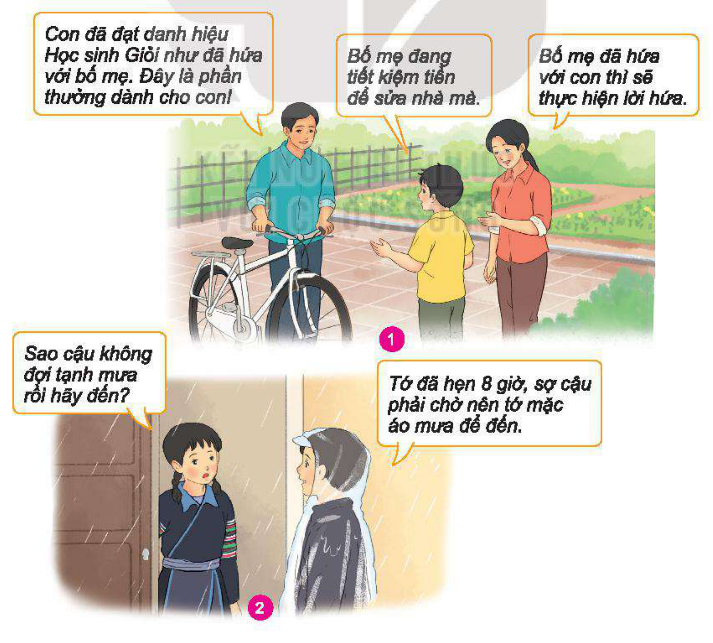
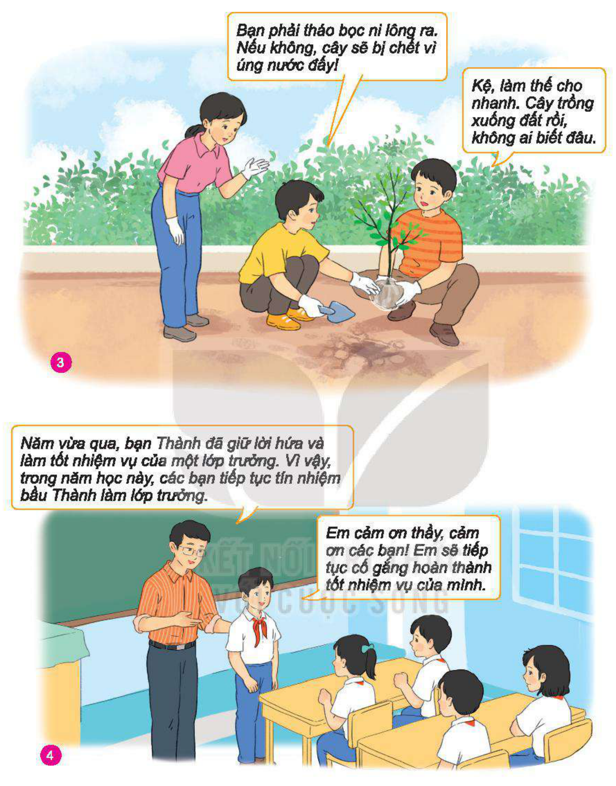
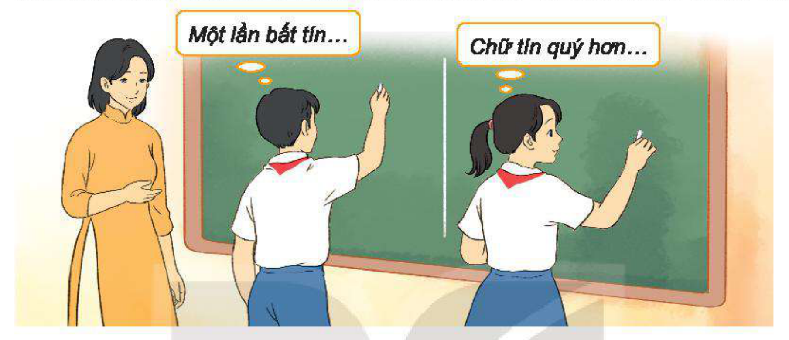
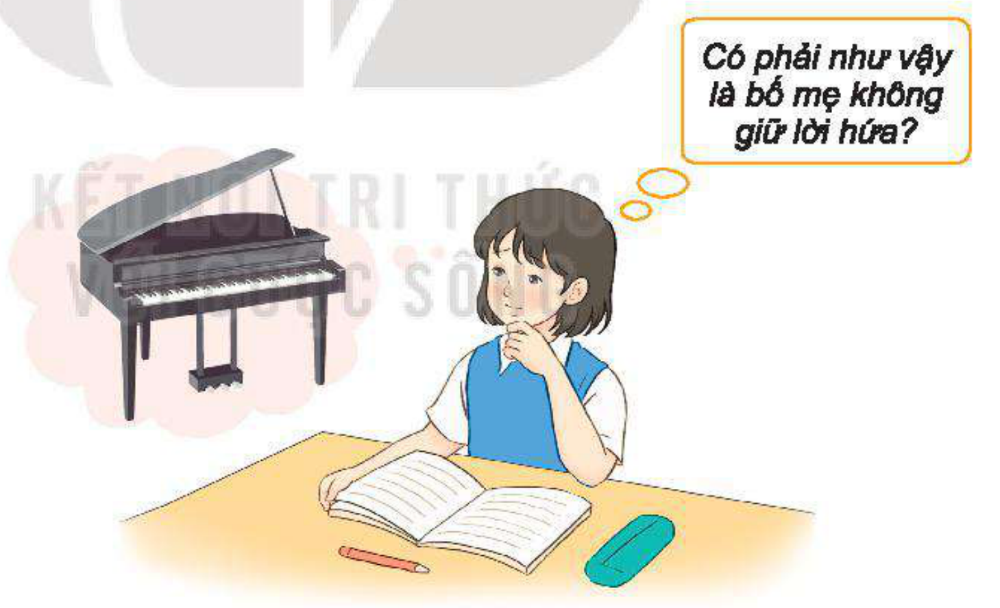

<!-- pdf:19 -->

# BÀI 4: GIỮ CHỮ TÍN

## 🎯 Mục tiêu:

- Trình bày được chữ tín là gì, biểu hiện của giữ chữ tín và vì sao phải giữ chữ tín.
- Phân biệt được hành vi giữ chữ tín và không giữ chữ tín.
- Luôn giữ lời hứa với người thân, thầy cô, bạn bè và người có trách nhiệm.
- Phê phán những người không biết giữ chữ tín.

## 🔴 Mở đầu

Giữ chữ tín là giữ niềm tin – một phẩm chất đạo đức cao quý, là sợi dây bền chặt liên kết con người với nhau, giúp mỗi người thành công hơn trong công việc và cuộc sống, góp phần xây dựng xã hội ổn định và phát triển. Bài học này giúp em hiểu được thế nào là giữ chữ tín, biết giữ chữ tín qua những việc làm cụ thể như thực hiện đúng lời hứa, cam kết, trung thực trong lời nói và việc làm.

Trong cuộc sống, có khi nào em cam kết hoặc người khác cam kết với em một điều gì đó mà không thực hiện chưa? Lúc đó, em cảm thấy thế nào?

## KHÁM PHÁ

## 1. Chữ tín và biểu hiện của giữ chữ tín

*• Chữ tín là gì?*

Em hãy đọc câu chuyện dưới đây và trả lời câu hỏi:

> CẬU BÉ ĐÁNH GIÀY
>
> Vào một ngày, trong lúc đứng đợi ở ga tàu để đi công tác, vị đạo diễn thấy một cậu bé đánh giày đi đến hỏi: “Ông có muốn đánh giày không?”.
>
> Đạo diễn cúi đầu nhìn đôi giày mới đánh, bèn lắc đầu.
>
> Vừa bước đi được mấy bước, đột nhiên ông thấy cậu bé mặt đỏ bừng chạy đến phía trước, khẩn cầu: “Thưa ông, cả ngày hôm nay cháu không có gì vào bụng, ông có thể cho cháu vay ít tiền được không? Cháu sẽ cố gắng đánh giày, đảm bảo sau một tuần là có thể trả lại tiền cho ông!”.
>
> Vị đạo diễn nhìn bộ dạng cậu bé, trong tâm có chút thương cảm, liền móc túi đưa cho cậu mấy đồng. Cậu bé cảm kích nói: “Cháu cảm ơn ông nhiều ạ!”. Đạo diễn lắc đầu, những đứa trẻ như thế này, ông đã gặp nhiều rồi.

<!-- pdf:20 -->

> Nửa tháng sau, khi dường như đã hoàn toàn quên đi câu chuyện đó, vị đạo diễn lại có dịp đi qua nhà ga nọ. Ông bỗng nhìn thấy một cậu bé gầy gò, từ xa chạy tới, người ướt đẫm mồ hôi, vừa thở hổn hển vừa nói: “Cháu đã ở đây đợi ông rất lâu rồi, hôm nay mới gặp được ông để trả lại tiền”.
>
> Vị đạo diễn nhìn những đồng tiền vẫn còn ướt do mồ hôi trên tay cậu bé, trong lòng cảm thấy ấm áp lạ thường. Nhìn lại cậu bé một lần nữa, ông chợt phát hiện thấy cậu chính là người mà mình luôn muốn tìm cho vai diễn mới.
>
> Nhiều năm sau, cậu bé đánh giày năm nào đã trở thành chủ tịch của một công ty văn hoá điện ảnh.
>
> *(Theo Lời van xin của cậu bé đánh giày và chuyện không ngờ sau 15 ngày, báo Dân sinh, ngày 11 – 12 – 2016)*

> ❓ a) Việc cậu bé cố gắng tìm cách trả lại tiền cho vị đạo diễn đã thể hiện điều gì?
>
> b) Theo em, thế nào là chữ tín?

*• Biểu hiện của giữ chữ tín*

Em hãy quan sát các bức tranh dưới đây và trả lời câu hỏi:

> - **Tranh 1:** “Con đã đạt danh hiệu Học sinh Giỏi như đã hứa với bố mẹ. Đây là phần thưởng dành cho con!” – “Bố mẹ đang tiết kiệm tiền để sửa nhà mà.” – “Bố mẹ đã hứa với con thì sẽ thực hiện lời hứa.”
> - **Tranh 2:** “Sao cậu không đợi tạnh mưa rồi hãy đến?” – “Tớ đã hẹn 8 giờ, sợ cậu phải chờ nên tớ mặc áo mưa để đến.”
<!-- ocr-ok: đã đối chiếu ảnh trang gốc 20, lời thoại trong Tranh 1–2 -->

<!-- pdf:21 -->

> - **Tranh 3:** “Bạn phải tháo bọc ni lông ra. Nếu không, cây sẽ bị chết vì úng nước đấy!” – “Kệ, làm thế cho nhanh. Cây trồng xuống đất rồi, không ai biết đâu.”
> - **Tranh 4:** “Năm vừa qua, bạn Thành đã giữ lời hứa và làm tốt nhiệm vụ của một lớp trưởng. Vì vậy, trong năm học này, các bạn tiếp tục tín nhiệm bầu Thành làm lớp trưởng.” – “Em cảm ơn thầy, cảm ơn các bạn! Em sẽ tiếp tục cố gắng hoàn thành tốt nhiệm vụ của mình.”
<!-- ocr-ok: đã đối chiếu ảnh trang gốc 21, lời thoại trong Tranh 3–4 -->

> ❓ a) Nêu những biểu hiện của việc giữ chữ tín và không giữ chữ tín trong các bức tranh trên.
>
> b) Hãy kể thêm một số biểu hiện của việc giữ chữ tín và không giữ chữ tín.

<!-- pdf:22 -->

## 2. Ý nghĩa của giữ chữ tín

Em hãy đọc các trường hợp dưới đây và trả lời câu hỏi:

> **Trường hợp 1:** Một công ty ở Nhật Bản đã hẹn giao 3 triệu chiếc dao, nĩa cho một công ty thực phẩm ở Mỹ vào ngày cố định. Tuy nhiên, một sự cố thiết bị xảy ra khiến lô hàng chỉ được hoàn tất vào trước hạn giao đúng một ngày.
>
> Sau khi cân nhắc kĩ lưỡng, công ty ở Nhật Bản đã quyết định thuê trọn gói một chiếc máy bay để chở toàn bộ lô hàng đến Mỹ đúng hạn như đã cam kết. Số tiền thuê máy bay vận chuyển cao gấp nhiều lần so với giá cước thuê tàu khiến cho lợi nhuận của công ty ở Nhật Bản bị sụt giảm nghiêm trọng. Việc làm này khiến lãnh đạo công ty thực phẩm ở Mỹ vô cùng cảm động. Những năm sau đó, họ tiếp tục đặt mua dao, nĩa của đối tác ở Nhật Bản với số lượng tăng gấp nhiều lần và trở thành khách hàng thân thiết của hãng trong suốt thời gian dài.
>
> *(Theo Giữ chữ tín để xây dựng thương hiệu, báo điện tử Đài Truyền hình Việt Nam, ngày 13 – 9 – 2017)*

> **Trường hợp 2:** Một số bạn học sinh có thói quen vay tiền, mượn đồ của bạn rồi “quên” không trả; hứa rất nhiều rồi lại quên ngay lời đã hứa; kí cam kết với nhà trường rồi lại vi phạm cam kết;... Những điều đó dần làm mất niềm tin của thầy cô, bạn bè, gây ảnh hưởng xấu đến các mối quan hệ. Người thất tín rất khó thành công trong công việc và cuộc sống.

> ❓ a) Việc giữ chữ tín đã đem lại điều gì cho công ty ở Nhật Bản?
>
> b) Hãy nêu hậu quả của việc không giữ chữ tín. Vì sao chúng ta cần giữ chữ tín?

> 1. **Chữ tín** là niềm tin của con người đối với nhau. **Giữ chữ tín** là coi trọng, giữ gìn niềm tin của mọi người đối với mình.
>
> 2. Biểu hiện của giữ chữ tín là: biết trọng lời hứa, đúng hẹn, thực hiện tốt chức trách, nhiệm vụ của bản thân, trung thực, thống nhất giữa lời nói và việc làm. <!-- term: Biểu hiện của giữ chữ tín -->
>
> 3. Người biết giữ chữ tín sẽ được mọi người tin tưởng, tôn trọng, hợp tác, dễ thành công hơn trong công việc, cuộc sống và góp phần làm cho các mối quan hệ xã hội trở nên tốt đẹp hơn. <!-- term: Ý nghĩa của giữ chữ tín -->

<!-- pdf:23 -->

## ✏️ Luyện tập

1. Em cùng các bạn tham gia trò chơi “Ai nhanh hơn?”:
- Tìm những câu ca dao, tục ngữ nói về việc giữ chữ tín. Ai tìm được nhanh và nhiều câu đúng hơn sẽ thắng.
- Chia sẻ hiểu biết của em về ý nghĩa của những câu ca dao, tục ngữ đã tìm được.

> - **Lời trong tranh:** “Một lần bất tín...”; “Chữ tín quý hơn...”
<!-- ocr-ok: đã đối chiếu ảnh trang gốc 23, chữ trong tranh trò chơi Ai nhanh hơn -->

2. Em đồng tình hay không đồng tình với ý kiến nào dưới đây? Vì sao?

a) Giữ chữ tín là coi trọng niềm tin của tất cả mọi người đối với mình.

b) Làm tốt công việc như đã cam kết chính là giữ chữ tín.

c) Để giữ chữ tín, cần phải thực hiện lời hứa trong bất kì hoàn cảnh nào, với bất kì đối tượng nào.

d) Chỉ người lớn mới cần giữ chữ tín, trẻ con chưa cần phải giữ chữ tín.

e) Người thất tín có thể được lợi trước mắt nhưng chịu thiệt hại lâu dài.

3. Trong các trường hợp dưới đây, hành vi nào thể hiện giữ chữ tín, hành vi nào thể hiện không giữ chữ tín? Vì sao?

a) H hẹn đi xem xiếc cùng P nhưng do nhà có việc đột xuất nên không đi được. H gọi điện xin lỗi P và hẹn hôm khác sẽ đi.

b) V hứa sẽ giúp D học tốt môn Tiếng Anh. Tuy bận rộn nhưng V vẫn sắp xếp thời gian để học cùng và hướng dẫn D. Chỉ sau một thời gian ngắn, trình độ tiếng Anh của D đã tiến bộ.

c) T mượn C quyển truyện và hứa sẽ trả bạn sau một tuần. Nhưng do bận tập văn nghệ để tham gia biểu diễn nên T chưa kịp đọc. T nghĩ “Chắc C đã đọc truyện rồi” nên bạn vẫn giữ lại, bao giờ đọc xong sẽ trả.

d) Bà X mở cửa hàng bán thực phẩm sạch. Mặc dù lợi nhuận thấp nhưng bà vẫn vui vì đã góp phần bảo vệ sức khoẻ cho mọi người. Có người khuyên bà nhập thực phẩm không rõ nguồn gốc về bán với danh nghĩa thực phẩm sạch, lợi nhuận sẽ cao hơn rất nhiều nhưng bà nhất quyết không làm theo.

<!-- pdf:24 -->

4. Em hãy đưa ra lời khuyên cho bạn trong các tình huống sau:

a) Ngày thứ Bảy, Y giúp mẹ bán rau. Có khách đến mua rau, họ đã trả tiền và nhờ Y nhặt rau giúp. Nhưng đã cuối ngày mà không thấy người khách quay lại.

> - **Lời trong tranh:** “Mình làm thế nào nhỉ?”
<!-- ocr-ok: đã đối chiếu ảnh trang gốc 24, bóng suy nghĩ trong tranh tình huống 4a -->

b) Bố mẹ hứa sẽ mua đàn cho M nếu bạn đạt danh hiệu Học sinh Giỏi. M cố gắng học và đã đạt được danh hiệu đó. Nhưng do ảnh hưởng của dịch bệnh, công việc khó khăn, thu nhập giảm nên bố mẹ vẫn chưa mua đàn cho M.

> - **Lời trong tranh:** “Có phải như vậy là bố mẹ không giữ lời hứa?”
<!-- ocr-ok: đã đối chiếu ảnh trang gốc 24, bóng suy nghĩ trong tranh tình huống 4b -->

## 🚀 Vận dụng

1. Viết một đoạn văn bày tỏ suy nghĩ của em về lời khuyên “Hãy tiết kiệm lời hứa”.
2. Cùng các bạn trong nhóm xây dựng và biểu diễn một tiểu phẩm về chủ đề “Giữ chữ tín trong học sinh” (Ví dụ: giữ lời hứa, trung thực trong thi cử,...).

## 📷 Danh sách hình trong bài

| Mã hình | Trang PDF | Trang sách | Chú thích |
|---|---|---|---|
| H7-giao_duc_cong_dan-b04-01 | 20 | 19 | Tranh 1–2 mục 1: Biểu hiện của giữ chữ tín |
| H7-giao_duc_cong_dan-b04-02 | 21 | 20 | Tranh 3–4 mục 1: Biểu hiện của giữ chữ tín và không giữ chữ tín |
| H7-giao_duc_cong_dan-b04-03 | 23 | 22 | Tranh trò chơi “Ai nhanh hơn?” mục Luyện tập |
| H7-giao_duc_cong_dan-b04-04 | 24 | 23 | Tranh tình huống 4a mục Luyện tập |
| H7-giao_duc_cong_dan-b04-05 | 24 | 23 | Tranh tình huống 4b mục Luyện tập |
