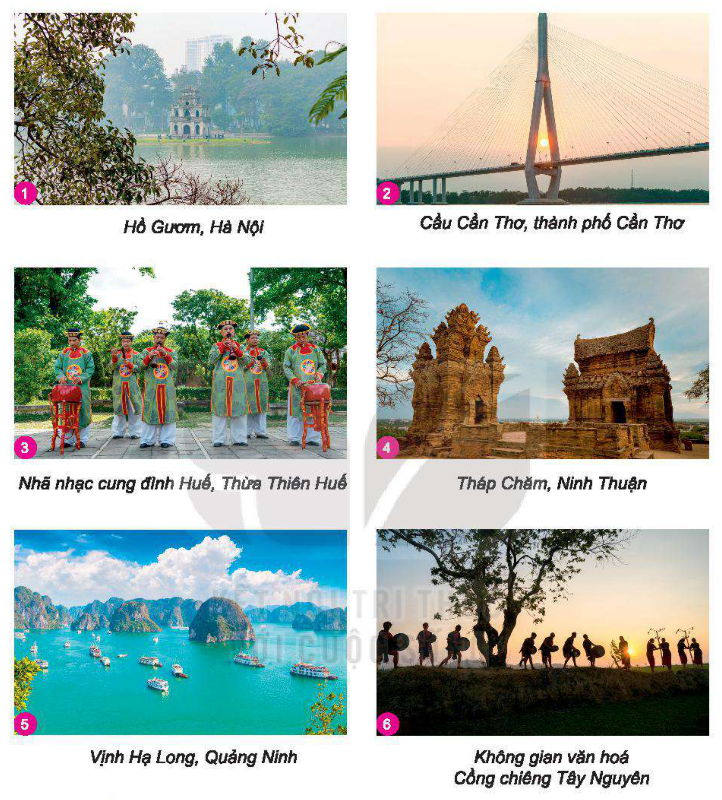
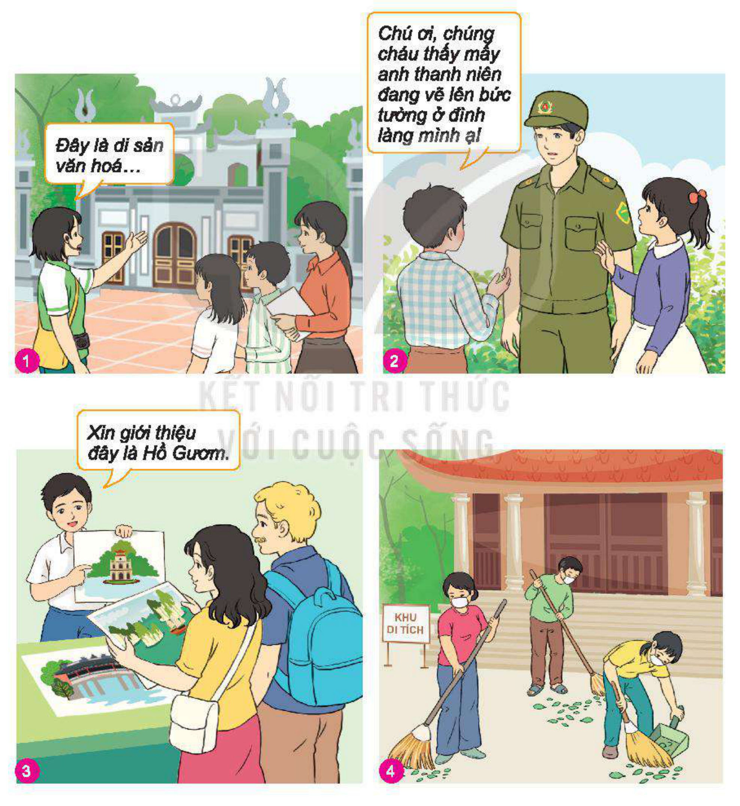

<!-- pdf:25 -->

# BÀI 5: BẢO TỒN DI SẢN VĂN HOÁ

## 🎯 Mục tiêu:

- Nêu được khái niệm di sản văn hoá và một số loại di sản văn hoá của Việt Nam.
- Giải thích được ý nghĩa của di sản văn hoá đối với con người và xã hội.
- Nêu được quy định cơ bản của pháp luật về quyền và nghĩa vụ của tổ chức, cá nhân đối với việc bảo vệ di sản văn hoá.
- Nêu được trách nhiệm của học sinh trong việc bảo tồn di sản văn hoá.
- Nêu được các hành vi vi phạm pháp luật về bảo tồn di sản văn hoá và cách đấu tranh, ngăn chặn các hành vi đó.
- Thực hiện được một số việc cần làm phù hợp với lứa tuổi để góp phần bảo vệ di sản văn hoá.

## 🔴 Mở đầu

Việt Nam có một kho tàng di sản văn hoá vô cùng phong phú, góp phần quan trọng vào việc giáo dục lịch sử, vun đắp truyền thống tốt đẹp của dân tộc, phát triển kinh tế, xây dựng và quảng bá hình ảnh của Việt Nam với thế giới.

Em hãy tìm và hát những làn điệu mang đậm bản sắc văn hoá quê hương, dân tộc: quan họ, chèo, hát ru,... Theo em, những làn điệu trên có phải là di sản văn hoá của Việt Nam không? Vì sao?

## KHÁM PHÁ

## 1. Khái niệm di sản văn hoá và một số loại di sản văn hoá của Việt Nam

Em hãy đọc thông tin, quan sát các hình ảnh dưới đây và trả lời câu hỏi:

> Trong tiến trình phát triển, nhân loại đã tạo ra nhiều sản phẩm vật chất và tinh thần có giá trị lớn lao về mặt lịch sử, văn hoá, khoa học. Những sản phẩm đó được lưu truyền từ đời này qua đời khác, trở thành các di sản văn hoá đặc sắc của mỗi dân tộc trong vườn hoa đa sắc màu của văn hoá nhân loại.
>
> Việt Nam là đất nước có kho tàng di sản văn hoá đa dạng. Có những di sản văn hoá vật thể, thể hiện qua những sản phẩm vật chất như các di tích lịch sử – văn hoá, danh lam thắng cảnh, di vật, cổ vật, bảo vật quốc gia,... Có những di sản văn hoá phi vật thể, thể hiện qua những sản phẩm tinh thần, không ngừng được tái tạo và lưu truyền từ thế hệ này sang thế hệ khác như một số tín ngưỡng, loại hình nghệ thuật dân tộc,... <!-- term: Di sản văn hoá vật thể --> <!-- term: Di sản văn hoá phi vật thể -->

<!-- pdf:26 -->

- **Hình 1:** Hồ Gươm, Hà Nội
- **Hình 2:** Cầu Cần Thơ, thành phố Cần Thơ
- **Hình 3:** Nhã nhạc cung đình Huế, Thừa Thiên Huế
- **Hình 4:** Tháp Chăm, Ninh Thuận
- **Hình 5:** Vịnh Hạ Long, Quảng Ninh
- **Hình 6:** Không gian văn hoá Cồng chiêng Tây Nguyên
<!-- ocr-ok: đã đối chiếu ảnh trang gốc 26, chú thích dưới Hình 1–6 -->

> ❓ a) Trong những hình ảnh trên, hình ảnh nào là di sản văn hoá? Hình ảnh nào không phải là di sản văn hoá? Hình ảnh nào là di sản văn hoá vật thể? Hình ảnh nào là di sản văn hoá phi vật thể?
>
> b) Theo em, di sản văn hoá là gì?
>
> c) Kể thêm những di sản văn hoá khác ở Việt Nam mà em biết.

<!-- pdf:27 -->

## 2. Ý nghĩa của di sản văn hoá đối với con người và xã hội

Em hãy đọc các thông tin dưới đây và trả lời câu hỏi:

> **Thông tin 1:** Phố cổ Hội An (tỉnh Quảng Nam) là nơi lưu giữ những di sản văn hoá độc đáo. Nơi đây được xem như một bảo tàng sống về kiến trúc đô thị với những ngôi nhà cổ và những công trình tôn giáo, tín ngưỡng đặc sắc. Hội An còn là nơi lưu giữ một nền văn hoá phi vật thể đa dạng, phong phú với những phong tục tập quán, sinh hoạt tín ngưỡng, nghệ thuật dân gian, lễ hội văn hoá,... Do vậy, phố cổ Hội An được UNESCO công nhận là Di sản Văn hoá thế giới (năm 1999). Việc bảo tồn và phát huy di sản văn hoá phố cổ Hội An vừa mang lại thu nhập cho ngành Du lịch vừa phát huy niềm tự hào về truyền thống lịch sử, văn hoá của dân tộc.
>
> *(Theo Nguyễn Quang Ngọc, Đô thị cổ Hội An: Quá trình lịch sử và hiện trạng di tích, Nông thôn và đô thị Việt Nam (Lịch sử, thực trạng và khuynh hướng biến đổi), NXB Giáo dục Việt Nam, 2018)*

> **Thông tin 2:** Hằng năm, từ mùng 5 đến mùng 7 Tết, ở thị xã Duy Tiên, tỉnh Hà Nam thường diễn ra lễ Tịch điền. Vua Lê Đại Hành là vị hoàng đế đầu tiên mở đầu cho một lễ nghi “Tịch điền” mà các vương triều sau tiếp tục noi theo để khuyến khích phát triển sản xuất nông nghiệp. Lễ Tịch điền không chỉ thể hiện sự quan tâm của các vị vua đối với người nông dân mà còn góp phần tuyên truyền, giáo dục các tầng lớp nhân dân, đặc biệt là thế hệ trẻ lòng biết ơn tiền nhân, tích cực phát triển sản xuất nông nghiệp.
>
> *(Theo Trần Thị Vinh (Chủ biên), Lịch sử Việt Nam – tập 2 – từ thế kỉ X đến thế kỉ XIV, NXB Khoa học xã hội, 2013)*

<!-- pdf:28 -->

> ❓ a) Di sản văn hoá phố cổ Hội An có ý nghĩa như thế nào đối với người dân Quảng Nam và cả nước?
>
> b) Lễ Tịch điền có ý nghĩa như thế nào đối với người dân Hà Nam và cả nước?
>
> c) Từ việc tìm hiểu ý nghĩa của các di sản văn hoá trên và những hiểu biết của bản thân, em hãy cho biết ý nghĩa của di sản văn hoá đối với con người và xã hội.

## 3. Quy định cơ bản của pháp luật về quyền và nghĩa vụ của các tổ chức, cá nhân trong việc bảo vệ di sản văn hoá

Em hãy đọc thông tin, trường hợp dưới đây và trả lời câu hỏi:

> *Điều 14 Luật Di sản văn hoá năm 2001 (sửa đổi, bổ sung năm 2009) quy định: tổ chức, cá nhân có các quyền và nghĩa vụ sau đây:*
>
> 1. Sở hữu hợp pháp di sản văn hoá;
> 2. Tham quan, nghiên cứu di sản văn hoá;
> 3. Tôn trọng, bảo vệ và phát huy giá trị di sản văn hoá;
> 4. Thông báo kịp thời địa điểm phát hiện di vật, cổ vật, bảo vật quốc gia, di tích lịch sử – văn hoá, danh lam thắng cảnh; giao nộp di vật, cổ vật, bảo vật quốc gia do mình tìm được cho cơ quan nhà nước có thẩm quyền nơi gần nhất;
> 5. Ngăn chặn hoặc đề nghị cơ quan nhà nước có thẩm quyền ngăn chặn, xử lí kịp thời những hành vi phá hoại, chiếm đoạt, sử dụng trái phép di sản văn hoá. <!-- term: Quyền và nghĩa vụ trong việc bảo vệ di sản văn hoá -->

> Xã V có một ngôi chùa cổ được xếp hạng di tích lịch sử – văn hoá cấp Quốc gia. Chính quyền địa phương nơi đây luôn chăm lo việc bảo tồn, ngăn chặn và xử lí nghiêm những hành vi phá hoại, ảnh hưởng đến di tích. Bà con trong xã cũng thường nhắc nhau giữ gìn, bảo vệ, tôn tạo để ngôi chùa luôn khang trang, sạch đẹp.

> ❓ a) Chính quyền và nhân dân xã V đã thực hiện các quy định của pháp luật trong việc bảo vệ di sản văn hoá như thế nào?
>
> b) Hãy nêu thêm các quy định cơ bản của pháp luật về quyền và nghĩa vụ của các tổ chức, cá nhân trong việc bảo vệ di sản văn hoá mà em biết.

<!-- pdf:29 -->

## 4. Trách nhiệm của học sinh trong việc bảo tồn di sản văn hoá

Em hãy đọc trường hợp, quan sát các tranh dưới đây và trả lời câu hỏi:

> Thấy Hồng hay chọn điệu dân ca Ví, Giặm Nghệ Tĩnh để biểu diễn ở các ngày lễ của trường, một số bạn trong lớp không thích và muốn Hồng chọn những bài hát hiện đại, sôi động. Hồng từ chối và giải thích: “Dân ca Ví, Giặm là sản phẩm đại diện, tiêu biểu cho gia tài văn hoá của vùng đất xứ Nghệ. Mình muốn giới thiệu loại hình dân ca độc đáo này với mọi người”.

> - **Tranh 1:** “Đây là di sản văn hoá...”
> - **Tranh 2:** “Chú ơi, chúng cháu thấy mấy anh thanh niên đang vẽ lên bức tường ở đình làng mình ạ!”
> - **Tranh 3:** “Xin giới thiệu đây là Hồ Gươm.”
> - **Tranh 4:** “KHU DI TÍCH”
<!-- ocr-ok: đã đối chiếu ảnh trang gốc 29, lời thoại và biển hiệu trong Tranh 1–4 -->

<!-- pdf:30 -->

> ❓ a) Em hãy nêu những việc làm góp phần bảo tồn di sản văn hoá trong trường hợp và các bức tranh trên.
>
> b) Theo em, học sinh cần làm gì để góp phần giữ gìn, bảo vệ và phát triển di sản văn hoá ở Việt Nam?

> 1. **Di sản văn hoá** là những sản phẩm vật chất, tinh thần có giá trị lịch sử, văn hoá, khoa học, được lưu truyền từ thế hệ này qua thế hệ khác. Di sản văn hoá gồm di sản văn hoá vật thể (Thành nhà Hồ, Thánh địa Mỹ Sơn,...) và di sản văn hoá phi vật thể (Tín ngưỡng thờ cúng Hùng Vương, Mộc bản Triều Nguyễn, Nghệ thuật Đờn ca tài tử Nam Bộ,...).
>
> 2. Bảo tồn di sản văn hoá góp phần xây dựng nền văn hoá Việt Nam tiên tiến, đậm đà bản sắc dân tộc và làm phong phú kho tàng di sản văn hoá thế giới. <!-- term: Bảo tồn di sản văn hoá -->
>
> 3. Pháp luật nước ta có những quy định cơ bản về quyền và nghĩa vụ của tổ chức, cá nhân đối với việc bảo vệ di sản văn hoá, thể hiện ở Luật Di sản văn hoá năm 2001 (sửa đổi, bổ sung năm 2009).
>
> 4. Học sinh có trách nhiệm: tìm hiểu, giới thiệu về các di sản văn hoá; giữ gìn các di sản văn hoá; đấu tranh ngăn chặn các hành vi vi phạm pháp luật về bảo tồn di sản văn hoá.

## ✏️ Luyện tập

1. Em đồng tình hay không đồng tình với ý kiến nào dưới đây? Vì sao?

a) Danh lam thắng cảnh nổi tiếng của đất nước được UNESCO công nhận mới được gọi là di sản văn hoá.

b) Phải bảo tồn cả di sản văn hoá vật thể và di sản văn hoá phi vật thể.

c) Chỉ cơ quan nhà nước có thẩm quyền mới có thể bảo vệ được các di sản văn hoá.

d) Việc giữ gìn, bảo tồn các di sản văn hoá góp phần phát triển nền văn hoá Việt Nam tiên tiến, đậm đà bản sắc dân tộc.

e) Chỉ nên bảo vệ di tích lịch sử – văn hoá đã được Nhà nước xếp hạng.

<!-- pdf:31 -->

2. Em hãy nhận xét các hành vi dưới đây:

a) Mỗi khi đi tham quan các di tích lịch sử, H thường khắc tên mình lên tượng đài, bức tượng, thân cây,... để đánh dấu những nơi mình đã tới.

b) T nhắc nhở các bạn trong xóm không nên chăn thả gia súc trong khu di tích lịch sử.

c) Cuối tuần, M thường rủ các bạn tới nhà bác K – một nghệ nhân hát chèo – để học hát.

d) N tích cực học ngoại ngữ để có thể giới thiệu về những danh lam thắng cảnh của quê hương mình với du khách nước ngoài.

3. Xử lí tình huống:

a) Trên đường đi học về, Q và H phát hiện mấy thanh niên lấy trộm cổ vật trong ngôi chùa của làng. Q rủ H đi báo công an nhưng H từ chối và nói: “Việc đó nguy hiểm lắm, nếu họ biết mình tố cáo sẽ trả thù chúng mình đấy!”.

*Nếu là Q, em sẽ làm gì?*

b) Khi vào chùa cùng bà, C thấy một số bạn gõ chuông, xoa tay lên các bức tượng Phật để cầu may.

*Nếu là C, em sẽ làm gì?*

4. Địa phương nơi em sinh sống có di sản văn hoá nào? Em đã làm gì để bảo vệ di sản văn hoá đó?

## 🚀 Vận dụng

1. Em cùng các bạn trong nhóm tìm hiểu, sưu tầm tranh, ảnh, tư liệu về các di sản văn hoá của địa phương,... sau đó, thiết kế thành một tờ báo tường và thuyết trình về ý nghĩa của các di sản văn hoá đó.
2. Em hãy lập và thực hiện kế hoạch bảo vệ một di sản ở địa phương em theo bảng gợi ý sau:

| Tên di sản | Biện pháp bảo vệ | Thời gian thực hiện | Kết quả |
|---|---|---|---|
| ? | ? | ? | ? |

## 📷 Danh sách hình trong bài

| Mã hình | Trang PDF | Trang sách | Chú thích |
|---|---|---|---|
| H7-giao_duc_cong_dan-b05-01 | 26 | 25 | Hình 1–6 mục 1: Một số công trình và di sản văn hoá ở Việt Nam |
| H7-giao_duc_cong_dan-b05-02 | 29 | 28 | Tranh 1–4 mục 4: Trách nhiệm của học sinh trong việc bảo tồn di sản văn hoá |
