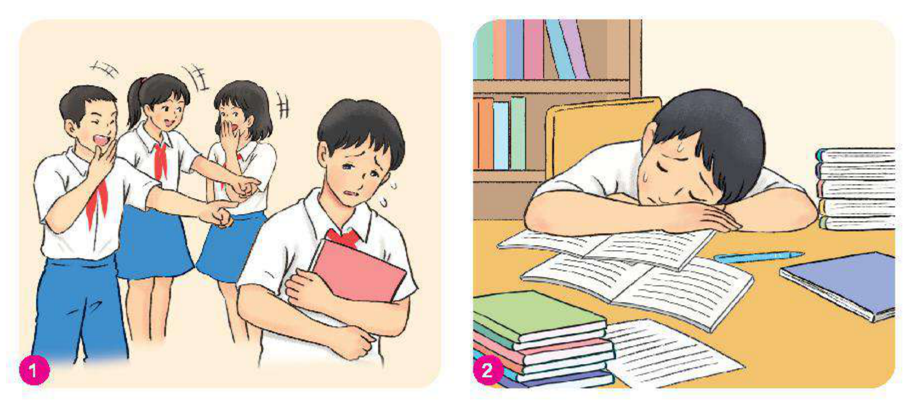
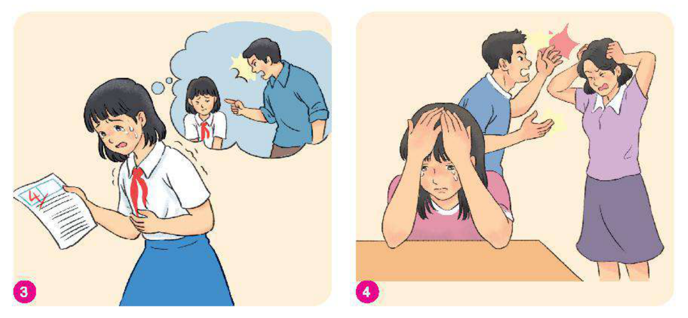
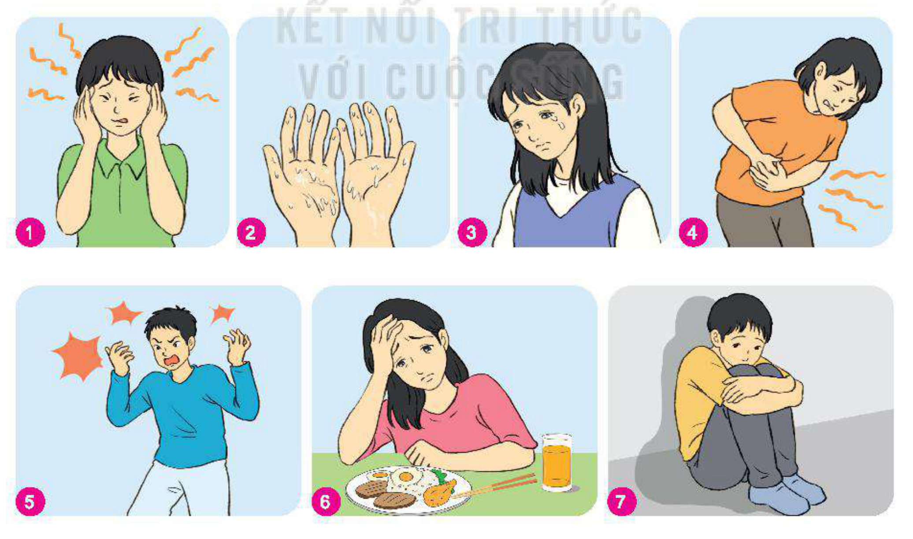

<!-- pdf:32 -->

# BÀI 6: ỨNG PHÓ VỚI TÂM LÍ CĂNG THẲNG

## 🎯 Mục tiêu:

- Nêu được các tình huống thường gây căng thẳng.
- Nhận biết được biểu hiện của cơ thể khi bị căng thẳng.
- Nêu được nguyên nhân và ảnh hưởng của căng thẳng.
- Nêu được cách ứng phó tích cực khi căng thẳng.
- Thực hành được cách ứng phó tích cực khi căng thẳng.

## 🔴 Mở đầu

Trong cuộc sống, mỗi chúng ta đều có thể gặp phải những tình huống gây ra tâm lí căng thẳng, ảnh hưởng tiêu cực đến cơ thể và tinh thần. Tuy nhiên, nếu biết cách ứng phó, chúng ta sẽ vượt qua được và trưởng thành, vững vàng hơn.

Em hãy chia sẻ về một lần em bị căng thẳng. Khi đó, em đã làm gì?

## KHÁM PHÁ

## 1. Các tình huống gây căng thẳng và biểu hiện của cơ thể khi bị căng thẳng

*• Các tình huống gây căng thẳng*

Em hãy quan sát các tranh dưới đây và trả lời câu hỏi:

<!-- pdf:33 -->

> ❓ a) Em hãy nêu những tình huống gây căng thẳng cho các bạn trong mỗi bức tranh trên.
>
> b) Theo em, ngoài các tình huống đã nêu, còn có những tình huống nào khác gây tâm lí căng thẳng cho học sinh?

*• Biểu hiện của cơ thể khi bị căng thẳng*

Em hãy quan sát các bức tranh dưới đây, nhớ lại những trải nghiệm của bản thân và trả lời câu hỏi:

<!-- pdf:34 -->

> ❓ a) Em hãy nêu biểu hiện của cơ thể khi gặp tâm lí căng thẳng được mô tả trong mỗi bức tranh.
>
> b) Ngoài ra, cơ thể thường có biểu hiện gì khi bị căng thẳng?
>
> c) Em hãy xếp các biểu hiện của cơ thể khi bị căng thẳng vào một trong bốn nhóm: (1) Thể chất, (2) Tinh thần, (3) Hành vi, (4) Cảm xúc.

## 2. Nguyên nhân và ảnh hưởng của tâm lí căng thẳng

Em hãy đọc các tình huống dưới đây và trả lời câu hỏi:

> **Tình huống 1:** Ngoài việc học ở trường, T thường phải đi học thêm ở trung tâm. Chỉ riêng việc di chuyển đã khiến T thấy mệt mỏi. Kì kiểm tra tới, lượng kiến thức cần ôn tập nhiều hơn khiến T càng căng thẳng, lo sợ. Tình trạng này kéo dài làm bạn thường xuyên thấy đau đầu, chán ăn, mất ngủ và kết quả học tập giảm sút.

> **Tình huống 2:** Gần đây, A nhận được nhiều tin nhắn với những lời lẽ thiếu văn hoá và đề nghị khiếm nhã từ một người lạ mặt làm bạn thấy hoang mang, lo sợ, mất tập trung vào việc học tập. Hàng trăm câu hỏi cứ hiện lên trong đầu: “Họ nhắn tin cho mình với mục đích gì?”, “Tại sao họ lại biết tên trường và lớp học của mình?”,... khiến cho A thường mất ngủ, giật mình, mơ thấy ác mộng và cảm thấy sợ hãi mỗi khi đến trường.

> **Tình huống 3:** N là học sinh giỏi Toán của lớp. Trong giờ kiểm tra, có bạn muốn chép bài của N, N không đồng ý vì như vậy là vi phạm quy chế kiểm tra. Trên đường về nhà, N đã bị bạn đó cùng một nhóm đi cùng doạ nạt và đánh. N rất sợ hãi, không dám đến trường vì sợ lại bị bạn đánh.

> **Tình huống 4:** Nhìn bề ngoài, M rất hạnh phúc vì là học sinh giỏi của lớp, có nhiều tài lẻ, lại được bố mẹ quan tâm. Tuy nhiên, bạn cảm thấy rất mệt mỏi vì phải chạy đua với thời gian mỗi ngày để học ở trường, học ngoại khoá, học ở nhà. M luôn phải gồng mình để có thể đáp ứng với nhịp độ ấy. Thêm nữa, thời gian gần đây, bạn còn bị phân tâm bởi những thay đổi về thể chất, tâm lí của tuổi dậy thì. Trong khi đó, bố mẹ luôn kì vọng bạn đạt thành tích học tập tốt. Kì kiểm tra đang tới khiến M càng cảm thấy áp lực. Bạn thu mình, không muốn tiếp xúc với ai, có lúc lại cáu gắt, tranh cãi với bố mẹ, quát mắng em vô cớ.

<!-- pdf:35 -->

> ❓ a) Em hãy nêu nguyên nhân gây ra tâm lí căng thẳng và ảnh hưởng của tâm lí đó đến các bạn trong các trường hợp trên.
>
> b) Theo em, còn có những nguyên nhân nào khác thường gây ra tâm lí căng thẳng cho học sinh? Những nguyên nhân đó ảnh hưởng như thế nào đến cuộc sống và việc học tập của học sinh?

## 3. Cách ứng phó tích cực khi căng thẳng

Em hãy đọc các trường hợp dưới đây và trả lời câu hỏi:

> **Trường hợp 1:** Hải chuẩn bị thi hùng biện trước toàn trường nên cảm thấy rất lo lắng, hồi hộp. Trước khi thi, Hải đã dành thời gian hít thở sâu và tự nhủ: “Mình sẽ làm tốt thôi, mình đã luyện tập rất nhiều rồi!”. Cuối cùng, Hải đã có phần thi rất ấn tượng và nhận được kết quả tốt. *(Lời tự nhủ trong tranh: “Tự tin vào chính mình.”)*

> **Trường hợp 2:** Mai không cẩn thận nên đã làm mất chiếc đồng hồ đeo tay. Bạn rất lo bố mẹ biết sẽ trách phạt. Càng nghĩ, Mai lại càng thấy căng thẳng. Bạn quyết định chạy thể dục vòng quanh khu nhà. Dần dần, Mai thấy bình tĩnh và đầu óc tỉnh táo hơn. Về nhà, bạn đã dũng cảm nhận lỗi với bố mẹ và hứa sẽ cẩn thận hơn trong việc bảo quản đồ dùng. *(Suy nghĩ của Mai: “Mình cần chạy bộ một lúc để bình tĩnh lại.”)*

> **Trường hợp 3:** Tuấn vốn là học sinh giỏi, là niềm tự hào của bố mẹ. Khi biết kết quả kiểm tra của mình không tốt, Tuấn rất buồn và luôn tự trách bản thân đã không cẩn thận. Bạn thấy căng thẳng vì sợ bố mẹ biết chuyện sẽ thất vọng về mình. Bình tĩnh lại, Tuấn nghĩ ai cũng có thể mắc sai lầm, vẫn còn có những bài kiểm tra tiếp theo, chỉ cần mình cố gắng thì sẽ có kết quả tốt. Nghĩ vậy, Tuấn thấy bình tĩnh hơn, bạn nói thật với bố mẹ về kết quả bài kiểm tra của mình và lập kế hoạch học tập cho học kì mới với quyết tâm đạt kết quả tốt hơn. *(Suy nghĩ của Tuấn: “Lần sau mình sẽ làm tốt hơn!”)*

<!-- pdf:36 -->

> **Trường hợp 4:** Mấy tuần nay, Hà cảm thấy sợ hãi vì những tin nhắn đe doạ, nói xấu mình trên mạng xã hội. Cảm thấy quá sức chịu đựng, bạn đã nhờ mẹ giúp đỡ. Mẹ an ủi, trấn an tinh thần và giúp Hà tìm hiểu nguyên nhân. Mẹ cũng nói chuyện với cô giáo chủ nhiệm để giúp bạn cảm thấy an toàn khi ở trên lớp. Dần dần, Hà đã ổn định tâm lí trở lại. *(Lời của Hà: “Mẹ giúp con chặn những tin nhắn này với ạ.”)*

> ❓ a) Cách ứng phó của các bạn trong từng tình huống căng thẳng như thế nào? Kết quả ra sao?
>
> b) Em hãy kể thêm những cách khác để ứng phó tích cực với tình huống căng thẳng.

> 1. **Căng thẳng tâm lí** là tình trạng mà con người cảm thấy khi phải chịu áp lực về tinh thần, thể chất. Những người trải qua mức độ căng thẳng tâm lí cao hoặc căng thẳng trong một thời gian dài có thể gặp các vấn đề về sức khoẻ tinh thần và thể chất. Các tình huống thường gây căng thẳng như: bị tẩy chay, bị bắt nạt, thay đổi chỗ ở, áp lực học tập, thay đổi cơ thể, sức khoẻ có vấn đề,...
>
> 2. Một số biểu hiện của cơ thể khi bị căng thẳng: mệt mỏi, chán ăn, khó ngủ, đau đầu, tim đập nhanh, hoa mắt, chóng mặt, đổ mồ hôi, đau bụng,... <!-- term: Biểu hiện của cơ thể khi bị căng thẳng -->
>
> 3. Nguyên nhân gây ra căng thẳng có thể đến từ những tác động bên ngoài như: áp lực học tập, các mối quan hệ bạn bè, kì vọng của gia đình,... hoặc có thể xuất phát từ chính bản thân như: tâm lí tự ti, suy nghĩ tiêu cực, lo lắng thái quá, các vấn đề về sức khoẻ,... <!-- term: Nguyên nhân gây ra căng thẳng -->

<!-- pdf:37 -->

> 4. Tâm lí căng thẳng gây ảnh hưởng tiêu cực đến việc học tập, cuộc sống hằng ngày và sự phát triển của cơ thể: kết quả học tập giảm sút, mất tập trung, đau nhức cơ thể, suy giảm trí nhớ, cáu gắt, bạo lực,... và có thể ảnh hưởng tiêu cực đến các mối quan hệ trong cuộc sống. <!-- term: Ảnh hưởng của tâm lí căng thẳng -->
>
> 5. Khi bị căng thẳng, em cần nhận diện được những biểu hiện cơ thể và cảm xúc của bản thân; tìm hiểu nguyên nhân gây ra căng thẳng, sau đó có cách ứng phó tích cực. Một số cách ứng phó tích cực khi bị căng thẳng là: đối mặt và suy nghĩ tích cực, vận động thể chất, tập trung vào hơi thở, yêu thương bản thân,... Khi cảm thấy quá căng thẳng hay mối lo quá lớn không thể tự mình xử lí được, hãy tìm kiếm sự giúp đỡ từ những người đáng tin cậy như người thân, thầy cô, bạn bè,... <!-- term: Ứng phó tích cực khi bị căng thẳng -->

## ✏️ Luyện tập

1. Em cùng các bạn tham gia trò chơi “Tiếp sức”: Kể về những tình huống gây căng thẳng cho học sinh trong cuộc sống. Các thành viên của mỗi đội lần lượt lên kể, nhóm nào kể được nhiều tình huống hơn trong cùng một khoảng thời gian sẽ thắng cuộc.

2. Hãy viết lại những suy nghĩ, lời nói tiêu cực sau đây thành những suy nghĩ, lời nói tích cực:

a) Mình không thể chấp nhận được lỗi lầm đó.

b) Chẳng ai quan tâm đến mình.

c) Bạn bè không thích chơi với mình.

d) Mình làm gì cũng thất bại.

e) Mình học thế này thì sẽ thi trượt mất.

3. Tập thở:

Khi căng thẳng, sợ hãi, em có thể tập trung vào hơi thở của mình để giúp bản thân bình tĩnh lại và xử lí tình huống một cách tỉnh táo.

Em hãy ghi lại cảm xúc, cảm nhận cơ thể của mình trước và sau khi thực hiện bài tập này.

- Ngồi trên ghế, thẳng lưng, thả lỏng cơ bắp, hai bàn chân vuông góc đặt trên mặt đất, tay đặt trên đùi.

<!-- pdf:38 -->

- Hít vào bằng mũi tối đa để mở rộng lồng ngực, sau đó thở ra từ từ bằng miệng, môi chúm lại, giống như thổi sáo.
- Hít vào nhẹ nhàng và đếm trong đầu chậm 1, 2, đến 2 thì thở ra, đếm trong đầu chậm 1, 2, 3, 4. Có nghĩa là thời gian thở ra dài gấp đôi so với thời gian hít vào.
- Khi hít thở, không cần gắng sức quá nhiều mà chỉ cần hít sâu vừa sức và thở ra vừa sức.
- Lặp đi lặp lại như vậy trong khoảng thời gian 3 đến 5 phút.

4. Đọc trường hợp dưới đây và trả lời câu hỏi:

a) Gần đến kì kiểm tra, N thấy quá nhiều bài tập mà không có đủ thời gian để hoàn thành nên rất căng thẳng. Bạn thấy lo âu, đau đầu, mất ngủ. Tình trạng này kéo dài khiến cơ thể N bị suy nhược.

b) Bố mẹ M dạo này hay cãi vã, bất hoà, có lúc M còn nghe bố mẹ nói sẽ li hôn. M cảm thấy rất buồn, lo sợ và bất an, không biết gia đình mình sẽ ra sao, hai anh em sẽ thế nào. Mỗi khi như vậy, M lại vùi đầu vào xem phim hoặc chơi trò chơi điện tử để né tránh cảm xúc của mình, khiến kết quả học tập sa sút.

- *Biểu hiện nào cho thấy hai bạn N và M đang bị căng thẳng?*
- *Nguyên nhân gây căng thẳng cho các bạn là gì? Nêu hậu quả của sự căng thẳng đó.*
- *Theo em, N và M nên làm gì để thoát khỏi trường hợp đó?*

## 🚀 Vận dụng

1. Em hãy viết lại những tình huống thường gây căng thẳng cho bản thân, từ đó tìm ra nguyên nhân, lập kế hoạch phòng tránh để không bị rơi vào những tình huống này và cách ứng phó tích cực nếu vẫn gặp những tình huống đó.

| Tình huống gây căng thẳng | Nguyên nhân | Cách phòng tránh | Cách ứng phó tích cực |
|---|---|---|---|
| ? | ? | ? | ? |

2. Em hãy cùng các bạn trong nhóm xây dựng và biểu diễn một vở kịch ngắn về tâm lí căng thẳng của học sinh và cách ứng phó tích cực với tâm lí căng thẳng.

## 📷 Danh sách hình trong bài

| Mã hình | Trang PDF | Trang sách | Chú thích |
|---|---|---|---|
| H7-giao_duc_cong_dan-b06-01 | 32 | 31 | Tranh 1–2 mục 1: Các tình huống gây căng thẳng |
| H7-giao_duc_cong_dan-b06-02 | 33 | 32 | Tranh 3–4 mục 1: Các tình huống gây căng thẳng |
| H7-giao_duc_cong_dan-b06-03 | 33 | 32 | Tranh 1–7 mục 1: Biểu hiện của cơ thể khi bị căng thẳng |
