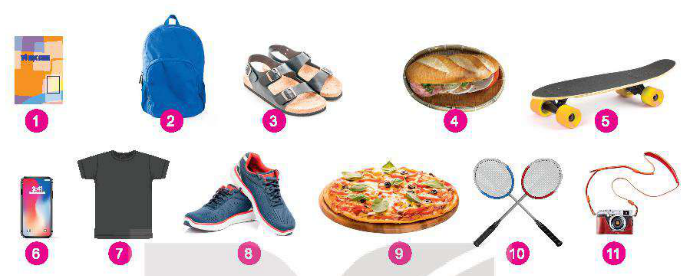
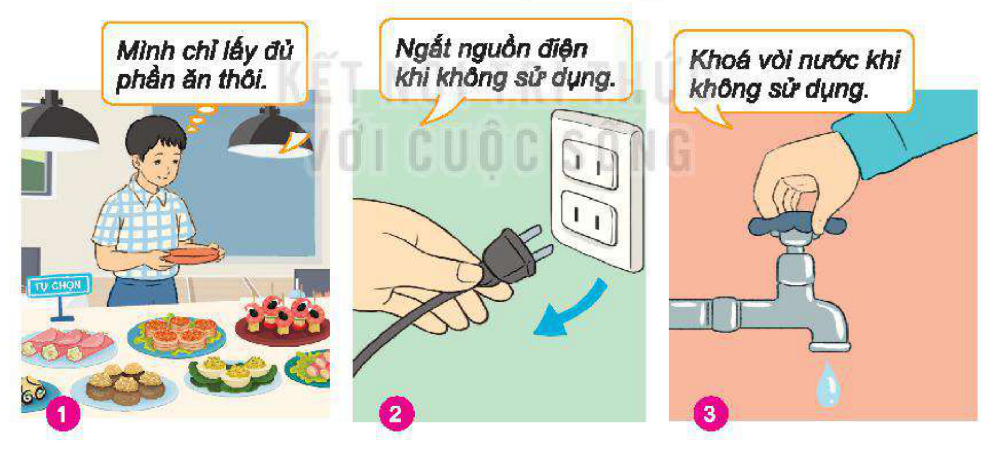
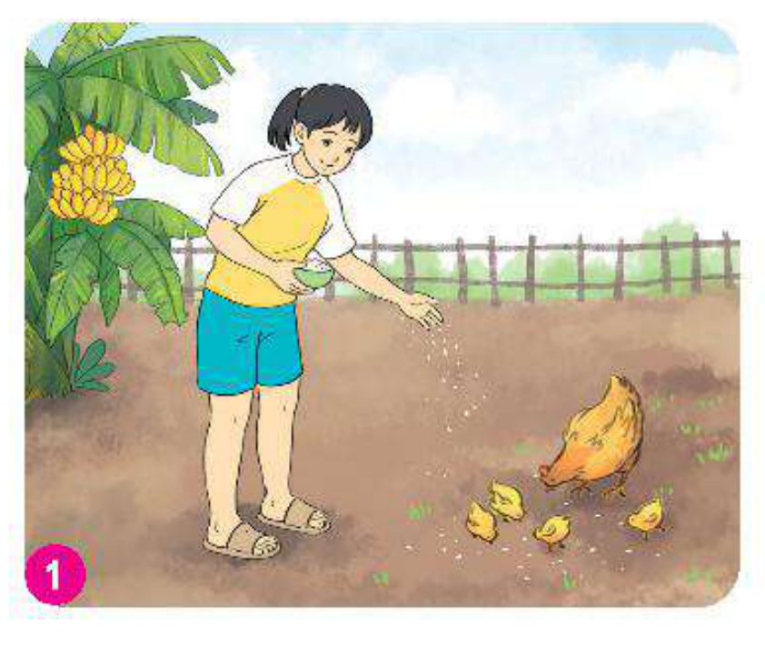
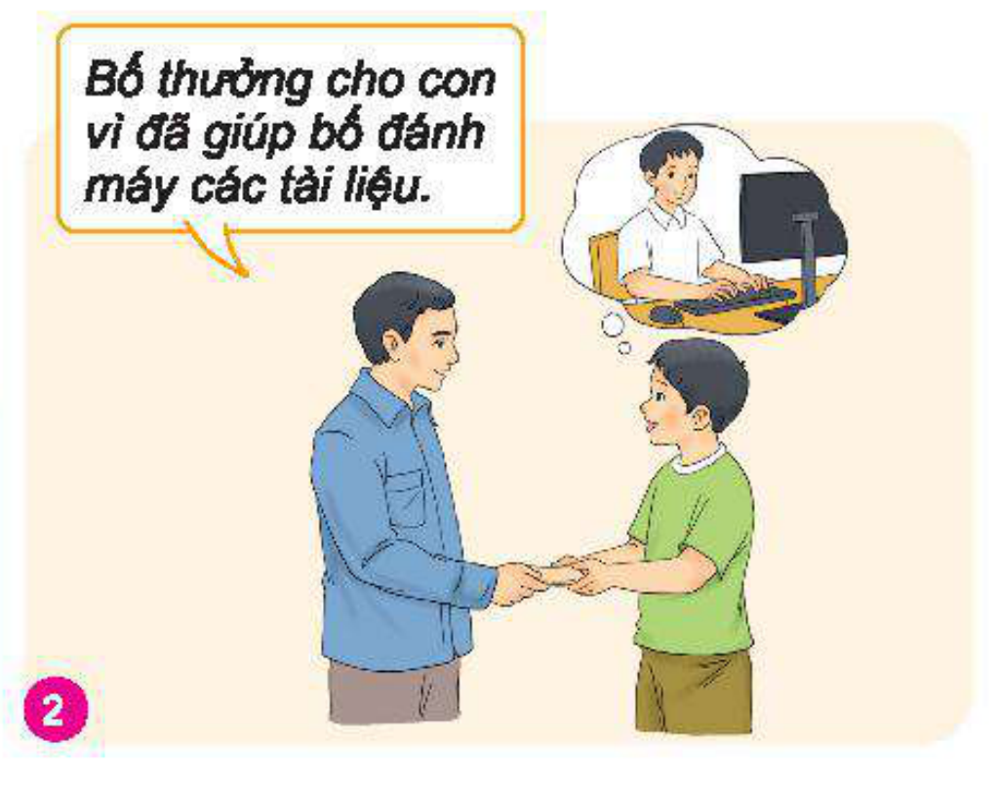
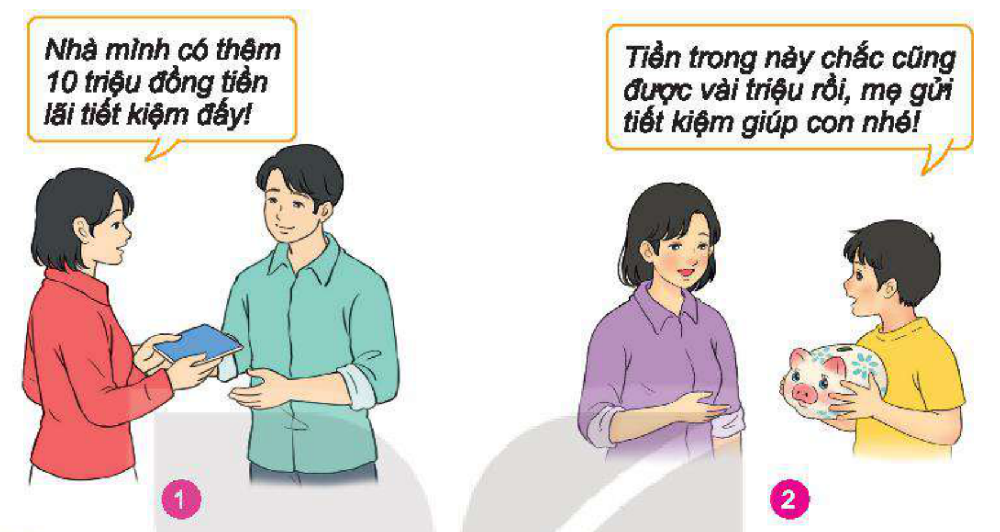

<!-- pdf:45 -->

# BÀI 8: QUẢN LÍ TIỀN

## 🎯 Mục tiêu:

- Nêu được ý nghĩa của việc quản lí tiền hiệu quả.
- Kể ra được một số nguyên tắc quản lí tiền có hiệu quả.
- Bước đầu quản lí được tiền và tạo nguồn thu nhập của cá nhân.

## 🔴 Mở đầu

Làm ra tiền đã khó nhưng quản lí chi tiêu, thực hành tiết kiệm còn khó hơn. Bởi vậy, mỗi chúng ta phải biết cách quản lí tiền để tự chủ trong cuộc sống và có nhiều cơ hội phát triển.

Giả định em đang có 200 000 đồng, hãy đưa ra phương án chi tiêu của mình với khoản tiền này và giải thích vì sao em lựa chọn như vậy.

## KHÁM PHÁ

## 1. Ý nghĩa của việc quản lí tiền hiệu quả

Em hãy đọc trường hợp dưới đây và trả lời câu hỏi:

> Năm lớp 7, Thuý được mẹ cho một khoản tiền nhỏ để dự phòng khi cần. Thuý tự nhủ phải giữ tiền cẩn thận và chỉ chi tiêu khi thật cần thiết. Thuý còn thu gom vỏ chai trong nhà bán lấy tiền, làm phụ giúp thêm bố mẹ ngoài giờ học nên thỉnh thoảng cũng được bố mẹ thưởng tiền. Nhờ biết quản lí tiền, Thuý ít khi phải xin thêm tiền từ bố mẹ. Thuý đã dành dụm đủ tiền để mua đồ dùng học tập, tặng em trai một bộ vợt cầu lông và đóng góp một phần nhỏ để ủng hộ đồng bào bị lũ lụt.

> ❓ a) Em có nhận xét gì về việc quản lí tiền của Thuý?
>
> b) Theo em, việc quản lí tiền hiệu quả có ý nghĩa gì trong cuộc sống?

<!-- pdf:46 -->

## 2. Một số nguyên tắc quản lí tiền hiệu quả

Em hãy quan sát các hình ảnh, đọc các trường hợp dưới đây và trả lời câu hỏi:

*• Sử dụng tiền hợp lí, hiệu quả*

- *Chi tiêu có kế hoạch: chỉ mua những thứ thực sự cần và phù hợp với khả năng chi trả* <!-- term: Chi tiêu có kế hoạch -->

> ❓ a) Trong các sản phẩm trên, đâu là thứ em mong muốn có? Đâu là thứ em rất cần? Nếu chỉ có một số tiền có hạn không mua được tất cả những thứ em muốn thì em sẽ chọn mua những sản phẩm nào? Vì sao?
>
> b) Nếu chi tiêu tuỳ tiện, vượt quá mức cho phép sẽ dẫn đến hậu quả gì? Theo em, có cách nào để tránh việc chi tiêu quá mức?

- *Chỉ vay tiền khi thực sự cần và phải trả đúng hẹn*

> H và các bạn trong lớp xuống căng-tin của trường để ăn trưa. Vì quên tiền ở nhà, H hỏi vay tiền các bạn để mua đồ ăn nhưng không được. Thấy vậy, N lại gần đưa tiền cho bạn và nói:
>
> – Sở dĩ cậu khó vay tiền vì những lần vay trước cậu thường dùng tiền vay để chơi điện tử và ít khi trả đúng hẹn. Khi thiếu tiền, mình có thể vay mượn người khác nhưng phải sử dụng tiền vay cho việc thực sự cần thiết và trả đúng hẹn thì lần vay sau mới được tin tưởng bạn ạ!
>
> H bối rối:
>
> – Cảm ơn bạn. Mình sẽ rút kinh nghiệm.

> ❓ a) Vì sao H khó vay tiền của các bạn trong lớp?
>
> b) Theo em, khi vay mượn tiền cần chú ý điều gì? Vì sao?

<!-- pdf:47 -->

*• Đặt mục tiêu và thực hiện tiết kiệm tiền hiệu quả*

- *Đặt mục tiêu tiết kiệm tiền*

> Chị Hà: Chị vừa mua chiếc áo len này tặng bà.
>
> Bình: Chị làm thế nào để có tiền vậy?
>
> Chị Hà: Chị đặt mục tiêu tiết kiệm từ mấy tháng trước. Tiền mẹ cho để mua vở và nước uống, chị tiết kiệm bằng cách mang theo bình nước và sử dụng những quyển vở vẫn còn mới từ năm trước. Thế là mỗi ngày chị bỏ được một ít tiền vào hũ tiết kiệm, “tích tiểu thành đại” mà.
>
> Bình: Em cũng muốn tiết kiệm được một khoản tiền riêng cho mình. Chắc em phải học theo chị thôi!

> ❓ a) Trong đoạn hội thoại trên, chị Hà đã đặt ra mục tiêu tiết kiệm tiền và thực hiện mục tiêu đó như thế nào?
>
> b) Em đã bao giờ đặt mục tiêu tiết kiệm tiền chưa? Nếu có, em đã thực hiện mục tiêu đó như thế nào?
>
> c) Hãy nêu lợi ích của việc đặt mục tiêu tiết kiệm tiền.

- *Không lãng phí thức ăn, điện, nước,...*

> - **Tranh 1:** “TỰ CHỌN” – “Mình chỉ lấy đủ phần ăn thôi.”
> - **Tranh 2:** “Ngắt nguồn điện khi không sử dụng.”
> - **Tranh 3:** “Khoá vòi nước khi không sử dụng.”
<!-- ocr-ok: đã đối chiếu ảnh trang gốc 47, lời chú thích trong Tranh 1–3 -->

> ❓ a) Vì sao tiết kiệm thức ăn, điện, nước,... lại giúp chúng ta tiết kiệm được tiền? Nêu ý nghĩa của việc tiết kiệm thức ăn, điện, nước,... trong cuộc sống.
>
> b) Em hãy nêu cách tiết kiệm thức ăn, điện, nước,... mà em biết.

<!-- pdf:48 -->

*• Học cách kiếm tiền phù hợp*

- *Kiếm tiền bằng việc tái chế*

> Hằng là một cô bé khéo tay, hay làm, rất quan tâm đến việc tái chế rác thải để góp phần bảo vệ môi trường. Bạn thu gom vỏ chai lọ, que kem, giấy màu đã bỏ đi, lau rửa sạch sẽ, xếp gọn gàng. Những lúc rảnh rỗi, bạn mày mò cắt dán, trang trí thành những món quà lưu niệm như chậu hoa, lọ đựng bút, khung ảnh,... Những sản phẩm này được nhiều bạn yêu thích. Hằng rất vui vì công việc này giúp bạn có chút tiền nhỏ để chi tiêu, phụ giúp thêm bố mẹ và làm từ thiện,...

> ❓ a) Việc làm của Hằng đem lại lợi ích gì?
>
> b) Em hãy kể thêm những đồ vật khác có thể tái chế.

- *Làm đồ thủ công để bán*
<!-- ocr-ok: đã đối chiếu ảnh trang gốc 48, dòng tiêu đề phụ in nghiêng bị OCR bỏ sót -->

> ❓ a) Em hãy kể tên các sản phẩm học sinh có thể tranh thủ thời gian rảnh, tự làm để bán lấy tiền trong các hình trên.
>
> b) Em hãy giới thiệu thêm những mặt hàng khác mà học sinh ở địa phương em có thể làm để bán.

- *Làm phụ giúp bố mẹ*

> - **Tranh 2:** “Bố thưởng cho con vì đã giúp bố đánh máy các tài liệu.”
<!-- ocr-ok: đã đối chiếu ảnh trang gốc 48, lời thoại trong Tranh 2 -->

<!-- pdf:49 -->

> ❓ a) Các bạn trong tranh đã làm những việc gì để có thu nhập cá nhân?
>
> b) Em hãy kể thêm những công việc học sinh có thể làm phụ giúp bố mẹ vào thời gian rảnh rỗi để có tiền.

- *Nhờ bố mẹ gửi tiết kiệm ngân hàng để lấy tiền lãi khi có tiền nhàn rỗi*

> - **Tranh 1:** “Nhà mình có thêm 10 triệu đồng tiền lãi tiết kiệm đấy!”
> - **Tranh 2:** “Tiền trong này chắc cũng được vài triệu rồi, mẹ gửi tiết kiệm giúp con nhé!”
<!-- ocr-ok: đã đối chiếu ảnh trang gốc 49, lời thoại trong Tranh 1–2 -->

> ❓ Theo em, gửi tiền vào ngân hàng mang lại ích lợi gì?
<!-- ocr-ok: đã đối chiếu ảnh trang gốc 49, câu hỏi thảo luận màu tím bị chữ chìm nền che khuất -->

> 1. **Quản lí tiền** là biết sử dụng tiền hợp lí, có hiệu quả.
>
> 2. Quản lí tiền hiệu quả giúp em rèn luyện thói quen chi tiêu hợp lí, tiết kiệm, biết cách kiếm tiền phù hợp với khả năng của mình,... để tạo dựng được cuộc sống ổn định, tự chủ và không ngừng phát triển. <!-- term: Ý nghĩa của việc quản lí tiền hiệu quả -->
>
> 3. Để quản lí tiền hiệu quả, em cần: sử dụng tiền hợp lí; đặt mục tiêu và thực hiện tiết kiệm tiền; học cách kiếm tiền phù hợp. <!-- term: Nguyên tắc quản lí tiền hiệu quả -->

## ✏️ Luyện tập

1. Em đồng tình hay không đồng tình với ý kiến nào dưới đây? Vì sao?

a) Học sinh nên tập trung vào học tập, không nên quan tâm đến tiền bạc.

b) Học sinh không nên giữ tiền vì không giữ được tiền cẩn thận và hay chi vào những việc không cần thiết.

c) Tiết kiệm tiền chỉ dành cho người thường chi tiêu quá nhiều.

d) Biết quản lí tiền sẽ có một cuộc sống đủ đầy.

<!-- pdf:50 -->

2. Em có nhận xét gì về hành vi của các bạn dưới đây?

a) Cả tuần vừa rồi, K đều nhịn ăn sáng để dành tiền mua cuốn truyện yêu thích.

b) Ngay tuần đầu tiên, H đã dùng hết số tiền mẹ cho để chi tiêu trong cả tháng. Bạn hỏi xin thêm nhưng mẹ từ chối.

c) Tháng nào, Q cũng đặt ra mục tiêu tiết kiệm một khoản tiền nhất định.

d) B có thói quen ghi ra giấy những thứ cần mua trước khi đi chợ.

3. Xử lí tình huống:

a) M muốn mua một quả bóng đá giá 100 000 đồng nhưng chỉ có 40 000 đồng. M hỏi vay Q 60 000 đồng và hứa sẽ trả khi được mẹ cho tiền và sẽ cho Q chơi cùng.

*Nếu là Q, em sẽ xử lí thế nào? Vì sao?*

b) N vui mừng khoe với các bạn rằng mình vừa được thưởng 200 000 đồng vì thành tích học tập và tích cực phụ giúp mẹ ở xưởng may tuần vừa rồi. Thấy vậy, các bạn muốn N mua kem khao cả nhóm. N lúng túng vì muốn dùng tiền để mua quà tặng bà ngoại và truyện tranh cho em gái.

*Theo em, N nên xử sự thế nào?*

4. Mẹ cho em 150 000 đồng để tổ chức sinh nhật cùng ba người bạn thân. Em sẽ sử dụng số tiền đó như thế nào để có buổi sinh nhật thật vui vẻ và tiết kiệm?

## 🚀 Vận dụng

1. Em hãy cùng các bạn trong nhóm lập kế hoạch kinh doanh tại hội chợ do lớp tổ chức nhằm gây quỹ từ thiện theo gợi ý sau:
- Chọn mặt hàng sẽ bán tại hội chợ:
  + Liệt kê những món đồ ở nhà mà em và các bạn không cần dùng nữa như: sách, truyện, tạp chí, túi, ví, mũ/nón,... có thể mang đi bán.
  + Lập danh sách một vài mặt hàng có thể mua để bán tại hội chợ (chú ý chọn mặt hàng nhiều người thích, chi ít tiền, khảo giá để mua được rẻ,...).
- Phân công các thành viên trong nhóm chuẩn bị mua hàng, thu gom sản phẩm cần bán, hỗ trợ nhau để bán hàng.
- Chuẩn bị gian hàng để bán hàng tiện lợi.
- Đánh giá kết quả kinh doanh và rút ra bài học để lần sau kinh doanh hiệu quả hơn.

2. Em hãy lập kế hoạch thực hiện mục tiêu tiết kiệm một khoản tiền trong một thời gian nhất định theo gợi ý dưới đây và chia sẻ với bố mẹ và các bạn:
- Xác định khoản tiền muốn tiết kiệm (ví dụ: 100 000 đồng hay 200 000 đồng,...)
- Mục đích tiết kiệm: Em muốn có khoản tiền đó để làm gì?
- Thời gian thực hiện (tuỳ theo khoản tiền dự định tiết kiệm để xác định thời gian thực hiện có thể là 1 tháng, 3 tháng,...).
- Cách thực hiện: Dự kiến những cách sẽ thực hiện để có được khoản tiền đó.
- Xây dựng kế hoạch thực hiện.

## 📷 Danh sách hình trong bài

| Mã hình | Trang PDF | Trang sách | Chú thích |
|---|---|---|---|
| H7-giao_duc_cong_dan-b08-01 | 46 | 45 | Hình 1–11 mục 2: Các sản phẩm tiêu dùng (chi tiêu có kế hoạch) |
| H7-giao_duc_cong_dan-b08-02 | 47 | 46 | Tranh 1–3 mục 2: Không lãng phí thức ăn, điện, nước |
| H7-giao_duc_cong_dan-b08-03 | 48 | 47 | Hình 1–2 mục 2: Làm đồ thủ công để bán |
| H7-giao_duc_cong_dan-b08-04 | 48 | 47 | Tranh 1 mục 2: Làm phụ giúp bố mẹ (chăn nuôi gà) |
| H7-giao_duc_cong_dan-b08-05 | 48 | 47 | Tranh 2 mục 2: Làm phụ giúp bố mẹ (giúp bố đánh máy tài liệu) |
| H7-giao_duc_cong_dan-b08-06 | 49 | 48 | Tranh 1–2 mục 2: Nhờ bố mẹ gửi tiết kiệm ngân hàng |
