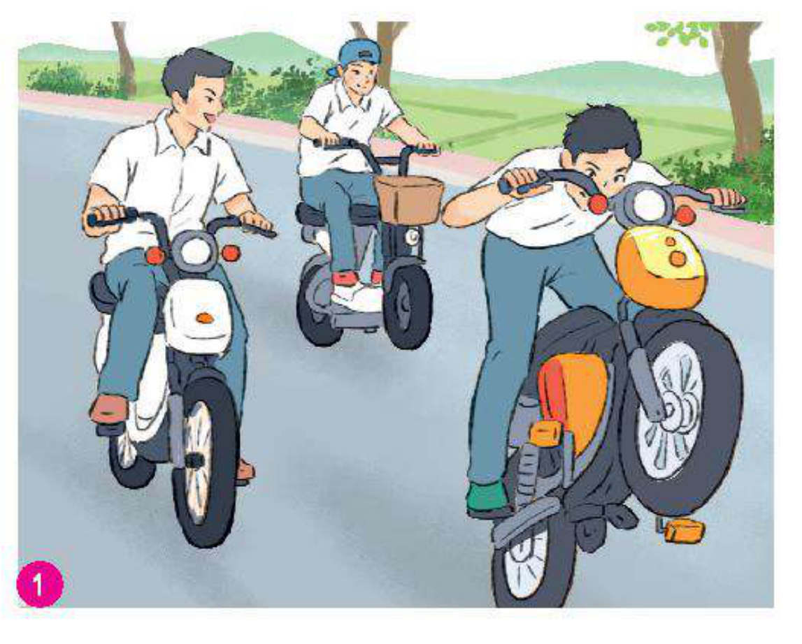
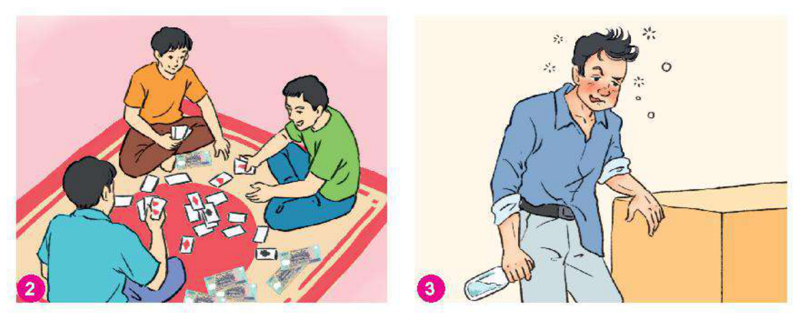
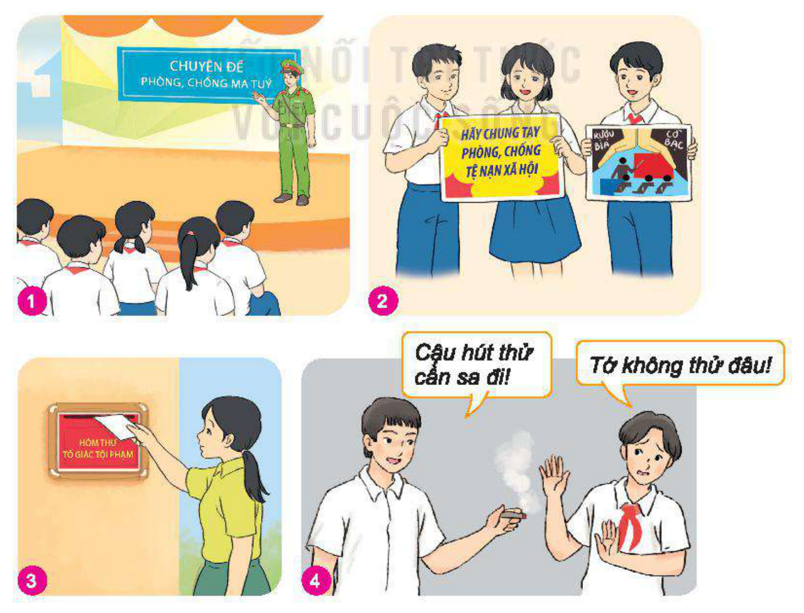
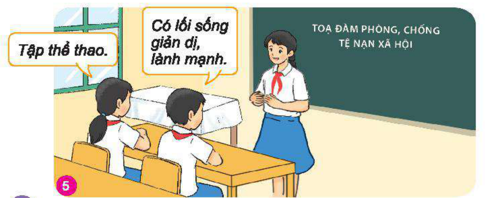

<!-- pdf:51 -->

# BÀI 9: PHÒNG, CHỐNG TỆ NẠN XÃ HỘI

## 🎯 Mục tiêu:

- Nêu được khái niệm tệ nạn xã hội và các loại tệ nạn xã hội phổ biến.
- Giải thích được nguyên nhân, hậu quả của tệ nạn xã hội đối với bản thân, gia đình và xã hội.
- Nêu được một số quy định của pháp luật về phòng, chống tệ nạn xã hội.
- Thực hiện tốt các quy định của pháp luật về phòng, chống tệ nạn xã hội.
- Tham gia các hoạt động phòng, chống tệ nạn xã hội do nhà trường, địa phương tổ chức.
- Phê phán, đấu tranh với các tệ nạn xã hội và tuyên truyền, vận động mọi người tham gia các hoạt động phòng, chống tệ nạn xã hội.

## 🔴 Mở đầu

Tệ nạn xã hội với nhiều loại hình, biến tướng tinh vi, phức tạp mang lại hậu quả xấu cho gia đình, nhà trường, xã hội. Phòng, chống tệ nạn xã hội là trách nhiệm chung của tất cả mọi người, trong đó có học sinh. Việc nâng cao nhận thức và thực hiện trách nhiệm của bản thân trong phòng, chống tệ nạn xã hội sẽ góp phần xây dựng và phát triển đất nước tiến bộ, văn minh và giàu đẹp.

Theo em, học sinh dễ bị lôi kéo vào những tệ nạn xã hội nào nhất? Vì sao?

## KHÁM PHÁ

## 1. Khái niệm và các loại tệ nạn xã hội phổ biến

Em hãy quan sát các tranh, đọc những trường hợp dưới đây và trả lời câu hỏi:

<!-- pdf:52 -->

> **Trường hợp 1:** Đội cảnh sát điều tra tội phạm về ma tuý đã phát hiện bốn nam sinh đang tẩm ma tuý vào thuốc lào để hút. Lực lượng công an đã tiến hành thu giữ tang vật, tạm giữ các đối tượng để xử lí theo quy định của pháp luật.

> **Trường hợp 2:** Thanh tra sở thông tin và truyền thông phối hợp cùng công an tỉnh lập biên bản và xử phạt bà H về việc đăng tải clip trên mạng có nội dung mê tín dị đoan, sai lệch chuẩn mực xã hội, vi phạm quy định pháp luật.

> ❓ a) Nhận xét về hành vi sai trái trong những bức tranh và các trường hợp trên. Nêu hậu quả của những hành vi đó.
>
> b) Theo em, tệ nạn xã hội là gì?
>
> c) Hãy kể tên các loại tệ nạn xã hội phổ biến hiện nay.

## 2. Nguyên nhân và hậu quả của tệ nạn xã hội

Em hãy đọc các trường hợp dưới đây và trả lời câu hỏi:

> **Trường hợp 1:** Nghe một số thanh niên kể về ma tuý đá, S tò mò và quyết định dùng thử để xem cảm giác thế nào. Sau nhiều lần sử dụng, S trở nên gầy gò, dáng đi xiêu vẹo, khả năng tập trung suy giảm và thường xuyên xuất hiện ảo giác. Một lần, S bỗng có những hành vi kích động, liên tục la hét và cầm hung khí tấn công mọi người xung quanh nên đã bị cơ quan công an bắt giữ.

> **Trường hợp 2:** Bà Y không có việc làm ổn định, bản tính lười biếng nhưng rất có tài ăn nói. Không muốn lao động vất vả, bà tung tin mình được thánh nhập, có khả năng tiên đoán trước tương lai. Do tin tưởng mù quáng, nhiều người đã đến nhờ bà xem bói, cúng tế linh đình gây lãng phí tiền bạc, mất an ninh, trật tự,...

<!-- pdf:53 -->

> **Trường hợp 3:** Nhận được tin nhắn trúng thưởng 100 000 000 đồng qua hình thức bốc thăm ngẫu nhiên số điện thoại khách hàng, N vội điền thông tin cá nhân, số tài khoản, mật khẩu để nhận thưởng. Sau khi thực hiện, toàn bộ số tiền trong tài khoản của N bị chiếm đoạt. Công an đã vào cuộc điều tra và bắt được đường dây lừa đảo.

> ❓ a) Em hãy nêu nguyên nhân, hậu quả của những tệ nạn xã hội trong các trường hợp trên.
>
> b) Kể thêm những hậu quả của tệ nạn xã hội mà em biết theo gợi ý dưới đây:

| Tệ nạn xã hội | Hậu quả đối với bản thân | Hậu quả đối với gia đình | Hậu quả đối với xã hội |
|---|---|---|---|
| ? | ? | ? | ? |
<!-- ocr-ok: đã đối chiếu ảnh trang gốc 53, bảng gợi ý có ô kẻ chéo -->

## 3. Một số quy định của pháp luật về phòng, chống tệ nạn xã hội

*• Luật Phòng, chống ma tuý năm 2021 (trích)*

> **Điều 5:** Các hành vi bị nghiêm cấm
>
> 1. Trồng cây có chứa chất ma tuý, hướng dẫn trồng cây có chứa chất ma tuý.
>
> 2. Nghiên cứu, giám định, kiểm nghiệm, kiểm định, sản xuất, tàng trữ, vận chuyển, bảo quản, tồn trữ, mua bán, phân phối, xử lí, trao đổi, xuất khẩu, nhập khẩu, tạm nhập, tái xuất, tạm xuất, tái nhập, quá cảnh trái phép chất ma tuý, tiền chất, thuốc gây nghiện, thuốc hướng thần, thuốc tiền chất, nguyên liệu làm thuốc là dược chất gây nghiện, dược chất hướng thần, tiền chất dùng làm thuốc, thuốc thú y có chứa chất ma tuý, tiền chất. [...]
>
> 5. Sử dụng, tổ chức sử dụng trái phép chất ma tuý; cưỡng bức, lôi kéo người khác sử dụng trái phép chất ma tuý; chứa chấp, hỗ trợ việc sử dụng trái phép chất ma tuý.
>
> 6. Sản xuất, tàng trữ, vận chuyển, mua bán phương tiện, dụng cụ dùng vào việc sản xuất hoặc sử dụng trái phép chất ma tuý. [...]

*• Bộ luật Hình sự năm 2015 (sửa đổi, bổ sung năm 2017) (trích)*

> **Điều 251:** Tội mua bán trái phép chất ma tuý
>
> 1. Người nào mua bán trái phép chất ma tuý, thì bị phạt tù từ 02 năm đến 07 năm. [...]
>
> **Điều 255:** Tội tổ chức sử dụng trái phép chất ma tuý
>
> 1. Người nào tổ chức sử dụng trái phép chất ma tuý dưới bất kì hình thức nào, thì bị phạt tù từ 02 năm đến 07 năm. [...]

<!-- pdf:54 -->

> **Điều 320:** Tội hành nghề mê tín, dị đoan
>
> 1. Người nào dùng bói toán, đồng bóng hoặc các hình thức mê tín, dị đoan khác đã bị xử phạt vi phạm hành chính về hành vi này hoặc đã bị kết án về tội này, chưa được xoá án tích mà còn vi phạm, thì bị phạt tiền từ 10 000 000 đồng đến 100 000 000 đồng, phạt cải tạo không giam giữ đến 03 năm hoặc phạt tù từ 06 tháng đến 03 năm. [...]
>
> **Điều 321:** Tội đánh bạc
>
> 1. Người nào đánh bạc trái phép dưới bất kì hình thức nào được thua bằng tiền hay hiện vật trị giá từ 5 000 000 đồng đến dưới 50 000 000 đồng hoặc dưới 5 000 000 đồng, đã bị xử phạt vi phạm hành chính về hành vi này hoặc hành vi quy định tại Điều 322 của Bộ luật này hoặc đã bị kết án về tội này hoặc tội quy định tại Điều 322 của Bộ luật này, chưa được xoá án tích mà còn vi phạm, thì bị phạt tiền từ 20 000 000 đồng đến 100 000 000 đồng, phạt cải tạo không giam giữ đến 03 năm hoặc phạt tù từ 06 tháng đến 03 năm.

> ❓ a) Em hãy cho biết hành vi tẩm ma tuý vào thuốc lào để hút của các học sinh ở trường hợp 1 (mục 1) có vi phạm quy định của pháp luật về phòng, chống tệ nạn xã hội không. Vì sao?
>
> b) Em hãy nêu một số quy định của pháp luật về phòng, chống tệ nạn xã hội.

## 4. Trách nhiệm của học sinh trong phòng, chống tệ nạn xã hội

Em hãy quan sát các tranh dưới đây và trả lời câu hỏi:

> - **Tranh 1:** “CHUYÊN ĐỀ PHÒNG, CHỐNG MA TUÝ”
> - **Tranh 2:** “HÃY CHUNG TAY PHÒNG, CHỐNG TỆ NẠN XÃ HỘI”, “RƯỢU BIA”, “CỜ BẠC”
> - **Tranh 3:** “HÒM THƯ TỐ GIÁC TỘI PHẠM”
> - **Tranh 4:** “Cậu hút thử cần sa đi!” – “Tớ không thử đâu!”
<!-- ocr-ok: đã đối chiếu ảnh trang gốc 54, chữ và lời thoại trong Tranh 1–4 -->

<!-- pdf:55 -->

> - **Tranh 5:** “TOẠ ĐÀM PHÒNG, CHỐNG TỆ NẠN XÃ HỘI” – “Tập thể thao.” – “Có lối sống giản dị, lành mạnh.”
<!-- ocr-ok: đã đối chiếu ảnh trang gốc 55, chữ trên bảng và lời thoại trong Tranh 5 -->

> ❓ a) Trong những bức tranh trên, các bạn đã làm gì để phòng, chống tệ nạn xã hội?
>
> b) Em hãy kể thêm những việc học sinh cần làm để phòng, chống tệ nạn xã hội.

> 1. **Tệ nạn xã hội** là những hành vi sai lệch chuẩn mực xã hội, vi phạm đạo đức và pháp luật mang tính phổ biến, gây hậu quả xấu về mọi mặt đối với đời sống xã hội.
>
> Có nhiều loại tệ nạn xã hội như: ma tuý, mại dâm, cờ bạc, mê tín dị đoan, nghiện rượu, bia,...
>
> Nguyên nhân của tệ nạn xã hội: do thiếu kiến thức, thiếu kĩ năng sống; do lười lao động, ham chơi, đua đòi, thích hưởng thụ; do ảnh hưởng của môi trường gia đình, môi trường xã hội tiêu cực;...
>
> Tệ nạn xã hội gây ra những hậu quả tiêu cực về sức khoẻ, tâm lí, tính mạng, kinh tế của bản thân và gia đình; gây rối loạn trật tự xã hội; cản trở sự phát triển của đất nước;... <!-- term: Nguyên nhân và hậu quả của tệ nạn xã hội -->
>
> 2. Việc phòng, chống tệ nạn xã hội được Nhà nước ta quy định trong một số văn bản luật như Bộ luật Hình sự năm 2015 (sửa đổi, bổ sung năm 2017), Luật Phòng, chống ma tuý năm 2021,... Pháp luật Việt Nam nghiêm cấm tham gia dưới mọi hình thức vào các tệ nạn xã hội ma tuý, mại dâm, cờ bạc, mê tín dị đoan,... Hành vi vi phạm quy định của pháp luật về phòng, chống tệ nạn xã hội sẽ bị xử lí theo nhiều hình thức như: cảnh cáo, xử phạt hành chính, phạt tù, tử hình,... tuỳ thuộc vào mức độ và tính chất vi phạm. <!-- term: Phòng, chống tệ nạn xã hội -->
>
> 3. Trách nhiệm của học sinh trong phòng, chống tệ nạn xã hội:
> - Chăm chỉ học tập, rèn luyện, nâng cao nhận thức, bổ sung kĩ năng, xây dựng lối sống giản dị, lành mạnh.
> - Tuân thủ và tuyên truyền phổ biến các quy định của pháp luật về phòng, chống tệ nạn xã hội.
> - Phê phán, tố cáo các hành vi vi phạm quy định của pháp luật về phòng, chống tệ nạn xã hội.
> - Tích cực tham gia các hoạt động phòng, chống tệ nạn xã hội ở nhà trường và địa phương.

<!-- pdf:56 -->

## ✏️ Luyện tập

1. Em đồng tình hay không đồng tình với ý kiến nào dưới đây? Vì sao?

a) Những người mắc tệ nạn xã hội đều là người xấu.

b) Trẻ em mắc vào tệ nạn xã hội sẽ ảnh hưởng không tốt đến tương lai của bản thân.

c) Phòng, chống tệ nạn xã hội là trách nhiệm của riêng cơ quan công an.

2. Em đồng tình hay không đồng tình với hành vi nào dưới đây? Vì sao?

a) L rủ các bạn trong lớp cá cược bóng đá, ai thua thì sẽ phải bỏ tiền mua đồ ăn sáng cho những người thắng.

b) Bà N dùng bánh kẹo để dụ dỗ trẻ em vận chuyển ma tuý hộ mình.

c) H kiên quyết từ chối khi được các bạn cùng lớp rủ đi xem bói.

3. Xử lí tình huống:

a) Thời gian gần đây, trong bản của A có một số trẻ nhỏ bị sốt và nổi ban đỏ trên cơ thể nên người dân vô cùng lo lắng. Thầy mo bảo rằng trong bản đang bị nhiều ma quỷ quấy rối và yêu cầu mọi người đóng tiền để làm lễ cúng trừ tà.

b) Gần đây, M thấy anh trai gieo trồng một giống cây lạ trong vườn và chăm sóc rất cẩn thận. M tò mò muốn biết anh trồng cây gì nên nhiều lần gặng hỏi nhưng anh không trả lời, anh chỉ nói rằng những cây đó bán được rất nhiều tiền. Cảm thấy nghi ngờ, M đã lên mạng tìm hiểu và phát hiện những cây mà anh trai đang trồng rất giống cây cần sa – một loại cây dùng để điều chế ma tuý.

c) Mùng Hai Tết, S được anh trai dẫn qua nhà một người bạn chơi. Khi đến nơi, S thấy một số người tụ tập đánh bài ăn tiền. Anh trai S không mang tiền nên ngỏ ý muốn mượn tiền mừng tuổi của S để chơi cùng mọi người. Anh còn hứa sẽ cho S tất cả số tiền thắng được.

*Nếu là A, M, S trong các tình huống trên, em sẽ xử lí thế nào?*

4. Em hãy chia sẻ những việc bản thân đã làm để phòng, chống tệ nạn xã hội.

## 🚀 Vận dụng

1. Em hãy cùng các bạn trong nhóm xây dựng và biểu diễn một tiết mục văn nghệ hoặc tiểu phẩm để tham gia hoạt động tuyên truyền về phòng, chống tệ nạn xã hội do nhà trường, địa phương tổ chức.
2. Em hãy vẽ một bức tranh phê phán các tệ nạn xã hội và thuyết minh giới thiệu sản phẩm với cả lớp.

## 📷 Danh sách hình trong bài

| Mã hình | Trang PDF | Trang sách | Chú thích |
|---|---|---|---|
| H7-giao_duc_cong_dan-b09-01 | 51 | 50 | Tranh 1 mục 1: Hành vi vi phạm trật tự an toàn giao thông |
| H7-giao_duc_cong_dan-b09-02 | 52 | 51 | Tranh 2–3 mục 1: Tệ nạn cờ bạc và nghiện rượu, bia |
| H7-giao_duc_cong_dan-b09-03 | 54 | 53 | Tranh 1–4 mục 4: Trách nhiệm của học sinh trong phòng, chống tệ nạn xã hội |
| H7-giao_duc_cong_dan-b09-04 | 55 | 54 | Tranh 5 mục 4: Toạ đàm phòng, chống tệ nạn xã hội |
