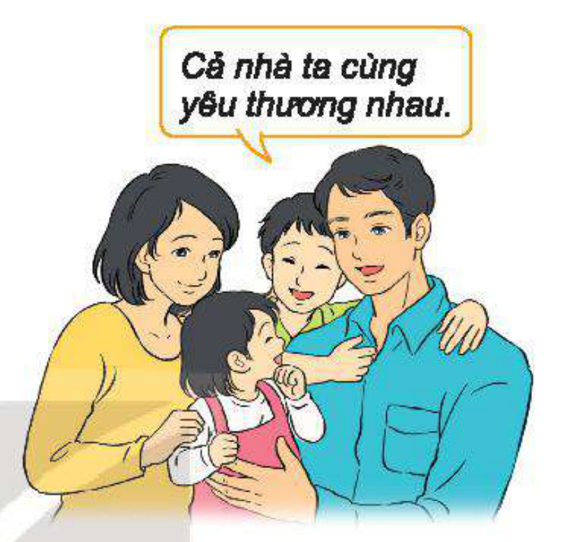
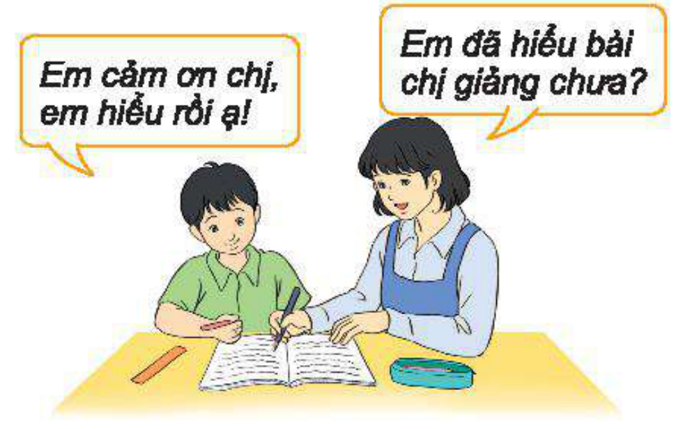

<!-- pdf:57 -->

# BÀI 10: QUYỀN VÀ NGHĨA VỤ CỦA CÔNG DÂN TRONG GIA ĐÌNH

## 🎯 Mục tiêu:

- Nêu được khái niệm và vai trò của gia đình; quy định cơ bản của pháp luật về quyền và nghĩa vụ của các thành viên trong gia đình.
- Nhận xét được việc thực hiện quyền và nghĩa vụ trong gia đình của bản thân và người khác.
- Thực hiện được nghĩa vụ của bản thân đối với ông bà, cha mẹ và anh, chị, em trong gia đình bằng những việc làm cụ thể.

## 🔴 Mở đầu

Mỗi chúng ta, ai cũng có một gia đình. Đó là nơi ta được sinh ra, được nuôi dưỡng, che chở. Để gia đình luôn là tổ ấm, là chỗ dựa vững chắc của mỗi người, mỗi thành viên cần thực hiện tốt quyền và nghĩa vụ của mình trong gia đình.

Hãy chia sẻ cảm xúc của em khi nghe/hát bài hát *“Cho con”*.

> *“Ba sẽ là cánh chim [...]*
> *Ba mẹ là lá chắn*
> *Che chở suốt đời con*
> *Khi con là con ba*
> *Con của ba rất ngoan*
> *Khi con là con mẹ*
> *Con của mẹ rất hiền [...]*
> *Ba mẹ là quê hương.”*
>
> *(Sáng tác: Phạm Trọng Cầu)*

## KHÁM PHÁ

## 1. Khái niệm và vai trò của gia đình

*• Khái niệm gia đình*

Em hãy đọc các trường hợp dưới đây và trả lời câu hỏi:

> **Trường hợp 1:** Anh Hoà kết hôn cùng chị Lan, sinh ra bé Vân. Hằng ngày, anh chị đi làm, chiều về cùng nhau đón con, nấu cơm, dọn dẹp. Sau bữa cơm, cả gia đình quây quần xem ti vi và nói chuyện. Bé Vân tíu tít kể chuyện ở lớp cho bố mẹ nghe. Anh Hoà vừa chơi với con vừa hỏi thăm công việc của vợ. Cả nhà thường rộn tiếng cười. Hàng xóm khen gia đình anh chị thật hạnh phúc.

<!-- pdf:58 -->

> **Trường hợp 2:** Vợ chồng chú Hải, cô Hoa không thể sinh con. Cô chú đã nhận Hùng về làm con nuôi. Tuy không sinh ra Hùng nhưng cô chú luôn yêu thương, chăm sóc tận tình. Đáp lại tình cảm đó, Hùng luôn ngoan ngoãn, hiếu thảo và cố gắng học tốt để bố mẹ vui lòng.

> ❓ a) Hãy cho biết mối quan hệ của các thành viên trong hai trường hợp trên.
>
> b) Em hiểu thế nào là gia đình?

*• Vai trò của gia đình*

Em hãy đọc các trường hợp dưới đây và trả lời câu hỏi:

> **Trường hợp 1:** Vợ chồng chị Mai cùng hai con trai sống chung với bố mẹ chồng. Hằng ngày, anh chị đi làm, cháu lớn đi học, ông bà nội ở nhà trông cháu bé, dọn dẹp và lo cơm nước. Ngoài việc làm chính ở cơ quan, vợ chồng chị còn nhận thêm sản phẩm làm ngoài giờ. Sáng nào, cả gia đình chị cũng dậy sớm tập thể dục để rèn luyện sức khoẻ. Dù bận rộn nhưng chị vẫn dành thời gian dạy con học và quan tâm đến sức khoẻ của bố mẹ. Các con chị đều khoẻ mạnh, ngoan ngoãn và học giỏi.

> **Trường hợp 2:** Khi kể về những cố gắng của bản thân trong quá trình học tập để trở thành học sinh giỏi cấp thành phố, Lý xúc động chia sẻ, để có được kết quả này, ngoài sự cố gắng của bản thân còn có công lao to lớn của ông nội và bố mẹ quan tâm, chăm sóc, tạo mọi điều kiện tốt nhất để bạn được học tập, phát triển. Đặc biệt, ông nội bạn luôn dành thời gian dạy bạn học, hướng dẫn bạn làm thêm các bài tập nâng cao. Thành tích mà Lý có được nhờ vào sự định hướng, giáo dục từ gia đình rất nhiều.

> ❓ a) Em hãy cho biết vai trò của gia đình qua các trường hợp trên.
>
> b) Kể thêm các vai trò khác của gia đình mà em biết.

<!-- pdf:59 -->

## 2. Quy định cơ bản của pháp luật về quyền, nghĩa vụ giữa các thành viên trong gia đình

*• Quyền, nghĩa vụ giữa vợ và chồng*

Em hãy đọc các thông tin, trường hợp dưới đây và trả lời câu hỏi:

> *Luật Hôn nhân và Gia đình năm 2014 (trích):*
>
> **Điều 17:** Bình đẳng về quyền, nghĩa vụ giữa vợ, chồng
>
> Vợ, chồng bình đẳng với nhau, có quyền, nghĩa vụ ngang nhau về mọi mặt trong gia đình, trong việc thực hiện các quyền, nghĩa vụ của công dân được quy định trong Hiến pháp, Luật này và các luật khác có liên quan.
>
> **Điều 19:** Tình nghĩa vợ chồng
>
> 1. Vợ chồng có nghĩa vụ thương yêu, chung thuỷ, tôn trọng, quan tâm, chăm sóc, giúp đỡ nhau; cùng nhau chia sẻ, thực hiện các công việc trong gia đình. [...] <!-- term: Quyền, nghĩa vụ giữa vợ và chồng -->

> **Trường hợp 1:** Chú Nam luôn cho rằng: Trong gia đình, vợ chồng phải bình đẳng, có quyền và nghĩa vụ ngang nhau. Vì vậy, chú luôn chia sẻ việc nhà với vợ, khi thì dọn dẹp, nấu cơm, khi thì chăm con để vợ được nghỉ ngơi. Vợ chú cũng luôn ủng hộ công việc chú làm, luôn tạo mọi điều kiện để chú có thể học tập, nâng cao trình độ. Mọi việc lớn nhỏ trong gia đình cô chú đều bàn bạc, tìm phương án thống nhất. Vì có sự tôn trọng nhau nên không khí trong gia đình cô chú luôn ấm êm, hoà thuận.

> **Trường hợp 2:** Do cần tiền để kinh doanh, chú Kha quyết định bán miếng đất hai vợ chồng đã mua mặc dù vợ chú không đồng ý vì giá quá thấp. Theo chú, đàn ông là trụ cột gia đình nên có quyền quyết định những việc lớn, phụ nữ không được can thiệp.

> ❓ a) Hai trường hợp trên liên quan đến quyền và nghĩa vụ gì giữa vợ và chồng? Chú Nam và chú Kha thực hiện đúng quy định của pháp luật không?
>
> b) Kể thêm các quyền và nghĩa vụ giữa vợ và chồng mà em biết.

*• Quyền, nghĩa vụ giữa cha mẹ và con*

Em hãy đọc các thông tin, trường hợp dưới đây và trả lời câu hỏi:

> *Luật Hôn nhân và Gia đình năm 2014 (trích):*
>
> **Điều 69:** Nghĩa vụ và quyền của cha mẹ

<!-- pdf:60 -->

> 1. Thương yêu con, tôn trọng ý kiến của con; chăm lo việc học tập, giáo dục để con phát triển lành mạnh về thể chất, trí tuệ, đạo đức, trở thành người con hiếu thảo của gia đình, công dân có ích cho xã hội.
>
> 2. Trông nom, nuôi dưỡng, chăm sóc, bảo vệ quyền, lợi ích hợp pháp của con chưa thành niên, con đã thành niên mất năng lực hành vi dân sự hoặc không có khả năng lao động và không có tài sản để tự nuôi mình. [...]
>
> **Điều 70:** Quyền và nghĩa vụ của con
>
> 1. Được cha mẹ thương yêu, tôn trọng, thực hiện các quyền, lợi ích hợp pháp về nhân thân và tài sản theo quy định của pháp luật; được học tập và giáo dục; được phát triển lành mạnh về thể chất, trí tuệ và đạo đức.
>
> 2. Có bổn phận yêu quý, kính trọng, biết ơn, hiếu thảo, phụng dưỡng cha mẹ, giữ gìn danh dự, truyền thống tốt đẹp của gia đình. [...] <!-- term: Quyền, nghĩa vụ giữa cha mẹ và con -->

> - **Lời thoại trong tranh:** “Cả nhà ta cùng yêu thương nhau.”
<!-- ocr-ok: đã đối chiếu ảnh trang gốc 60, lời thoại trong tranh -->

> **Trường hợp 1:** Gia đình K rất khó khăn. Bố mẹ là công nhân, phải làm tăng ca thường xuyên để có tiền nuôi hai anh em K ăn học. Thương bố mẹ, anh em K bảo nhau chăm chỉ học và làm việc nhà để giúp đỡ bố mẹ. Có lần, anh trai K định bỏ học, đi làm để đỡ gánh nặng cho bố mẹ nhưng bố K cương quyết không đồng ý. Bố cho rằng, vất vả mấy bố mẹ cũng sẽ cố gắng để các con được ăn no, mặc ấm, được đi học.

> **Trường hợp 2:** Biết Mai yêu thích bơi lội, bố mẹ đã tạo điều kiện để bạn luyện tập, phát triển năng khiếu. Được nhà trường cử tham gia thi bơi trong đại hội thể thao toàn tỉnh, Mai đã giành giải cao. Nhà trường và bố mẹ Mai rất vui vì thành tích của em.

> **Trường hợp 3:** Do hoàn cảnh gia đình khó khăn nên H (14 tuổi) phải làm thêm một số công việc khác để kiếm tiền ngoài giờ học. Mặc dù bố mẹ phải làm việc vất vả để nuôi các con ăn học nhưng H đã dùng hết số tiền kiếm được để chi tiêu riêng, không đóng góp cho gia đình.

> ❓ a) Việc làm của bố mẹ K, bố mẹ Mai và H trong các trường hợp trên nói đến quyền và nghĩa vụ gì giữa cha mẹ và con? Những ai đã thực hiện đúng/không đúng các quyền, nghĩa vụ đó? Vì sao?
>
> b) Kể thêm các quyền, nghĩa vụ giữa cha mẹ và con mà em biết.

<!-- pdf:61 -->

*• Quyền, nghĩa vụ giữa anh, chị, em trong gia đình*

Em hãy đọc các thông tin, trường hợp dưới đây và trả lời câu hỏi:

> *Luật Hôn nhân và Gia đình năm 2014 (trích):*
>
> **Điều 105:** Quyền, nghĩa vụ của anh, chị, em
>
> Anh, chị, em có quyền, nghĩa vụ thương yêu, chăm sóc, giúp đỡ nhau; có quyền, nghĩa vụ nuôi dưỡng nhau trong trường hợp không còn cha mẹ hoặc cha mẹ không có điều kiện trông nom, nuôi dưỡng, chăm sóc, giáo dục con. <!-- term: Quyền, nghĩa vụ giữa anh, chị, em trong gia đình -->

> - **Lời thoại trong tranh:** “Em đã hiểu bài chị giảng chưa?” – “Em cảm ơn chị, em hiểu rồi ạ!”
<!-- ocr-ok: đã đối chiếu ảnh trang gốc 61, lời thoại trong tranh -->

> **Trường hợp 1:** Thấy bố mẹ làm việc vất vả để nuôi 3 anh em ăn học nên ngoài việc học, Hưng tranh thủ làm các công việc phụ giúp bố mẹ, quan tâm, nhắc các em chăm học. Các em rất nghe lời và yêu quý Hưng.

> **Trường hợp 2:** Là con trai được bố mẹ nuông chiều, P thường bắt nạt em. Mọi việc trong nhà, P đều bắt em phải làm kể cả những việc bố mẹ giao cho mình. Khi gặp những việc không như ý, P thường to tiếng với em, giành phần hơn về mình và doạ đánh em.

> ❓ a) Em hãy nhận xét việc làm của Hưng và P trong các trường hợp trên.
>
> b) Theo em, giữa anh, chị, em trong gia đình có quyền, nghĩa vụ gì?

*• Quyền, nghĩa vụ giữa ông bà và các cháu*

Em hãy đọc các thông tin, trường hợp dưới đây và trả lời câu hỏi:

> *Luật Hôn nhân và Gia đình năm 2014 (trích):*
>
> **Điều 104:** Quyền, nghĩa vụ của ông bà nội, ông bà ngoại và cháu
>
> 1. Ông bà nội, ông bà ngoại có quyền, nghĩa vụ trông nom, chăm sóc, giáo dục cháu, sống mẫu mực và nêu gương tốt cho con cháu; trường hợp cháu chưa thành niên, cháu đã thành niên mất năng lực hành vi dân sự hoặc không có khả năng lao động và không có tài sản để tự nuôi mình mà không có người nuôi dưỡng theo quy định tại Điều 105 của Luật này thì ông bà nội, ông bà ngoại có nghĩa vụ nuôi dưỡng cháu.
>
> 2. Cháu có nghĩa vụ kính trọng, chăm sóc, phụng dưỡng ông bà nội, ông bà ngoại; trường hợp ông bà nội, ông bà ngoại không có con để nuôi dưỡng mình thì cháu đã thành niên có nghĩa vụ nuôi dưỡng. <!-- term: Quyền, nghĩa vụ giữa ông bà và các cháu -->

<!-- pdf:62 -->

> **Trường hợp 1:** Bố mẹ mất sớm, Bình được ông bà nội nuôi tới khi trưởng thành. Ông bà đã chứng kiến những bước đi chập chững đầu đời, nâng đỡ, che chở, dạy cho Bình những bài học trong cuộc sống. Ở bên ông bà, Bình luôn thấy ấm áp yêu thương và bạn rất tự hào khoe về ông bà với mọi người.

> **Trường hợp 2:** Bà nội già, yếu nên bố H đón về ở cùng gia đình để tiện chăm sóc. Tuy nhiên, H không thích bà vì cho rằng bà già lẩm cẩm, nói nhiều và hay làm đổ, vỡ, hư hỏng đồ dùng. Khi bà có việc cần nhờ giúp, H thường trốn tránh không làm.

> ❓ a) Em hãy nhận xét về tình cảm và việc làm của ông bà Bình, H trong các trường hợp trên và cho biết ai thực hiện đúng/không đúng quyền và nghĩa vụ giữa ông bà và cháu.
>
> b) Kể thêm quyền, nghĩa vụ giữa ông bà và các cháu mà em biết.

> 1. **Gia đình** là tập hợp những người gắn bó với nhau do hôn nhân, quan hệ huyết thống hoặc quan hệ nuôi dưỡng làm phát sinh các quyền và nghĩa vụ giữa họ với nhau theo quy định của Luật Hôn nhân và Gia đình.
>
> 2. Gia đình có các vai trò cơ bản: duy trì nòi giống, kinh tế, tổ chức đời sống gia đình, nuôi dưỡng, giáo dục con, cháu và góp phần phát triển xã hội. <!-- term: Vai trò của gia đình -->
>
> 3. Theo Luật Hôn nhân và Gia đình, các thành viên trong gia đình có quyền và nghĩa vụ:
> - Vợ, chồng bình đẳng với nhau, có quyền, nghĩa vụ ngang nhau về mọi mặt trong gia đình; vợ chồng có nghĩa vụ thương yêu, chung thuỷ, tôn trọng, quan tâm, chăm sóc, giúp đỡ nhau; cùng nhau chia sẻ, thực hiện các công việc trong gia đình;...
> - Cha mẹ có quyền và nghĩa vụ nuôi dạy con thành công dân tốt; bảo vệ quyền và lợi ích hợp pháp của con; không phân biệt đối xử giữa các con; không ngược đãi, ép buộc con làm điều trái pháp luật, trái đạo đức;...
> - Con có bổn phận yêu quý, kính trọng, biết ơn cha mẹ; có nghĩa vụ chăm sóc, phụng dưỡng cha mẹ và tham gia công việc gia đình phù hợp lứa tuổi; giữ gìn danh dự, truyền thống tốt đẹp của gia đình;...
> - Anh, chị, em có quyền, nghĩa vụ thương yêu, chăm sóc, giúp đỡ nhau; nuôi dưỡng nhau trong trường hợp không còn cha mẹ,...
> - Ông bà nội, ông bà ngoại có quyền, nghĩa vụ trông nom, chăm sóc, giáo dục cháu; nuôi dưỡng cháu chưa thành niên, cháu đã thành niên mất năng lực hành vi dân sự không có người nuôi dưỡng,...
> - Cháu có nghĩa vụ kính trọng, chăm sóc, phụng dưỡng ông bà nội, ông bà ngoại,... <!-- term: Quyền và nghĩa vụ của các thành viên trong gia đình -->

<!-- pdf:63 -->

## ✏️ Luyện tập

1. Em đồng tình hay không đồng tình với ý kiến nào dưới đây? Vì sao?

a) Nếp sống của gia đình có vai trò quan trọng trong sự hình thành và phát triển nhân cách của trẻ.

b) Cha mẹ có quyền phân biệt đối xử giữa các con.

c) Giáo dục trẻ em là công việc của nhà trường.

2. Trong những trường hợp dưới đây, ai thực hiện đúng, ai vi phạm quyền và nghĩa vụ giữa các thành viên trong gia đình? Vì sao?

a) N thích học đàn, bạn được bố mua đàn và tìm thầy dạy. Bố khuyến khích N học đàn nhưng luôn nhắc nhở N không được lơ là việc học các môn văn hoá.

b) Được ông bà chiều chuộng, đáp ứng mọi yêu cầu nên M không nghe lời bố mẹ, lười học, ham chơi. Khi bố mẹ mắng, M tỏ ra không nghe lời vì được ông bà bênh.

c) Bố mẹ H luôn khuyến khích H tham gia các hoạt động tập thể của trường, lớp.

d) Ở nhà, bố thường trao đổi, tham khảo ý kiến A về các vấn đề liên quan đến trẻ em.

3. Em hãy xử lí các tình huống dưới đây:

a) V và em trai học cùng trường. Nhà trường tổ chức đi tham quan Vườn Quốc gia Cúc Phương. Hai chị em đều muốn tham gia nhưng bố chỉ cho V đi, còn em trai phải ở nhà vì còn nhỏ.

*Nếu là V, em sẽ ứng xử thế nào?*

b) S thích vẽ và vẽ rất đẹp nên được các bạn bầu làm nhóm trưởng tờ báo tường của lớp. S xin mẹ cho đi học lớp vẽ ở Cung thiếu nhi nhưng mẹ không đồng ý vì sợ học vẽ sẽ ảnh hưởng đến việc học ở trường của S.

*Nếu là S, em sẽ ứng xử thế nào?*

c) Nhà D có hai anh em, D luôn tranh giành, bắt nạt em. Bố mẹ đi làm giao cho D ở nhà nấu cơm, dọn dẹp, trông em, D luôn nhận việc nhưng khi bố mẹ vừa đi, D liền đi chơi và bắt em làm những việc bố mẹ giao.

*Nếu là bạn của D, em có lời khuyên gì cho D?*

d) Bà ốm, bố mẹ bận việc ở cơ quan nên dặn C ở nhà chăm sóc bà. C từ chối với lí do đã có hẹn đi xem phim cùng các bạn.

*Nếu là C, khi được bố mẹ giao việc đó, em sẽ ứng xử thế nào? Vì sao?*

## 🚀 Vận dụng

1. Em hãy viết thư cho người thân bày tỏ mong muốn về việc được thực hiện quyền tham gia của em trong gia đình.
2. Em hãy lập và thực hiện bản kế hoạch điều chỉnh những việc làm của mình cho đúng với nghĩa vụ công dân trong gia đình theo gợi ý dưới đây:

| Các quyền, nghĩa vụ chưa thực hiện | Nguyên nhân chưa thực hiện | Mong muốn cần đạt | Phương thức điều chỉnh | Thời gian điều chỉnh |
|---|---|---|---|---|
| ? | ? | ? | ? | ? |
<!-- ocr-ok: đã đối chiếu ảnh trang gốc 63, bảng gợi ý có ô kẻ chéo -->

## 📷 Danh sách hình trong bài

| Mã hình | Trang PDF | Trang sách | Chú thích |
|---|---|---|---|
| H7-giao_duc_cong_dan-b10-01 | 60 | 59 | Tranh minh hoạ mục 2: Gia đình yêu thương nhau |
| H7-giao_duc_cong_dan-b10-02 | 61 | 60 | Tranh minh hoạ mục 2: Chị giảng bài giúp em |
