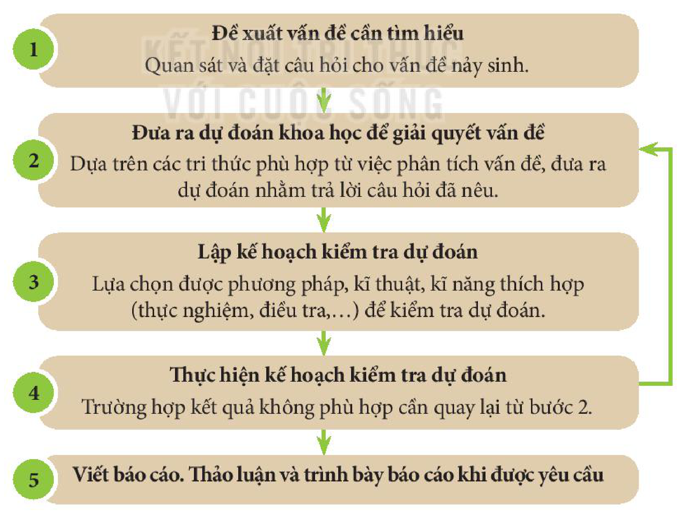
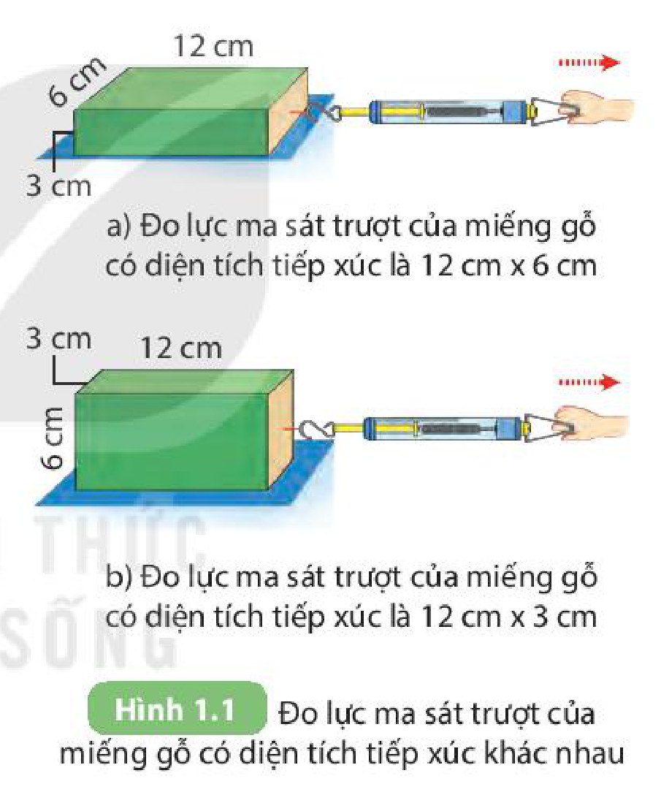
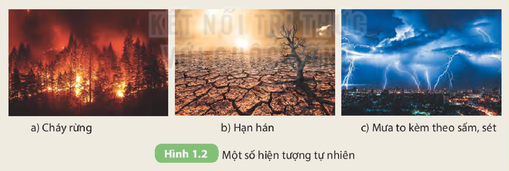
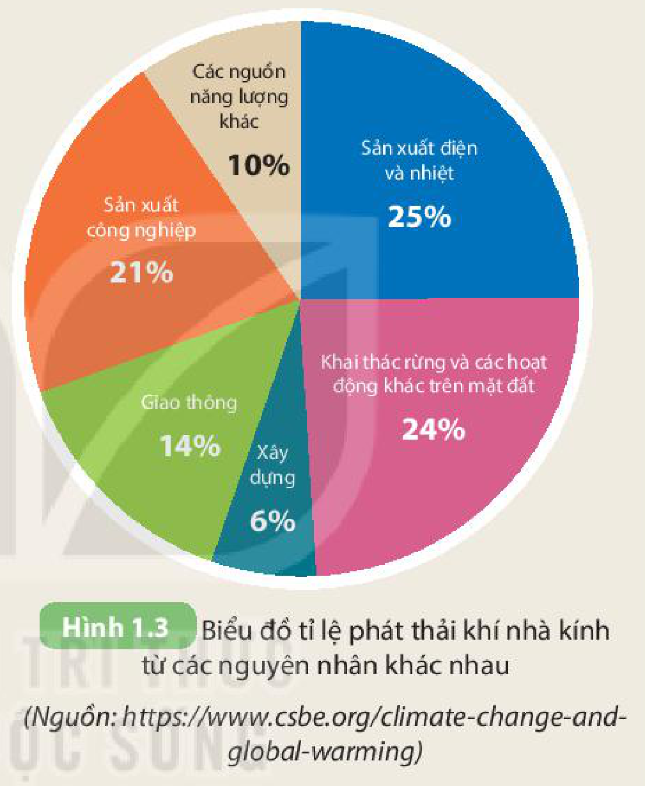
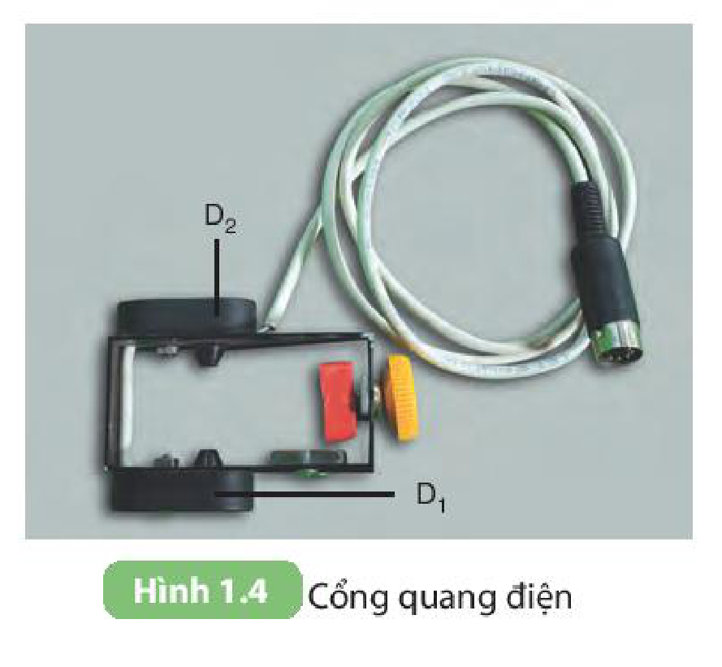
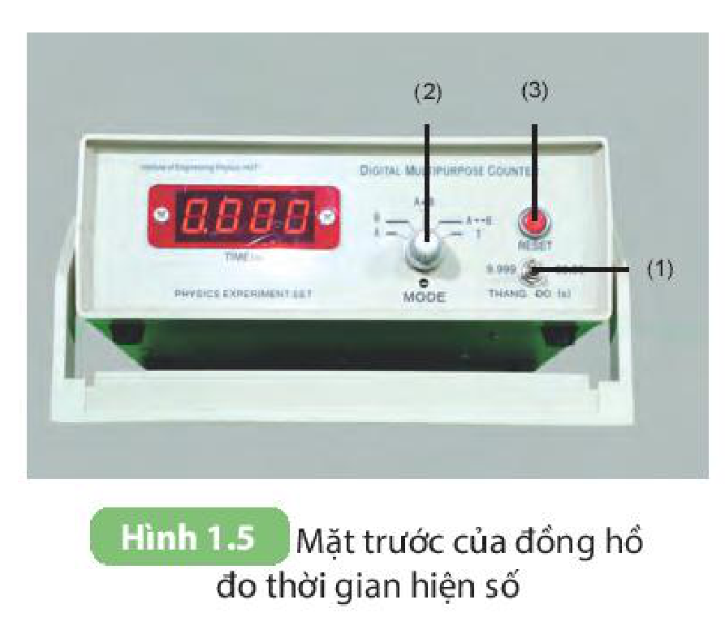
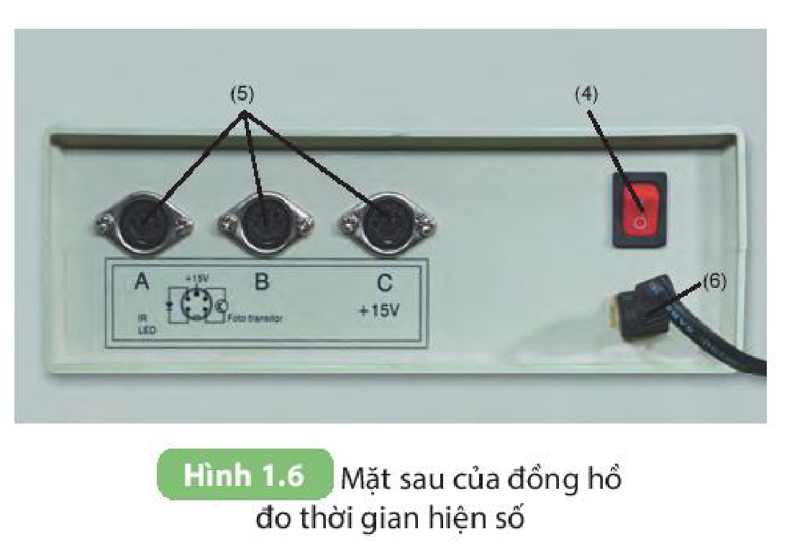

<!-- pdf:7 -->

# BÀI 1: PHƯƠNG PHÁP VÀ KĨ NĂNG HỌC TẬP MÔN KHOA HỌC TỰ NHIÊN

## 🎯 Mục tiêu

- Trình bày và vận dụng được một số phương pháp và kĩ năng trong học tập môn Khoa học tự nhiên:
  - Phương pháp tìm hiểu tự nhiên;
  - Thực hiện được các kĩ năng tiến trình: quan sát, phân loại, liên kết, đo, dự báo.
- Sử dụng được một số dụng cụ đo trong môn Khoa học tự nhiên 7.
- Làm được báo cáo, thuyết trình.

## 🔴 Mở đầu

Môn Khoa học tự nhiên là môn học về các sự vật và hiện tượng trong thế giới tự nhiên nhằm hình thành và phát triển các năng lực khoa học tự nhiên: nhận thức khoa học tự nhiên, tìm hiểu tự nhiên và vận dụng kiến thức, kĩ năng đã học vào cuộc sống. Để học tốt môn Khoa học tự nhiên các em cần sử dụng những phương pháp và kĩ năng nào?

## I. Phương pháp tìm hiểu tự nhiên

Phương pháp tìm hiểu tự nhiên là cách thức tìm hiểu các sự vật, hiện tượng trong tự nhiên và đời sống, chứng minh được các vấn đề trong thực tiễn bằng các dẫn chứng khoa học. Phương pháp này gồm các bước được mô tả bằng sơ đồ sau: <!-- term: Phương pháp tìm hiểu tự nhiên -->

1. Đề xuất vấn đề cần tìm hiểu: Quan sát và đặt câu hỏi cho vấn đề nảy sinh.
2. Đưa ra dự đoán khoa học để giải quyết vấn đề: Dựa trên các tri thức phù hợp từ việc phân tích vấn đề, đưa ra dự đoán nhằm trả lời câu hỏi đã nêu.
3. Lập kế hoạch kiểm tra dự đoán: Lựa chọn được phương pháp, kĩ thuật, kĩ năng thích hợp (thực nghiệm, điều tra,...) để kiểm tra dự đoán.
4. Thực hiện kế hoạch kiểm tra dự đoán: Trường hợp kết quả không phù hợp cần quay lại từ bước 2.
5. Viết báo cáo. Thảo luận và trình bày báo cáo khi được yêu cầu.
<!-- ocr-ok: đã đối chiếu ảnh trang gốc 7 (trang sách 6), OCR bỏ sót toàn bộ chữ trong 5 hộp của sơ đồ phương pháp tìm hiểu tự nhiên -->

<!-- pdf:8 -->

Ví dụ: Tìm hiểu mối quan hệ giữa độ lớn của lực ma sát trượt và diện tích tiếp xúc của vật với mặt phẳng vật chuyển động.

*Bước 1:* Đề xuất vấn đề.

Tìm hiểu xem độ lớn của lực ma sát trượt có phụ thuộc vào diện tích tiếp xúc của vật với mặt phẳng vật chuyển động hay không.

*Bước 2:* Đưa ra dự đoán khoa học để giải quyết vấn đề.

Các quan sát hằng ngày cho người ta cảm giác rằng độ lớn của lực ma sát trượt tăng khi diện tích tiếp xúc của vật tăng. Ví dụ, đi giày đế hẹp thì dễ bị trượt ngã hơn đi giày đế rộng. Từ đó, người ta có thể dự đoán độ lớn của lực ma sát trượt phụ thuộc vào diện tích tiếp xúc của vật: diện tích tiếp xúc càng lớn thì lực ma sát càng mạnh.

*Bước 3:* Lập kế hoạch kiểm tra dự đoán.

Dùng lực kế đo độ lớn của lực ma sát trượt của cùng một vật chuyển động trên mặt bàn với những mặt tiếp xúc có diện tích khác nhau.

*Bước 4:* Tiến hành thí nghiệm kiểm tra dự đoán và rút ra kết luận.

Đo lực ma sát trượt của một miếng gỗ hình hộp chữ nhật có kích thước ($12\text{ cm} \times 6\text{ cm} \times 3\text{ cm}$) chuyển động đều trên mặt bàn, trên hai mặt tiếp xúc khác nhau (Hình 1.1a và Hình 1.1b).

Kéo lực kế từ từ cho tới khi vật bắt đầu chuyển động đều (lực kế chỉ một giá trị ổn định), thì đọc số chỉ của lực kế. Số chỉ của lực kế là độ lớn của lực ma sát trượt.

Thí nghiệm cho thấy khi thay đổi diện tích mặt tiếp xúc thì độ lớn của lực ma sát trượt không thay đổi: Độ lớn của lực ma sát trượt không phụ thuộc vào diện tích mặt tiếp xúc.

*Bước 5:* Báo cáo kết quả và thảo luận về kết quả thí nghiệm.

*a) Đo lực ma sát trượt của miếng gỗ có diện tích tiếp xúc là $12\text{ cm} \times 6\text{ cm}$; b) Đo lực ma sát trượt của miếng gỗ có diện tích tiếp xúc là $12\text{ cm} \times 3\text{ cm}$*

Hình 1.1. Đo lực ma sát trượt của miếng gỗ có diện tích tiếp xúc khác nhau

> ❓ Sắp xếp nội dung các thông tin khi nghiên cứu sự hoà tan của một số chất rắn theo các bước của phương pháp tìm hiểu tự nhiên.
>
> - Tìm hiểu khả năng hoà tan của muối ăn, đường, đá vôi (dạng bột) trong nước.
> - Dự đoán trong số các chất muối ăn, đường, đá vôi (dạng bột): chất nào tan, chất nào không tan trong nước.
> - Thực hiện các bước thí nghiệm: rót cùng một thể tích nước (khoảng $5\text{ mL}$) vào ba ống nghiệm. Thêm vào mỗi ống nghiệm khoảng 1 gam mỗi chất trên và lắc đều khoảng $1 - 2\text{ phút}$. Quan sát và ghi lại kết quả thí nghiệm. So sánh và rút ra kết luận.
> - Đề xuất thí nghiệm để kiểm tra dự đoán (chuẩn bị dụng cụ, hoá chất và các bước thí nghiệm).
> - Viết báo cáo và trình bày quá trình thực nghiệm, thảo luận kết quả thí nghiệm.

<!-- pdf:9 -->

## II. Một số kĩ năng tiến trình học tập môn Khoa học tự nhiên

Các kĩ năng mà các nhà khoa học sử dụng trong quá trình nghiên cứu thường được gọi là kĩ năng tiến trình. Một số kĩ năng tiến trình cơ bản thường được áp dụng trong nghiên cứu là kĩ năng: quan sát, phân loại, liên kết, đo và dự báo. <!-- term: Kĩ năng tiến trình -->

### 1. Kĩ năng quan sát, phân loại

Kĩ năng quan sát là kĩ năng sử dụng một hoặc nhiều giác quan để thu nhận thông tin về các đặc điểm, kích thước, hình dạng, kết cấu, vị trí,... của các sự vật và hiện tượng trong tự nhiên. Học sinh cần sử dụng các dụng cụ như thước đo, kính hiển vi,... để mở rộng phạm vi quan sát và có những thông tin, kết quả chính xác hơn. Trong thí nghiệm đo lực ma sát trượt của miếng gỗ có diện tích tiếp xúc khác nhau (Hình 1.1), kĩ năng quan sát được lựa chọn (ở bước 2) và sử dụng (ở bước 4 của phương pháp tìm hiểu tự nhiên). <!-- term: Kĩ năng quan sát -->

Ở các lớp dưới, kĩ năng phân loại là kĩ năng nhận dạng đặc điểm, tính chất đặc trưng, phổ biến của sự vật, hiện tượng để xếp vào các nhóm. Ở lớp 7, kĩ năng này được yêu cầu ở mức cao hơn, học sinh biết nhóm các đối tượng, khái niệm hoặc sự kiện thành các danh mục, theo các tính năng hoặc đặc điểm được lựa chọn. <!-- term: Kĩ năng phân loại -->

> ❓ 1. Quan sát Hình 1.2 và cho biết hiện tượng nào là hiện tượng tự nhiên thường xảy ra trên Trái Đất. Hiện tượng nào là thảm hoạ thiên nhiên gây tác động xấu đến con người và môi trường?
>
> 2. Em hãy tìm hiểu và cho biết cách phòng chống và ứng phó của con người trước thảm hoạ thiên nhiên ở Hình 1.2.
>
> 
>
> *a) Cháy rừng; b) Hạn hán; c) Mưa to kèm theo sấm, sét*
>
> Hình 1.2. Một số hiện tượng tự nhiên

### 2. Kĩ năng liên kết

Kĩ năng liên kết liên quan đến việc sử dụng các số liệu quan sát, kết quả phân tích số liệu hoặc dựa vào những điều đã biết nhằm xác định các mối quan hệ mới của các sự vật và hiện tượng trong tự nhiên. <!-- term: Kĩ năng liên kết -->

Ví dụ: Vòng tuần hoàn của nước trên Trái Đất liên quan chặt chẽ đến tính chất các thể của nước, sự vận chuyển và lưu chuyển của nước trong khí quyển và ảnh hưởng đến sự phân phối, đặc điểm của hệ thống sinh thái động vật và thực vật,...

<!-- pdf:10 -->

> ❓ Hãy kết nối thông tin giữa cột (A) và cột (B) tạo thành câu hoàn chỉnh, thể hiện sự liên kết trong tìm hiểu, khám phá tự nhiên.
>
> | Cột (A) | Cột (B) |
> |---|---|
> | 1. Nước được cấu tạo từ hai nguyên tố là oxygen và hydrogen. Nước có | a) người ta cho rằng đây cũng chính là nguyên nhân tạo ra từ trường của Trái Đất. |
> | 2. Nhân Trái Đất được cấu tạo chủ yếu từ hợp kim của sắt và nickel, | b) dựa trên nhu cầu của cây trồng trong từng thời kì sinh trưởng và phát triển. |
> | 3. Lựa chọn phân bón cho cây trồng | c) vai trò quan trọng trong quá trình quang hợp của cây xanh. |

### 3. Kĩ năng đo

Khi thực hiện thí nghiệm, học sinh cần biết chức năng, độ chính xác, giới hạn đo,... của các dụng cụ và thiết bị khác nhau để lựa chọn và sử dụng chúng một cách thích hợp. <!-- term: Kĩ năng đo -->

Kĩ năng đo đã được hình thành và phát triển ngay từ lớp 6. Việc đo thường được thực hiện theo các bước sau: <!-- term: Kĩ năng đo -->

(1) Ước lượng (khối lượng, chiều dài,... của vật) để lựa chọn dụng cụ/thiết bị đo phù hợp.

(2) Thực hiện phép đo, ghi kết quả đo và xử lí số liệu đo.

(3) Nhận xét độ chính xác của kết quả đo căn cứ vào loại dụng cụ đo và cách đo.

(4) Phân tích kết quả và thảo luận về kết quả nghiên cứu thu được.

> ✋ Đo và xác định khối lượng
>
> *Chuẩn bị:* cân điện tử.
>
> *Tiến hành:* đo khối lượng cuốn sách Khoa học tự nhiên 7 bằng cân điện tử.
>
> *Thảo luận nhóm, hoàn thành bảng mẫu và thực hiện yêu cầu sau:*
>
> Bảng 1.1. Kết quả đo khối lượng cuốn sách Khoa học tự nhiên 7
>
> | Thứ tự phép cân | Kết quả thu được (gam) | Nhận xét/đánh giá kết quả đo (nếu có) |
> |---|---|---|
> | 1 | ? | ? |
> | 2 | ? | ? |
> | 3 | ? | ? |
> | Khối lượng của cuốn sách (kết quả trung bình) | ? | ? |
>
> Hãy xác định khối lượng của cuốn sách và nhận xét kết quả của các lần đo so với kết quả trung bình.
<!-- ocr-ok: đã đối chiếu ảnh trang gốc 10 (trang sách 9), OCR không đọc được tiêu đề cột chữ trắng/đậm trên nền xanh của Bảng 1.1 và các dấu hỏi -->

<!-- pdf:11 -->

### 4. Kĩ năng dự báo

Kĩ năng dự báo là kĩ năng đề xuất điều gì sẽ xảy ra dựa trên các quan sát, kiến thức, sự hiểu biết và suy luận của con người về sự vật và hiện tượng trong tự nhiên. Người ta có thể đưa ra các dự báo định tính và định lượng. Để đưa ra dự báo định tính, thay vì sử dụng các số liệu quan sát, người ta dựa vào các hiểu biết, đánh giá và suy luận của các chuyên gia. Sử dụng mô hình để tính toán có thể đưa ra dự báo định lượng chính xác hơn. Khi đưa ra dự đoán (bước 2 của phương pháp tìm hiểu tự nhiên) người ta thường sử dụng kĩ năng này để giải quyết vấn đề đặt ra. <!-- term: Kĩ năng dự báo -->

> ❓ 1. Khí carbon dioxide là nguyên nhân chính gây ra sự ấm lên của Trái Đất do hiệu ứng nhà kính. Quan sát Hình 1.3 và cho biết nguyên nhân nào làm phát thải khí nhà kính nhiều nhất. Hãy tìm hiểu và đề xuất biện pháp giảm sự phát thải khí carbon dioxide từ nguồn này.
>
> 2. Tìm hiểu thông tin trên sách, báo, Internet,... về nhiệt độ trung bình toàn cầu của Trái Đất trong khoảng 100 năm qua và suy luận về nhiệt độ của Trái Đất tăng hay giảm trong vòng 10 năm tới.
>
> 
>
> Hình 1.3. Biểu đồ tỉ lệ phát thải khí nhà kính từ các nguyên nhân khác nhau *(Nguồn: https://www.csbe.org/climate-change-and-global-warming)*

## III. Sử dụng các dụng cụ đo trong nội dung môn Khoa học tự nhiên 7

### 1. Cổng quang điện (gọi tắt là cổng quang)

Cổng quang là thiết bị có vai trò như công tắc điều khiển mở/đóng đồng hồ đo thời gian hiện số. Nó gồm một bộ phận phát tia hồng ngoại $\text{D}_1$, một bộ phận thu tia hồng ngoại $\text{D}_2$ và dây cáp nối với đồng hồ đo thời gian hiện số. Dây nối này vừa có tác dụng cung cấp điện cho cổng quang, vừa có tác dụng gửi tín hiệu điện từ cổng quang tới đồng hồ (Hình 1.4).

Hình 1.4. Cổng quang điện

<!-- pdf:12 -->

### 2. Đồng hồ đo thời gian hiện số

Đồng hồ đo thời gian hiện số hoạt động như một đồng hồ bấm giây nhưng được điều khiển bằng cổng quang.

Hình 1.5. Mặt trước của đồng hồ đo thời gian hiện số

Hình 1.6. Mặt sau của đồng hồ đo thời gian hiện số

Mặt trước của đồng hồ đo thời gian hiện số (Hình 1.5) có các nút:

(1) THANG ĐO: Bên nút thang đo có ghi giới hạn đo (GHĐ) và độ chia nhỏ nhất (ĐCNN) của đồng hồ:

$9,999\text{ s} - 0,001\text{ s}$ và $99,99\text{ s} - 0,01\text{ s}$.

Với nội dung môn Khoa học tự nhiên 7, chỉ cần chọn thang đo $99,99\text{ s} - 0,01\text{ s}$ là thích hợp.

(2) MODE: Nút này dùng để chọn chế độ làm việc của đồng hồ.

Với nội dung môn Khoa học tự nhiên ở lớp 7, cần chọn chế độ làm việc $\text{A} \leftrightarrow \text{B}$ để đo khoảng thời gian giữa hai thời điểm A và B. Tại thời điểm A, đồng hồ được cổng quang mở, tại thời điểm B, đồng hồ được cổng quang đóng. Trên mặt đồng hồ xuất hiện số đo thời gian $\Delta t$ giữa hai thời điểm trên. Cổng C để kết nối với nam châm điện.

(3) RESET: Cho đồng hồ quay về trạng thái ban đầu, mặt đồng hồ hiện chỉ số $0.000$.

Mặt sau của đồng hồ đo thời gian hiện số (Hình 1.6) có các nút:

(4) Công tắc điện.

(5) Ba ổ cắm cổng quang A, B, C.

(6) Ổ cắm điện.

<!-- pdf:13 -->

> ❓ 1. Đồng hồ đo thời gian hiện số được điều khiển bởi cổng quang như thế nào?
>
> 2. Khi ước lượng thời gian chuyển động của vật lớn hơn $10\text{ s}$, cần lựa chọn thang đo nào của đồng hồ đo thời gian hiện số? Vì sao?

## IV. Báo cáo thực hành

### 1. Viết báo cáo thực hành

Sau khi làm thực hành, học sinh viết báo cáo theo mẫu sau: <!-- term: Báo cáo thực hành -->

> Họ và tên ... *Ngày ... tháng ... năm ...*
>
> Lớp ...
>
> BÁO CÁO THỰC HÀNH
>
> 1. Mục đích thí nghiệm
> 2. Chuẩn bị
> 3. Các bước tiến hành
> 4. Kết quả
>    - Bảng số liệu (nếu có)
>    - Tính toán (nếu có)
>    - Nhận xét, kết luận
> 5. Trả lời các câu hỏi (nếu có)
<!-- term: Báo cáo thực hành -->

> ✋ Hãy viết báo cáo bài thực hành: Quan sát và phân biệt một số loại tế bào đã học trong môn Khoa học tự nhiên ở lớp 6 theo mẫu trên.

<!-- pdf:14 -->

### 2. Viết và trình bày báo cáo, thuyết trình

- Một số bài trong môn Khoa học tự nhiên ở lớp 7 có yêu cầu trình bày, thảo luận, thuyết trình một vấn đề nào đó có liên quan đến nội dung bài học. Ví dụ: Bài thực hành cảm ứng ở sinh vật yêu cầu: thực hiện quan sát, ghi chép và trình bày được kết quả quan sát một số tập tính của động vật.
- Để hoạt động thuyết trình thảo luận có kết quả, cần chú ý những vấn đề sau đây:
  + Chuẩn bị các bước từ việc chọn vấn đề thuyết trình, lập dàn bài chi tiết của báo cáo thuyết trình, thu thập tư liệu/số liệu đến cách trình bày báo cáo,... dựa trên những hướng dẫn cụ thể từ các thầy/cô giáo.
  + Thực hiện hoạt động theo nhóm hoặc tổ với một bảng kế hoạch chi tiết trong đó có ghi rõ nội dung công việc, người phụ trách, tiến trình thực hiện, sản phẩm. Để hoạt động hiệu quả hơn, hấp dẫn và sinh động hơn, cần ưu tiên cho các tư liệu mang tính trực quan như biểu bảng, tranh ảnh, video,...
  + Mỗi báo cáo thuyết trình cần có tối thiểu 4 nội dung sau đây: (1) Mục đích báo cáo, thuyết trình; (2) Chuẩn bị và các bước tiến hành; (3) Kết quả và thảo luận; (4) Kết luận.

> ✋ Hãy lập dàn ý chi tiết cho báo cáo thuyết trình về vai trò của đa dạng sinh học đã học trong môn Khoa học tự nhiên ở lớp 6.

## 📌 Em đã học

- Năm bước cần thực hiện khi áp dụng phương pháp tìm hiểu khoa học tự nhiên trong quá trình học tập và khám phá tri thức ở các bài học.
- Kĩ năng cần thiết trong tìm hiểu khoa học tự nhiên: quan sát, phân loại, liên kết, dự báo,...
- Cấu tạo và cách sử dụng một số dụng cụ đo mới trong nội dung môn Khoa học tự nhiên ở lớp 7: cổng quang điện, đồng hồ đo thời gian hiện số.

## ✏️ Em có thể

Tìm hiểu một số sự vật hoặc hiện tượng tự nhiên theo phương pháp nghiên cứu khoa học.

## 📷 Danh sách hình trong bài

| Mã hình | Trang PDF | Trang sách | Chú thích |
|---|---|---|---|
| H7-khoa_hoc_tu_nhien-b01-01 | 7 | 6 | Sơ đồ các bước của phương pháp tìm hiểu tự nhiên |
| H7-khoa_hoc_tu_nhien-b01-02 | 8 | 7 | Hình 1.1. Đo lực ma sát trượt của miếng gỗ có diện tích tiếp xúc khác nhau |
| H7-khoa_hoc_tu_nhien-b01-03 | 9 | 8 | Hình 1.2. Một số hiện tượng tự nhiên |
| H7-khoa_hoc_tu_nhien-b01-04 | 11 | 10 | Hình 1.3. Biểu đồ tỉ lệ phát thải khí nhà kính từ các nguyên nhân khác nhau |
| H7-khoa_hoc_tu_nhien-b01-05 | 11 | 10 | Hình 1.4. Cổng quang điện |
| H7-khoa_hoc_tu_nhien-b01-06 | 12 | 11 | Hình 1.5. Mặt trước của đồng hồ đo thời gian hiện số |
| H7-khoa_hoc_tu_nhien-b01-07 | 12 | 11 | Hình 1.6. Mặt sau của đồng hồ đo thời gian hiện số |
