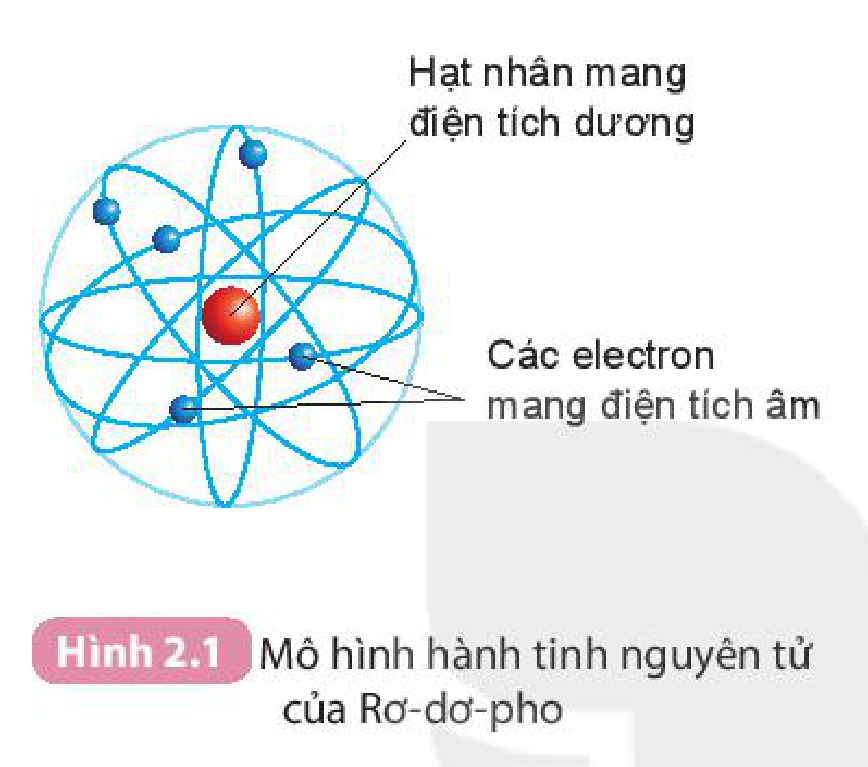
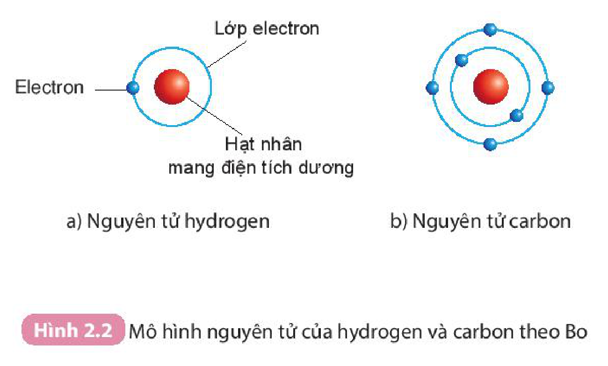
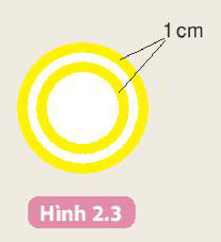
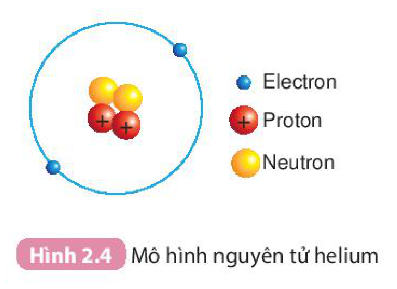
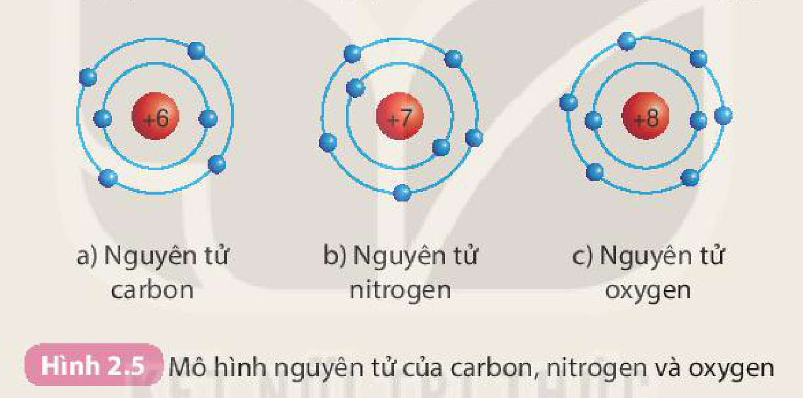
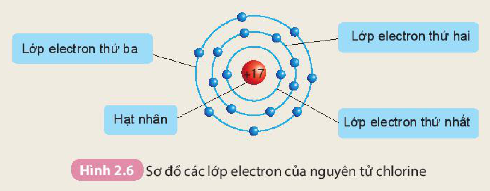

<!-- pdf:15 -->

# BÀI 2: NGUYÊN TỬ

## 🎯 Mục tiêu

- Trình bày được mô hình nguyên tử của Rutherford – Bohr (mô hình sắp xếp electron trong các lớp electron ở vỏ nguyên tử).
- Nêu được khối lượng của một nguyên tử theo đơn vị quốc tế amu (đơn vị khối lượng nguyên tử).

## 🔴 Mở đầu

Mọi vật thể tự nhiên hay nhân tạo đều được tạo thành từ một số loại hạt vô cùng nhỏ bé gọi là nguyên tử. Vậy nguyên tử có cấu tạo như thế nào?

## I. Quan niệm ban đầu về nguyên tử

Hàng ngàn năm trước, nhiều nhà thông thái Hy Lạp mà đại diện là Đê-mô-crit (Democritus), đã cho rằng: sự tồn tại của một loại hạt vô cùng nhỏ (được gọi là nguyên tử) tạo nên sự đa dạng của vạn vật. Khởi nguồn của quan niệm nguyên tử là sự chia nhỏ một vật sẽ đến một giới hạn "không thể phân chia được". Khái niệm này bị lãng quên cho đến đầu thế kỉ XIX mới được nhắc lại qua giải thích của Đan-tơn (J. Dalton) (1766 – 1844), nhà khoa học người Anh. Khi tiến hành các thí nghiệm hoá học, ông nhận thấy rằng các chất tác dụng vừa đủ với nhau theo các lượng xác định. Điều đó chứng tỏ rằng có các đơn vị chất tối thiểu (được gọi là nguyên tử) để chúng kết hợp vừa đủ với nhau.

> 🔍 Em có biết?
>
> Trong một thời gian dài các nhà giả kim thuật thực hiện nhiều thí nghiệm nhằm biến các kim loại rẻ tiền (như chì) thành các kim loại quý (như vàng). Tuy nhiên, không một nhà giả kim thuật nào thực hiện thành công sự biến đổi đó.

> ❓ Theo Đê-mô-crit và Đan-tơn, nguyên tử được quan niệm như thế nào?

<!-- pdf:16 -->

## II. Mô hình nguyên tử của Rơ-dơ-pho – Bo

Rơ-dơ-pho (E. Rutherford) (1871 – 1937), nhà vật lí người Niu-di-lân (New Zealand), đã đề xuất mô hình nguyên tử. Theo mô hình này, nguyên tử có cấu tạo rỗng. Nguyên tử có hạt nhân ở tâm mang điện tích dương và các electron mang điện tích âm, chuyển động xung quanh hạt nhân như các hành tinh quay xung quanh Mặt Trời (mẫu hành tinh nguyên tử) (xem Hình 2.1). <!-- term: Mẫu hành tinh nguyên tử -->

Hình 2.1. Mô hình hành tinh nguyên tử của Rơ-dơ-pho

> 🔍 Em có biết?
>
> Sự tìm ra các hạt tạo nên nguyên tử
>
> - Bằng các thí nghiệm vật lí, Tôm-xơn (J.J. Thomson) (1856 – 1940), nhà vật lí người Anh, đã xác định được electron, kí hiệu là e, là một thành phần tạo nên nguyên tử và mang điện tích âm.
> - Qua thí nghiệm bắn phá lá vàng, Rơ-dơ-pho đã xác định được nguyên tử có cấu tạo rỗng và có hạt nhân ở tâm.
> - Bằng cách bắn phá các hạt nhân nguyên tử, Rơ-dơ-pho đã tìm ra hạt proton mang điện tích dương và Chat-uých (J. Chadwick) đã tìm ra hạt neutron không mang điện, đó là các hạt tạo nên hạt nhân nguyên tử.

Bo (N. Bohr) (1885 – 1962), nhà vật lí người Đan Mạch, đã hoàn thiện mô hình nguyên tử của Rơ-dơ-pho. Theo Bo, các electron chuyển động xung quanh hạt nhân theo từng lớp khác nhau. Lớp electron trong cùng chứa tối đa 2 electron và bị hạt nhân hút mạnh nhất. Các lớp electron khác chứa tối đa 8 electron hoặc nhiều hơn và bị hạt nhân hút yếu hơn (xem Hình 2.2). <!-- term: Lớp electron -->

*a) Nguyên tử hydrogen; b) Nguyên tử carbon*

Hình 2.2. Mô hình nguyên tử của hydrogen và carbon theo Bo

<!-- pdf:17 -->

> ✋ Làm mô hình nguyên tử carbon theo Bo
>
> *Chuẩn bị:* bìa carton, giấy màu vàng, các viên bi nhựa to màu đỏ và các viên bi nhỏ màu xanh.
>
> *Tiến hành:*
>
> Gắn viên bi đỏ vào bìa carton làm hạt nhân nguyên tử carbon.
>
> Cắt giấy màu vàng thành hai đường tròn có bán kính khác nhau và mỗi vòng tròn có độ dày khoảng $1\text{ cm}$ (Hình 2.3). Dán các đường tròn lên bìa carton sao cho tâm của hai đường tròn là viên bi đỏ.
>
> Gắn các viên bi màu xanh lên hai đường tròn màu vàng như Hình 2.2b.
>
> 
>
> Hình 2.3
>
> *Thảo luận nhóm và trả lời câu hỏi:*
>
> 1. Các đường tròn bằng giấy màu vàng biểu diễn gì?
> 2. Em hãy cho biết số electron có trong lớp electron thứ nhất, thứ hai của nguyên tử carbon và chỉ ra lớp electron đã chứa tối đa electron.

> ❓ 1. Quan sát Hình 2.1 và cho biết các thành phần cấu tạo nên nguyên tử.
>
> 2. Quan sát Hình 2.2, áp dụng mô hình nguyên tử của Bo, mô tả cấu tạo của nguyên tử hydrogen và nguyên tử carbon.

## III. Cấu tạo nguyên tử

### 1. Hạt nhân nguyên tử

Nguyên tử có kích thước vô cùng nhỏ, chỉ khoảng một phần mười tỉ mét. Kích thước của hạt nhân còn nhỏ hơn nữa và chỉ bằng khoảng một phần mười ngàn kích thước của nguyên tử.

Hạt nhân nguyên tử tạo thành từ các hạt proton và neutron. Hạt proton kí hiệu là p, hạt neutron kí hiệu là n. Hạt neutron không mang điện. Mỗi hạt proton mang một đơn vị điện tích dương, quy ước là $+1$. Số đơn vị điện tích hạt nhân, kí hiệu là $Z$, bằng tổng số hạt proton có trong hạt nhân.

Ví dụ: Hạt nhân nguyên tử helium có 2p, 2n được mô tả trong Hình 2.4.

Hình 2.4. Mô hình nguyên tử helium

> ❓ Quan sát Hình 2.4 và cho biết:
>
> 1. Hạt nhân nguyên tử có một hay nhiều hạt? Các hạt đó thuộc cùng một loại hạt hay nhiều loại hạt?
> 2. Số đơn vị điện tích hạt nhân của helium bằng bao nhiêu?

<!-- pdf:18 -->

### 2. Vỏ nguyên tử

Vỏ nguyên tử được tạo nên bởi các electron. Mỗi electron mang một đơn vị điện tích âm, quy ước là $-1$. Các electron sắp xếp thành từng lớp. Lớp electron thứ nhất ở trong cùng, gần hạt nhân nhất có tối đa là 2 electron; lớp thứ hai có tối đa là 8 electron;... Các electron sắp xếp vào các lớp theo thứ tự từ trong ra ngoài cho đến hết. Các electron ở lớp ngoài cùng quyết định tính chất hoá học của nguyên tử. <!-- term: Lớp electron -->

Ví dụ: Vỏ nguyên tử carbon có 6 electron sắp xếp vào hai lớp, lớp trong cùng có 2 electron, lớp tiếp theo có 4 electron (xem Hình 2.2b).

Như vậy, nguyên tử là hạt vô cùng nhỏ tạo nên các chất. Nguyên tử gồm hạt nhân mang điện tích dương và vỏ nguyên tử mang điện tích âm. Nguyên tử trung hoà về điện nên tổng số hạt proton bằng tổng số hạt electron. <!-- term: Nguyên tử -->

> ✋ Tìm hiểu cấu tạo một số nguyên tử
>
> *Chuẩn bị:* Mô hình nguyên tử của các nguyên tử carbon, nitrogen, oxygen theo Hình 2.5.
>
> 
>
> *a) Nguyên tử carbon; b) Nguyên tử nitrogen; c) Nguyên tử oxygen*
>
> Hình 2.5. Mô hình nguyên tử của carbon, nitrogen và oxygen
>
> *Quan sát các mô hình nguyên tử đã chuẩn bị, thảo luận nhóm và hoàn thành bảng theo mẫu sau:*
>
> Bảng 2.1.
>
> | Nguyên tử | Số proton trong hạt nhân | Số electron trong vỏ nguyên tử | Số lớp electron | Số electron ở lớp electron ngoài cùng |
> |---|---|---|---|---|
> | carbon | ? | ? | ? | ? |
> | oxygen | ? | ? | ? | ? |
> | nitrogen | ? | ? | ? | ? |

<!-- pdf:19 -->

> ❓ Quan sát Hình 2.6 và cho biết:
>
> 1. Thứ tự sắp xếp các electron ở vỏ nguyên tử chlorine.
> 2. Số electron trên từng lớp ở vỏ nguyên tử chlorine.
>
> 
>
> Hình 2.6. Sơ đồ các lớp electron của nguyên tử chlorine

## IV. Khối lượng nguyên tử

Khối lượng nguyên tử bằng tổng khối lượng của các hạt proton, neutron trong hạt nhân và các hạt electron ở vỏ nguyên tử.

Khối lượng nguyên tử vô cùng nhỏ, để thuận tiện cho việc sử dụng, người ta dùng đơn vị khối lượng nguyên tử, viết tắt là $\text{amu}^{(1)}$. Một proton có khối lượng gần đúng bằng khối lượng của một neutron và xấp xỉ bằng $1\text{ amu}$. Một electron có khối lượng xấp xỉ bằng $0,00055\text{ amu}$. <!-- term: Đơn vị khối lượng nguyên tử -->

> ❓ 1. Em hãy cho biết vì sao khối lượng hạt nhân nguyên tử có thể coi là khối lượng của nguyên tử.
>
> 2. Hãy so sánh khối lượng của nguyên tử nhôm (13p, 14n) và nguyên tử đồng (29p, 36n).

> $^{(1)}$ amu là viết tắt của từ tiếng Anh *atomic mass unit*, nghĩa là đơn vị khối lượng nguyên tử, có giá trị bằng một phần mười hai khối lượng nguyên tử carbon. <!-- term: Đơn vị khối lượng nguyên tử -->

## 📌 Em đã học

- Nguyên tử là hạt vô cùng nhỏ, trung hoà về điện. Nguyên tử gồm hạt nhân mang điện tích dương và vỏ nguyên tử mang điện tích âm.
- Hạt nhân nguyên tử gồm các hạt proton mang điện tích dương và neutron không mang điện.
- Vỏ nguyên tử gồm các hạt electron mang điện tích âm sắp xếp thành từng lớp.
- Khối lượng nguyên tử tập trung ở hạt nhân, được coi bằng khối lượng của hạt nhân và có đơn vị là amu.

## ✏️ Em có thể

Làm được mô hình một số nguyên tử theo mô hình nguyên tử của Bo.

## 📷 Danh sách hình trong bài

| Mã hình | Trang PDF | Trang sách | Chú thích |
|---|---|---|---|
| H7-khoa_hoc_tu_nhien-b02-01 | 16 | 15 | Hình 2.1. Mô hình hành tinh nguyên tử của Rơ-dơ-pho |
| H7-khoa_hoc_tu_nhien-b02-02 | 16 | 15 | Hình 2.2. Mô hình nguyên tử của hydrogen và carbon theo Bo |
| H7-khoa_hoc_tu_nhien-b02-03 | 17 | 16 | Hình 2.3 |
| H7-khoa_hoc_tu_nhien-b02-04 | 17 | 16 | Hình 2.4. Mô hình nguyên tử helium |
| H7-khoa_hoc_tu_nhien-b02-05 | 18 | 17 | Hình 2.5. Mô hình nguyên tử của carbon, nitrogen và oxygen |
| H7-khoa_hoc_tu_nhien-b02-06 | 19 | 18 | Hình 2.6. Sơ đồ các lớp electron của nguyên tử chlorine |
