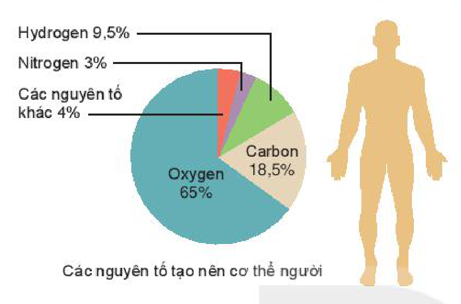
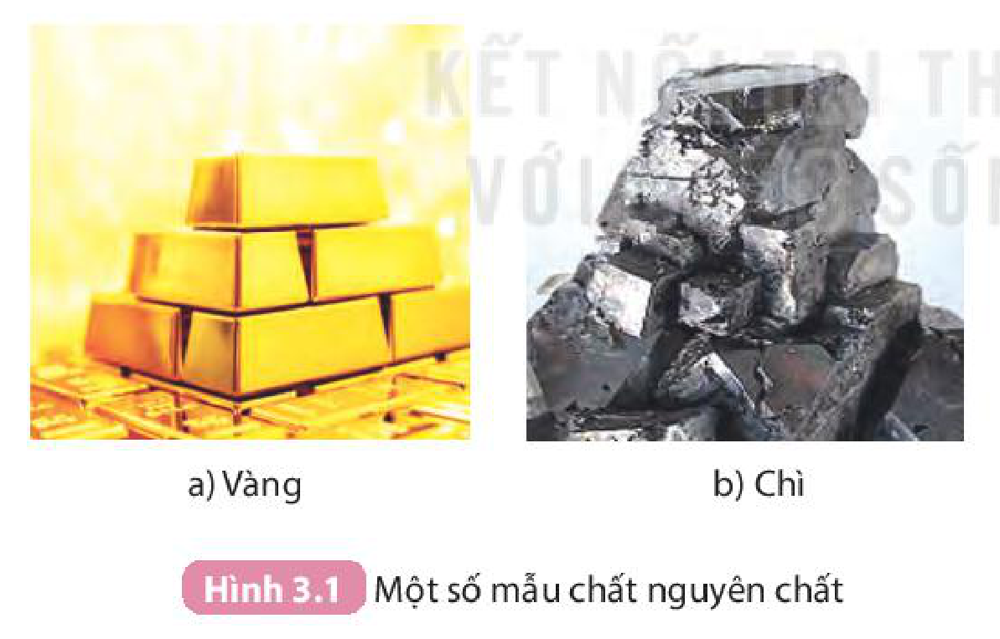
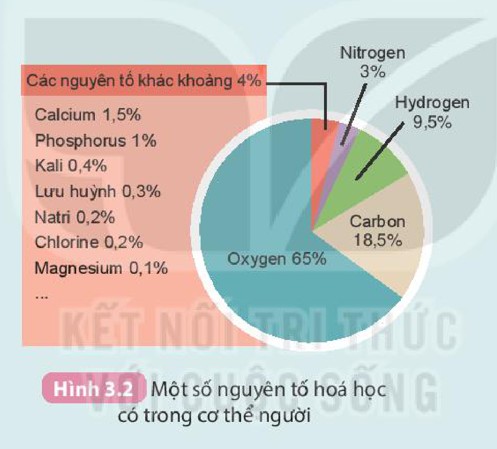

<!-- pdf:20 -->

# BÀI 3: NGUYÊN TỐ HOÁ HỌC

## 🎯 Mục tiêu

- Phát biểu được khái niệm về nguyên tố hoá học và kí hiệu nguyên tố hoá học.
- Viết được kí hiệu hoá học và đọc được tên của 20 nguyên tố đầu tiên.

## 🔴 Mở đầu

Oxygen, carbon, hydrogen, nitrogen,... là các nguyên tố hoá học tạo nên cơ thể người. Vậy nguyên tố hoá học là gì?

## I. Nguyên tố hoá học

Đến nay, người ta đã tìm ra 118 nguyên tố hoá học. Mỗi nguyên tố hoá học có tính chất riêng biệt do được tạo thành từ các nguyên tử có số proton xác định. Ví dụ: Một mẩu chì nguyên chất chỉ chứa các nguyên tử chì, mỗi nguyên tử chì có 82 proton trong hạt nhân. Một mẩu vàng nguyên chất chỉ chứa các nguyên tử vàng, mỗi nguyên tử vàng có 79 proton trong hạt nhân.

*a) Vàng; b) Chì*

Hình 3.1. Một số mẫu chất nguyên chất

> 🔍 Em có biết?
>
> Ở Hy Lạp cổ đại, người ta tin rằng mọi thứ đều được tạo ra từ một hoặc nhiều “nguyên tố” là lửa, không khí, nước và đất. Còn ở Trung Hoa cổ đại, họ sử dụng năm “nguyên tố” đó là kim, mộc, thuỷ, hoả và thổ để giải thích các hiện tượng của thế giới tự nhiên.

Các nguyên tử có cùng số proton trong hạt nhân đều thuộc cùng một nguyên tố hoá học. Số proton trong hạt nhân chính là số hiệu nguyên tử. Mỗi nguyên tố hoá học chỉ có duy nhất một số hiệu nguyên tử. <!-- term: Số hiệu nguyên tử -->

Các nguyên tử thuộc cùng một nguyên tố hoá học có thể có số neutron khác nhau. Ví dụ: Oxygen trong tự nhiên chứa các nguyên tử oxygen cùng có 8 proton trong hạt nhân nhưng có số neutron khác nhau (8 neutron, 9 neutron hoặc 10 neutron).

<!-- pdf:21 -->

> ✋ Nhận biết nguyên tố hoá học dựa vào số proton
>
> *Chuẩn bị:* 12 tấm thẻ ghi thông tin (p, n) của các nguyên tử sau: A (1, 0); D (1, 1); E (1, 2); G (6, 6); L (6, 8); M (7, 7); Q (8, 8); R (8, 9); T (8, 10); X (20, 20); Y (19, 20); Z (19, 21).
>
> *Thực hiện:* xếp các thẻ thuộc cùng một nguyên tố vào một ô vuông.
>
> *Thảo luận nhóm và trả lời câu hỏi:*
>
> 1. Em có thể xếp được bao nhiêu ô vuông?
> 2. Các nguyên tử nào thuộc cùng một nguyên tố hoá học?

> ❓ 1. Trong tự nhiên, có một số loại nguyên tử mà trong hạt nhân cùng có một proton nhưng có thể có số neutron khác nhau: không có neutron, có một hoặc hai neutron. Hãy giải thích tại sao các loại nguyên tử này đều thuộc về một nguyên tố hoá học là hydrogen.
>
> 2. Số hiệu nguyên tử oxygen là 8. Số proton trong hạt nhân nguyên tử của nguyên tố oxygen là bao nhiêu?

## II. Tên gọi và kí hiệu của nguyên tố hoá học

### 1. Tên gọi của nguyên tố hoá học

Một số nguyên tố hoá học đã được biết đến từ thời cổ xưa như vàng (gold), bạc (silver), sắt (iron), thuỷ ngân (mercury), thiếc (tin), đồng (copper), chì (lead). Trong khi đó lại có nhiều nguyên tố mới được tìm thấy gần đây như rutherfordium, bohrium,... Tên gọi của các nguyên tố hoá học được đặt theo các cách khác nhau. Ngày nay, tên gọi của các nguyên tố được quy định dùng thống nhất trên toàn thế giới theo $\text{IUPAC}^{(1)}$ (xem Bảng tuần hoàn trang 25). <!-- term: IUPAC -->

> ❓ Hãy tìm hiểu và thảo luận nhóm về nguồn gốc tên gọi của một số nguyên tố có nhiều ứng dụng trong cuộc sống như đồng, sắt và nhôm.

### 2. Kí hiệu của nguyên tố hoá học

Mỗi nguyên tố hoá học có một kí hiệu hoá học riêng. Kí hiệu hoá học được quy định dùng thống nhất trên toàn thế giới. Kí hiệu hoá học gồm một hoặc hai chữ cái có trong tên gọi của nguyên tố, trong đó chữ cái đầu được viết ở dạng chữ in hoa và chữ cái sau viết thường (xem Bảng 3.1).

Ví dụ: Kí hiệu hoá học của nguyên tố hydrogen là H, của nguyên tố oxygen là O, của nguyên tố lithium là Li.

> $^{(1)}$ IUPAC là viết tắt của tên tiếng Anh *International Union of Pure and Applied Chemistry*, nghĩa là Liên minh Quốc tế về Hoá học cơ bản và Hoá học ứng dụng. <!-- term: IUPAC -->

<!-- pdf:22 -->

Một số nguyên tố có kí hiệu hoá học không xuất phát từ tên gọi theo IUPAC mà xuất phát từ tên Latin của nguyên tố.

Ví dụ: Nguyên tố sodium (tên Latin là natrium) có kí hiệu hoá học là Na; nguyên tố potassium (tên Latin là kalium) có kí hiệu hoá học là K.

Bảng 3.1. Tên gọi, kí hiệu hoá học và khối lượng nguyên tử của 20 nguyên tố đầu tiên.

| Số hiệu nguyên tử Z | Tên nguyên tố hoá học (IUPAC) | Kí hiệu hoá học | Khối lượng nguyên tử$^{(1)}$ (amu) |
|---|---|---|---|
| 1 | hydrogen | H | 1 |
| 2 | helium | He | 4 |
| 3 | lithium | Li | 7 |
| 4 | beryllium | Be | 9 |
| 5 | boron | B | 11 |
| 6 | carbon | C | 12 |
| 7 | nitrogen | N | 14 |
| 8 | oxygen | O | 16 |
| 9 | fluorine | F | 19 |
| 10 | neon | Ne | 20 |
| 11 | sodium (natri) | Na | 23 |
| 12 | magnesium | Mg | 24 |
| 13 | aluminium (nhôm) | Al | 27 |
| 14 | silicon | Si | 28 |
| 15 | phosphorus | P | 31 |
| 16 | sulfur (lưu huỳnh) | S | 32 |
| 17 | chlorine | Cl | 35,5 |
| 18 | argon | Ar | 40 |
| 19 | potassium (kali) | K | 39 |
| 20 | calcium | Ca | 40 |

> ✋ Nhận biết nguyên tố hoá học có mặt xung quanh ta
>
> *Chuẩn bị:* các mẫu đồ vật (hộp sữa, dây đồng, đồ dùng học tập,...).
>
> *Quan sát các đồ vật đã chuẩn bị, thảo luận nhóm và thực hiện yêu cầu:*
>
> 1. Hãy đọc tên những nguyên tố hoá học mà em biết trong các đồ vật trên.
> 2. Viết kí hiệu hoá học và nêu một số ứng dụng của những nguyên tố hoá học đó.

> $^{(1)}$ Khối lượng nguyên tử được làm tròn.

<!-- pdf:23 -->

> ❓ Đọc thông tin trong Bảng 3.1 và trả lời câu hỏi:
>
> 1. Hãy tìm nguyên tố có kí hiệu chỉ gồm một chữ cái và nguyên tố có kí hiệu gồm hai chữ cái. Kí hiệu nguyên tố nào không liên quan tới tên IUPAC của nó?
> 2. Hãy đọc tên một số nguyên tố có trong thành phần không khí.

> 🔍 Em có biết?
>
> Nguyên tố hoá học có trong cơ thể người
>
> Bốn nguyên tố carbon (C), oxygen (O), hydrogen (H) và nitrogen (N) chiếm khoảng $96\%$ trọng lượng cơ thể người, các nguyên tố phosphorus (P), lưu huỳnh (S), calcium (Ca) và kali (K),... chiếm xấp xỉ $4\%$. Một số nguyên tố hoá học tồn tại trong cơ thể người với hàm lượng rất nhỏ, ví dụ như sắt (Fe), nhưng là nguyên tố cần thiết cho con người cũng như hầu hết các loài sinh vật khác. Iodine (I) là nguyên tố vi lượng, hàng ngày con người cần khoảng $0,15\text{ miligam}$ iodine cho hoạt động bình thường của tuyến giáp.
>
> 
>
> Hình 3.2. Một số nguyên tố hoá học có trong cơ thể người

## 📌 Em đã học

- Những nguyên tử có cùng số proton thuộc cùng một nguyên tố hoá học.
- Kí hiệu nguyên tố hoá học gồm một hoặc hai chữ cái có trong tên gọi của nguyên tố, trong đó chữ cái đầu được viết ở dạng chữ in hoa và chữ cái sau viết thường.

## ✏️ Em có thể

Nhận biết được sự có mặt của các nguyên tố hoá học thông qua kí hiệu, tên gọi của chúng trong các loại nhãn mác thuốc, đồ uống, đồ ăn,...

## 📷 Danh sách hình trong bài

| Mã hình | Trang PDF | Trang sách | Chú thích |
|---|---|---|---|
| H7-khoa_hoc_tu_nhien-b03-01 | 20 | 19 | Các nguyên tố tạo nên cơ thể người |
| H7-khoa_hoc_tu_nhien-b03-02 | 20 | 19 | Hình 3.1. Một số mẫu chất nguyên chất |
| H7-khoa_hoc_tu_nhien-b03-03 | 23 | 22 | Hình 3.2. Một số nguyên tố hoá học có trong cơ thể người |
