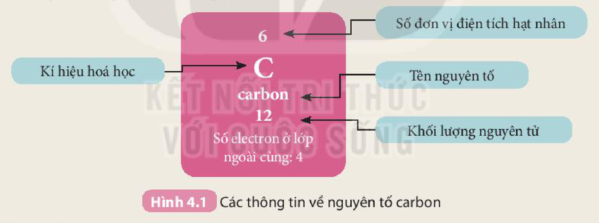
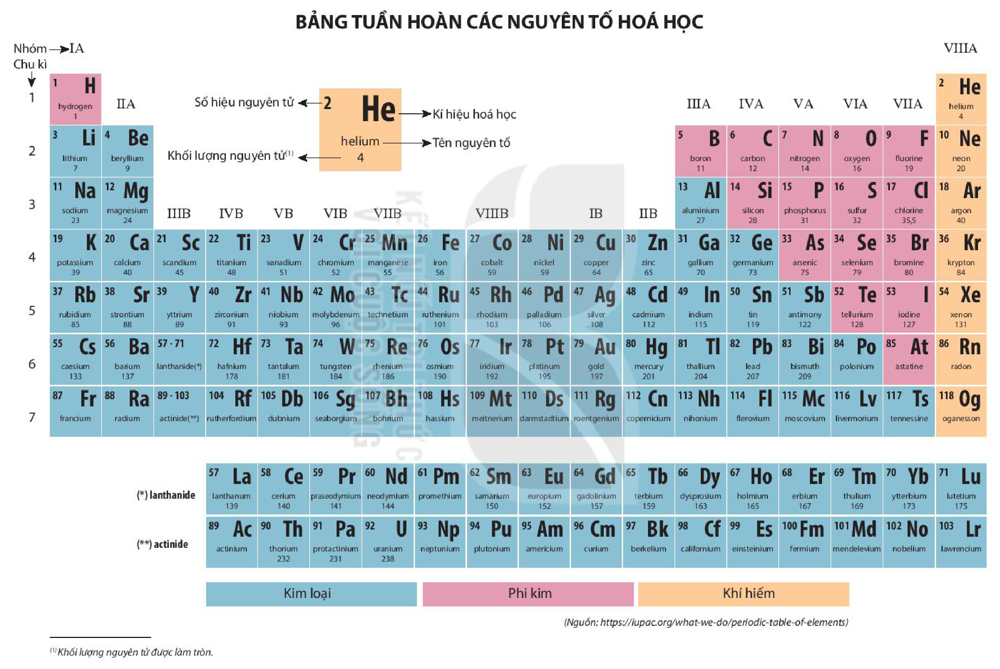
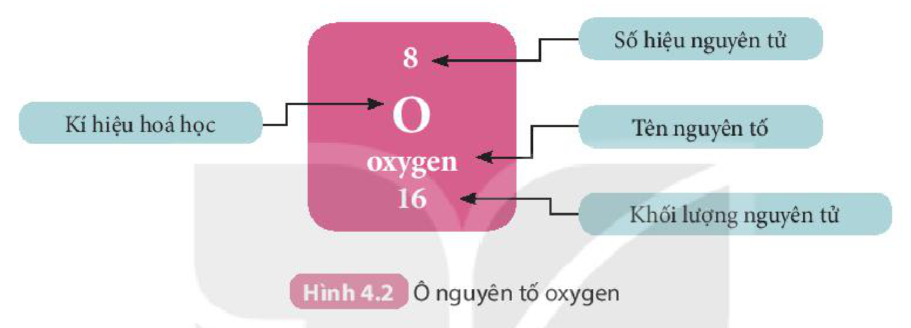
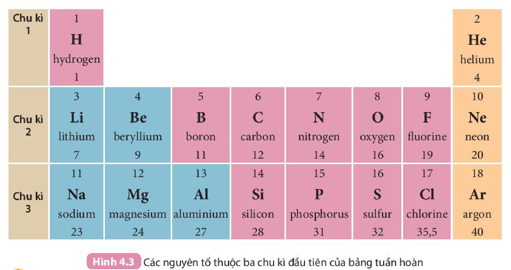
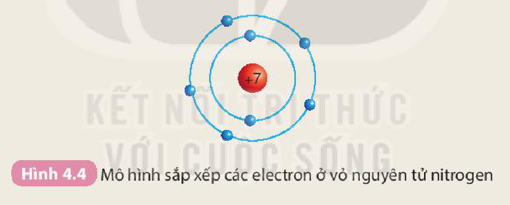
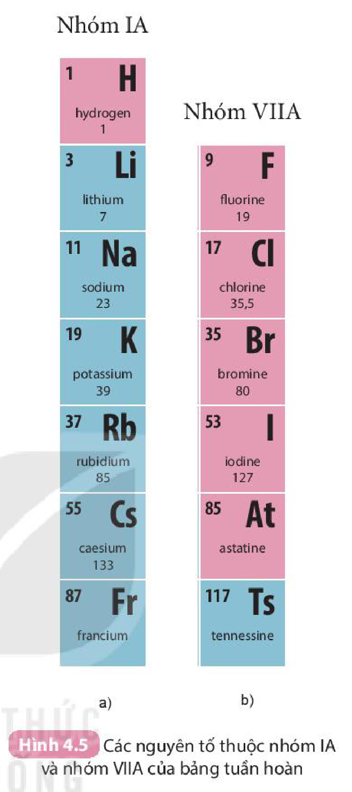
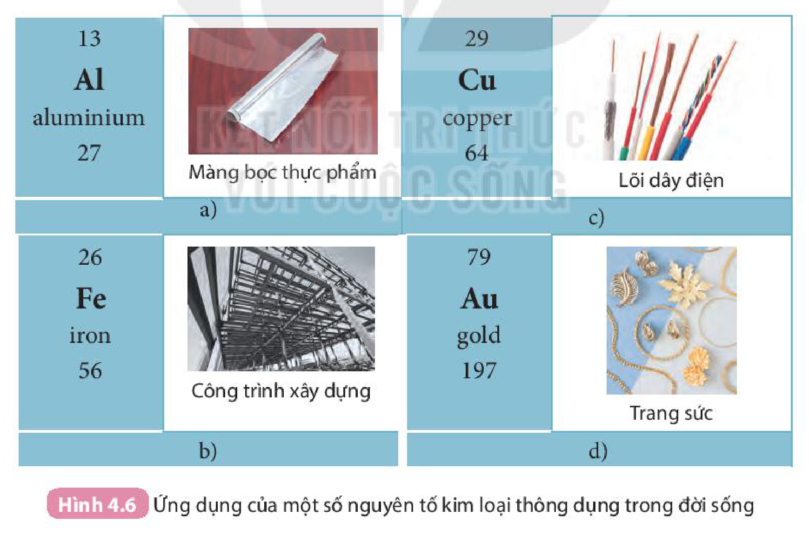
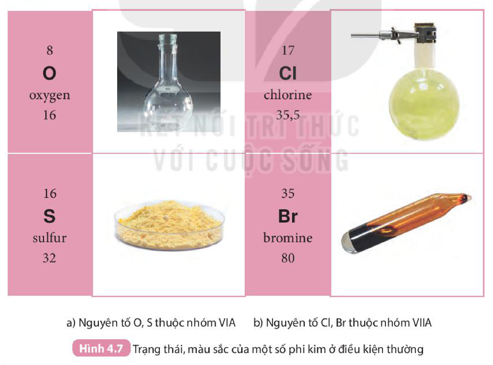

<!-- pdf:24 -->

# BÀI 4: SƠ LƯỢC VỀ BẢNG TUẦN HOÀN CÁC NGUYÊN TỐ HOÁ HỌC

## 🎯 Mục tiêu

- Nêu được các nguyên tắc xây dựng bảng tuần hoàn các nguyên tố hoá học.
- Mô tả được cấu tạo bảng tuần hoàn gồm ô, nhóm, chu kì.
- Sử dụng được bảng tuần hoàn để chỉ ra các nhóm nguyên tố kim loại, phi kim, khí hiếm.

## 🔴 Mở đầu

Ngày nay, người ta đã xác định được hàng chục triệu chất hoá học với các tính chất khác nhau được tạo thành từ hơn một trăm nguyên tố hoá học. Liệu có nguyên tắc nào sắp xếp các nguyên tố để dễ nhận ra tính chất của chúng không?

## I. Nguyên tắc sắp xếp các nguyên tố hoá học trong bảng tuần hoàn

> ✋ Sắp xếp các nguyên tố hoá học
>
> *Chuẩn bị:*
>
> - 18 thẻ ghi thông tin của 18 nguyên tố đầu tiên theo mẫu trong Hình 4.1.
>
> 
>
> Hình 4.1. Các thông tin về nguyên tố carbon
>
> - Bảng mẫu:
>
> 
>
> *Tiến hành:* gắn các thẻ vào bảng mẫu ở trên từ trái qua phải, từ trên xuống dưới, mỗi thẻ vào 1 ô theo chiều tăng dần số đơn vị điện tích hạt nhân của các nguyên tố.
>
> *Thảo luận nhóm và nhận xét về các đặc điểm của bảng sau khi đã sắp xếp:*
>
> 1. Sự thay đổi số electron ở lớp ngoài cùng của nguyên tử các nguyên tố trong một hàng khi đi từ trái sang phải.
> 2. Số electron ở lớp ngoài cùng của nguyên tử các nguyên tố trong cùng một cột.

<!-- pdf:25 -->

Năm 1869, Men-đê-lê-ép (D. I. Mendeleev) (1834 – 1907), nhà bác học người Nga đã xây dựng bảng tuần hoàn các nguyên tố hoá học theo chiều tăng dần khối lượng nguyên tử. Sau đó, các nhà khoa học đã chứng minh rằng điện tích hạt nhân nguyên tử mới là cơ sở để xây dựng bảng tuần hoàn các nguyên tố hoá học.

Ngày nay, bảng tuần hoàn các nguyên tố hoá học (gọi tắt là bảng tuần hoàn) gồm 118 nguyên tố hoá học (xem Bảng tuần hoàn trang 25), được xây dựng theo nguyên tắc sau:

- Các nguyên tố hoá học được xếp theo chiều tăng dần của điện tích hạt nhân.
- Các nguyên tố trong cùng một hàng có cùng số lớp electron trong nguyên tử.
- Các nguyên tố trong cùng cột có tính chất gần giống nhau.

> ❓ 1. Dựa vào đặc điểm nào về cấu tạo nguyên tử để sắp xếp các nguyên tố vào hàng, vào cột trong bảng tuần hoàn?
>
> 2. Sử dụng bảng tuần hoàn, hãy cho biết các nguyên tố nào trong số các nguyên tố Li, Na, C, O có cùng số lớp electron trong nguyên tử.

> 🔍 Em có biết?
>
> - Tuần hoàn là tính lặp đi lặp lại một cách đều đặn dấu hiệu nào đó. Tính tuần hoàn phổ biến trong thế giới tự nhiên không chỉ trong sự tuần hoàn tính chất các nguyên tố mà gồm cả sự tuần hoàn trong quá trình vận chuyển và chuyển hoá các chất trong cơ thể sinh vật, sự tuần hoàn của nước trên Trái Đất,...
> - Ngay từ khi chưa biết rõ về cấu tạo nguyên tử, các nhà khoa học đã tìm cách phân loại, sắp xếp các nguyên tố hoá học để tìm ra quy luật về tính chất của chúng. Trong lịch sử nghiên cứu, một số quy luật sắp xếp đã được tìm ra nhưng đều không thành công. Đến năm 1869, Men-đê-lê-ép sắp xếp 63 nguyên tố hoá học đã biết thời đó theo chiều tăng dần khối lượng nguyên tử và phát hiện ra rằng tính chất của các nguyên tố được lặp lại đều đặn sau một số nguyên tố nhất định. Tuy nhiên, ông đã hiệu chỉnh vị trí một số nguyên tố trái với nguyên tắc sắp xếp để chúng phù hợp với quy luật về biến đổi tính chất và dự đoán vị trí một số nguyên tố chưa biết. Tiên đoán của Men-đê-lê-ép là đúng sau khi các nhà khoa học tìm ra các nguyên tố mới. Để ghi nhận sự cống hiến vĩ đại của ông, năm 1955, các nhà vật lí người Mỹ đã đặt tên nguyên tố họ tổng hợp được có số thứ tự 101 trong bảng tuần hoàn là Mendelevium (Md).

<!-- pdf:26 -->

BẢNG TUẦN HOÀN CÁC NGUYÊN TỐ HOÁ HỌC *(Nguồn: https://iupac.org/what-we-do/periodic-table-of-elements)*
<!-- ocr-ok: đã đối chiếu ảnh trang gốc 26 (trang sách 25), Bảng tuần hoàn in xoay ngang 90 độ nên OCR đọc ngược toàn trang -->

| Chu kì \ Nhóm | IA | IIA | IIIB | IVB | VB | VIB | VIIB | VIIIB (cột 1) | VIIIB (cột 2) | VIIIB (cột 3) | IB | IIB | IIIA | IVA | VA | VIA | VIIA | VIIIA |
|---|---|---|---|---|---|---|---|---|---|---|---|---|---|---|---|---|---|---|
| 1 | 1 H (hydrogen, 1) | | | | | | | | | | | | | | | | | 2 He (helium, 4) |
| 2 | 3 Li (lithium, 7) | 4 Be (beryllium, 9) | | | | | | | | | | | 5 B (boron, 11) | 6 C (carbon, 12) | 7 N (nitrogen, 14) | 8 O (oxygen, 16) | 9 F (fluorine, 19) | 10 Ne (neon, 20) |
| 3 | 11 Na (sodium, 23) | 12 Mg (magnesium, 24) | | | | | | | | | | | 13 Al (aluminium, 27) | 14 Si (silicon, 28) | 15 P (phosphorus, 31) | 16 S (sulfur, 32) | 17 Cl (chlorine, 35,5) | 18 Ar (argon, 40) |
| 4 | 19 K (potassium, 39) | 20 Ca (calcium, 40) | 21 Sc (scandium, 45) | 22 Ti (titanium, 48) | 23 V (vanadium, 51) | 24 Cr (chromium, 52) | 25 Mn (manganese, 55) | 26 Fe (iron, 56) | 27 Co (cobalt, 59) | 28 Ni (nickel, 59) | 29 Cu (copper, 64) | 30 Zn (zinc, 65) | 31 Ga (gallium, 70) | 32 Ge (germanium, 73) | 33 As (arsenic, 75) | 34 Se (selenium, 79) | 35 Br (bromine, 80) | 36 Kr (krypton, 84) |
| 5 | 37 Rb (rubidium, 85) | 38 Sr (strontium, 88) | 39 Y (yttrium, 89) | 40 Zr (zirconium, 91) | 41 Nb (niobium, 93) | 42 Mo (molybdenum, 96) | 43 Tc (technetium) | 44 Ru (ruthenium, 101) | 45 Rh (rhodium, 103) | 46 Pd (palladium, 106) | 47 Ag (silver, 108) | 48 Cd (cadmium, 112) | 49 In (indium, 115) | 50 Sn (tin, 119) | 51 Sb (antimony, 122) | 52 Te (tellurium, 128) | 53 I (iodine, 127) | 54 Xe (xenon, 131) |
| 6 | 55 Cs (caesium, 133) | 56 Ba (barium, 137) | 57–71 lanthanide$^{(*)}$ | 72 Hf (hafnium, 178) | 73 Ta (tantalum, 181) | 74 W (tungsten, 184) | 75 Re (rhenium, 186) | 76 Os (osmium, 190) | 77 Ir (iridium, 192) | 78 Pt (platinum, 195) | 79 Au (gold, 197) | 80 Hg (mercury, 201) | 81 Tl (thallium, 204) | 82 Pb (lead, 207) | 83 Bi (bismuth, 209) | 84 Po (polonium) | 85 At (astatine) | 86 Rn (radon) |
| 7 | 87 Fr (francium) | 88 Ra (radium) | 89–103 actinide$^{(**)}$ | 104 Rf (rutherfordium) | 105 Db (dubnium) | 106 Sg (seaborgium) | 107 Bh (bohrium) | 108 Hs (hassium) | 109 Mt (meitnerium) | 110 Ds (darmstadtium) | 111 Rg (roentgenium) | 112 Cn (copernicium) | 113 Nh (nihonium) | 114 Fl (flerovium) | 115 Mc (moscovium) | 116 Lv (livermorium) | 117 Ts (tennessine) | 118 Og (oganesson) |
<!-- ocr-ok: đã đối chiếu ảnh trang gốc 26 (trang sách 25), bảng chép đầy đủ 18 cột và 7 chu kì theo ảnh gốc 300 DPI -->

| Họ nguyên tố xếp riêng | Các ô nguyên tố |
|---|---|
| $^{(*)}$ lanthanide | 57 La (lanthanum, 139); 58 Ce (cerium, 140); 59 Pr (praseodymium, 141); 60 Nd (neodymium, 144); 61 Pm (promethium); 62 Sm (samarium, 150); 63 Eu (europium, 152); 64 Gd (gadolinium, 157); 65 Tb (terbium, 159); 66 Dy (dysprosium, 163); 67 Ho (holmium, 165); 68 Er (erbium, 167); 69 Tm (thulium, 169); 70 Yb (ytterbium, 173); 71 Lu (lutetium, 175) |
| $^{(**)}$ actinide | 89 Ac (actinium); 90 Th (thorium, 232); 91 Pa (protactinium, 231); 92 U (uranium, 238); 93 Np (neptunium); 94 Pu (plutonium); 95 Am (americium); 96 Cm (curium); 97 Bk (berkelium); 98 Cf (californium); 99 Es (einsteinium); 100 Fm (fermium); 101 Md (mendelevium); 102 No (nobelium); 103 Lr (lawrencium) |
<!-- ocr-ok: đã đối chiếu ảnh trang gốc 26 (trang sách 25), chép hai hàng lanthanide và actinide ở cuối bảng tuần hoàn -->

> Chú giải ô nguyên tố (ví dụ ô 2 He): Số hiệu nguyên tử (2), Kí hiệu hoá học (He), Tên nguyên tố (helium), Khối lượng nguyên tử$^{(1)}$ (4). Phân loại màu ô: màu xanh – Kim loại; màu hồng – Phi kim; màu vàng – Khí hiếm.
>
> $^{(1)}$ Khối lượng nguyên tử được làm tròn.
<!-- ocr-ok: đã đối chiếu ảnh trang gốc 26 (trang sách 25), chú giải và chú thích chân bảng in xoay ngang -->

<!-- pdf:27 -->

## II. Cấu tạo bảng tuần hoàn các nguyên tố hoá học

### 1. Ô nguyên tố

Mỗi nguyên tố hoá học được xếp vào một ô của bảng tuần hoàn, gọi là ô nguyên tố.

Ô nguyên tố cho biết: kí hiệu hoá học, tên nguyên tố, số hiệu nguyên tử và khối lượng nguyên tử của nguyên tố đó.

Số hiệu nguyên tử $=$ Số đơn vị điện tích hạt nhân $=$ Số electron trong nguyên tử.

Số hiệu nguyên tử chính là số thứ tự của nguyên tố trong bảng tuần hoàn.

Ví dụ: Các thông tin về nguyên tố ở ô số 8 trong bảng tuần hoàn được chỉ ra trong Hình 4.2.

Hình 4.2. Ô nguyên tố oxygen

> ❓ 1. Quan sát Hình 4.2, cho biết số proton, electron trong nguyên tử oxygen.
>
> 2. Sử dụng bảng tuần hoàn và cho biết kí hiệu hoá học, tên nguyên tố, số hiệu nguyên tử, khối lượng nguyên tử và số electron trong nguyên tử của các nguyên tố ở ô số 6, 11.

### 2. Chu kì

Chu kì là dãy các nguyên tố mà nguyên tử của chúng có cùng số lớp electron, được xếp theo chiều điện tích hạt nhân tăng dần khi đi từ trái sang phải.

Bảng tuần hoàn hiện nay gồm 7 chu kì được đánh số từ 1 đến 7, mỗi chu kì là 1 hàng ngang (riêng chu kì 6 và chu kì 7, mỗi chu kì có thêm 1 hàng xếp tách riêng ở cuối bảng).

Chu kì 1, 2, 3 được gọi là các chu kì nhỏ, chu kì 4, 5, 6, 7 được gọi là các chu kì lớn. <!-- term: Chu kì nhỏ --> <!-- term: Chu kì lớn -->

Ví dụ: Chu kì 1 gồm 2 nguyên tố là H và He, chu kì 2 gồm 8 nguyên tố từ Li đến Ne và chu kì 3 gồm 8 nguyên tố từ Na đến Ar (xem Hình 4.3).

<!-- pdf:28 -->

Hình 4.3. Các nguyên tố thuộc ba chu kì đầu tiên của bảng tuần hoàn

> ✋ Tìm hiểu mối quan hệ giữa số lớp electron của nguyên tử các nguyên tố với số thứ tự của chu kì
>
> *Chuẩn bị:* 6 mô hình sắp xếp electron ở vỏ nguyên tử của sáu nguyên tố H, He, Li, Be, C, N theo mẫu được mô tả trong Hình 4.4.
>
> 
>
> Hình 4.4. Mô hình sắp xếp các electron ở vỏ nguyên tử nitrogen
>
> *Quan sát các mô hình đã chuẩn bị, thảo luận và thực hiện các yêu cầu sau:*
>
> 1. Hãy cho biết số lớp electron của nguyên tử các nguyên tố trên.
> 2. So sánh số lớp electron của nguyên tử các nguyên tố trên với số thứ tự chu kì của các nguyên tố đó.

Trong bảng tuần hoàn, số thứ tự của chu kì bằng số lớp electron của nguyên tử các nguyên tố trong chu kì đó.

> ❓ 1. Quan sát Hình 4.3 và cho biết tên, kí hiệu hoá học và điện tích hạt nhân của nguyên tử các nguyên tố xung quanh nguyên tố carbon.
>
> 2. Hãy cho biết số lớp electron của nguyên tử các nguyên tố thuộc chu kì 3. Giải thích.

<!-- pdf:29 -->

### 3. Nhóm

Bảng tuần hoàn gồm 8 nhóm A được đánh số từ IA đến VIIIA và 8 nhóm B được đánh số từ IB đến VIIIB (xem Bảng tuần hoàn trang 25). <!-- term: Nhóm -->

Các nguyên tố trong cùng một nhóm A có số electron ở lớp ngoài cùng bằng nhau (trừ trường hợp nguyên tố He), do vậy chúng có tính chất gần giống nhau. <!-- term: Nhóm -->

Trong cùng một nhóm, khi đi từ trên xuống dưới, điện tích hạt nhân của nguyên tử các nguyên tố tăng dần. <!-- term: Nhóm -->

Ví dụ:

Nhóm IA gồm 7 nguyên tố từ H đến Fr (xem Hình 4.5a). Các nguyên tố trong nhóm IA là các kim loại điển hình (trừ H).

Nhóm VIIA gồm 6 nguyên tố từ F đến Ts (xem Hình 4.5b). Các nguyên tố trong nhóm VIIA là các phi kim điển hình (trừ Ts).

*a) Nhóm IA; b) Nhóm VIIA*
<!-- ocr-ok: đã đối chiếu ảnh trang gốc 29 (trang sách 28), nhãn Nhóm IA/Nhóm VIIA và a)/b) đặt ở đầu và chân hai cột trong Hình 4.5 -->

Hình 4.5. Các nguyên tố thuộc nhóm IA và nhóm VIIA của bảng tuần hoàn

> 🔍 Em có biết?
>
> - Một số nhóm có tên gọi riêng như: nhóm IA: nhóm kim loại kiềm; nhóm IIA: nhóm kim loại kiềm thổ; nhóm VIIA: nhóm halogen; nhóm VIIIA: nhóm khí hiếm.
> - Nguyên tố H có nhiều tính chất gần giống với các nguyên tố nhóm VIIA nên còn có thể được xếp ở vị trí đầu nhóm VIIA.

> ✋ Tìm hiểu mối quan hệ giữa số electron ở lớp ngoài cùng của nguyên tử các nguyên tố với số thứ tự của nhóm
>
> *Chuẩn bị:* 4 mô hình sắp xếp electron ở vỏ nguyên tử của Li, Na, F, Cl theo mẫu mô tả trong Hình 4.4.
>
> *Quan sát các mô hình đã chuẩn bị, thảo luận và trả lời câu hỏi:*
>
> 1. Hãy cho biết nguyên tử các nguyên tố nào có cùng số electron ở lớp ngoài cùng.
> 2. Hãy so sánh số electron lớp ngoài cùng của nguyên tử các nguyên tố với số thứ tự nhóm của các nguyên tố đó.

Số thứ tự của nhóm A bằng số electron ở lớp ngoài cùng của nguyên tử các nguyên tố trong nhóm đó.

<!-- pdf:30 -->

> ❓ Sử dụng bảng tuần hoàn, hãy cho biết:
>
> 1. Số electron lớp ngoài cùng của nguyên tử hai nguyên tố Al và S. Giải thích.
> 2. Hãy kể tên nguyên tố thuộc chu kì nhỏ và cùng nhóm với nguyên tố beryllium.

## III. Vị trí các nhóm nguyên tố kim loại, phi kim và khí hiếm trong bảng tuần hoàn

### 1. Các nguyên tố kim loại

Trong số 118 nguyên tố hoá học đã biết có hơn 90 nguyên tố là kim loại. Trong bảng tuần hoàn, các nguyên tố kim loại ở góc dưới bên trái của bảng và được thể hiện bằng màu xanh (xem Bảng tuần hoàn trang 25). Chúng gồm: <!-- term: Nguyên tố kim loại -->

- Hầu hết các nguyên tố thuộc nhóm IA, nhóm IIA, nhóm IIIA và một số nguyên tố ở các nhóm IVA, VA, VIA.
- Các nguyên tố thuộc nhóm IB đến VIIIB, các nguyên tố lanthanide và các nguyên tố actinide được xếp riêng thành hai hàng ở cuối bảng.

Một số nguyên tố kim loại thông dụng và ứng dụng của chúng trong đời sống được chỉ ra trong Hình 4.6.

*a) Al – Màng bọc thực phẩm; b) Fe – Công trình xây dựng; c) Cu – Lõi dây điện; d) Au – Trang sức*
<!-- ocr-ok: đã đối chiếu ảnh trang gốc 30 (trang sách 29), OCR đọc rời rạc các nhãn trong 4 ô của Hình 4.6 -->

Hình 4.6. Ứng dụng của một số nguyên tố kim loại thông dụng trong đời sống

<!-- pdf:31 -->

> ❓ 1. Sử dụng bảng tuần hoàn, hãy xác định vị trí (số thứ tự, chu kì, nhóm) của các nguyên tố Al, Ca, Na.
>
> 2. Tính chất nào của nhôm, sắt, đồng đã được dùng trong các ứng dụng ở trong Hình 4.6?

### 2. Các nguyên tố phi kim

Một số phi kim rất quen thuộc trong đời sống của chúng ta như: oxygen là phi kim không thể thiếu với sự sống của hầu hết sinh vật, được tạo ra trong quá trình quang hợp và được sử dụng trong quá trình hô hấp; chlorine có thể được dùng để khử trùng nước sinh hoạt.

Trong số 118 nguyên tố hoá học đã biết, có chưa đến 20 nguyên tố là phi kim. Ở điều kiện thường, chúng có thể ở thể rắn, thể lỏng hay thể khí (xem Hình 4.7). Trong bảng tuần hoàn, các nguyên tố phi kim chủ yếu ở góc trên bên phải của bảng, được thể hiện bằng màu hồng (xem Bảng tuần hoàn trang 25). Chúng gồm: <!-- term: Nguyên tố phi kim -->

- Hầu hết các nguyên tố thuộc nhóm VIIA, VIA, VA.
- Một số nguyên tố thuộc nhóm IVA, IIIA.
- Nguyên tố H ở nhóm IA.

*a) Nguyên tố O, S thuộc nhóm VIA; b) Nguyên tố Cl, Br thuộc nhóm VIIA*

Hình 4.7. Trạng thái, màu sắc của một số phi kim ở điều kiện thường

> ❓ Sử dụng bảng tuần hoàn, hãy xác định vị trí (số thứ tự, chu kì, nhóm) của các nguyên tố có tên trong Hình 4.7.

<!-- pdf:32 -->

### 3. Các nguyên tố khí hiếm

Trong số 118 nguyên tố đã biết có 7 nguyên tố là nguyên tố khí hiếm. Nguyên tử của chúng có lớp electron ngoài cùng bền vững nên khó bị biến đổi hoá học. Một số ứng dụng trong đời sống của khí hiếm như: He được sử dụng trong khinh khí cầu, Ne được dùng trong đèn LED,... <!-- term: Nguyên tố khí hiếm -->

Trong bảng tuần hoàn, nguyên tố khí hiếm nằm ở nhóm VIIIA và được thể hiện bằng màu vàng (xem Bảng tuần hoàn trang 25). <!-- term: Nguyên tố khí hiếm -->

> 🔍 Em có biết?
>
> Các nguyên tử kim loại có xu hướng nhường electron (để tạo ion dương), còn các phi kim có xu hướng nhận electron (để tạo ion âm) để đạt được lớp electron ngoài cùng bền vững giống khí hiếm là 8 electron hoặc 2 electron (với trường hợp He).

> ❓ 1. Sử dụng bảng tuần hoàn, hãy xác định vị trí (số thứ tự, chu kì, nhóm) của khí hiếm neon.
>
> 2. Bảng tuần hoàn các nguyên tố hoá học gồm các nguyên tố:
>
>    A. Kim loại và phi kim
>
>    B. Phi kim và khí hiếm
>
>    C. Kim loại và khí hiếm
>
>    D. Kim loại, phi kim và khí hiếm.
>
>    Hãy chọn đáp án đúng nhất.
>
> 3. Cho các nguyên tố sau: P, Ba, Rb, Cu, Fe, Ne, Si.
>
>    a) Sử dụng bảng tuần hoàn, hãy cho biết trong các nguyên tố trên, nguyên tố nào là kim loại, nguyên tố nào là phi kim.
>
>    b) Nêu ứng dụng trong đời sống của một nguyên tố trong số các nguyên tố trên.

## 📌 Em đã học

- Các nguyên tố hoá học trong bảng tuần hoàn được sắp xếp theo chiều tăng dần của điện tích hạt nhân nguyên tử. Các nguyên tố trong cùng một chu kì có cùng số lớp electron, các nguyên tố trong cùng một nhóm có tính chất gần giống nhau.
- Cấu trúc bảng tuần hoàn gồm các ô nguyên tố, chu kì và nhóm.
- Trong bảng tuần hoàn, các nguyên tố kim loại tập trung ở các nhóm IA, IIA, IIIA và các nhóm B. Các nguyên tố phi kim tập trung ở các nhóm VA, VIA, VIIA, còn các nguyên tố khí hiếm ở nhóm VIIIA.

## ✏️ Em có thể

Vận dụng mối quan hệ giữa vị trí trong bảng tuần hoàn, tính chất của một số kim loại, phi kim hay khí hiếm thông dụng với một số ứng dụng của chúng trong thực tiễn.

## 📷 Danh sách hình trong bài

| Mã hình | Trang PDF | Trang sách | Chú thích |
|---|---|---|---|
| H7-khoa_hoc_tu_nhien-b04-01 | 24 | 23 | Hình 4.1. Các thông tin về nguyên tố carbon |
| H7-khoa_hoc_tu_nhien-b04-02 | 24 | 23 | Bảng mẫu sắp xếp 18 nguyên tố đầu tiên |
| H7-khoa_hoc_tu_nhien-b04-03 | 26 | 25 | Bảng tuần hoàn các nguyên tố hoá học |
| H7-khoa_hoc_tu_nhien-b04-04 | 27 | 26 | Hình 4.2. Ô nguyên tố oxygen |
| H7-khoa_hoc_tu_nhien-b04-05 | 28 | 27 | Hình 4.3. Các nguyên tố thuộc ba chu kì đầu tiên của bảng tuần hoàn |
| H7-khoa_hoc_tu_nhien-b04-06 | 28 | 27 | Hình 4.4. Mô hình sắp xếp các electron ở vỏ nguyên tử nitrogen |
| H7-khoa_hoc_tu_nhien-b04-07 | 29 | 28 | Hình 4.5. Các nguyên tố thuộc nhóm IA và nhóm VIIA của bảng tuần hoàn |
| H7-khoa_hoc_tu_nhien-b04-08 | 30 | 29 | Hình 4.6. Ứng dụng của một số nguyên tố kim loại thông dụng trong đời sống |
| H7-khoa_hoc_tu_nhien-b04-09 | 31 | 30 | Hình 4.7. Trạng thái, màu sắc của một số phi kim ở điều kiện thường |
