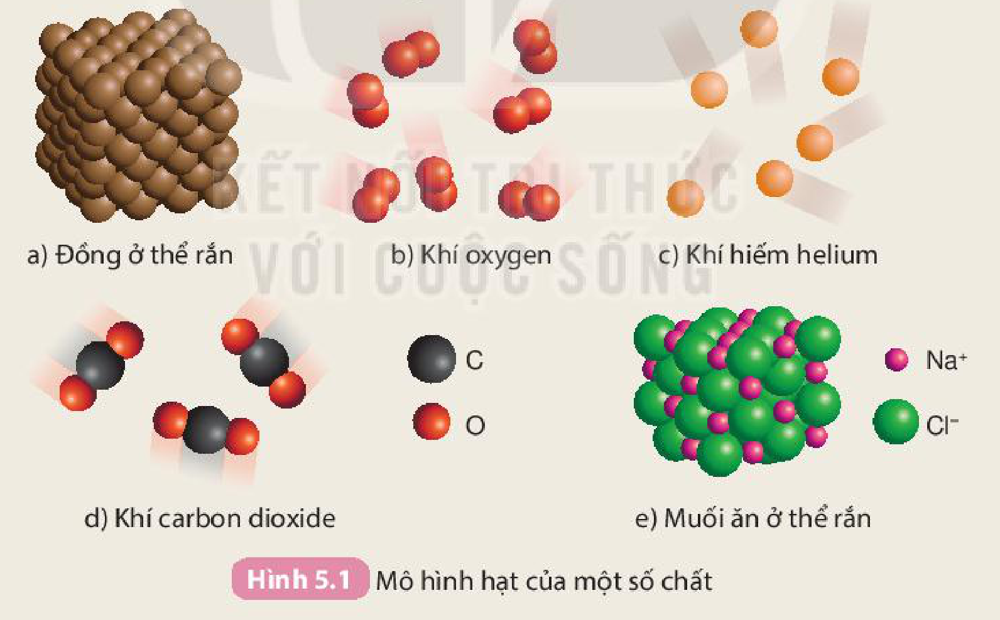
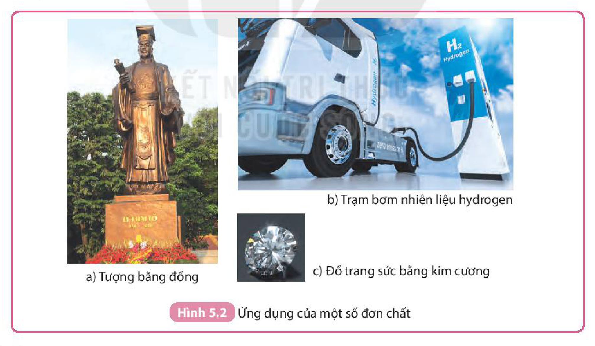
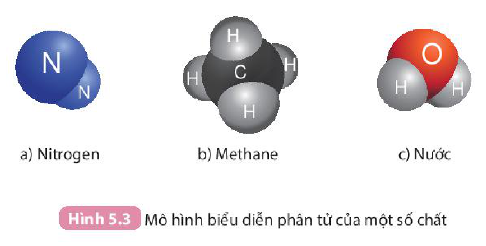

<!-- pdf:33 -->

# BÀI 5: PHÂN TỬ – ĐƠN CHẤT – HỢP CHẤT

## 🎯 Mục tiêu

- Nêu được khái niệm đơn chất, hợp chất và phân tử.
- Đưa ra được một số ví dụ về đơn chất và hợp chất.
- Tính được khối lượng phân tử theo đơn vị amu.

## 🔴 Mở đầu

Hàng chục triệu chất hoá học đã biết được phân loại như thế nào để dễ nghiên cứu và sử dụng?

## I. Đơn chất và hợp chất

> ✋ Phân loại chất
>
> Mô hình hạt của đồng ở thể rắn, khí oxygen, khí hiếm helium, khí carbon dioxide và muối ăn ở thể rắn được biểu diễn trong Hình 5.1.
>
> 
>
> *a) Đồng ở thể rắn; b) Khí oxygen; c) Khí hiếm helium; d) Khí carbon dioxide; e) Muối ăn ở thể rắn*
>
> Hình 5.1. Mô hình hạt của một số chất
>
> *Lưu ý:* Nguyên tử được biểu diễn bằng các quả cầu. Các nguyên tử cùng màu thuộc cùng một nguyên tố hoá học, các nguyên tử khác màu thuộc các nguyên tố hoá học khác nhau.
>
> *Quan sát các mô hình trong Hình 5.1, thảo luận nhóm và thực hiện yêu cầu sau:*
>
> Dựa vào thành phần nguyên tố, em hãy phân loại các chất trên thành hai loại: chất được tạo nên từ một nguyên tố hoá học và chất được tạo nên từ hai nguyên tố hoá học.

Đồng, oxygen, helium là đơn chất. Khí carbon dioxide và muối ăn là hợp chất.

<!-- pdf:34 -->

### 1. Đơn chất

Các chất như đồng (copper), dùng làm lõi dây điện, đúc tượng,... chỉ được tạo nên từ một nguyên tố đồng; than chì dùng làm ruột bút chì, kim cương dùng làm đồ trang sức, mũi khoan,... chỉ được tạo nên từ một nguyên tố carbon; khí hydrogen dùng làm nhiên liệu,... chỉ được tạo nên từ một nguyên tố hydrogen (xem Hình 5.2).

> 🔍 Em có biết?
>
> Tên của đơn chất thường trùng với tên của nguyên tố, trừ một số trường hợp, ví dụ: Ozone tạo nên từ oxygen, than chì và kim cương tạo nên từ carbon.

Những chất kể trên được gọi là đơn chất. Vậy, đơn chất là những chất được tạo nên từ một nguyên tố hoá học.

Một nguyên tố thường chỉ tạo nên một dạng đơn chất.

Tuy nhiên, một số nguyên tố có thể tạo nên các dạng đơn chất khác nhau. Ví dụ: carbon tạo nên các dạng đơn chất như than chì, than gỗ, kim cương; phosphorus tạo nên các dạng đơn chất như phosphorus đỏ, phosphorus trắng;...

Đơn chất được phân loại thành kim loại, phi kim, khí hiếm, tạo nên từ nguyên tố kim loại, phi kim, khí hiếm tương ứng. Ở điều kiện thường, các kim loại (như đồng, sắt, nhôm,...) tồn tại ở thể rắn (trừ thuỷ ngân tồn tại ở thể lỏng); các phi kim có thể tồn tại ở thể rắn (như sulfur, carbon,...), thể khí (như hydrogen, nitrogen,...) và thể lỏng như bromine. Các khí hiếm đều tồn tại ở thể khí.

*a) Tượng bằng đồng; b) Trạm bơm nhiên liệu hydrogen; c) Đồ trang sức bằng kim cương*

Hình 5.2. Ứng dụng của một số đơn chất

> ❓ Tượng đồng, nhiên liệu hydrogen, đồ trang sức bằng kim cương trong Hình 5.2 là ví dụ về ứng dụng của đồng, hydrogen và carbon. Em hãy kể ra các ứng dụng khác của đồng, hydrogen và carbon mà em biết.

<!-- pdf:35 -->

### 2. Hợp chất

Hợp chất là chất được tạo nên từ hai hay nhiều nguyên tố hoá học. Hiện nay, người ta đã biết hàng chục triệu hợp chất khác nhau.

Hợp chất chứa hai nguyên tố như nước chứa H và O, carbon dioxide chứa C và O cần thiết cho quá trình quang hợp của cây xanh; các loại khí đốt cung cấp năng lượng cho hoạt động của con người, có thành phần chính là hydrocarbon, chứa C và H; muối ăn (sodium chloride) chứa Na và Cl có vai trò giữ cân bằng nước trong cơ thể người;...

Các hợp chất chứa ba nguyên tố như calcium carbonate chứa Ca, C và O là thành phần chính của đá vôi, được sử dụng trong rất nhiều công trình xây dựng và trong nông nghiệp; các loại đường chứa C, H và O như glucose, saccharose (đường ăn),... cung cấp nhiều năng lượng cho cơ thể người.

Các chất phức tạp như protein có vai trò cấu tạo, duy trì và phát triển cơ thể, chứa các nguyên tố C, H, O, N,...

Các hợp chất như nước, carbon dioxide, muối ăn, calcium carbonate,... là hợp chất vô cơ. Những hợp chất như glucose (có nhiều trong quả nho chín), saccharose, protein,... là hợp chất hữu cơ. <!-- term: Hợp chất vô cơ -->

> ❓ 1. Hãy trình bày sự khác biệt giữa đơn chất oxygen và hợp chất carbon dioxide về thành phần nguyên tố và vai trò của chúng đối với sự sống và sự cháy.
>
> 2. Hãy dự đoán số lượng của các đơn chất nhiều hơn hay ít hơn số lượng của các hợp chất. Giải thích.

## II. Phân tử

### 1. Khái niệm

Phân tử là hạt đại diện cho chất, gồm một số nguyên tử liên kết với nhau và thể hiện đầy đủ tính chất hoá học của chất.

Phân tử đơn chất được tạo nên bởi các nguyên tử của cùng một nguyên tố hoá học. <!-- term: Phân tử đơn chất -->

Ví dụ: Hai nguyên tử nitrogen liên kết với nhau thành phân tử nitrogen (Hình 5.3a).

Phân tử hợp chất được tạo nên bởi các nguyên tử của các nguyên tố hoá học khác nhau. <!-- term: Phân tử hợp chất -->

Ví dụ: Phân tử hợp chất methane gồm một nguyên tử carbon liên kết với bốn nguyên tử hydrogen (Hình 5.3b); phân tử nước gồm một nguyên tử oxygen liên kết với hai nguyên tử hydrogen (Hình 5.3c).

<!-- pdf:36 -->

*a) Nitrogen; b) Methane; c) Nước*

Hình 5.3. Mô hình biểu diễn phân tử của một số chất

### 2. Khối lượng phân tử

Khối lượng phân tử của một chất bằng tổng khối lượng của các nguyên tử trong phân tử chất đó. Khối lượng của một phân tử được tính theo đơn vị amu. <!-- term: Khối lượng phân tử -->

Ví dụ: Khối lượng phân tử của nước (xem Hình 5.3c) bằng: $2 \cdot 1 + 16 = 18\text{ (amu)}$.

> ❓ Sử dụng giá trị khối lượng nguyên tử của một số nguyên tố trong bảng tuần hoàn để tính khối lượng phân tử của các chất được biểu diễn trong Hình 5.3a và Hình 5.3b.

## 📌 Em đã học

- Đơn chất được tạo nên từ một nguyên tố hoá học.
- Hợp chất được tạo nên từ hai nguyên tố hoá học trở lên.
- Phân tử là hạt đại diện cho chất, gồm một số nguyên tử liên kết với nhau và thể hiện đầy đủ tính chất hoá học của chất.
- Khối lượng phân tử được tính theo đơn vị amu, bằng tổng khối lượng của các nguyên tử có trong phân tử.

## ✏️ Em có thể

Giải thích được sự lan toả của chất (mùi, màu sắc,...).

## 📷 Danh sách hình trong bài

| Mã hình | Trang PDF | Trang sách | Chú thích |
|---|---|---|---|
| H7-khoa_hoc_tu_nhien-b05-01 | 33 | 32 | Hình 5.1. Mô hình hạt của một số chất |
| H7-khoa_hoc_tu_nhien-b05-02 | 34 | 33 | Hình 5.2. Ứng dụng của một số đơn chất |
| H7-khoa_hoc_tu_nhien-b05-03 | 36 | 35 | Hình 5.3. Mô hình biểu diễn phân tử của một số chất |
