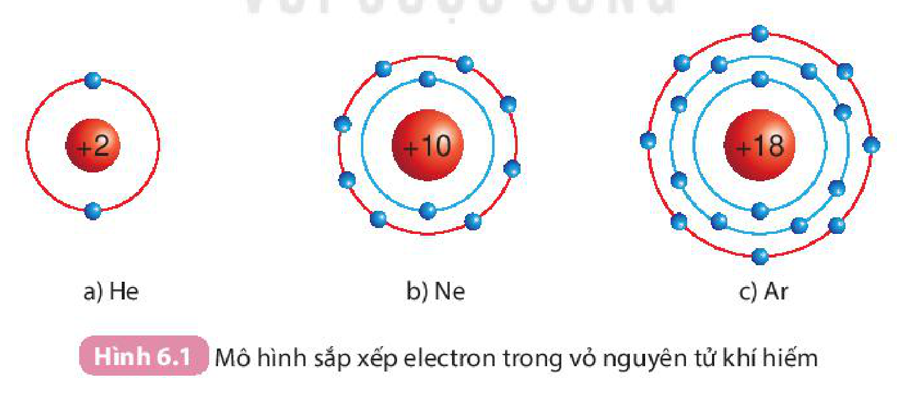
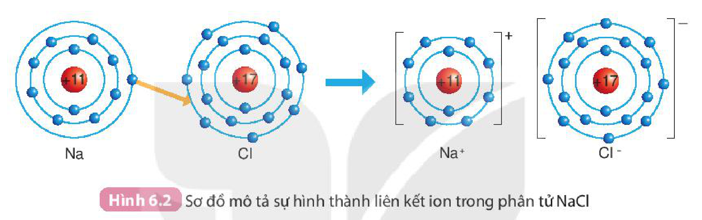
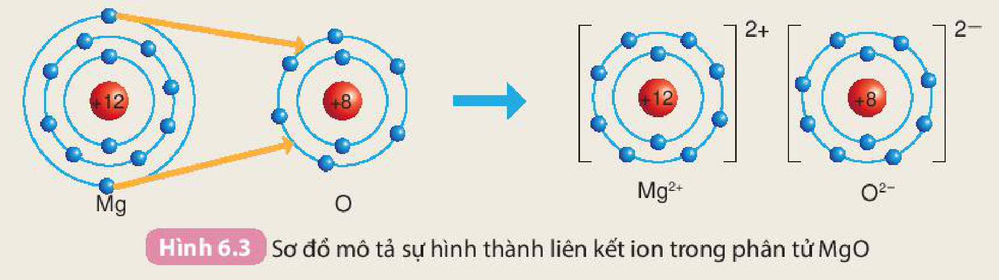
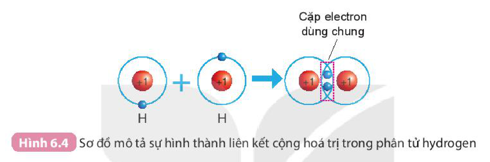
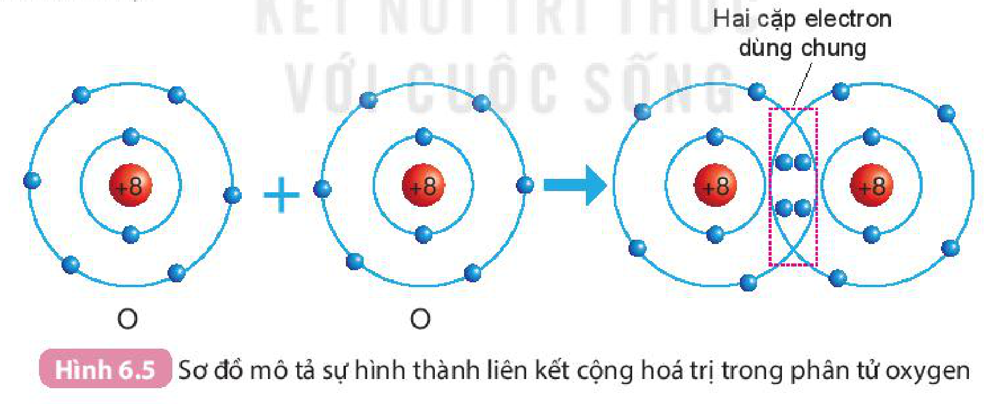
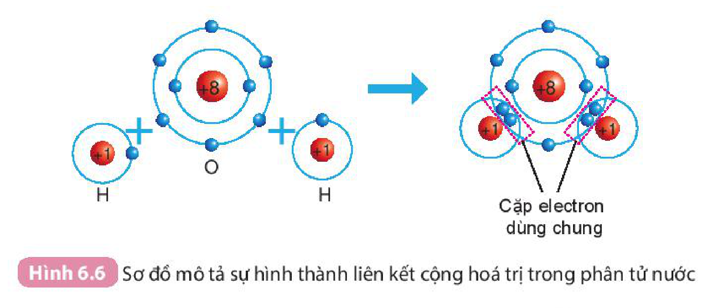

<!-- pdf:37 -->

# BÀI 6: GIỚI THIỆU VỀ LIÊN KẾT HOÁ HỌC

## 🎯 Mục tiêu

- Nêu được mô hình sắp xếp các electron trong vỏ nguyên tử của một số nguyên tố khí hiếm.
- Nêu được sự hình thành liên kết cộng hoá trị theo nguyên tắc dùng chung electron để tạo ra lớp electron ngoài cùng giống nguyên tử nguyên tố khí hiếm. Áp dụng được cho các phân tử đơn giản như $\ce{H2}$, $\ce{Cl2}$, $\ce{NH3}$, $\ce{H2O}$, $\ce{CO2}$, $\ce{N2}$,...
- Nêu được sự hình thành liên kết ion theo nguyên tắc cho và nhận electron để tạo ra ion có lớp electron ngoài cùng giống nguyên tử nguyên tố khí hiếm. Áp dụng cho các phân tử đơn giản như $\ce{NaCl}$, $\ce{MgO}$,...
- Chỉ ra được sự khác nhau về một số tính chất của hợp chất ion và hợp chất cộng hoá trị.

## 🔴 Mở đầu

Trong tự nhiên, chỉ có các khí hiếm tồn tại ở dạng đơn nguyên tử bền vững, còn nguyên tử của các nguyên tố khác thường có xu hướng kết hợp với nhau bằng các liên kết hoá học. Các liên kết hoá học được hình thành như thế nào?

## I. Cấu trúc electron bền vững của khí hiếm

Ở điều kiện thường, các khí hiếm tồn tại dưới dạng đơn nguyên tử bền vững, khó bị biến đổi hoá học. Lớp electron ngoài cùng của chúng chứa 8 electron (trừ He chứa 2 electron). Nguyên tử của các nguyên tố khác có xu hướng tham gia liên kết hoá học để đạt được lớp electron ngoài cùng giống khí hiếm bằng cách nhường, nhận hay dùng chung các electron. <!-- term: Cấu trúc electron bền vững của khí hiếm --> <!-- term: Liên kết hoá học -->

> 🔍 Em có biết?
>
> Helium trơ, rất khó cháy hay nổ, được sử dụng để bơm vào khinh khí cầu thay thế cho hydrogen. Vì hydrogen dễ gây cháy nổ.
<!-- ocr-ok: đã đối chiếu ảnh trang gốc 37 (trang sách 36), OCR đọc hỏng phông chữ hẹp trong hộp Em có biết? -->

*a) He; b) Ne; c) Ar*

Hình 6.1. Mô hình sắp xếp electron trong vỏ nguyên tử khí hiếm

> ❓ Quan sát Hình 6.1, so sánh số electron lớp ngoài cùng của He, Ne và Ar.

<!-- pdf:38 -->

## II. Liên kết ion

*Sự hình thành liên kết ion trong phân tử muối ăn*

Khi hình thành phân tử sodium chloride ($\ce{NaCl}$), các nguyên tử đã có sự nhường và nhận electron như sau:

Nguyên tử natri (Na) nhường một electron ở lớp electron ngoài cùng cho nguyên tử chlorine (Cl) để tạo thành ion dương $\ce{Na+}$ có vỏ bền vững giống vỏ nguyên tử khí hiếm Ne.

Nguyên tử Cl nhận vào lớp electron ngoài cùng một electron của nguyên tử Na để tạo thành ion âm $\ce{Cl-}$ có vỏ bền vững giống vỏ nguyên tử khí hiếm Ar (xem Hình 6.2).

> 🔍 Em có biết?
>
> Nguyên tử trung hoà về điện, khi nguyên tử nhường hay nhận electron, nó trở thành phần tử mang điện gọi là ion.
>
> Điện tích của ion được viết ở phía trên, bên phải của kí hiệu hoá học.
<!-- term: Ion -->

Hình 6.2. Sơ đồ mô tả sự hình thành liên kết ion trong phân tử $\ce{NaCl}$

Hai ion được tạo thành mang điện tích ngược dấu hút nhau để hình thành liên kết ion trong phân tử muối ăn. Nói chung, khi kim loại tác dụng với phi kim, nguyên tử kim loại nhường electron cho nguyên tử phi kim. Nguyên tử kim loại trở thành ion dương và nguyên tử phi kim trở thành ion âm. Các ion dương và âm hút nhau tạo thành liên kết trong hợp chất ion. Vậy liên kết ion là liên kết được hình thành bởi lực hút giữa các ion mang điện tích trái dấu.

Các hợp chất ion như muối ăn,... là chất rắn ở điều kiện thường, khó bay hơi, khó nóng chảy và khi tan trong nước tạo thành dung dịch dẫn được điện.

> ❓ 1. Quan sát Hình 6.2 và so sánh số electron ở lớp ngoài cùng của nguyên tử Na, Cl với ion $\ce{Na+}$, $\ce{Cl-}$.
>
> 2. Cho sơ đồ mô tả sự hình thành liên kết ion trong phân tử magnesium oxide như sau:
>
> 
>
> Hình 6.3. Sơ đồ mô tả sự hình thành liên kết ion trong phân tử $\ce{MgO}$
>
> Hãy cho biết nguyên tử Mg đã nhường hay nhận bao nhiêu electron.

<!-- pdf:39 -->

## III. Liên kết cộng hoá trị

Các nguyên tử riêng rẽ của các nguyên tố hydrogen và oxygen không bền vững, chúng có xu hướng kết hợp với nguyên tử khác bằng liên kết cộng hoá trị để hình thành các phân tử.

### 1. Liên kết cộng hoá trị trong phân tử đơn chất

*Sự hình thành phân tử hydrogen*

Mỗi nguyên tử H có 1 electron ở lớp ngoài cùng. Để có cấu trúc electron bền vững của khí hiếm He, khi hình thành phân tử hydrogen, hai nguyên tử H đã liên kết với nhau bằng cách mỗi nguyên tử H góp chung 1 electron tạo thành một cặp electron dùng chung (xem Hình 6.4). <!-- term: Cặp electron dùng chung -->

Hình 6.4. Sơ đồ mô tả sự hình thành liên kết cộng hoá trị trong phân tử hydrogen

*Sự hình thành phân tử oxygen*

Mỗi nguyên tử O có 6 electron ở lớp ngoài cùng. Để có cấu trúc electron bền vững của khí hiếm Ne, khi hình thành phân tử oxygen, hai nguyên tử O đã liên kết với nhau bằng cách mỗi nguyên tử O góp chung 2 electron tạo thành hai cặp electron dùng chung (xem Hình 6.5). <!-- term: Cặp electron dùng chung -->

Hình 6.5. Sơ đồ mô tả sự hình thành liên kết cộng hoá trị trong phân tử oxygen

Liên kết được hình thành trong phân tử hydrogen và oxygen là liên kết cộng hoá trị. Vậy, liên kết cộng hoá trị là liên kết được tạo nên giữa hai nguyên tử bằng một hay nhiều cặp electron dùng chung. Liên kết cộng hoá trị thường gặp trong nhiều phân tử đơn chất phi kim như nitrogen, chlorine, fluorine,...

> ❓ 1. Quan sát Hình 6.4 và Hình 6.5, cho biết số electron lớp ngoài cùng của H và O trước và sau khi tạo thành liên kết cộng hoá trị.
>
> 2. Hãy mô tả sự hình thành liên kết cộng hoá trị trong phân tử khí chlorine, khí nitrogen.

<!-- pdf:40 -->

### 2. Liên kết cộng hoá trị trong phân tử hợp chất

*Sự hình thành phân tử nước*

Khi hình thành phân tử nước, hai nguyên tử H đã liên kết với một nguyên tử O bằng cách nguyên tử O góp chung với mỗi nguyên tử H một electron tạo thành cặp electron dùng chung (xem Hình 6.6). <!-- term: Cặp electron dùng chung -->

Hình 6.6. Sơ đồ mô tả sự hình thành liên kết cộng hoá trị trong phân tử nước

Các chất hydrogen, oxygen và nước chỉ chứa các liên kết cộng hoá trị, được gọi là chất cộng hoá trị. Các chất ammonia, carbon dioxide, đường ăn,... cũng là chất cộng hoá trị. Các chất cộng hoá trị có thể là chất khí, chất lỏng hay chất rắn. Các chất cộng hoá trị thường có nhiệt độ nóng chảy và nhiệt độ sôi thấp.

> ❓ 1. Quan sát Hình 6.6 và cho biết khi nguyên tử O liên kết với hai nguyên tử H theo cách dùng chung electron thì lớp vỏ của nguyên tử oxygen giống với lớp vỏ của nguyên tử khí hiếm nào?
>
> 2. Hãy mô tả sự hình thành liên kết cộng hoá trị trong phân tử carbon dioxide, ammonia (gồm một nguyên tử N liên kết với ba nguyên tử H).

## 📌 Em đã học

- Nguyên tử khí hiếm có lớp electron ngoài cùng bền vững.
- Nguyên tử của các nguyên tố khác có thể đạt được lớp electron ngoài cùng của khí hiếm bằng cách tạo thành liên kết hoá học.
- Liên kết ion là liên kết được hình thành bởi lực hút giữa các ion mang điện tích trái dấu.
- Liên kết cộng hoá trị được tạo nên do sự dùng chung một hay nhiều cặp electron.
- Hợp chất ion thường khó bay hơi, khó nóng chảy,... Chất cộng hoá trị thường có nhiệt độ nóng chảy và nhiệt độ sôi thấp.

## ✏️ Em có thể

Vận dụng khái niệm liên kết hoá học để giải thích được vì sao trong tự nhiên, muối ăn ở dạng rắn, khó nóng chảy, khó bay hơi, còn đường ăn, nước đá ở thể rắn dễ nóng chảy và nước ở thể lỏng dễ bay hơi.

## 📷 Danh sách hình trong bài

| Mã hình | Trang PDF | Trang sách | Chú thích |
|---|---|---|---|
| H7-khoa_hoc_tu_nhien-b06-01 | 37 | 36 | Hình 6.1. Mô hình sắp xếp electron trong vỏ nguyên tử khí hiếm |
| H7-khoa_hoc_tu_nhien-b06-02 | 38 | 37 | Hình 6.2. Sơ đồ mô tả sự hình thành liên kết ion trong phân tử NaCl |
| H7-khoa_hoc_tu_nhien-b06-03 | 38 | 37 | Hình 6.3. Sơ đồ mô tả sự hình thành liên kết ion trong phân tử MgO |
| H7-khoa_hoc_tu_nhien-b06-04 | 39 | 38 | Hình 6.4. Sơ đồ mô tả sự hình thành liên kết cộng hoá trị trong phân tử hydrogen |
| H7-khoa_hoc_tu_nhien-b06-05 | 39 | 38 | Hình 6.5. Sơ đồ mô tả sự hình thành liên kết cộng hoá trị trong phân tử oxygen |
| H7-khoa_hoc_tu_nhien-b06-06 | 40 | 39 | Hình 6.6. Sơ đồ mô tả sự hình thành liên kết cộng hoá trị trong phân tử nước |
