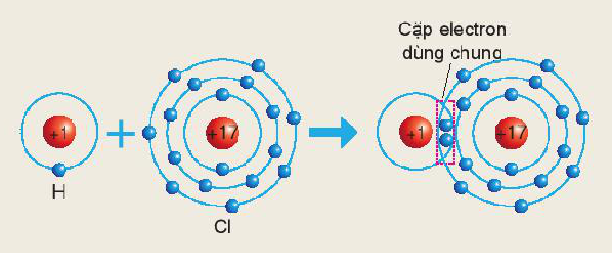

<!-- pdf:41 -->

# BÀI 7: HOÁ TRỊ VÀ CÔNG THỨC HOÁ HỌC

## 🎯 Mục tiêu

- Trình bày được khái niệm về hoá trị (cho chất cộng hoá trị), cách viết công thức hoá học.
- Viết được công thức hoá học của một số đơn chất và hợp chất đơn giản, thông dụng.
- Nêu được mối liên hệ giữa hoá trị của nguyên tố với công thức hoá học của hợp chất.
- Tính được phần trăm nguyên tố trong hợp chất khi biết công thức hoá học của nó.
- Xác định được công thức hoá học của hợp chất dựa vào phần trăm nguyên tố và khối lượng phân tử.

## 🔴 Mở đầu

Trong phân tử nước, một nguyên tử O liên kết với hai nguyên tử H, người ta nói rằng O có hoá trị II. Vậy hoá trị có mối liên hệ với công thức hoá học của hợp chất như thế nào?

## I. Công thức hoá học

Công thức hoá học của một chất là cách biểu diễn chất bằng kí hiệu hoá học của nguyên tố kèm theo chỉ số ở chân bên phải kí hiệu hoá học. Ví dụ: công thức hoá học của oxygen và carbon dioxide lần lượt là $\ce{O2}$ và $\ce{CO2}$.

> 🔍 Em có biết?
>
> Carbon kim cương hay carbon than chì là những phân tử rất lớn, bao gồm rất nhiều nguyên tử C liên kết cộng hoá trị với nhau, tuy nhiên chúng đều có chung công thức hoá học là $\ce{C}$.

*Cách viết công thức hoá học:*

- Công thức hoá học của đơn chất: <!-- term: Công thức hoá học của đơn chất -->

  Đối với các đơn chất được tạo thành từ nguyên tố kim loại, khí hiếm và một số phi kim thì kí hiệu hoá học của nguyên tố được coi là công thức hoá học. <!-- term: Công thức hoá học của đơn chất -->

  Ví dụ: Công thức hoá học của đồng là $\ce{Cu}$, sắt là $\ce{Fe}$, helium là $\ce{He}$, carbon là $\ce{C}$, lưu huỳnh là $\ce{S}$,...

  Một số phi kim có phân tử gồm hai hay ba nguyên tử liên kết với nhau thì thêm chỉ số này ở chân bên phải kí hiệu hoá học. <!-- term: Công thức hoá học của đơn chất -->

  Ví dụ: Công thức hoá học của hydrogen là $\ce{H2}$, oxygen là $\ce{O2}$, ozone là $\ce{O3}$,...

- Công thức hoá học của hợp chất gồm kí hiệu hoá học của những nguyên tố tạo ra hợp chất kèm theo chỉ số ở chân bên phải kí hiệu hoá học. Chỉ số là những số nguyên, cho biết số nguyên tử của mỗi nguyên tố trong phân tử hợp chất. Chỉ số bằng 1 thì không ghi. <!-- term: Công thức hoá học của hợp chất -->

  Ví dụ: Công thức hoá học của khí methane là $\ce{CH4}$, muối ăn là $\ce{NaCl}$.

<!-- pdf:42 -->

*Ý nghĩa của công thức hoá học:*

**Công thức hoá học cho biết:**

- Các nguyên tố hoá học tạo nên chất.
- Số nguyên tử hay tỉ lệ số nguyên tử của các nguyên tố hoá học có trong phân tử.
- Khối lượng phân tử của chất.

Ví dụ: Công thức hoá học của calcium carbonate là $\ce{CaCO3}$, cho biết:

- Calcium carbonate gồm ba nguyên tố là Ca, C, O.
- Trong một phân tử calcium carbonate có một nguyên tử Ca, một nguyên tử C, ba nguyên tử O và tỉ lệ số nguyên tử $\text{Ca} : \text{C} : \text{O}$ là $1 : 1 : 3$.
- Khối lượng phân tử bằng $40 + 12 + 3 \cdot 16 = 100\text{ (amu)}$.

**Biết công thức hoá học, tính được phần trăm khối lượng của các nguyên tố trong hợp chất:** <!-- term: Phần trăm khối lượng nguyên tố trong hợp chất -->

*Bước 1:* Tính khối lượng phân tử hợp chất. <!-- term: Phần trăm khối lượng nguyên tố trong hợp chất -->

*Bước 2:* Tính phần trăm khối lượng các nguyên tố trong hợp chất: <!-- term: Phần trăm khối lượng nguyên tố trong hợp chất -->

$\% \text{ khối lượng nguyên tố} = \frac{\text{khối lượng nguyên tử} \cdot \text{số nguyên tử của nguyên tố} \cdot 100\%}{\text{khối lượng phân tử}}$
<!-- ocr-ok: đã đối chiếu ảnh trang gốc 42 (trang sách 41), biểu thức phân số tính phần trăm khối lượng nguyên tố viết bằng LaTeX -->

Ví dụ: Tính phần trăm khối lượng của các nguyên tố trong phân bón $\ce{KNO3}$.

- Khối lượng phân tử $\ce{KNO3}$ bằng: $39 \cdot 1 + 14 \cdot 1 + 16 \cdot 3 = 101\text{ (amu)}$.
- Phần trăm khối lượng các nguyên tố trong $\ce{KNO3}$:

  $\%\text{K} = \frac{39 \cdot 1 \cdot 100\%}{101} \approx 38,6\%$; $\%\text{N} = \frac{14 \cdot 1 \cdot 100\%}{101} \approx 13,9\%$;

  $\%\text{O} = 100\% - 38,6\% - 13,9\% = 47,5\%$.

> ❓ Copper sulfate ($\ce{CuSO4}$) được dùng làm chất chống xoăn lá cho cây cà chua. Em hãy cho biết số nguyên tử của từng nguyên tố có trong một phân tử copper sulfate và xác định phần trăm khối lượng của các nguyên tố trong hợp chất này.

## II. Hoá trị

### 1. Khái niệm hoá trị

Trong chất cộng hoá trị, hoá trị của nguyên tố được xác định bằng số cặp electron dùng chung của nguyên tử nguyên tố đó với nguyên tử khác. <!-- term: Hoá trị -->

Ví dụ: Trong phân tử nước, mỗi nguyên tử H có một cặp electron dùng chung với nguyên tử O nên H có hoá trị I; nguyên tử O có hai cặp electron dùng chung với hai nguyên tử H nên O có hoá trị II.

Hoá trị là con số biểu thị khả năng liên kết của nguyên tử nguyên tố này với nguyên tử nguyên tố khác. <!-- term: Hoá trị -->

<!-- pdf:43 -->

> ❓ Sơ đồ sau mô tả sự hình thành liên kết cộng hoá trị trong phân tử $\ce{HCl}$:
>
> 
>
> Xác định hoá trị của chlorine trong hợp chất trên.

### 2. Quy tắc hoá trị

> ✋ Tìm hiểu về quy tắc hoá trị
>
> *Quan sát Bảng 7.1 và thực hiện các yêu cầu sau:*
>
> Bảng 7.1.
>
> | Hợp chất | Hoá trị của lưu huỳnh/carbon | Tích của chỉ số và hoá trị của lưu huỳnh/carbon | Tích của chỉ số và hoá trị của hydrogen |
> |---|---|---|---|
> | $\ce{H2S}$ | II | $1 \cdot \text{II}$ | $2 \cdot \text{I}$ |
> | $\ce{CH4}$ | IV | $1 \cdot \text{IV}$ | $4 \cdot \text{I}$ |
>
> 1. Xét phân tử $\ce{H2S}$, hãy so sánh tích của chỉ số và hoá trị của nguyên tố lưu huỳnh với tích chỉ số và hoá trị của nguyên tố hydrogen.
> 2. Xét phân tử $\ce{CH4}$, hãy so sánh tích của chỉ số và hoá trị của nguyên tố carbon với tích chỉ số và hoá trị của nguyên tố hydrogen.

Quy tắc hoá trị: Trong công thức hoá học của hợp chất hai nguyên tố, tích của chỉ số và hoá trị của nguyên tố này bằng tích của chỉ số và hoá trị của nguyên tố kia.

Ví dụ: $\overset{\text{V}}{\text{P}}_2\overset{\text{II}}{\text{O}}_5$, ta có: $2 \cdot \text{V} = 5 \cdot \text{II}$.

Quy tắc được vận dụng chủ yếu cho các hợp chất vô cơ.

Người ta quy ước nguyên tố H luôn có hoá trị I. Nguyên tử của nguyên tố khác liên kết được với bao nhiêu nguyên tử H thì nguyên tố đó có hoá trị bằng bấy nhiêu.

Oxygen cũng được quy ước có hoá trị II. Từ đó người ta xác định được hoá trị cho các nguyên tố khác trong các hợp chất có chứa H hoặc O.

Ví dụ: Trong phân tử carbon dioxide ($\ce{CO2}$), nguyên tử của nguyên tố C liên kết được với hai nguyên tử O nên có hoá trị IV.

<!-- pdf:44 -->

Hoá trị của nhóm nguyên tử được xác định tương tự như cách xác định hoá trị của nguyên tố. <!-- term: Hoá trị của nhóm nguyên tử -->

Ví dụ: Trong phân tử sulfuric acid ($\ce{H2SO4}$), nhóm ($\ce{SO4}$) liên kết với 2 nguyên tử hydrogen nên có hoá trị II. <!-- term: Hoá trị của nhóm nguyên tử -->

Hoá trị của một số nguyên tố hoá học và nhóm nguyên tử được cho trong Bảng 7.2 và Bảng 7.3.

Bảng 7.2. Hoá trị thường gặp của một số nguyên tố hoá học

| Tên nguyên tố | Kí hiệu hoá học | Hoá trị |
|---|---|---|
| hydrogen | H | I |
| carbon | C | II, IV |
| nitrogen | N | I, II, III, IV |
| oxygen | O | II |
| natri | Na | I |
| magnesium | Mg | II |
| nhôm | Al | III |
| silicon | Si | IV |
| phosphorus | P | III, V |
| lưu huỳnh | S | II, IV, VI |
| chlorine | Cl | I, III, V, VII |
| kali | K | I |
| calcium | Ca | II |
<!-- ocr-ok: đã đối chiếu ảnh trang gốc 44 (trang sách 43), OCR đọc sai các chữ số La Mã chỉ hoá trị trong Bảng 7.2 -->

Bảng 7.3. Hoá trị của một số nhóm nguyên tử

| Tên nhóm | Hoá trị |
|---|---|
| Hydroxyl ($\ce{OH}$) | I |
| Nitrate ($\ce{NO3}$) | I |
| Sulfate ($\ce{SO4}$) | II |
| Carbonate ($\ce{CO3}$) | II |
| Phosphate ($\ce{PO4}$) | III |
<!-- ocr-ok: đã đối chiếu ảnh trang gốc 44 (trang sách 43), OCR đọc hỏng công thức nhóm nguyên tử và chữ số La Mã trong Bảng 7.3 -->

> ❓ 1. Xác định hoá trị của lưu huỳnh trong hợp chất sulfur dioxide (một nguyên tử S liên kết với hai nguyên tử O).
>
> 2. Hãy xác định hoá trị của carbon trong hợp chất methane có trong Hình 5.3b.
>
> 3. Dựa vào quy tắc hoá trị và Bảng 7.2, cho biết công thức hoá học của potassium oxide là $\ce{KO}$ hay $\ce{K2O}$.

## III. Lập công thức hoá học của hợp chất

### 1. Lập công thức hoá học của hợp chất khi biết hoá trị

Ví dụ: Lập công thức hoá học của hợp chất tạo bởi lưu huỳnh có hoá trị IV và oxygen.

- Viết công thức dạng chung: $\overset{\text{IV}}{\text{S}}_x\overset{\text{II}}{\text{O}}_y$.

<!-- pdf:45 -->

- Theo quy tắc hoá trị: $x \cdot \text{IV} = y \cdot \text{II}$.

  Chuyển biểu thức này thành tỉ lệ: $\frac{x}{y} = \frac{\text{II}}{\text{IV}} = \frac{1}{2}$.

  Thường thì tỉ lệ số nguyên tử trong phân tử là những số nguyên đơn giản nhất, vì vậy lấy: $x = 1$ và $y = 2$.

- Công thức hoá học của hợp chất: $\ce{SO2}$.

### 2. Lập công thức hoá học của hợp chất theo phần trăm các nguyên tố

Ví dụ: Lập công thức hoá học của hợp chất tạo bởi carbon và hydrogen, biết phần trăm khối lượng của C, H lần lượt là $75\%$, $25\%$ và khối lượng phân tử của hợp chất là $16\text{ amu}$.

*Bước 1:* Viết công thức hợp chất là $\ce{C}_x\ce{H}_y$.

*Bước 2:* Khối lượng phân tử của hợp chất là: $12 \cdot x + 1 \cdot y = 16$.

*Bước 3:* Lập biểu thức tính phần trăm khối lượng của C, H để tìm $x$ và $y$:

$\%\text{C} = \frac{12 \cdot x \cdot 100\%}{16} = 75\%$; $\%\text{H} = \frac{1 \cdot y \cdot 100\%}{16} = 25\%$.

$\Rightarrow x = 1; y = 4$.

Vậy công thức của hợp chất là $\ce{CH4}$.

> ❓ 1. Khí carbon dioxide luôn có thành phần như sau: cứ 1 phần khối lượng carbon có tương ứng $2,667$ phần khối lượng oxygen. Hãy lập công thức hoá học của khí carbon dioxide, biết khối lượng phân tử của nó là $44\text{ amu}$.
>
> 2. Hãy lập công thức phân tử của khí hydrogen sulfide, biết lưu huỳnh trong hợp chất này có hoá trị II. Tính thành phần phần trăm về khối lượng của lưu huỳnh và của hydrogen trong hợp chất đó.

## 📌 Em đã học

- Công thức hoá học gồm kí hiệu hoá học của một nguyên tố (đơn chất) hay hai, ba,... nguyên tố (hợp chất) và chỉ số ở chân bên phải mỗi kí hiệu.
- Công thức hoá học cho biết: thành phần các nguyên tố hoá học tạo nên chất; số nguyên tử hay tỉ lệ số nguyên tử của các nguyên tố trong phân tử; khối lượng phân tử của chất.
- Nguyên tố H có hoá trị I. Nguyên tố O có hoá trị II. Hoá trị của nguyên tố khác được xác định từ hoá trị của H hoặc của O.

## ✏️ Em có thể

Xác định được phần trăm khối lượng các nguyên tố hoá học có trong các chất dựa vào công thức phân tử trên nhãn mác sản phẩm như phân bón, thức ăn, đồ uống,...

## 📷 Danh sách hình trong bài

| Mã hình | Trang PDF | Trang sách | Chú thích |
|---|---|---|---|
| H7-khoa_hoc_tu_nhien-b07-01 | 43 | 42 | Sơ đồ mô tả sự hình thành liên kết cộng hoá trị trong phân tử HCl |
