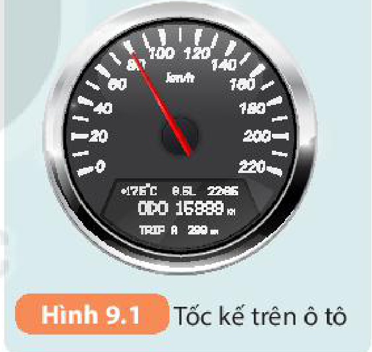
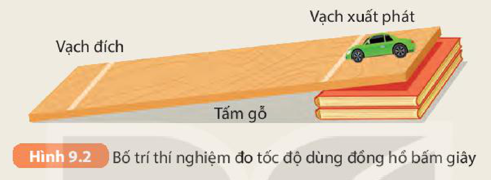
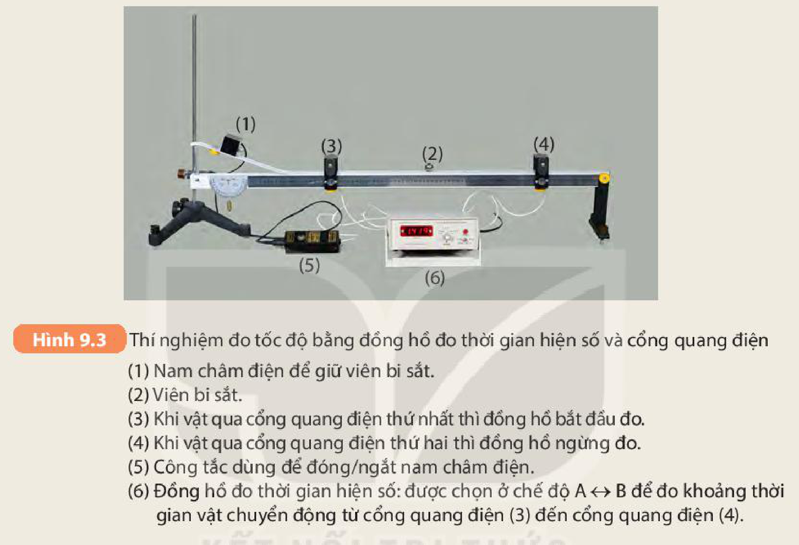
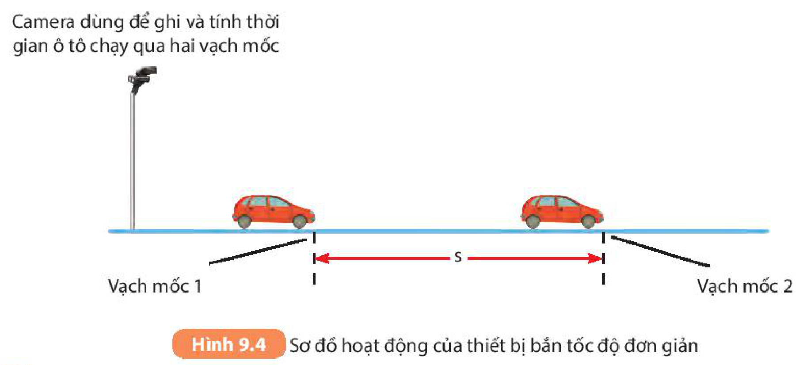

<!-- pdf:50 -->

# BÀI 9: ĐO TỐC ĐỘ

## 🎯 Mục tiêu

- Mô tả được sơ lược cách đo tốc độ bằng đồng hồ bấm giây và cổng quang điện trong dụng cụ thực hành ở nhà trường; thiết bị "bắn tốc độ" trong kiểm tra tốc độ các phương tiện giao thông.

## 🔴 Mở đầu

Theo em để xác định tốc độ chuyển động người ta phải đo những đại lượng nào và dùng những dụng cụ nào để đo? Tại sao?

## I. Đo tốc độ dùng đồng hồ bấm giây

### 1. Dụng cụ đo

Ngoài đồng hồ bấm giây dùng để đo thời gian chuyển động $t$, người ta còn phải dùng các loại thước khác nhau để đo độ dài của quãng đường đi được $s$. Cách sử dụng các dụng cụ đo độ dài và đo thời gian này đã được học trong môn Khoa học tự nhiên ở lớp 6.

> 🔍 Em có biết?
>
> Dụng cụ dùng để đo tốc độ của các phương tiện giao thông như ô tô, xe máy,... gọi là tốc kế (Hình 9.1). <!-- term: Tốc kế -->
>
> 
>
> Hình 9.1. Tốc kế trên ô tô

### 2. Cách đo

Có hai cách đo:

Cách 1: Chọn quãng đường $s$ trước, đo thời gian $t$ sau.

Cách 2: Chọn thời gian $t$ trước, đo quãng đường $s$ sau.

Trong phòng thực hành thường chọn cách 1.

Để đo tốc độ dùng đồng hồ bấm giây trong phòng thực hành cần thực hiện các bước sau đây: <!-- term: Đo tốc độ dùng đồng hồ bấm giây -->

- Dùng thước đo độ dài của quãng đường $s$. Xác định vạch xuất phát và vạch đích.
- Dùng đồng hồ bấm giây đo thời gian $t$ từ khi vật bắt đầu chuyển động từ vạch xuất phát cho đến khi tới vạch đích.
- Thông thường thực hiện các phép đo 3 lần để lấy giá trị trung bình.
- Lập bảng ghi kết quả đo, tính trung bình quãng đường và thời gian trong 3 lần đo, sau đó tính tốc độ.
- Dùng công thức $v = \dfrac{s}{t}$ tính tốc độ.
- Nhận xét kết quả đo. <!-- term: Đo tốc độ dùng đồng hồ bấm giây -->

> ❓ Hãy mô tả cách tiến hành kiểm tra chạy cự li ngắn 60 m của các em trong môn Giáo dục thể chất. Cách tiến hành này có gì giống và khác với cách đo tốc độ ở trên?

<!-- pdf:51 -->

### 3. Ví dụ

> ✋ Đo tốc độ của một ô tô đồ chơi chạy trên một mặt dốc.
>
> *Dụng cụ:*
>
> Một ô tô đồ chơi nhỏ, không có động cơ; một tấm gỗ phẳng, dài khoảng 80 cm; thước dài, bút dạ hoặc phấn; đồng hồ bấm giây cơ học hoặc điện tử; vài cuốn sách.
>
> *Tiến hành:*
>
> (1) Dùng tấm gỗ phẳng và vài cuốn sách hoặc giá đỡ thí nghiệm để tạo ra một mặt dốc (Hình 9.2). Dùng bút dạ hoặc phấn vẽ trên tấm gỗ vạch xuất phát và vạch đích cách nhau 50 cm hoặc 60 cm.
>
> 
>
> Hình 9.2. Bố trí thí nghiệm đo tốc độ dùng đồng hồ bấm giây
>
> (2) Lập bảng ghi kết quả đo theo mẫu Bảng 9.1.
>
> (3) Giữ ô tô trước vạch xuất phát. Thả ô tô đồng thời dùng đồng hồ bấm giây đo thời gian ô tô chạy từ vạch xuất phát tới vạch đích. Thực hiện 3 lần phép đo trên.
>
> (4) Ghi kết quả đo vào mẫu Bảng 9.1 và thực hiện các phép tính để điền vào chỗ trống của bảng.
>
> Bảng 9.1. Bảng ghi kết quả thí nghiệm đo tốc độ
>
> | Lần đo | Quãng đường ($\text{cm}$) | Thời gian ($\text{s}$) |
> |---|---|---|
> | 1 | $s_1 = \dots$ | $t_1 = \dots$ |
> | 2 | $s_2 = \dots$ | $t_2 = \dots$ |
> | 3 | $s_3 = \dots$ | $t_3 = \dots$ |
>
> Tính giá trị trung bình của $s$: $s = \dfrac{s_1 + s_2 + s_3}{3}$ và của $t$: $t = \dfrac{t_1 + t_2 + t_3}{3}$ từ đó xác định tốc độ: $v = \dfrac{s}{t}$.
>
> (5) Nhận xét kết quả đo: ...

## II. Đo tốc độ dùng đồng hồ đo thời gian hiện số và cổng quang điện

### 1. Dụng cụ đo

Cách đo tốc độ này chỉ khác cách đo trên ở chỗ dùng đồng hồ đo thời gian hiện số và cổng quang điện để đo thời gian chuyển động. <!-- term: Đo tốc độ bằng cổng quang điện -->

Hình 9.3 mô tả cách lắp đặt các thiết bị trong phòng thí nghiệm để đo tốc độ dùng đồng hồ đo thời gian hiện số và cổng quang điện.

<!-- pdf:52 -->

### 2. Cách đo

> ✋ 1. Hãy dựa vào Hình 9.3 để mô tả sơ lược cách đo tốc độ dùng cổng quang điện và đồng hồ đo thời gian hiện số khi viên bi chuyển động từ cổng quang điện (3) đến cổng quang điện (4).
>
> 2. Quan sát thí nghiệm biểu diễn trên lớp để kiểm tra mô tả của mình và tính tốc độ của viên bi.
>
> 
>
> Hình 9.3. Thí nghiệm đo tốc độ bằng đồng hồ đo thời gian hiện số và cổng quang điện
>
> - (1) Nam châm điện để giữ viên bi sắt.
> - (2) Viên bi sắt.
> - (3) Khi vật qua cổng quang điện thứ nhất thì đồng hồ bắt đầu đo.
> - (4) Khi vật qua cổng quang điện thứ hai thì đồng hồ ngừng đo.
> - (5) Công tắc dùng để đóng/ngắt nam châm điện.
> - (6) Đồng hồ đo thời gian hiện số: được chọn ở chế độ $\text{A} \leftrightarrow \text{B}$ để đo khoảng thời gian vật chuyển động từ cổng quang điện (3) đến cổng quang điện (4).

## III. Thiết bị bắn tốc độ

Một trong những biện pháp quan trọng để giảm bớt tai nạn giao thông đường bộ là kiểm tra tốc độ của các phương tiện tham gia giao thông. Do đó, các thiết bị bắn tốc độ được sử dụng rộng rãi và cải tiến không ngừng.

Thiết bị bắn tốc độ đơn giản chỉ có một camera theo dõi ô tô chạy trên đường, ghi và tính thời gian ô tô chạy qua hai vạch mốc trên mặt đường, cách nhau khoảng từ 5 m đến 10 m tuỳ theo cung đường. Cụ thể là:

- Camera ghi biển số của ô tô và thời gian ô tô chạy qua các vạch mốc 1 và 2.
- Máy tính nhỏ đặt trong camera tính tốc độ của ô tô khi chạy từ vạch mốc này sang vạch mốc kia, so sánh với tốc độ giới hạn của cung đường để phát hiện ô tô nào vượt quá tốc độ này.

Khi phát hiện ô tô vượt tốc độ giới hạn, camera tự động chụp số liệu về tốc độ kèm theo biển số của ô tô, gửi về các trạm kiểm soát giao thông để xử lí (Hình 9.4).

<!-- pdf:53 -->

Hình 9.4. Sơ đồ hoạt động của thiết bị bắn tốc độ đơn giản

> ❓ Camera của thiết bị bắn tốc độ ở Hình 9.4 ghi và tính được thời gian ô tô chạy từ vạch mốc 1 sang vạch mốc 2 cách nhau 5 m là 0,35 s.
>
> a) Hỏi tốc độ của ô tô bằng bao nhiêu?
>
> b) Nếu tốc độ giới hạn của cung đường là $60\text{ km/h}$ thì ô tô này có vượt quá tốc độ giới hạn không?

> 🔍 Em có biết?
>
> *Đo tốc độ bằng đồng hồ điện tử đeo tay, điện thoại di động*
>
> Các đồng hồ điện tử đeo tay và điện thoại di động có trang bị phần mềm GPS (GPS là tên viết tắt tiếng Anh của “Hệ thống định vị toàn cầu”) có thể xác định vị trí của người sử dụng tại các thời điểm khác nhau dựa vào các tín hiệu do GPS của thiết bị gửi đến các vệ tinh nhân tạo và các tín hiệu phản hồi của các vệ tinh này gửi về thiết bị. Khi người, phương tiện giao thông mang thiết bị có GPS chuyển động thì thiết bị này theo dõi sự thay đổi vị trí của người dùng để xác định quãng đường và thời gian chuyển động của người dùng, từ đó tự động tính tốc độ chuyển động. <!-- term: Hệ thống định vị toàn cầu -->

## 📌 Em đã học

- Để đo tốc độ chuyển động, cần đo độ dài và đo thời gian. Để đo thời gian có thể dùng đồng hồ bấm giây hoặc cổng quang điện và đồng hồ đo thời gian hiện số.
- Các thiết bị bắn tốc độ được sử dụng để đo tốc độ của các phương tiện giao thông đường bộ.

## 🚀 Em có thể

- Đo được tốc độ bằng cách dùng đồng hồ bấm giây.
- Sử dụng được thước, đồng hồ bấm giây để xác định tốc độ chạy cự li ngắn 60 m của mỗi thành viên trong tổ mình.
- Giải thích được sơ lược nguyên tắc làm việc của thiết bị "bắn tốc độ" đơn giản.

## 📷 Danh sách hình trong bài

| Mã hình | Trang PDF | Trang sách | Chú thích |
|---|---|---|---|
| H7-khoa_hoc_tu_nhien-b09-01 | 50 | 49 | Hình 9.1. Tốc kế trên ô tô |
| H7-khoa_hoc_tu_nhien-b09-02 | 51 | 50 | Hình 9.2. Bố trí thí nghiệm đo tốc độ dùng đồng hồ bấm giây |
| H7-khoa_hoc_tu_nhien-b09-03 | 52 | 51 | Hình 9.3. Thí nghiệm đo tốc độ bằng đồng hồ đo thời gian hiện số và cổng quang điện |
| H7-khoa_hoc_tu_nhien-b09-04 | 53 | 52 | Hình 9.4. Sơ đồ hoạt động của thiết bị bắn tốc độ đơn giản |
