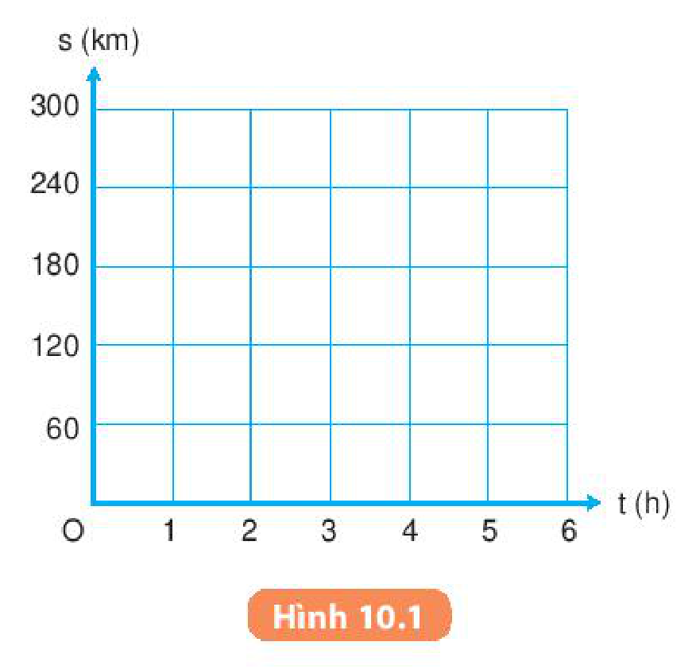
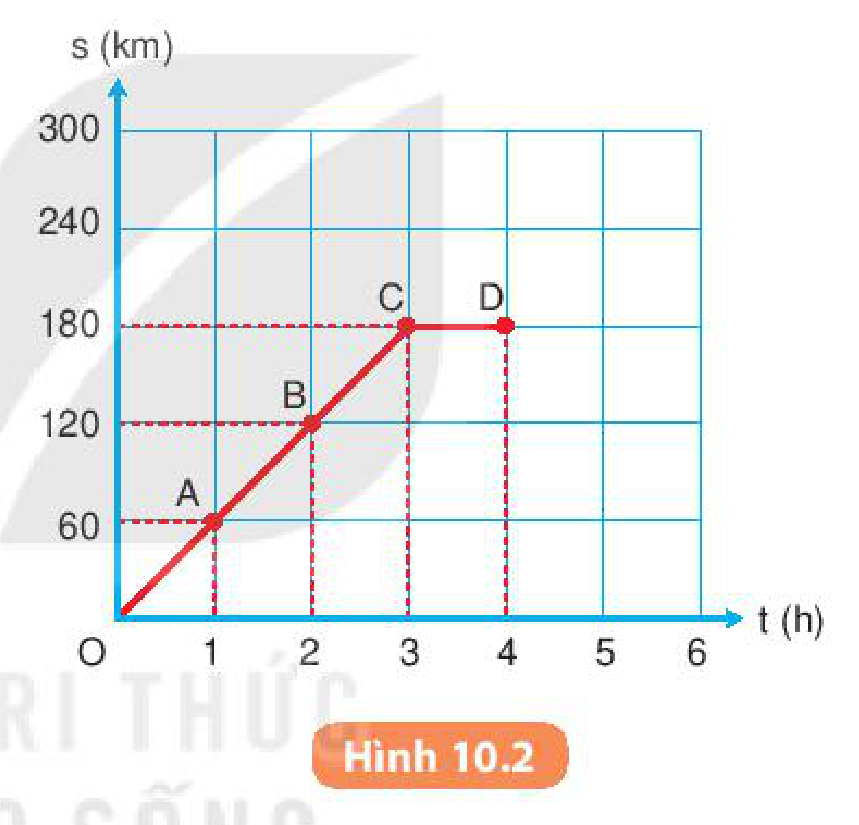

<!-- pdf:54 -->

# BÀI 10: ĐỒ THỊ QUÃNG ĐƯỜNG – THỜI GIAN

## 🎯 Mục tiêu

- Vẽ được đồ thị quãng đường – thời gian cho chuyển động thẳng.
- Từ đồ thị quãng đường – thời gian cho trước, tìm được quãng đường vật đi (hoặc tốc độ hay thời gian chuyển động của vật).

## 🔴 Mở đầu

Theo em làm thế nào để có thể xác định được quãng đường đi được sau những khoảng thời gian khác nhau mà không cần dùng công thức $s = v \cdot t$?

## I. Vẽ đồ thị quãng đường – thời gian cho chuyển động thẳng

### 1. Lập bảng ghi quãng đường đi được theo thời gian

Để vẽ đồ thị quãng đường – thời gian cho một chuyển động thì trước hết phải lập bảng ghi quãng đường đi được theo thời gian.

Ví dụ, Bảng 10.1 ghi số liệu mô tả chuyển động của một ô tô chở khách trong hành trình 6 h đi từ bến xe A đến bến xe B trên một quốc lộ.

Bảng 10.1. Bảng ghi quãng đường đi được theo thời gian

| Thời gian ($\text{h}$) | 0 | 1 | 2 | 3 | 4 | 5 | 6 |
|---|---|---|---|---|---|---|---|
| Quãng đường ($\text{km}$) | 0 | 60 | 120 | 180 | 180 | 220 | 260 |

> ❓ Hãy dựa vào Bảng 10.1 để trả lời các câu hỏi sau:
>
> 1. Trong 3 h đầu, ô tô chạy với tốc độ bao nhiêu $\text{km/h}$?
> 2. Trong khoảng thời gian nào thì ô tô dừng lại để hành khách nghỉ ngơi?

### 2. Vẽ đồ thị

Dựa vào Bảng 10.1 để vẽ đồ thị quãng đường – thời gian (hoặc đồ thị $s - t$) để mô tả mối quan hệ giữa quãng đường đi được và thời gian trong quá trình chuyển động của vật. <!-- term: Đồ thị quãng đường – thời gian -->

<!-- pdf:55 -->

Sau đây là cách vẽ đồ thị dựa trên các số liệu trong Bảng 10.1:

1. Vẽ hai tia $Os$ và $Ot$ vuông góc với nhau tại $O$, gọi là hai trục toạ độ. <!-- term: Trục toạ độ -->
   - Trục thẳng đứng (trục tung) $Os$ được dùng để biểu diễn các độ lớn của quãng đường đi được theo một tỉ xích thích hợp. <!-- term: Trục toạ độ -->
   - Trục nằm ngang (trục hoành) $Ot$ biểu diễn thời gian theo một tỉ xích thích hợp (Hình 10.1). <!-- term: Trục toạ độ -->

Hình 10.1

2. Xác định các điểm biểu diễn quãng đường đi được và thời gian tương ứng.

Biết điểm $O$ là điểm khởi hành, khi đó $s = 0$ và $t = 0$.

Xác định trên Hình 10.1 vị trí của các điểm A, B, C, D lần lượt tương ứng với các quãng đường đi được sau 1 h, 2 h, 3 h, 4 h.

Nối các điểm O, A, B, C và C, D với nhau và nhận xét về các đường nối này (thẳng hay cong, nghiêng hay song song với trục hoành).

Hình 10.2

Đường nối năm điểm O, A, B, C, D trên là đồ thị quãng đường – thời gian trong 4 h đầu (Hình 10.2).

Nhận xét:

- Đồ thị biểu diễn quãng đường đi được theo thời gian trong 3 h đầu là một đoạn thẳng nằm nghiêng. Quãng đường đi được trong 3 h đầu tỉ lệ thuận với thời gian đi.
- Khi đồ thị là đường thẳng song song với trục thời gian, vật không chuyển động.

> ✋ Xác định các điểm E và G lần lượt tương ứng với quãng đường đi được sau 5 h và 6 h và vẽ các đường nối hai điểm D và E, hai điểm E và G trong Hình 10.2. Nhận xét về các đường nối này.

<!-- pdf:56 -->

## II. Sử dụng đồ thị quãng đường – thời gian

> ✋ 1. Từ đồ thị ở Hình 10.2:
>
> a) Mô tả lại bằng lời chuyển động của ô tô trong 4 h đầu.
>
> b) Xác định tốc độ của ô tô trong 3 h đầu.
>
> c) Xác định quãng đường ô tô đi được sau 1 h 30 min từ khi khởi hành.
>
> 2. Lúc 6 h sáng, bạn A đi bộ từ nhà ra công viên để tập thể dục cùng các bạn. Trong 15 min đầu, A đi thong thả được 1 000 m thì gặp B. A đứng lại nói chuyện với B trong 5 min. Chợt A nhớ ra là các bạn hẹn mình bắt đầu tập thể dục ở công viên vào lúc 6 h 30 min nên vội vã đi nốt 1 000 m còn lại và đến công viên vào đúng lúc 6 h 30 min.
>
> a) Vẽ đồ thị quãng đường – thời gian của bạn A trong suốt hành trình 30 min đi từ nhà đến công viên.
>
> b) Xác định tốc độ của bạn A trong 15 min đầu và 10 min cuối của hành trình.

## 📌 Em đã học

- Đồ thị của chuyển động có tốc độ không đổi là một đường thẳng. <!-- term: Đồ thị quãng đường – thời gian -->
- Cách vẽ đồ thị quãng đường – thời gian của chuyển động.
- Đồ thị quãng đường – thời gian cho biết tốc độ chuyển động, quãng đường đi được và thời gian đi. <!-- term: Đồ thị quãng đường – thời gian -->

## 🚀 Em có thể

Sử dụng được đồ thị quãng đường – thời gian để mô tả chuyển động, xác định quãng đường đi được, thời gian đi, vị trí của vật ở những thời điểm xác định.

## 📷 Danh sách hình trong bài

| Mã hình | Trang PDF | Trang sách | Chú thích |
|---|---|---|---|
| H7-khoa_hoc_tu_nhien-b10-01 | 55 | 54 | Hình 10.1 (Hệ trục toạ độ biểu diễn quãng đường – thời gian) |
| H7-khoa_hoc_tu_nhien-b10-02 | 55 | 54 | Hình 10.2 (Đồ thị quãng đường – thời gian của ô tô trong 4 h đầu) |
