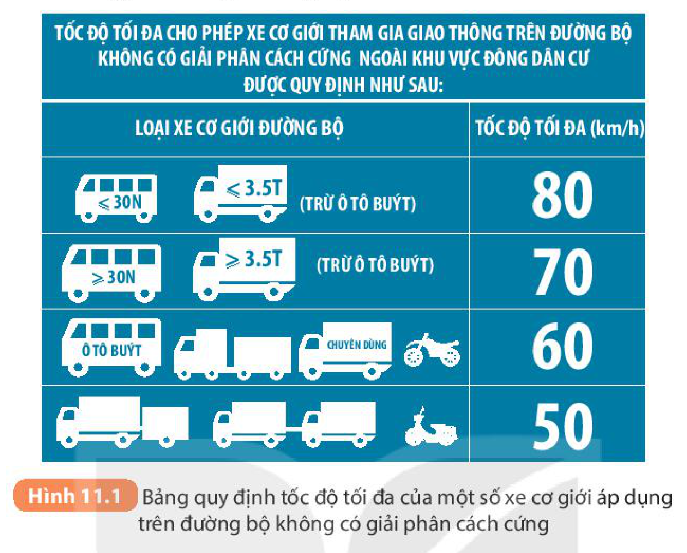
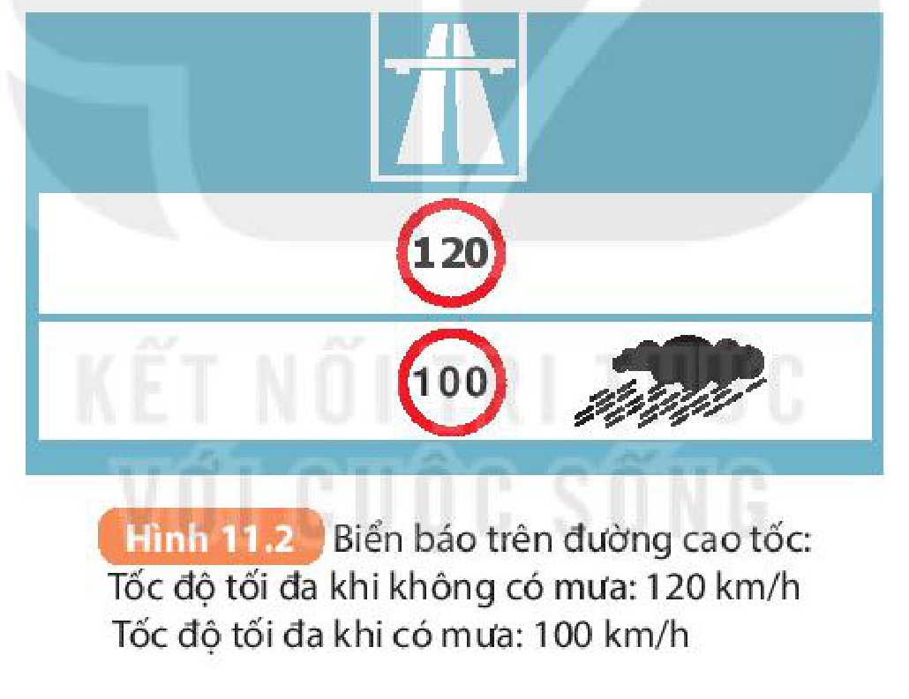
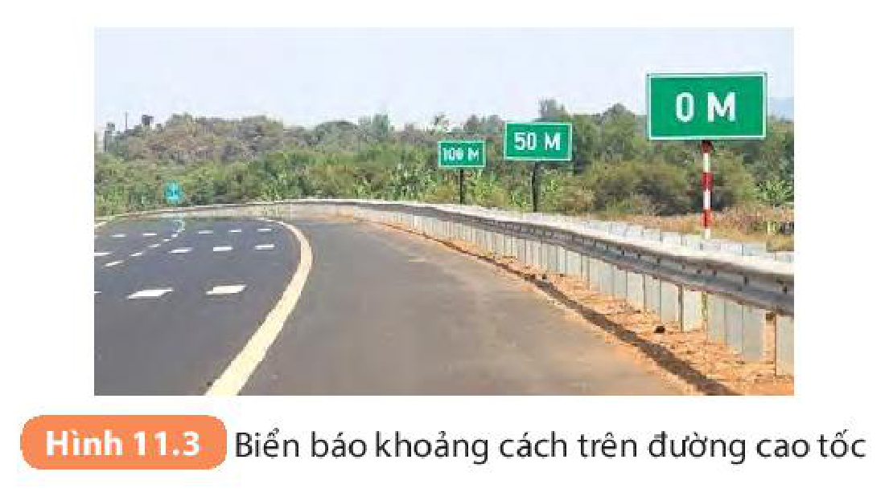

<!-- pdf:57 -->

# BÀI 11: THẢO LUẬN VỀ ẢNH HƯỞNG CỦA TỐC ĐỘ TRONG AN TOÀN GIAO THÔNG

## 🎯 Mục tiêu

- Dựa vào tranh ảnh (hoặc học liệu điện tử) thảo luận để nêu được ảnh hưởng của tốc độ trong an toàn giao thông.

## 🔴 Mở đầu

Theo em nguyên nhân gây ra tai nạn giao thông đường bộ có phải chủ yếu là do vi phạm quy định về tốc độ giới hạn không?

## I. Yêu cầu

Sưu tầm tài liệu, tranh ảnh, video để trình bày và thảo luận về ảnh hưởng của tốc độ trong an toàn giao thông.

## II. Nguồn tư liệu

### 1. Sưu tầm tư liệu

Có thể sưu tầm tư liệu để tham gia thảo luận dựa trên:

Bài viết, hình ảnh, video trên các chương trình truyền hình, trên báo chí và các phương tiện truyền thông khác (như internet,...) có liên quan đến những vấn đề sau đây:

- Quy định về tốc độ giới hạn (tốc độ tối đa và tốc độ tối thiểu) của các phương tiện giao thông khác nhau nhằm bảo đảm an toàn cho người điều khiển phương tiện giao thông cũng như người tham gia giao thông. <!-- term: Tốc độ giới hạn -->
- Quy định về khoảng cách an toàn tối thiểu giữa các phương tiện giao thông ứng với các tốc độ khác nhau để giúp người điều khiển phương tiện giao thông có đủ thời gian phanh, tránh va chạm gây tai nạn. <!-- term: Khoảng cách an toàn tối thiểu -->
- Tình hình vi phạm về tốc độ gây ra tai nạn giao thông, làm ảnh hưởng đến sức khoẻ, tính mạng của người điều khiển phương tiện giao thông và người tham gia giao thông ở địa phương mình.

<!-- pdf:58 -->

### 2. Một số ví dụ về tư liệu cần sưu tầm

a) Một số biển báo giao thông đường bộ

Hình 11.1. Bảng quy định tốc độ tối đa của một số xe cơ giới áp dụng trên đường bộ không có giải phân cách cứng

Hình 11.2. Biển báo trên đường cao tốc:
Tốc độ tối đa khi không có mưa: $120\text{ km/h}$
Tốc độ tối đa khi có mưa: $100\text{ km/h}$

b) Khoảng cách an toàn giữa hai xe khi tham gia giao thông trên đường bộ được quy định như sau:

Bảng 11.1.

| Tốc độ lưu hành ($\text{km/h}$) | Khoảng cách an toàn tối thiểu ($\text{m}$) |
|---|---|
| $v = 60$ | 35 |
| $60 < v \le 80$ | 55 |
| $80 < v \le 100$ | 70 |
| $100 < v \le 120$ | 100 |
<!-- ocr-ok: đã đối chiếu ảnh trang 58, OCR bỏ sót hàng tiêu đề nền cam của Bảng 11.1 -->

<!-- pdf:59 -->

Hình 11.3. Biển báo khoảng cách trên đường cao tốc

Trường hợp điều khiển xe chạy với tốc độ dưới $60\text{ km/h}$, người lái xe phải chủ động giữ khoảng cách an toàn phù hợp với xe chạy liền trước xe của mình; khoảng cách này tuỳ thuộc vào mật độ phương tiện, tình hình giao thông thực tế để đảm bảo an toàn giao thông.

c) Quy tắc “3 giây” khi đi xe trên đường cao tốc:

Trên đường cao tốc thường có các biển báo khoảng cách giúp lái xe có thể ước lượng khoảng cách giữa các xe để giữ khoảng cách an toàn.

Vì khó ghi nhớ được đầy đủ bảng quy định khoảng cách giới hạn nên khi lái xe trên đường cao tốc, người ta có thể áp dụng quy tắc “3 giây” để tính gần đúng khoảng cách an toàn với xe trước: <!-- term: Quy tắc “3 giây” -->

Khoảng cách an toàn ($\text{m}$) = tốc độ ($\text{m/s}$) $\times 3\text{ (s)}$. <!-- term: Quy tắc “3 giây” -->

d) Thống kê của Uỷ ban An toàn giao thông Quốc gia về tình hình tai nạn giao thông từ năm 2016 đến năm 2020 và phân tích nguyên nhân gây ra các vụ tai nạn giao thông.

| Năm | Số vụ tai nạn giao thông | Số người chết |
|---|---|---|
| 2016 | 21 589 | 8 685 |
| 2017 | 20 080 | 8 279 |
| 2018 | 18 232 | 8 125 |
| 2019 | 17 626 | 7 624 |
| 2020 | 14 510 | 6 700 |
<!-- ocr-ok: đã đối chiếu ảnh trang 59, OCR bỏ sót hàng tiêu đề nền cam của bảng thống kê -->

*Nguồn: Uỷ ban An toàn giao thông Quốc gia*

Qua phân tích nguyên nhân các vụ tai nạn giao thông, cho thấy tai nạn giao thông đường bộ chủ yếu xuất phát từ các lỗi vi phạm trật tự an toàn giao thông dẫn đến tai nạn giao thông như đi không đúng làn đường, phần đường quy định, không chấp hành tín hiệu đèn giao thông, chạy quá tốc độ, chuyển hướng không đúng quy định.

<!-- pdf:60 -->

## III. Thảo luận

Để việc thảo luận có kết quả tốt, cần sử dụng các tư liệu đã sưu tầm được và các tư liệu tham khảo trong bài học. Nội dung thảo luận như sau:

*Nội dung thảo luận 1:* Tại sao phải quy định tốc độ giới hạn đối với các phương tiện giao thông khác nhau, trên những cung đường khác nhau? So sánh tốc độ tối đa của các phương tiện giao thông khác nhau trong bảng và giải thích tại sao có sự khác biệt giữa các tốc độ này (Xem Hình 11.1).

*Nội dung thảo luận 2:* Giải thích sự khác biệt về tốc độ tối đa khi trời mưa và khi trời không mưa của biển báo tốc độ trên đường cao tốc ở Hình 11.2.

*Nội dung thảo luận 3:* Tại sao người ta phải quy định khoảng cách an toàn ứng với các tốc độ khác nhau giữa các phương tiện giao thông đường bộ (xem Bảng 11.1). Tìm cách chứng tỏ người điều khiển phương tiện giao thông có tốc độ càng lớn thì càng không có đủ thời gian cũng như khoảng cách để tránh va chạm gây tai nạn.

*Nội dung thảo luận 4:* Các biển báo khoảng cách trên đường cao tốc dùng để làm gì?

Dùng quy tắc “3 giây” để ước tính khoảng cách an toàn khi xe chạy với tốc độ $68\text{ km/h}$.

*Nội dung thảo luận 5:* Để đảm bảo an toàn giao thông thì người tham gia giao thông phải:

- Có ý thức tôn trọng các quy định về an toàn giao thông.
- Có hiểu biết về ảnh hưởng của tốc độ trong an toàn giao thông.

Hãy thảo luận về tầm quan trọng của hai yếu tố trên.

## 📌 Em đã học

- Cần phải tuân thủ các quy định về tốc độ khi tham gia giao thông để đảm bảo an toàn.
- Người tham gia giao thông vừa phải có ý thức thực hiện an toàn giao thông vừa phải có hiểu biết về ảnh hưởng của tốc độ trong an toàn giao thông.

## 🚀 Em có thể

Tham gia thảo luận được về ảnh hưởng của tốc độ trong an toàn giao thông.

## 📷 Danh sách hình trong bài

| Mã hình | Trang PDF | Trang sách | Chú thích |
|---|---|---|---|
| H7-khoa_hoc_tu_nhien-b11-01 | 58 | 57 | Hình 11.1. Bảng quy định tốc độ tối đa của một số xe cơ giới áp dụng trên đường bộ không có giải phân cách cứng |
| H7-khoa_hoc_tu_nhien-b11-02 | 58 | 57 | Hình 11.2. Biển báo trên đường cao tốc: Tốc độ tối đa khi không có mưa: 120 km/h; Tốc độ tối đa khi có mưa: 100 km/h |
| H7-khoa_hoc_tu_nhien-b11-03 | 59 | 58 | Hình 11.3. Biển báo khoảng cách trên đường cao tốc |
