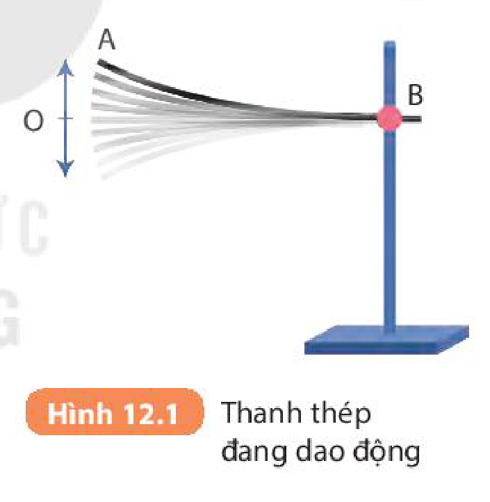
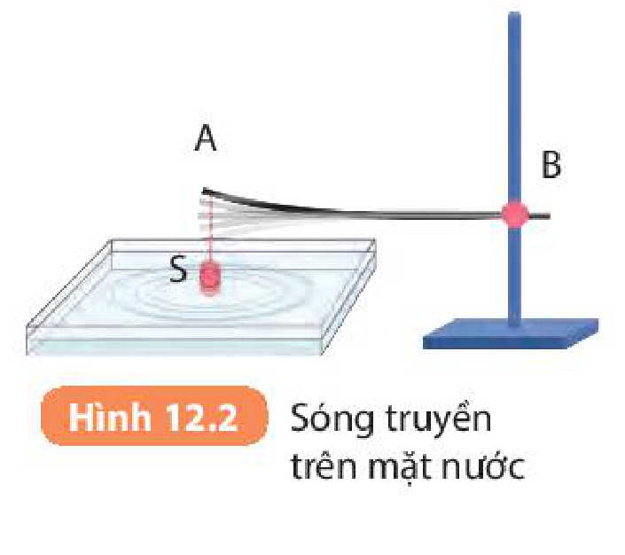
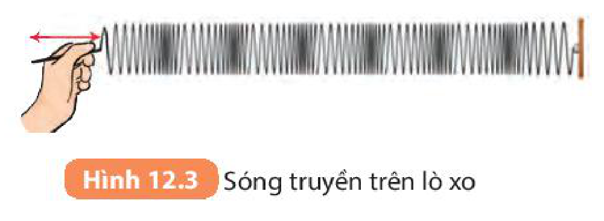
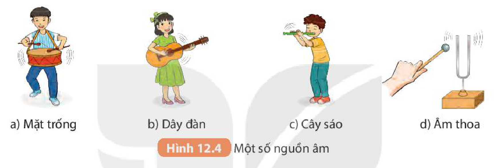
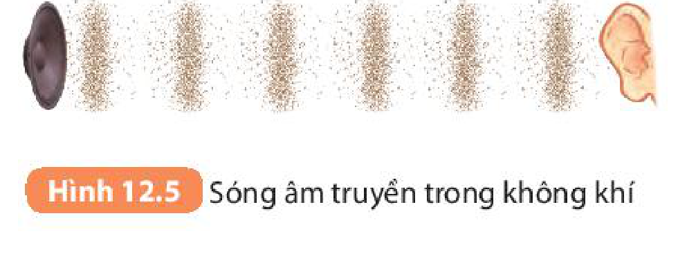
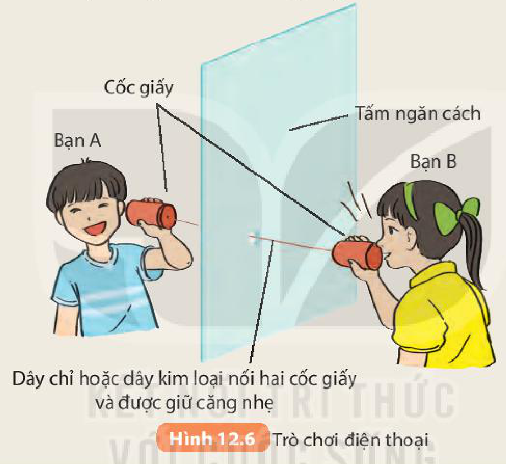

<!-- pdf:61 -->

# BÀI 12: SÓNG ÂM

## 🎯 Mục tiêu

- Thực hiện thí nghiệm tạo sóng âm (như gảy đàn, gõ vào thanh kim loại,...) để chứng tỏ được sóng âm có thể truyền được trong chất rắn, lỏng, khí.
- Giải thích được sự truyền sóng âm trong không khí.

## 🔴 Mở đầu

Trong lịch sử, khi phương tiện truyền thông còn chưa phát triển, để phát hiện quân địch đang di chuyển bằng ngựa người ta lại áp tai xuống đất và có thể nghe được tiếng vó ngựa cách xa vài kilômét. Tại sao?

## I. Dao động và sóng

### 1. Dao động

Dùng một thanh thép đàn hồi AB gắn trên giá đỡ như Hình 12.1. Kéo đầu A của thanh xuống rồi thả tay ra làm đầu này chuyển động lên, xuống quanh vị trí cân bằng (O).

Hình 12.1. Thanh thép đang dao động

Các chuyển động qua lại quanh một vị trí cân bằng như trên được gọi là **dao động**.

> ❓ Tìm thêm ví dụ về dao động.

### 2. Sóng

Sóng là sự lan truyền dao động trong môi trường.

- Thanh thép đàn hồi AB dao động sẽ kéo theo vật nhỏ S dao động, làm mặt nước dao động theo. Dao động này được lan truyền trên mặt nước tạo thành sóng nước hình tròn có tâm S (Hình 12.2).

Hình 12.2. Sóng truyền trên mặt nước

<!-- pdf:62 -->

- Khi cho một đầu của lò xo dao động thì dao động này cũng được dây lò xo truyền đi tạo thành sóng trên lò xo. Dọc theo dây lò xo xuất hiện những đoạn nén và dãn liên tiếp (Hình 12.3).

Hình 12.3. Sóng truyền trên lò xo

> ❓ Hãy tìm thêm ví dụ về sự truyền dao động tạo thành sóng.

## II. Nguồn âm

Nguồn âm là nguồn phát ra âm, các nguồn âm đều dao động. Dưới đây là một số ví dụ về nguồn âm. <!-- term: Nguồn âm -->

- *a) Mặt trống*
- *b) Dây đàn*
- *c) Cây sáo*
- *d) Âm thoa*

Hình 12.4. Một số nguồn âm

> ✋ Hãy thực hiện thí nghiệm đơn giản sau: gảy đàn (Hình 12.4b), gõ vào âm thoa (Hình 12.4d) để chứng tỏ âm truyền được trong không khí.

> ❓ Tìm thêm ví dụ về vật dao động phát ra âm thanh.

## III. Sóng âm

Sóng âm là sự lan truyền dao động của nguồn âm trong môi trường.

Sóng âm được tạo ra như thế nào?

Hình 12.5 cho thấy: Màng loa dao động làm cho lớp không khí tiếp xúc với nó dao động (nén, dãn). Lớp không khí dao động này lại làm cho lớp không khí kế tiếp dao động,... Cứ thế các dao động của nguồn âm được không khí truyền tới tai ta, làm cho màng nhĩ dao động, do đó ta nghe thấy âm phát ra từ nguồn âm.

Hình 12.5. Sóng âm truyền trong không khí

<!-- pdf:63 -->

> ❓ Tìm thêm ví dụ cho thấy sóng âm truyền từ nguồn âm theo mọi phương ra môi trường xung quanh.

## IV. Các môi trường truyền âm

Môi trường truyền được sóng âm gọi là môi trường truyền âm. <!-- term: Môi trường truyền âm -->

> ❓ Trong Hình 12.6, khi bạn A úp cốc vào tai thì nghe được tiếng bạn B nói, nhưng nếu bạn A đưa cốc ra xa tai thì không nghe được tiếng bạn B nói. Hiện tượng này chứng tỏ điều gì? Có thể rút ra nhận xét gì về môi trường truyền âm?
>
> 
>
> Hình 12.6. Trò chơi điện thoại

> ✋ Trong thí nghiệm được mô tả ở Hình 12.7, khi nhúng hộp đựng đồng hồ báo thức đang kêu vào nước thì có còn nghe thấy tiếng chuông báo thức không? Làm thí nghiệm kiểm tra để chứng tỏ âm truyền được trong chất lỏng.
>
> 
>
> Hình 12.7. Thí nghiệm truyền âm trong môi trường nước

<!-- pdf:64 -->

> ❓ 1. Tìm thêm ví dụ về âm truyền trong chất khí, chất rắn và chất lỏng.
>
> 2. Hãy trả lời câu hỏi nêu ra ở phần mở đầu của bài học.

> 🔍 Em có biết?
>
> Hiện tượng mô tả trong Hình 12.8 cho ta thấy âm không truyền được trong chân không.
>
> 
>
> Hình 12.8. Thí nghiệm so sánh hai môi trường truyền âm: không khí và chân không

## 📌 Em đã học

- Sóng âm là sự truyền dao động âm trong các môi trường rắn, lỏng, khí.

## 🚀 Em có thể

Giải thích được việc không nghe được âm thanh của chuông đồng hồ khi để trong bình chân không (Hình 12.8).

## 📷 Danh sách hình trong bài

| Mã hình | Trang PDF | Trang sách | Chú thích |
|---|---|---|---|
| H7-khoa_hoc_tu_nhien-b12-01 | 61 | 60 | Hình 12.1. Thanh thép đang dao động |
| H7-khoa_hoc_tu_nhien-b12-02 | 61 | 60 | Hình 12.2. Sóng truyền trên mặt nước |
| H7-khoa_hoc_tu_nhien-b12-03 | 62 | 61 | Hình 12.3. Sóng truyền trên lò xo |
| H7-khoa_hoc_tu_nhien-b12-04 | 62 | 61 | Hình 12.4. Một số nguồn âm |
| H7-khoa_hoc_tu_nhien-b12-05 | 62 | 61 | Hình 12.5. Sóng âm truyền trong không khí |
| H7-khoa_hoc_tu_nhien-b12-06 | 63 | 62 | Hình 12.6. Trò chơi điện thoại |
| H7-khoa_hoc_tu_nhien-b12-07 | 63 | 62 | Hình 12.7. Thí nghiệm truyền âm trong môi trường nước |
| H7-khoa_hoc_tu_nhien-b12-08 | 64 | 63 | Hình 12.8. Thí nghiệm so sánh hai môi trường truyền âm: không khí và chân không |
