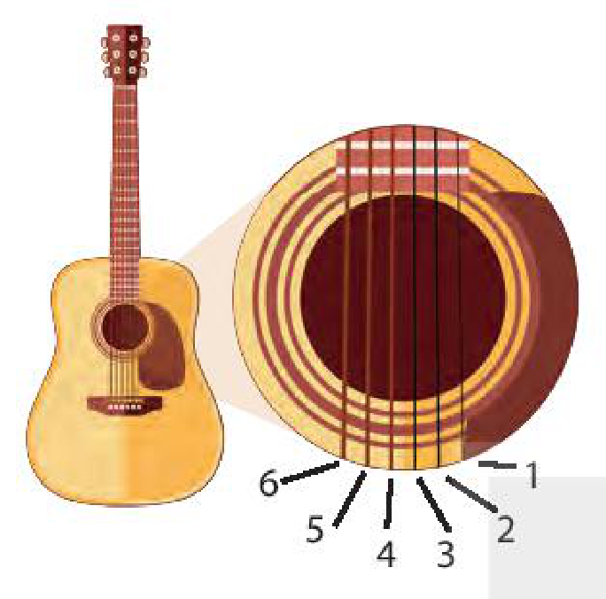
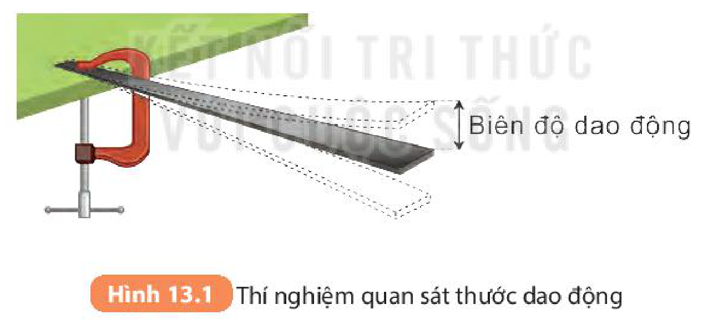
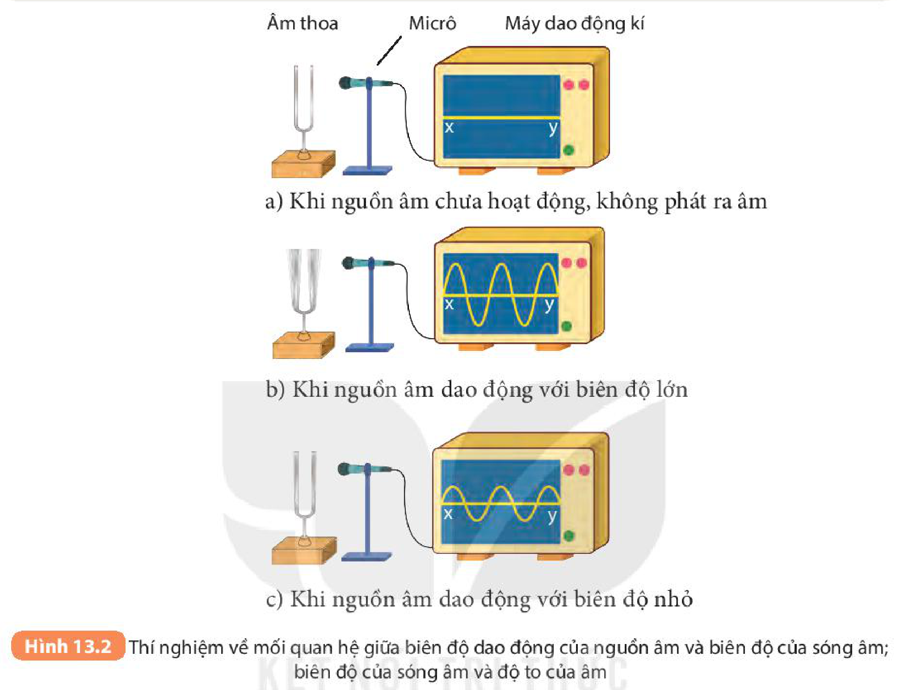
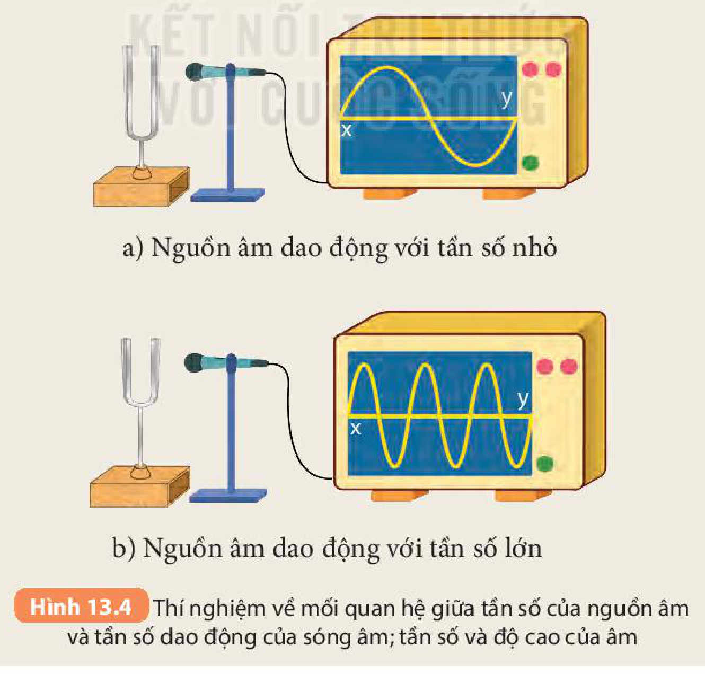

<!-- pdf:65 -->

# BÀI 13: ĐỘ TO VÀ ĐỘ CAO CỦA ÂM

## 🎯 Mục tiêu

- Từ hình ảnh hoặc đồ thị xác định được biên độ và tần số sóng âm.
- Nêu được đơn vị của tần số là héc (kí hiệu là $\text{Hz}$).
- Nêu được sự liên quan của độ to của âm với biên độ âm.
- Sử dụng nhạc cụ (hoặc dao động kí) chứng tỏ được độ cao của âm liên hệ với tần số âm.

## 🔴 Mở đầu

Âm mà ta nghe được phát ra từ dây số 1 và dây số 6 của cây đàn ghita có gì khác nhau?

## I. Độ to và biên độ của sóng âm

### 1. Biên độ dao động của nguồn âm, sóng âm

Thí nghiệm mô tả ở Hình 13.1 là một cách để quan sát dao động. Một thước thép mỏng, đàn hồi (dài khoảng 30 cm) một đầu cố định, đầu còn lại để tự do.

Hình 13.1. Thí nghiệm quan sát thước dao động

Khi kéo đầu tự do xuống rồi buông ra thì đầu thước dao động và phát ra âm.

Trên hình cho thấy **biên độ dao động** là khoảng cách từ vị trí ban đầu (cân bằng) đến vị trí xa nhất của đầu thước.

Ta không thể nhìn thấy sóng âm, nhưng ta có thể dùng các thiết bị điện tử để ghi lại các đặc điểm của sóng âm. Nếu kết nối một micrô với một máy dao động kí (hoặc điện thoại hay máy tính có trang bị phần mềm ghi dao động) thì có thể quan sát được các đặc điểm của sóng âm (Hình 13.2). <!-- term: Máy dao động kí -->

Trên màn hình dao động kí, biên độ của sóng âm được biểu diễn bằng khoảng cách từ đường $xy$ đến điểm cao nhất của đường biểu diễn trên màn hình. <!-- term: Biên độ của sóng âm -->

<!-- pdf:66 -->

> ❓ Hãy so sánh biên độ của sóng âm trong Hình 13.2b và 13.2c từ đó rút ra mối quan hệ giữa biên độ của sóng âm và biên độ dao động của nguồn âm.

- *a) Khi nguồn âm chưa hoạt động, không phát ra âm*
- *b) Khi nguồn âm dao động với biên độ lớn*
- *c) Khi nguồn âm dao động với biên độ nhỏ*
<!-- ocr-ok: đã đối chiếu ảnh trang 66, OCR bỏ sót chú thích hình 13.2a và 13.2b -->

Hình 13.2. Thí nghiệm về mối quan hệ giữa biên độ dao động của nguồn âm và biên độ của sóng âm; biên độ của sóng âm và độ to của âm

### 2. Độ to của âm

> ❓ 1. So sánh độ to của âm nghe được trong thí nghiệm được mô tả ở Hình 13.2b và 13.2c.
>
> 2. Từ câu trả lời trên, rút ra mối quan hệ giữa biên độ của sóng âm với độ to của âm.
>
> 3. Khi gảy đàn hoặc đánh trống, muốn âm phát ra to hơn người ta làm thế nào? Tại sao?

## II. Độ cao và tần số của sóng âm

### 1. Tần số

Số dao động vật thực hiện được trong một giây gọi là **tần số**. Đơn vị của tần số là héc (Hertz – tên của nhà vật lí người Đức, Hình 13.3), kí hiệu là $\text{Hz}$. Ví dụ: nếu trong 1 giây vật thực hiện được 30 dao động thì tần số dao động của vật là $30\text{ Hz}$. <!-- term: Héc -->

Hình 13.3. Heinrich Rudolf Hertz (1857-1894) nhà vật lí người Đức

<!-- pdf:67 -->

> ❓ 1. Nếu một dây đàn ghita dao động 880 lần mỗi giây thì tần số của nó là bao nhiêu?
>
> 2. Nếu một mặt trống dao động với tần số $100\text{ Hz}$ thì nó thực hiện được bao nhiêu dao động trong 1 min?
>
> 3. Nếu một con ong mật khi bay đập cánh lên, xuống 3 300 lần trong 10 s thì tần số dao động của cánh nó là bao nhiêu?

- Tần số âm mà tai ta có thể nghe được khoảng từ $20\text{ Hz}$ đến $20\,000\text{ Hz}$.
- Tần số của một số nốt nhạc: si ($494\text{ Hz}$); đô ($523\text{ Hz}$); rê ($587\text{ Hz}$); mi ($629\text{ Hz}$); fa ($698\text{ Hz}$); son ($784\text{ Hz}$); la ($880\text{ Hz}$).

### 2. Độ cao của âm

Khi nghe âm, ta thấy có âm cao (bổng), âm thấp (trầm). <!-- term: Độ cao của âm -->

Vậy sự cao, thấp của âm nghe được có liên hệ như thế nào với tần số của sóng âm? Thí nghiệm ở Hình 13.4 sẽ giúp chúng ta trả lời câu hỏi này.

> ✋ Biết tần số của sóng âm được xác định bằng số dao động trong một giây. Trên màn hình dao động kí, nếu số đường biểu diễn dao động mau thì tần số của sóng âm lớn, số đường biểu diễn dao động thưa thì tần số của sóng âm nhỏ.
>
> 1. Hãy so sánh tần số của sóng âm trong Hình 13.4a và 13.4b từ đó rút ra mối quan hệ giữa tần số sóng âm và tần số dao động của nguồn âm.
> 2. So sánh độ cao (bổng, trầm) của âm nghe được trong thí nghiệm Hình 13.4a và 13.4b.
> 3. Từ câu trả lời trên, rút ra mối quan hệ giữa tần số của sóng âm với độ cao của âm.
>
> 
>
> - *a) Nguồn âm dao động với tần số nhỏ*
> - *b) Nguồn âm dao động với tần số lớn*
>
> Hình 13.4. Thí nghiệm về mối quan hệ giữa tần số của nguồn âm và tần số dao động của sóng âm; tần số và độ cao của âm

<!-- pdf:68 -->

> ❓ 1. Một con muỗi khi bay vỗ cánh 3 000 lần trong 5 giây và một con ong mật khi bay vỗ cánh 4 950 lần trong 15 giây.
>
> a) Tính tần số dao động của cánh muỗi và cánh ong khi bay. Con nào vỗ cánh nhanh hơn?
>
> b) Âm phát ra khi vỗ cánh của con muỗi hay con ong cao hơn?
>
> 2. Hãy tìm hiểu xem khi vặn cho dây đàn ghita căng nhiều, căng ít thì âm phát ra sẽ cao, thấp như thế nào? Tần số lớn, nhỏ ra sao?
>
> 3. Tìm ví dụ về âm trầm (thấp), âm bổng (cao).

> 🔍 Em có biết?
>
> 1. Nghe giọng nói của nữ giới cao hơn nam giới, nên ta biết được khi nói, các dây thanh quản của nữ giới dao động nhanh hơn nam giới.
> 2. Khi hét to, kéo dài, các dây thanh quản phải dao động với biên độ lớn trong thời gian dài dẫn tới bị tổn thương, vì thế ta thường bị đau họng, giọng nói khàn và nhỏ đi.

## 📌 Em đã học

- Biên độ dao động là khoảng cách từ vị trí cân bằng đến vị trí xa nhất của dao động.
- Tần số là số dao động trong 1 giây.
- Đơn vị của tần số là héc ($\text{Hz}$).
- Sóng âm có biên độ càng lớn thì nghe thấy âm càng to (và ngược lại). <!-- term: Độ to của âm -->
- Sóng âm có tần số càng lớn thì nghe thấy âm càng cao (và ngược lại). <!-- term: Độ cao của âm -->

## 🚀 Em có thể

- Giải thích tại sao âm phát ra từ mỗi dây đàn ghita có độ cao khác nhau.
- Trình bày về mối liên hệ giữa độ to của âm và biên độ dao động của nguồn âm như khi gõ mạnh thì âm thanh do tiếng trống phát ra to hơn khi gõ nhẹ.

## 📷 Danh sách hình trong bài

| Mã hình | Trang PDF | Trang sách | Chú thích |
|---|---|---|---|
| H7-khoa_hoc_tu_nhien-b13-01 | 65 | 64 | (Hình mở đầu Bài 13: Cây đàn ghita với các dây đàn đánh số từ 1 đến 6) |
| H7-khoa_hoc_tu_nhien-b13-02 | 65 | 64 | Hình 13.1. Thí nghiệm quan sát thước dao động |
| H7-khoa_hoc_tu_nhien-b13-03 | 66 | 65 | Hình 13.2. Thí nghiệm về mối quan hệ giữa biên độ dao động của nguồn âm và biên độ của sóng âm; biên độ của sóng âm và độ to của âm |
| H7-khoa_hoc_tu_nhien-b13-04 | 66 | 65 | Hình 13.3. Heinrich Rudolf Hertz (1857-1894) nhà vật lí người Đức |
| H7-khoa_hoc_tu_nhien-b13-05 | 67 | 66 | Hình 13.4. Thí nghiệm về mối quan hệ giữa tần số của nguồn âm và tần số dao động của sóng âm; tần số và độ cao của âm |
