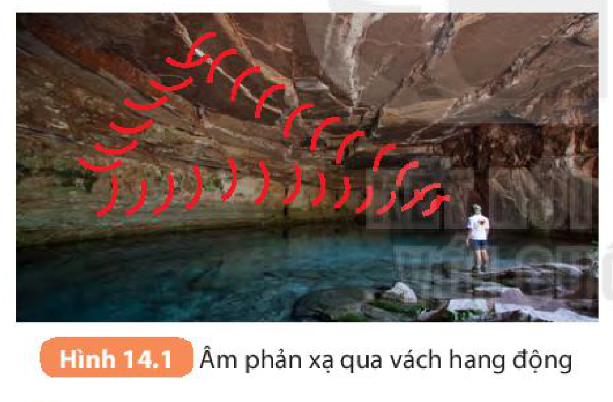
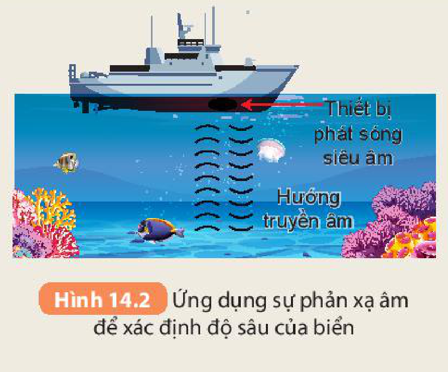
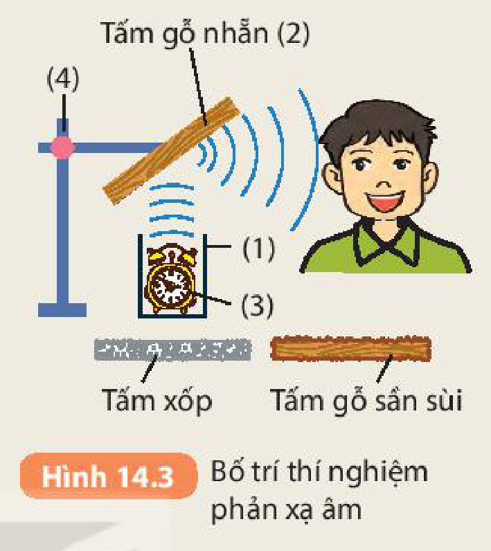
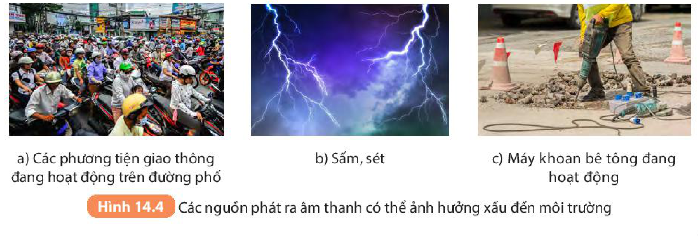
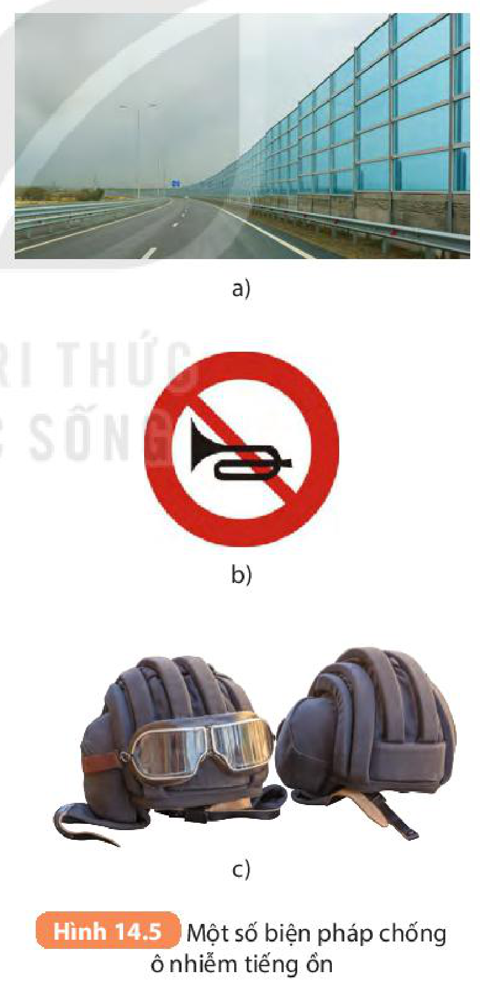
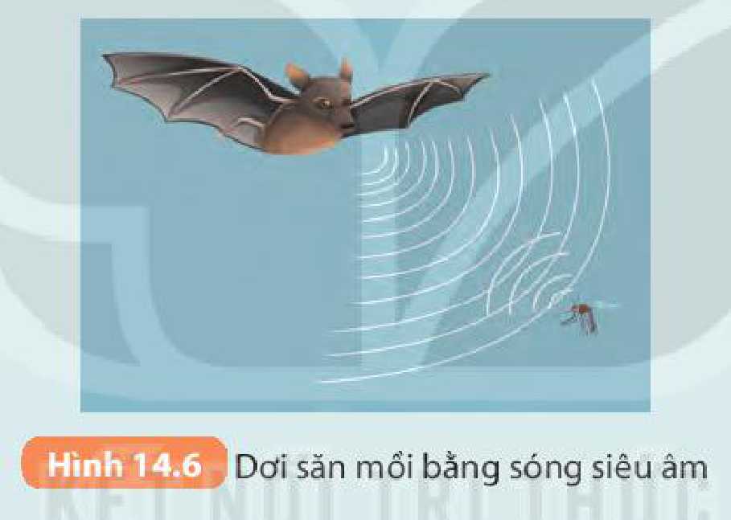

<!-- pdf:69 -->

# BÀI 14: PHẢN XẠ ÂM, CHỐNG Ô NHIỄM TIẾNG ỒN

## 🎯 Mục tiêu

- Lấy được ví dụ về vật phản xạ âm tốt, vật phản xạ âm kém.
- Giải thích được một số hiện tượng đơn giản thường gặp trong thực tế về sóng âm; đề xuất được phương án đơn giản để hạn chế tiếng ồn ảnh hưởng đến sức khoẻ.

## 🔴 Mở đầu

Tại sao tường của nhà hát, phòng hoà nhạc, rạp chiếu phim thường được làm sần sùi hoặc treo, phủ rèm nhung, len, dạ,...?

## I. Phản xạ âm

Khi đứng trước vách hang động, nếu nói to ta sẽ nghe được tiếng nói của chính mình vọng lại. Âm phát ra đã được vách hang động phản xạ lại tai ta. Đó là hiện tượng **phản xạ âm**.

Âm được dội lại khi gặp một mặt chắn gọi là âm phản xạ. <!-- term: Âm phản xạ -->

Hình 14.1. Âm phản xạ qua vách hang động
<!-- ocr-ok: đã đối chiếu ảnh trang 69, OCR bỏ sót chú thích Hình 14.1 -->

> 🔍 Em có biết?
>
> Khi âm phản xạ truyền đến tai ta chậm hơn âm truyền trực tiếp đến tai ta một khoảng thời gian lớn hơn $\dfrac{1}{15}$ giây thì âm phản xạ được gọi là *tiếng vang*. <!-- term: Tiếng vang -->

> ✋ 1. Tìm ví dụ về phản xạ âm.
>
> 2. Tại sao khi nói to trong phòng lớn thì nghe được tiếng vang, nhưng nói to như thế trong phòng nhỏ lại không nghe được tiếng vang?
>
> 3. Người ta thường ứng dụng sự phản xạ của sóng âm có tần số rất lớn (hơn $20\,000\text{ Hz}$) để xác định độ sâu của biển. Hãy sử dụng Hình 14.2 để giải thích ứng dụng này.
>
> 
>
> Hình 14.2. Ứng dụng sự phản xạ âm để xác định độ sâu của biển

<!-- pdf:70 -->

## II. Vật phản xạ âm tốt, vật phản xạ âm kém

> ✋ *Thí nghiệm*
>
> *Dụng cụ:*
>
> Hộp làm bằng vật liệu cách âm (1); một tấm gỗ nhẵn, một tấm gỗ sần sùi, một tấm xốp mềm hình chữ nhật cùng kích cỡ dùng làm tấm phản xạ âm (2); một chiếc đồng hồ để bàn nhỏ làm nguồn âm (3); giá đỡ tấm phản xạ âm (4).
>
> *Tiến hành:*
>
> *Bước 1:* Gắn tấm phản xạ âm bằng tấm gỗ nhẵn lên giá thí nghiệm, đặt tai tại vị trí như trên Hình 14.3, lắng nghe âm truyền từ nguồn tới tấm gỗ nhẵn và phản xạ đến tai.
>
> *Bước 2:* Lần lượt thay tấm gỗ nhẵn bằng tấm xốp và tấm gỗ sần sùi, lặp lại thí nghiệm như bước 1.
>
> Rút ra nhận xét vật nào phản xạ âm tốt, vật nào phản xạ âm kém.
>
> 
>
> Hình 14.3. Bố trí thí nghiệm phản xạ âm

- Vật liệu cứng có bề mặt nhẵn thì phản xạ âm tốt. <!-- term: Vật phản xạ âm tốt -->
- Vật liệu có bề mặt sần sùi và vật liệu mềm, xốp thì phản xạ âm kém. <!-- term: Vật phản xạ âm kém -->

> ❓ 1. Trong những vật dưới đây, hãy chỉ ra vật phản xạ âm tốt, vật phản xạ âm kém:
>
> Ghế đệm mút; mặt gương; tấm xốp; rèm nhung; mặt đá hoa; mặt tường gạch; tấm kim loại; tấm bìa; mặt nước.
>
> 2. Trả lời câu hỏi ở phần mở đầu của bài học.

## III. Chống ô nhiễm tiếng ồn

### 1. Tiếng ồn

Âm thanh có vai trò quan trọng trong đời sống con người và động vật nhưng không phải âm thanh nào cũng có ích mà có âm thanh có hại (Hình 14.4).

- *a) Các phương tiện giao thông đang hoạt động trên đường phố*
- *b) Sấm, sét*
- *c) Máy khoan bê tông đang hoạt động*

Hình 14.4. Các nguồn phát ra âm thanh có thể ảnh hưởng xấu đến môi trường

<!-- pdf:71 -->

Những âm thanh to, kéo dài có thể có hại đến sức khoẻ và hoạt động bình thường của con người gọi là **tiếng ồn**. Ở những nơi thường xuyên có tiếng ồn, ta nói môi trường sống tại đó bị ô nhiễm tiếng ồn.

> ❓ 1. Âm thanh nào dưới đây là tiếng ồn?
>
> a) Tiếng xe cứu thương.
>
> b) Tiếng học sinh phát biểu trong lớp.
>
> c) Tiếng sấm.
>
> d) Tiếng máy khoan bê tông kéo dài liên tục gần khu dân cư.
>
> e) Tiếng ồn từ khu chợ gần lớp học.
>
> g) Tiếng hát karaoke vào đêm khuya.
>
> 2. Hãy tìm thêm các ví dụ trong thực tế về ô nhiễm tiếng ồn.

### 2. Các biện pháp để giảm tiếng ồn ảnh hưởng đến sức khoẻ

Trong thực tế để tránh ô nhiễm tiếng ồn, người ta thường sử dụng các biện pháp sau:

a) Xây dựng hàng rào chống ồn được ghép bằng các tấm cách âm để ngăn cách khu dân cư với đường cao tốc (Hình 14.5a) và trồng nhiều cây xanh quanh nhà.

b) Treo biển báo “Cấm sử dụng còi” tại những tuyến đường gần bệnh viện, trường học (Hình 14.5b).

c) Hạn chế sử dụng các phương tiện giao thông cá nhân bằng cách tăng cường sử dụng các phương tiện giao thông công cộng.

d) Treo biển “Đi nhẹ, nói khẽ” ở bệnh viện.

e) Người lính xe tăng phải đội một chiếc mũ đặc biệt (Hình 14.5c).

Hình 14.5. Một số biện pháp chống ô nhiễm tiếng ồn

> ✋ Hãy thảo luận nhóm và cho biết mục đích của các biện pháp nêu trên.

<!-- pdf:72 -->

Các biện pháp để giảm tiếng ồn ảnh hưởng đến sức khoẻ: <!-- term: Biện pháp chống ô nhiễm tiếng ồn -->

1. Hạn chế nguồn gây ra tiếng ồn. <!-- term: Biện pháp chống ô nhiễm tiếng ồn -->
2. Phân tán tiếng ồn trên đường truyền. <!-- term: Biện pháp chống ô nhiễm tiếng ồn -->
3. Ngăn cản bớt sự lan truyền của tiếng ồn đến tai. <!-- term: Biện pháp chống ô nhiễm tiếng ồn -->

> ❓ Giả sử ngôi nhà gia đình em đang sinh sống ở ngay gần một khu chợ hoặc bến xe, em hãy chỉ ra những tiếng ồn gây ảnh hưởng đến sức khoẻ và đề xuất biện pháp để làm giảm những ảnh hưởng này.

> 🔍 Em có biết?
>
> Dơi có thể phát ra một loại sóng âm có tần số rất cao từ $50\,000\text{ Hz}$ đến $70\,000\text{ Hz}$ (siêu âm). Khi sóng âm này phát ra gặp vật cản (con muỗi, cành cây, vách hang,...) thì phản xạ trở lại (Hình 14.6). Dựa vào âm phản xạ mà dơi nhận ra vật cản.
>
> 
>
> Hình 14.6. Dơi săn mồi bằng sóng siêu âm

## 📌 Em đã học

- Âm phản xạ là âm được dội lại khi gặp một mặt chắn.
- Những vật liệu cứng, có bề mặt nhẵn thì phản xạ âm tốt. Những vật liệu mềm, xốp, có bề mặt sần sùi thì phản xạ âm kém. <!-- term: Vật phản xạ âm tốt --> <!-- term: Vật phản xạ âm kém -->
- Một số biện pháp chống ô nhiễm tiếng ồn: hạn chế nguồn gây ra tiếng ồn; phân tán tiếng ồn; ngăn cản bớt sự lan truyền của tiếng ồn đến tai. <!-- term: Biện pháp chống ô nhiễm tiếng ồn -->

## 🚀 Em có thể

- Nhận biết được vật nào phản xạ âm tốt, vật nào phản xạ âm kém.
- Đề xuất phương án để chống ô nhiễm tiếng ồn tại nhà ở, khu dân cư hoặc lớp học của em.
- Trình bày về sự phản xạ của sóng âm khi gặp mặt chắn và giải thích được một số biện pháp chống ô nhiễm tiếng ồn.

## 📷 Danh sách hình trong bài

| Mã hình | Trang PDF | Trang sách | Chú thích |
|---|---|---|---|
| H7-khoa_hoc_tu_nhien-b14-01 | 69 | 68 | Hình 14.1. Âm phản xạ qua vách hang động |
| H7-khoa_hoc_tu_nhien-b14-02 | 69 | 68 | Hình 14.2. Ứng dụng sự phản xạ âm để xác định độ sâu của biển |
| H7-khoa_hoc_tu_nhien-b14-03 | 70 | 69 | Hình 14.3. Bố trí thí nghiệm phản xạ âm |
| H7-khoa_hoc_tu_nhien-b14-04 | 70 | 69 | Hình 14.4. Các nguồn phát ra âm thanh có thể ảnh hưởng xấu đến môi trường |
| H7-khoa_hoc_tu_nhien-b14-05 | 71 | 70 | Hình 14.5. Một số biện pháp chống ô nhiễm tiếng ồn |
| H7-khoa_hoc_tu_nhien-b14-06 | 72 | 71 | Hình 14.6. Dơi săn mồi bằng sóng siêu âm |
