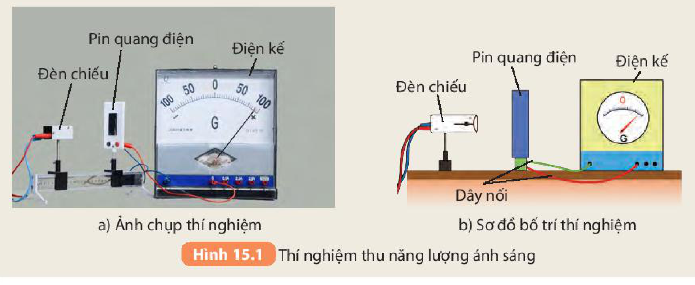
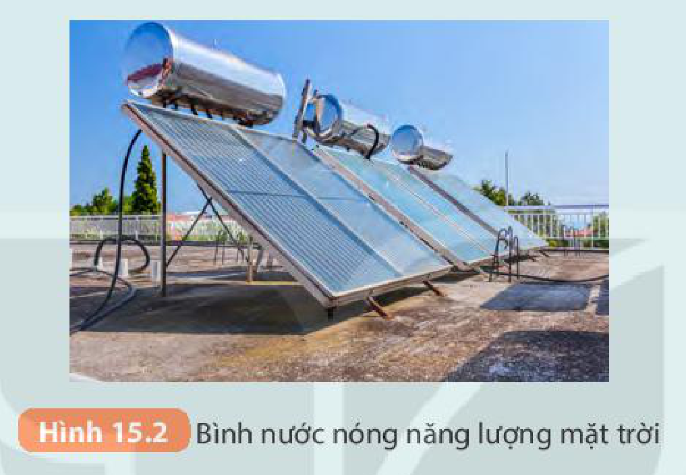
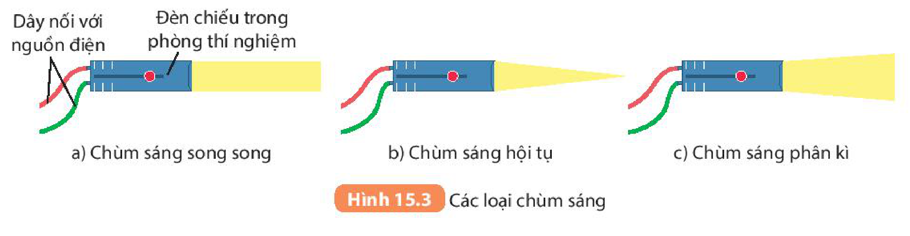
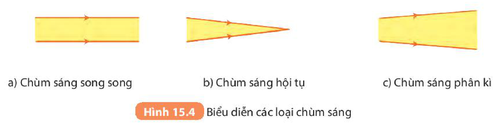
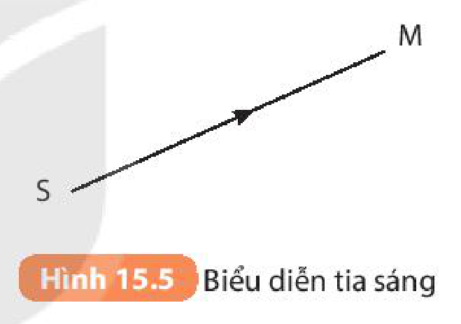
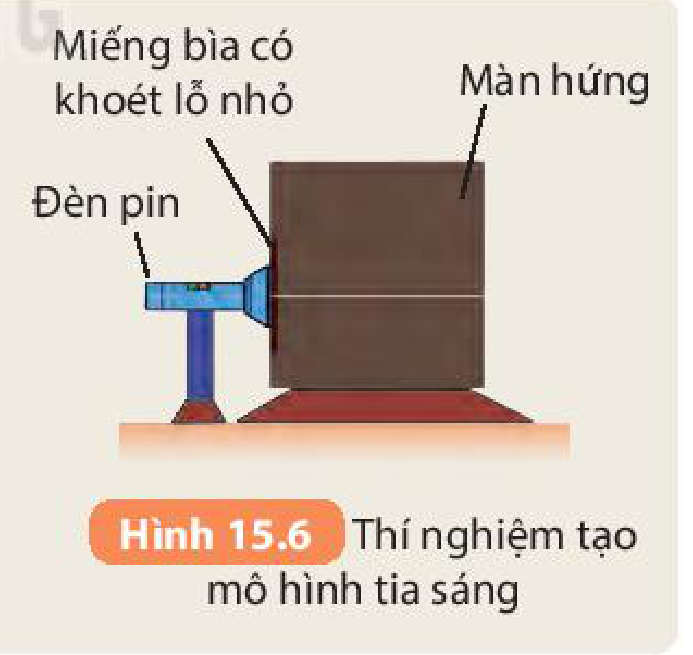
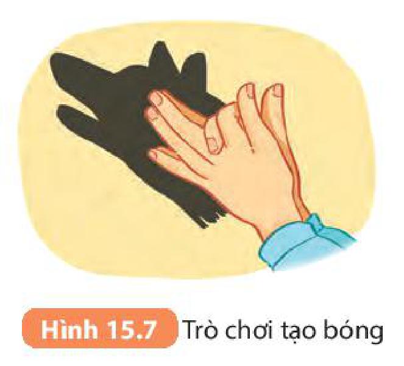
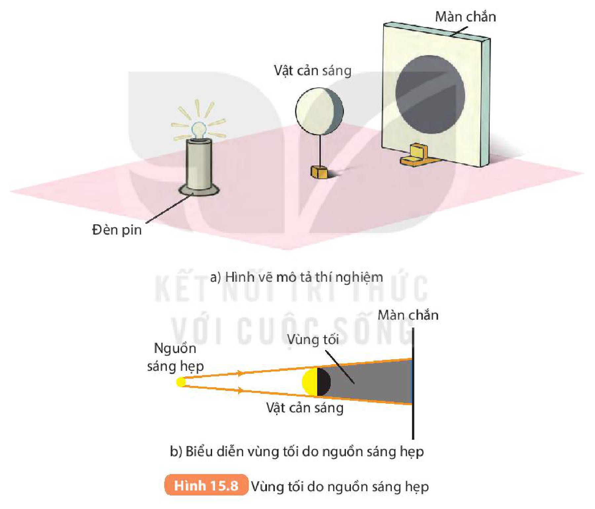
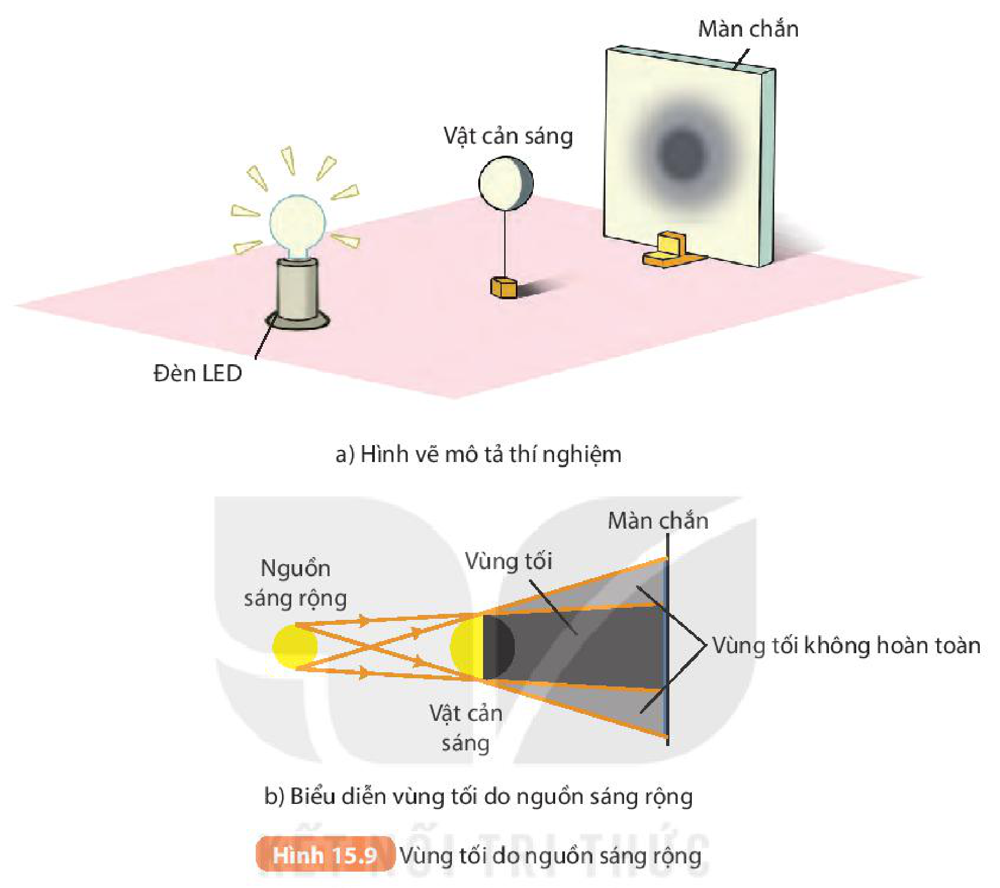
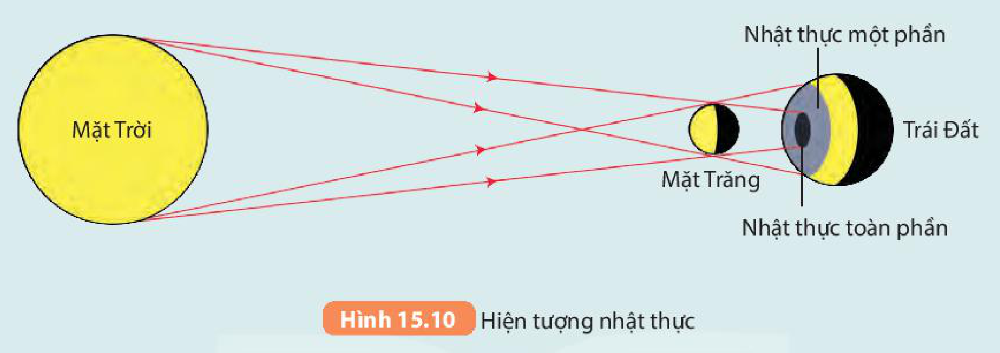

<!-- pdf:73 -->
<!-- CHƯƠNG V - ÁNH SÁNG -->

# BÀI 15: NĂNG LƯỢNG ÁNH SÁNG. TIA SÁNG, VÙNG TỐI

## 🎯 Mục tiêu

- Thực hiện thí nghiệm thu được năng lượng ánh sáng; từ đó, nêu được ánh sáng là một dạng của năng lượng.
- Thực hiện được thí nghiệm tạo ra mô hình tia sáng bằng một chùm sáng hẹp song song.
- Vẽ được hình biểu diễn vùng tối do nguồn sáng rộng và vùng tối do nguồn sáng hẹp.

## 🔴 Mở đầu

> Em hãy dựa vào hình trên, nêu lên vai trò quan trọng của năng lượng ánh sáng trên Trái Đất.

## I. Ánh sáng là một dạng của năng lượng

Ánh sáng không thể thiếu trong cuộc sống của con người và các vật sống khác trên Trái Đất. Việc tìm hiểu ánh sáng sẽ giúp em giải thích được vì sao ánh sáng lại có vai trò quan trọng như vậy.

> ✋ *Thí nghiệm thu năng lượng từ ánh sáng*
>
> Bố trí thí nghiệm như Hình 15.1. Xác định vị trí của kim điện kế:
> - Khi chưa bật đèn chiếu.
> - Khi bật đèn chiếu.
>
> 
>
> Hình 15.1. Thí nghiệm thu năng lượng ánh sáng

<!-- pdf:74 -->

<!-- term: Năng lượng ánh sáng -->
<!-- term: Pin quang điện -->
Khi chưa bật đèn, kim điện kế chỉ số 0, chứng tỏ pin quang điện không phát điện. Khi bật đèn, kim điện kế bị lệch đi, chứng tỏ pin quang điện đã nhận được năng lượng ánh sáng của đèn để chuyển hoá thành điện năng, làm lệch kim điện kế.

> ❓ 1. Nếu thay điện kế trong Hình 15.1 bằng một quạt máy nhỏ và bật đèn, thì sẽ có hiện tượng gì xảy ra? Tại sao?
> 2. Giải thích vì sao chai nước để ngoài nắng, sau một khoảng thời gian thì nóng lên. Năng lượng ánh sáng đã chuyển hoá thành dạng năng lượng nào?

> 🔍 Em có biết?
>
> 
>
> Hình 15.2. Bình nước nóng năng lượng mặt trời
<!-- ocr-ok: đã đối chiếu ảnh trang gốc 74, hộp biểu tượng ống nhòm chỉ có Hình 15.2 Bình nước nóng năng lượng mặt trời -->

> ❓ Nêu thêm ví dụ về sử dụng năng lượng ánh sáng mặt trời ở gia đình hoặc địa phương em. Cho biết năng lượng ánh sáng mặt trời đã chuyển hoá thành những dạng năng lượng nào trong mỗi ví dụ. Tại sao cần ưu tiên sử dụng năng lượng ánh sáng mặt trời?

<!-- term: Năng lượng ánh sáng -->
*Ánh sáng là một dạng của năng lượng.*

## II. Chùm sáng và tia sáng

### 1. Chùm sáng

<!-- term: Chùm sáng -->
Ánh sáng phát ra từ nguồn sáng và truyền trong không gian thành những chùm sáng. Tuỳ thuộc vào nguồn sáng mà chùm sáng có hình dạng và kích thước khác nhau.

Hình 15.3 mô tả ba loại chùm sáng thường gặp.

Hình 15.3. Các loại chùm sáng

<!-- pdf:75 -->

<!-- term: Chùm sáng -->
Quy ước vẽ chùm sáng bằng hai đường thẳng giới hạn chùm sáng, có mũi tên chỉ chiều truyền của ánh sáng (Hình 15.4).

Hình 15.4. Biểu diễn các loại chùm sáng

> ❓ Hãy tìm thêm ví dụ về chùm sáng song song, chùm sáng hội tụ và chùm sáng phân kì trong thực tế.

### 2. Tia sáng

Ta đã biết ánh sáng truyền theo đường thẳng. Quy ước biểu diễn đường truyền của ánh sáng bằng một đường thẳng có mũi tên chỉ chiều truyền của ánh sáng, gọi là **tia sáng**.

Đường thẳng có hướng SM trong Hình 15.5 biểu diễn một tia sáng.

Hình 15.5. Biểu diễn tia sáng

### 3. Thí nghiệm tạo tia sáng bằng chùm sáng hẹp song song

Trong thực tế, người ta coi một chùm sáng song song rất hẹp là mô hình một tia sáng.

> ✋ - Dùng miếng bìa có khoét một lỗ nhỏ để che tấm kính của đèn pin và bố trí thí nghiệm như Hình 15.6. Bật đèn pin, điều chỉnh miếng bìa sao cho vệt sáng từ lỗ nhỏ đi là là trên mặt màn hứng.
> - Quan sát và mô tả vệt sáng đó.
>
> Vệt sáng này hẹp, thẳng trên màn hứng được coi là tia sáng.
>
> 
>
> Hình 15.6. Thí nghiệm tạo mô hình tia sáng

> ❓ 1. Chùm sáng phát ra từ một bút laser có thể coi là mô hình tia sáng không? Tại sao?
> 2. Chùm sáng phát ra từ một đèn pin có thể coi là mô hình tia sáng không? Tại sao?

<!-- pdf:76 -->

## III. Vùng tối

Trong trò chơi tạo bóng (Hình 15.7), khi dùng bóng đèn dây tóc thì bóng của vật sẽ rõ nét; còn khi dùng bóng đèn ống thì bóng của vật không rõ nét. Để giải thích hiện tượng này, chúng ta phải tìm hiểu sự khác biệt giữa vùng tối do nguồn sáng hẹp và vùng tối do nguồn sáng rộng.

Hình 15.7. Trò chơi tạo bóng

### 1. Vùng tối do nguồn sáng hẹp

Dùng loại đèn pin nhỏ chỉ có 1 bóng đèn LED nhỏ để tạo ra nguồn sáng hẹp. Đặt trước đèn một quả bóng nhỏ làm vật cản sáng.

Hình 15.8. Vùng tối do nguồn sáng hẹp

Đối với nguồn sáng hẹp thì phía sau vật cản sáng có vùng hoàn toàn không nhận được ánh sáng từ nguồn sáng truyền tới. Vùng này gọi là **vùng tối**.

> ❓ Hãy mô tả bóng của vật cản sáng trên màn chắn ở Hình 15.8a và giải thích tại sao có bóng đó.

<!-- pdf:77 -->

### 2. Vùng tối do nguồn sáng rộng

Làm lại thí nghiệm trên với đèn LED $20\text{ W}$ dùng làm nguồn sáng rộng.

Hình 15.9. Vùng tối do nguồn sáng rộng

<!-- term: Vùng tối không hoàn toàn -->
Đối với nguồn sáng rộng thì phía sau vật cản sáng có vùng hoàn toàn không nhận được ánh sáng từ nguồn sáng và có vùng chỉ nhận được một phần ánh sáng từ nguồn sáng truyền tới (vùng tối không hoàn toàn).

> ❓ 1. Hãy mô tả bóng của vật cản sáng thu được trên màn chắn trong thí nghiệm ở Hình 15.9a.
> 2. Tìm thêm ví dụ về vùng tối do nguồn sáng hẹp và vùng tối do nguồn sáng rộng.

> ✋ 1. Đặt một vật cản sáng trước ánh nắng mặt trời (lúc trời nắng và không có mây che) để thu bóng của nó trên một màn chắn. Tự làm thí nghiệm để rút ra nhận xét về bóng của vật.
> 2. Giải thích hiện tượng nêu ra ở đầu mục III.

<!-- pdf:78 -->

<!-- term: Nhật thực -->
> 🔍 Em có biết?
>
> Khi Mặt Trời, Mặt Trăng, Trái Đất thẳng hàng như Hình 15.10 thì phía sau Mặt Trăng xuất hiện vùng tối và vùng tối không hoàn toàn. Đứng trên Trái Đất, ở chỗ vùng tối, không nhìn thấy Mặt Trời, đó là vùng có nhật thực toàn phần; ở chỗ vùng tối không hoàn toàn, nhìn thấy một phần Mặt Trời, đó là vùng có nhật thực một phần.
>
> 
>
> Hình 15.10. Hiện tượng nhật thực

## 📌 Em đã học

- Ánh sáng là một dạng của năng lượng.
- Biểu diễn tia sáng bằng đường thẳng có mũi tên chỉ chiều truyền của ánh sáng.
- Chùm sáng song song rất hẹp được coi là mô hình của tia sáng.
- Vùng tối là vùng phía sau vật cản sáng không nhận được ánh sáng từ nguồn sáng truyền tới. Vùng tối do nguồn sáng hẹp có ranh giới rõ rệt với vùng sáng. Vùng tối do nguồn sáng rộng có ranh giới không rõ rệt với vùng sáng.

## 🚀 Em có thể

- Giải thích được sự tạo thành vùng tối do nguồn sáng hẹp và vùng tối do nguồn sáng rộng.
- Nêu được vai trò của năng lượng ánh sáng đối với đời sống của con người, động vật và thực vật.

## 📷 Danh sách hình trong bài

| Mã hình | Trang PDF | Vị trí trong bài | Chú thích gốc |
| --- | :---: | --- | --- |
| H7-khoa_hoc_tu_nhien-b15-01 | 73 | Mở đầu | (sách không đánh số, ảnh đàn bò trên đồng cỏ dưới ánh nắng mặt trời) |
| H7-khoa_hoc_tu_nhien-b15-02 | 73 | Mục I | Hình 15.1. Thí nghiệm thu năng lượng ánh sáng |
| H7-khoa_hoc_tu_nhien-b15-03 | 74 | Mục I (Em có biết?) | Hình 15.2. Bình nước nóng năng lượng mặt trời |
| H7-khoa_hoc_tu_nhien-b15-04 | 74 | Mục II.1 | Hình 15.3. Các loại chùm sáng |
| H7-khoa_hoc_tu_nhien-b15-05 | 75 | Mục II.1 | Hình 15.4. Biểu diễn các loại chùm sáng |
| H7-khoa_hoc_tu_nhien-b15-06 | 75 | Mục II.2 | Hình 15.5. Biểu diễn tia sáng |
| H7-khoa_hoc_tu_nhien-b15-07 | 75 | Mục II.3 | Hình 15.6. Thí nghiệm tạo mô hình tia sáng |
| H7-khoa_hoc_tu_nhien-b15-08 | 76 | Mục III | Hình 15.7. Trò chơi tạo bóng |
| H7-khoa_hoc_tu_nhien-b15-09 | 76 | Mục III.1 | Hình 15.8. Vùng tối do nguồn sáng hẹp |
| H7-khoa_hoc_tu_nhien-b15-10 | 77 | Mục III.2 | Hình 15.9. Vùng tối do nguồn sáng rộng |
| H7-khoa_hoc_tu_nhien-b15-11 | 78 | Em có biết? | Hình 15.10. Hiện tượng nhật thực |
