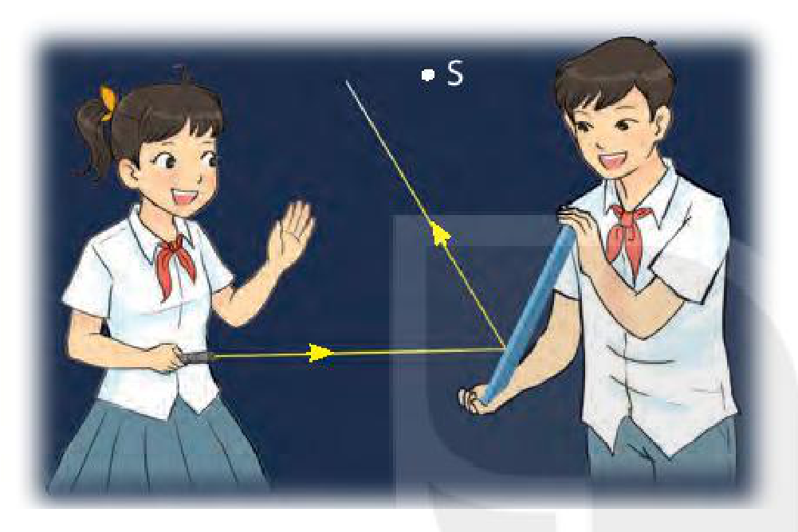
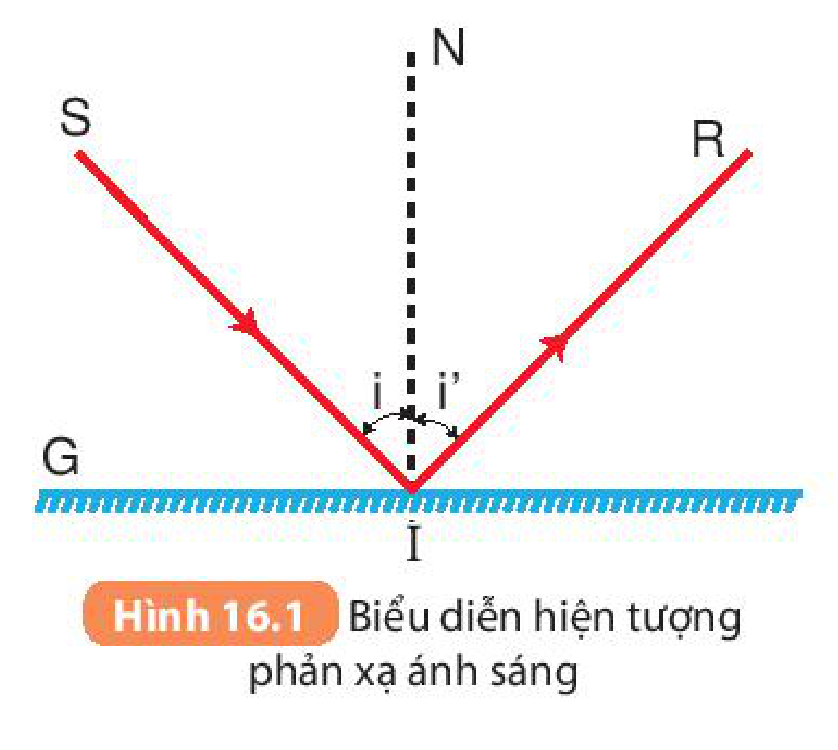
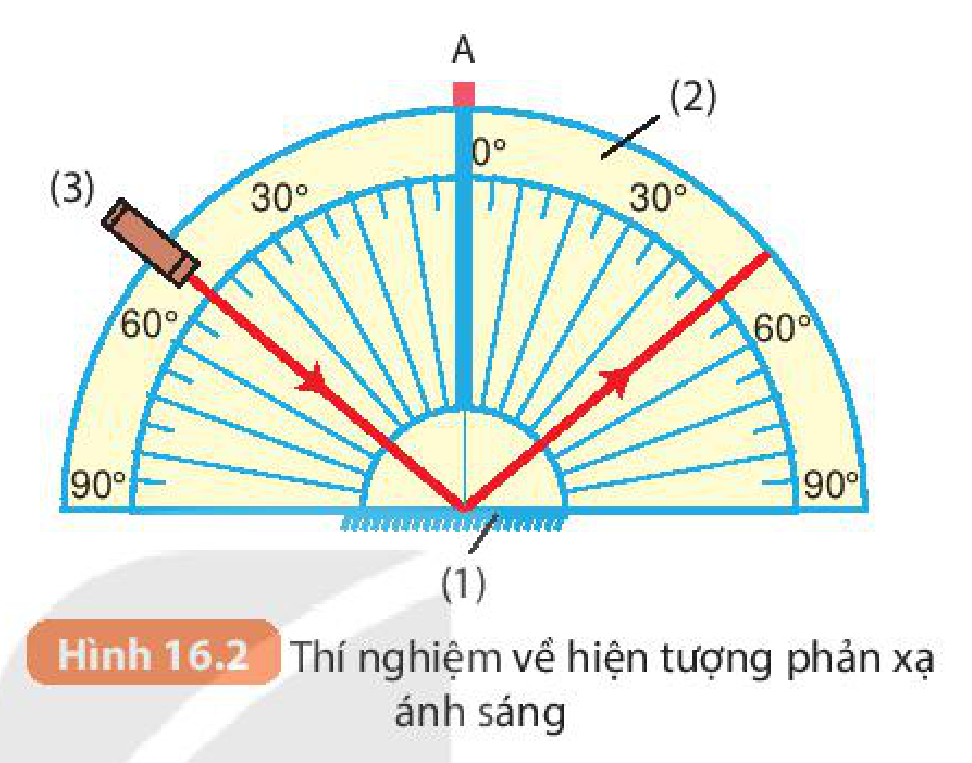
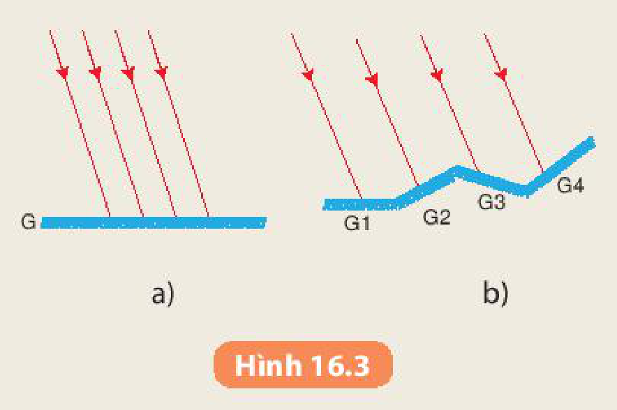
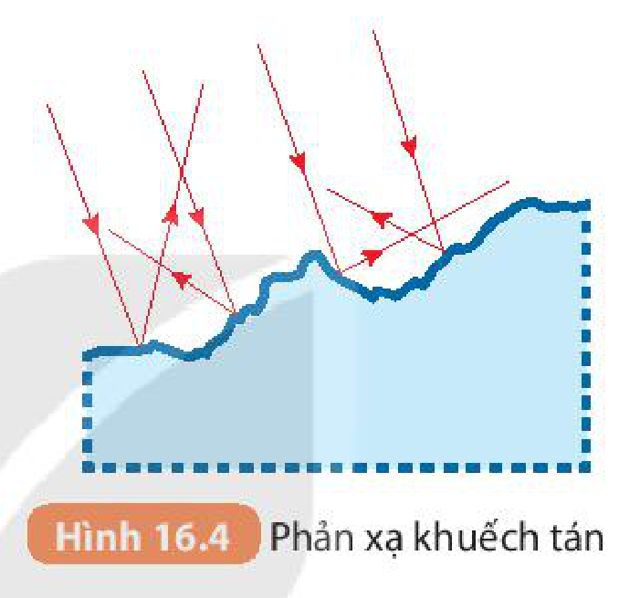
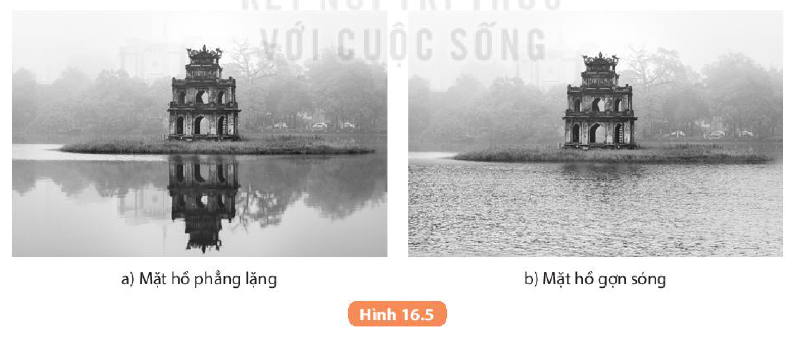
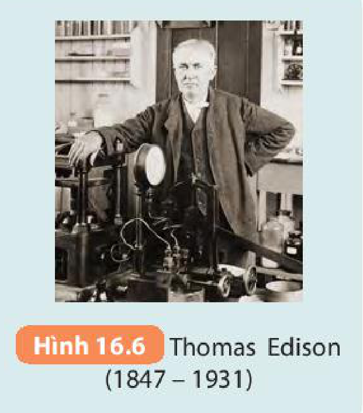

<!-- pdf:79 -->

# BÀI 16: SỰ PHẢN XẠ ÁNH SÁNG

## 🎯 Mục tiêu

- Vẽ được hình biểu diễn và nêu được các khái niệm: tia sáng tới, tia sáng phản xạ, pháp tuyến, góc tới, góc phản xạ, mặt phẳng tới.
- Thực hiện được thí nghiệm rút ra định luật và phát biểu được nội dung của định luật phản xạ ánh sáng.
- Phân biệt được phản xạ và phản xạ khuếch tán.

## 🔴 Mở đầu

> Theo em trong hình bên, có những cách nào để làm cho ánh sáng phát ra từ đèn chiếu tới gương, phản chiếu vào điểm S trên bảng?

## I. Hiện tượng phản xạ ánh sáng

Khi chiếu một chùm sáng vào gương thì chùm sáng bị hắt trở lại theo hướng khác. Hiện tượng đó gọi là **phản xạ ánh sáng**.

Hiện tượng này còn xảy ra với các bề mặt nhẵn bóng khác.

> ❓ Tìm thêm ví dụ về hiện tượng phản xạ ánh sáng.

Trong hiện tượng phản xạ ánh sáng, người ta quy ước (Hình 16.1):

- G: gương phẳng (mặt phản xạ).
- **Tia sáng tới** (SI): tia sáng chiếu vào gương.
- **Tia sáng phản xạ** (IR): tia sáng bị gương hắt trở lại.
- **Điểm tới** (I): giao điểm của tia sáng tới và gương.

Hình 16.1. Biểu diễn hiện tượng phản xạ ánh sáng

<!-- pdf:80 -->

- **Pháp tuyến** (IN) tại I: đường thẳng vuông góc với gương tại I.
- **Mặt phẳng tới**: mặt phẳng chứa tia sáng tới và pháp tuyến tại điểm tới.
- **Góc tới** ($\widehat{SIN} = i$): góc tạo bởi tia sáng tới và pháp tuyến tại điểm tới.
- **Góc phản xạ** ($\widehat{RIN} = i'$): góc tạo bởi tia sáng phản xạ và pháp tuyến tại điểm tới.

## II. Định luật phản xạ ánh sáng

### 1. Thí nghiệm

a) Dụng cụ thí nghiệm

- Một gương phẳng (1).
- Một bảng chia độ được chia làm hai nửa, nửa bên trái và nửa bên phải đều quay được quanh trục A (2).
- Một đèn tạo chùm sáng hẹp (tia sáng) có thể di chuyển được từ góc $0^\circ$ đến $90^\circ$ trên bảng chia độ (3).

b) Bố trí thí nghiệm như Hình 16.2

c) Tiến hành thí nghiệm

Hình 16.2. Thí nghiệm về hiện tượng phản xạ ánh sáng

> ✋ Dùng đèn chiếu tia sáng tới mặt gương phẳng sao cho tia sáng này đi là là trên mặt bảng chia độ. Hãy quan sát thí nghiệm và thực hiện các yêu cầu sau:
>
> 1. Tia sáng phản xạ có xuất hiện trên mặt phẳng tới không?
>    Quay nửa bên phải của bảng chia độ quanh trục A để nó không thuộc mặt phẳng chứa nửa bên trái. Quan sát xem có còn nhìn thấy tia sáng phản xạ không.
> 2. Quay nửa bên phải của bảng chia độ trở lại vị trí ban đầu, rồi thay đổi góc tới để tìm mối quan hệ giữa góc tới và góc phản xạ.
> 3. Rút ra kết luận về mặt phẳng chứa tia sáng phản xạ và mối quan hệ giữa góc phản xạ và góc tới.

### 2. Định luật phản xạ ánh sáng

<!-- term: Định luật phản xạ ánh sáng -->
- Tia sáng phản xạ nằm trong mặt phẳng tới;
- Góc phản xạ bằng góc tới.

> ❓ 1. Có thể viết công thức của định luật phản xạ ánh sáng $i = i'$ được không? Tại sao?
> 2. Chiếu tia sáng tới dưới góc tới $30^\circ$ vào gương phẳng đặt thẳng đứng, vẽ hình biểu diễn tia sáng tới và tia sáng phản xạ.
> 3. Chiếu một tia sáng vào gương phẳng đặt nằm ngang ta được tia sáng phản xạ vuông góc với tia sáng tới. Em hãy tính góc tới và góc phản xạ. Vẽ hình.

<!-- pdf:81 -->

## III. Phản xạ và phản xạ khuếch tán

> ✋ Em hãy vẽ các tia sáng phản xạ của các tia sáng tới trong Hình 16.3a và 16.3b.
>
> Nhận xét về hướng của các tia sáng phản xạ đã vẽ trong Hình 16.3a và 16.3b. Giải thích.
>
> 
>
> Hình 16.3

Khi mặt phản xạ nhẵn thì các tia sáng tới song song bị phản xạ theo một hướng. Hiện tượng này gọi là hiện tượng *phản xạ* (còn gọi là **phản xạ gương**).

Khi mặt phản xạ không nhẵn thì các tia sáng tới song song bị phản xạ theo mọi hướng (Hình 16.4). Hiện tượng này gọi là hiện tượng **phản xạ khuếch tán** (còn gọi là tán xạ).

Hình 16.4. Phản xạ khuếch tán

- Khi có phản xạ, ta có thể nhìn thấy ảnh của vật (Hình 16.5a).
- Khi có phản xạ khuếch tán, ta không nhìn thấy ảnh của vật (Hình 16.5b).

Hình 16.5

> ❓ Tìm thêm ví dụ về phản xạ và phản xạ khuếch tán.

<!-- pdf:82 -->

> 🔍 Em có biết?
>
> Ê-đi-xơn (Thomas Edison), khi 10 tuổi đã có sáng kiến dùng nhiều tấm gương tập trung ánh sáng phản xạ của nhiều ngọn đèn dầu để đủ sáng cho bác sĩ mổ ruột thừa của mẹ kịp thời, cứu được bà thoát chết. Sau này lớn lên, ông đã trở thành nhà bác học nổi tiếng và là tác giả của rất nhiều sáng chế khoa học trong đó có bóng đèn điện, tàu điện, máy chiếu phim, đĩa hát,...
>
> Ông được bầu chọn là một trong 100 người có ảnh hưởng lớn nhất đến sự tiến bộ của nhân loại thế kỉ XX.
>
> 
>
> Hình 16.6. Thomas Edison (1847 – 1931)

## 📌 Em đã học

- Khi ánh sáng truyền đến một bề mặt nhẵn bóng sẽ xảy ra hiện tượng phản xạ.
- Định luật phản xạ ánh sáng:
  - Tia sáng phản xạ nằm trong mặt phẳng tới;
  - Góc phản xạ bằng góc tới.
- Phản xạ khuếch tán là hiện tượng các tia sáng song song truyền đến bề mặt không nhẵn, bị phản xạ theo mọi hướng.

## 🚀 Em có thể

Thuyết trình về sự phản xạ ánh sáng trên các bề mặt nhẵn bóng.

## 📷 Danh sách hình trong bài

| Mã hình | Trang PDF | Vị trí trong bài | Chú thích gốc |
| --- | :---: | --- | --- |
| H7-khoa_hoc_tu_nhien-b16-01 | 79 | Mở đầu | (sách không đánh số, hình vẽ hai học sinh chiếu đèn vào gương phản chiếu tới điểm S trên bảng) |
| H7-khoa_hoc_tu_nhien-b16-02 | 79 | Mục I | Hình 16.1. Biểu diễn hiện tượng phản xạ ánh sáng |
| H7-khoa_hoc_tu_nhien-b16-03 | 80 | Mục II.1 | Hình 16.2. Thí nghiệm về hiện tượng phản xạ ánh sáng |
| H7-khoa_hoc_tu_nhien-b16-04 | 81 | Mục III | Hình 16.3 |
| H7-khoa_hoc_tu_nhien-b16-05 | 81 | Mục III | Hình 16.4. Phản xạ khuếch tán |
| H7-khoa_hoc_tu_nhien-b16-06 | 81 | Mục III | Hình 16.5 |
| H7-khoa_hoc_tu_nhien-b16-07 | 82 | Em có biết? | Hình 16.6. Thomas Edison (1847 – 1931) |
