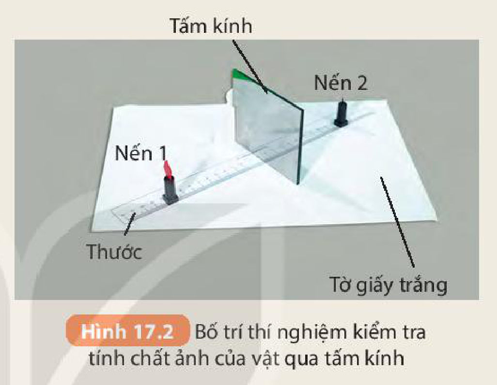
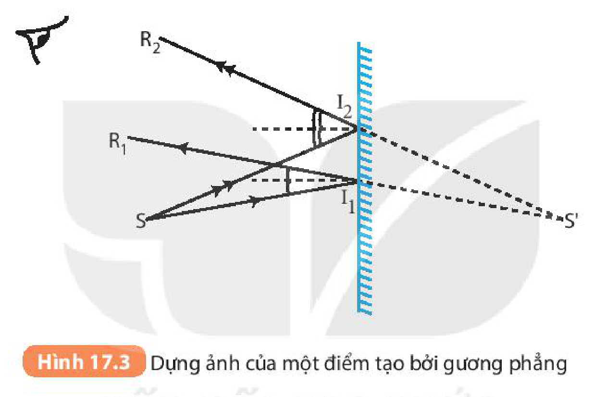
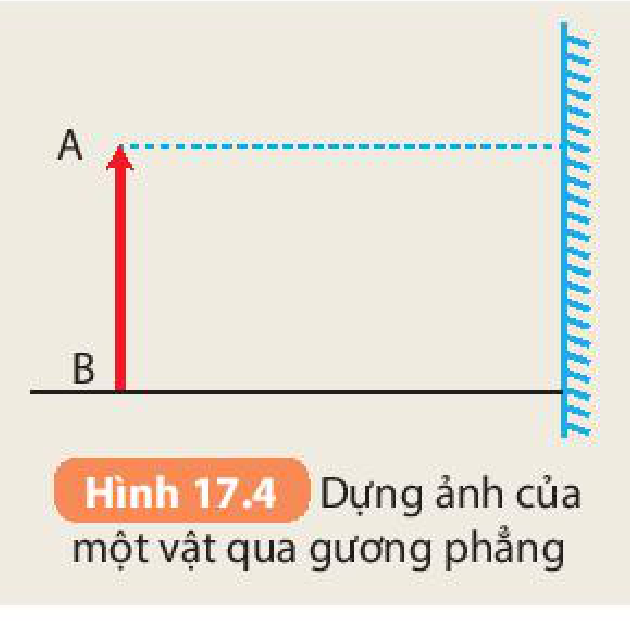
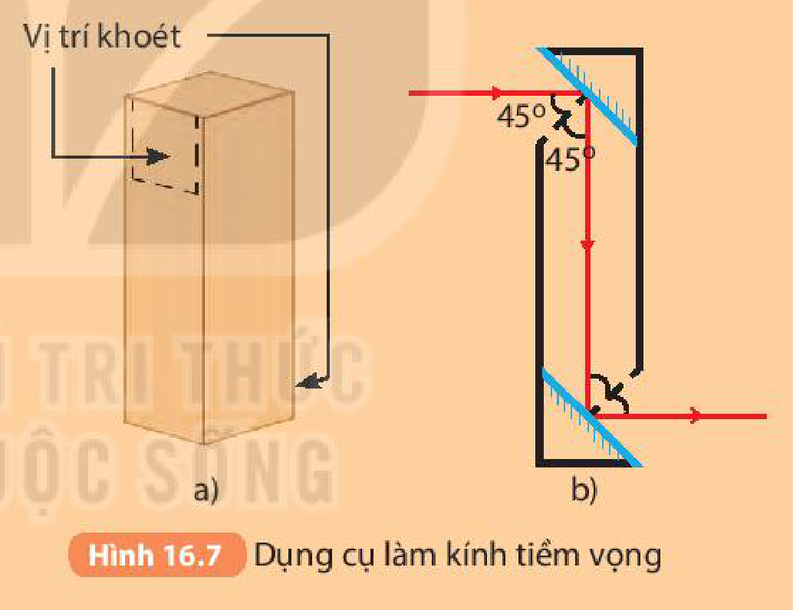

<!-- pdf:83 -->

# BÀI 17: ẢNH CỦA VẬT QUA GƯƠNG PHẲNG

## 🎯 Mục tiêu

- Vẽ được hình biển diễn và nêu được tính chất ảnh của vật qua gương phẳng.
- Dựng được ảnh của một vật qua gương phẳng.
- Vận dụng được định luật phản xạ trong một số trường hợp đơn giản.

## 🔴 Mở đầu

> Tại sao chữ AMBULANCE trên đầu xe cứu thương lại được viết ngược từ phải sang trái?

## I. Ảnh của vật qua gương phẳng

Khi soi gương ta thấy hình của mình ở trong gương (Hình 17.1). Hình của vật nhìn thấy trong gương phẳng được gọi là **ảnh của vật qua gương phẳng**.

Hình 17.1. Ảnh của khuôn mặt qua gương phẳng

> ❓ Hãy nêu thêm ví dụ về ảnh của vật qua gương phẳng hoặc các mặt phản xạ khác.

## II. Tính chất ảnh của vật qua gương phẳng

### 1. Dự đoán về tính chất của ảnh qua gương phẳng

Ta có thể dự đoán được tính chất ảnh của vật qua gương phẳng bằng việc quan sát ảnh của chính mình qua gương phẳng.

> ❓ 1. Có thể thu được ảnh qua gương phẳng trên màn chắn không?
> 2. Khoảng cách từ ảnh tới gương phẳng có bằng khoảng cách từ vật tới gương phẳng không?
> 3. Độ lớn của ảnh có bằng độ lớn của vật không?

<!-- pdf:84 -->

### 2. Thí nghiệm kiểm tra dự đoán

*a) Dụng cụ thí nghiệm*

- Một tấm kính mỏng, phẳng để thay cho gương phẳng.
- Hai cây nến giống nhau.
- Thước đo có ĐCNN tới milimét, tờ giấy trắng.
- Một giá đỡ tấm kính, hai giá đỡ nến.

*b) Tiến hành thí nghiệm*

> ✋ 1. Hãy nghĩ cách làm thí nghiệm để kiểm tra xem ảnh của vật qua gương phẳng có thu được trên màn chắn không.
> 2. Hãy tiến hành thí nghiệm theo các bước sau để kiểm tra dự đoán về khoảng cách từ ảnh, vật tới tấm kính và độ lớn của ảnh so với vật (Hình 17.2):
>    - Đặt cây nến 1 trước tấm kính (không đặt sát vào kính) và thắp sáng.
>    - Di chuyển cây nến 2 ra phía sau tấm kính đến đúng vị trí ảnh của cây nến 1 (sao cho ảnh ngọn lửa của cây nến 1 nằm ở ngọn của cây nến 2).
>    - So sánh độ lớn ảnh của cây nến 1 với cây nến 2; đo khoảng cách từ hai cây nến đến tấm kính để từ đó rút ra kết luận.
>
> 
>
> Hình 17.2. Bố trí thí nghiệm kiểm tra tính chất ảnh của vật qua tấm kính

> ✋ Hãy dùng một miếng bìa có viết chữ “ƎƆИA⅃UЯMA” hướng mặt có dòng chữ vào gương phẳng để tìm ảnh của dòng chữ và trả lời câu hỏi ở phần mở bài.

> ❓ 1. Bạn A đứng cách bức tường $4\text{ m}$, trên tường treo thẳng đứng một tấm gương phẳng rộng và nhìn thấy ảnh của mình trong gương. Bạn A phải di chuyển về phía nào, một khoảng bao nhiêu để cách ảnh của mình $2\text{ m}$?
> 2. Ảnh của chữ “TÌM” trong gương phẳng là chữ gì?

<!-- pdf:85 -->

## III. Dựng ảnh của vật qua gương phẳng

### 1. Dựng ảnh của một điểm S (nguồn sáng rất nhỏ)

*Bước 1.* Từ $S$ vẽ một chùm sáng được giới hạn bởi hai tia sáng $SI_1$ và $SI_2$ tới gương.

*Bước 2.* Áp dụng định luật phản xạ ánh sáng, vẽ chùm tia sáng phản xạ được giới hạn bởi các tia sáng phản xạ $I_1R_1$ và $I_2R_2$ tương ứng.

<!-- term: Ảnh ảo -->
*Bước 3.* Tìm giao điểm $S'$ của chùm phản xạ bằng cách kéo dài các tia sáng phản xạ (biểu diễn bằng đường nét đứt). Các đường này cắt nhau tại $S'$. $S'$ là ảnh ảo của $S$ (Hình 17.3).

<!-- term: Ảnh ảo -->
Khi đặt mắt hứng chùm tia sáng phản xạ ta sẽ nhìn thấy ảnh $S'$ và có cảm giác như ánh sáng xuất phát từ $S'$ tới mắt ta.

Hình 17.3. Dựng ảnh của một điểm tạo bởi gương phẳng

> ❓ 1. Giải thích tại sao chỉ nhìn thấy ảnh $S'$ mà không thể thu được ảnh này trên màn chắn.
> 2. Hãy tìm cách vẽ hình biểu diễn ảnh của một vật qua gương phẳng mà không cần vẽ tia sáng.

### 2. Dựng ảnh của một vật qua gương phẳng

> ✋ Dựa vào tính chất đối xứng của ảnh và vật qua gương phẳng, hãy dựng ảnh của vật AB qua gương phẳng (Hình 17.4).
>
> 
>
> Hình 17.4. Dựng ảnh của một vật qua gương phẳng

<!-- pdf:86 -->

## 📌 Em đã học

<!-- term: Ảnh ảo -->
<!-- term: Tính chất của ảnh tạo bởi gương phẳng -->
- Ảnh của vật qua gương phẳng là ảnh ảo (không hứng được trên màn chắn).
- Độ lớn của ảnh bằng độ lớn của vật, khoảng cách từ một điểm của vật đến gương phẳng bằng khoảng cách từ ảnh của điểm đó đến gương (ảnh và vật đối xứng nhau qua gương).
- Hai cách dựng ảnh của vật qua gương phẳng:
  - Cách 1: Dựa vào định luật phản xạ ánh sáng.
  - Cách 2: Dựa vào tính chất của ảnh.

## 🚀 Em có thể

<!-- term: Kính tiềm vọng -->
- Giải thích được cách bố trí gương trong tiệm cắt tóc, tiệm trang điểm, cửa hàng thời trang,...
- Nhận ra vẻ đẹp của cơ thể sinh vật và các vật dụng có tính đối xứng tương tự như vật và ảnh của nó qua gương.
- Tự làm kính tiềm vọng dùng để quan sát những vật nằm sau vật cản che khuất tầm nhìn của mắt.
  *Chuẩn bị:* Tấm bìa cứng, hai chiếc gương phẳng hình vuông, băng dính, keo dán, kéo và dao rọc giấy.
  *Tiến hành:*
  - Tạo một hình hộp chữ nhật như Hình 16.7a (chú ý chiều rộng của hộp lớn hơn độ dài cạnh của gương).
  - Khoét hai lỗ hình chữ nhật trên hai mặt đối diện nhau của hộp đủ để gắn gương tại hai vị trí theo sơ đồ Hình 16.7b, ta được một chiếc kính tiềm vọng đơn giản.
  1. Quan sát ảnh của vật bằng kính tiềm vọng tự làm.
  2. Mô tả và giải thích tác dụng của kính tiềm vọng.

Hình 16.7. Dụng cụ làm kính tiềm vọng

## 📷 Danh sách hình trong bài

| Mã hình | Trang PDF | Vị trí trong bài | Chú thích gốc |
| --- | :---: | --- | --- |
| H7-khoa_hoc_tu_nhien-b17-01 | 83 | Mở đầu | (sách không đánh số, ảnh xe cứu thương có chữ AMBULANCE viết ngược ở đầu xe) |
| H7-khoa_hoc_tu_nhien-b17-02 | 83 | Mục I | Hình 17.1. Ảnh của khuôn mặt qua gương phẳng |
| H7-khoa_hoc_tu_nhien-b17-03 | 84 | Mục II.2 | Hình 17.2. Bố trí thí nghiệm kiểm tra tính chất ảnh của vật qua tấm kính |
| H7-khoa_hoc_tu_nhien-b17-04 | 85 | Mục III.1 | Hình 17.3. Dựng ảnh của một điểm tạo bởi gương phẳng |
| H7-khoa_hoc_tu_nhien-b17-05 | 85 | Mục III.2 | Hình 17.4. Dựng ảnh của một vật qua gương phẳng |
| H7-khoa_hoc_tu_nhien-b17-06 | 86 | Em có thể (allow_edge_ink: nằm trong hộp nền cam đậm) | Hình 16.7. Dụng cụ làm kính tiềm vọng |
