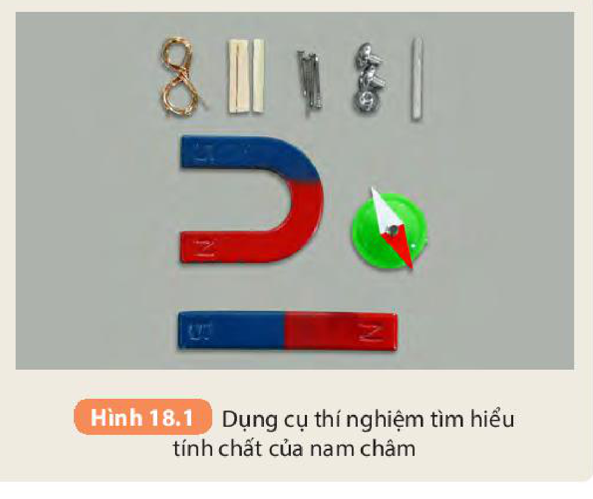
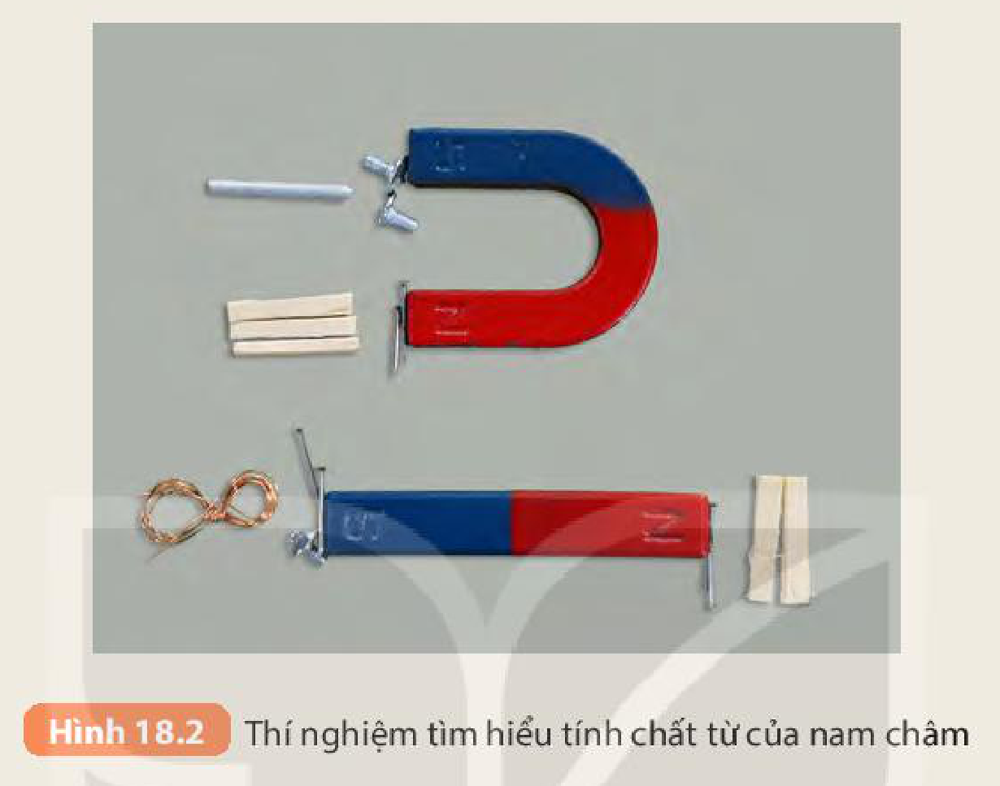
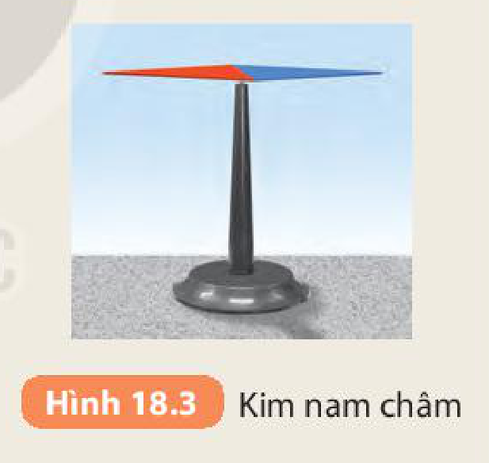
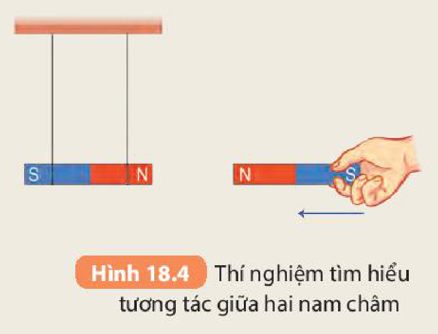
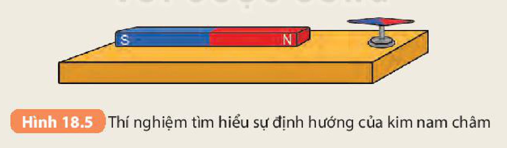

<!-- pdf:87 -->
<!-- CHƯƠNG VI - TỪ -->

# BÀI 18: NAM CHÂM

## 🎯 Mục tiêu

- Tiến hành thí nghiệm để nêu được: tác dụng của nam châm đến các vật liệu khác nhau; sự định hướng của thanh nam châm (kim nam châm).
- Xác định được cực Bắc và cực Nam của một thanh nam châm.

## 🔴 Mở đầu

> Em đã bao giờ nhìn thấy hay có một vật gọi là “nam châm” chưa? Bằng cách nào có thể xác định được vật đó là nam châm?

## I. Nam châm là gì?

Từ xa xưa, con người đã chú ý đến một số loại đá có tính chất hút được một số vật bằng sắt. Nếu buộc nó vào một sợi chỉ thì khi cân bằng nó luôn chỉ một hướng xác định, một đầu hòn đá chỉ hướng bắc, một đầu chỉ hướng nam. Các thuỷ thủ dùng những “viên đá dẫn đường” này, hay còn gọi là đá nam châm, để định hướng trên biển. Sau này, khoa học công nghệ phát triển, con người đã nghiên cứu bản chất của nam châm và tạo ra nam châm có kích thước và hình dạng khác nhau: nam châm thẳng, nam châm hình chữ U, nam châm viên,... Các vật có tính chất như trên được gọi là **nam châm**.

## II. Tính chất từ của nam châm

Hãy thực hiện các thí nghiệm dưới đây để tìm hiểu các tính chất của nam châm.

> ✋ *Dụng cụ:* một nam châm thẳng, một nam châm hình chữ U, một kim nam châm có thể quay quanh một trục, một số vật nhỏ làm bằng sắt, thép, đồng, nhôm, gỗ (Hình 18.1).
>
> 
>
> Hình 18.1. Dụng cụ thí nghiệm tìm hiểu tính chất của nam châm

<!-- pdf:88 -->

> *Tiến hành:*
>
> *Thí nghiệm 1:*
>
> Đưa thanh nam châm thẳng và nam châm hình chữ U lại gần các vật sắt, thép, đồng, nhôm, gỗ (Hình 18.2).
> a) Hai đầu nam châm hút vật liệu nào và không hút vật liệu nào?
> b) Các vật liệu đặt ở hai đầu hay ở giữa của nam châm thì bị hút mạnh nhất?
>
> 
>
> Hình 18.2. Thí nghiệm tìm hiểu tính chất từ của nam châm
>
> *Thí nghiệm 2:*
> - Đặt một kim nam châm nằm cân bằng trên một mũi nhọn (kim nam châm tự do) (Hình 18.3), quan sát hướng chỉ của hai đầu kim khi kim đã nằm cân bằng.
> - Đẩy nhẹ cho kim quay một góc nhỏ rồi buông tay, quan sát hướng chỉ của kim nam châm khi đã nằm cân bằng.
>
> 
>
> Hình 18.3. Kim nam châm

> ❓ 1. Một đầu kim luôn chỉ hướng nào và đầu kia của kim luôn chỉ hướng nào (hướng bắc hay hướng nam)?
> 2. Từ các thí nghiệm trên có thể rút ra những tính chất gì của nam châm?
> 3. Dùng kim nam châm xác định các hướng nam, bắc, đông, tây ở trong phòng học.

<!-- term: Tính chất từ của nam châm -->
Các tính chất được rút ra từ các thí nghiệm gọi là *tính chất từ* của nam châm.

> ❓ Làm thế nào để xác định được cực Bắc và cực Nam của một nam châm khi trên nam châm không đánh dấu cực?

<!-- pdf:89 -->

## III. Tương tác giữa hai nam châm

> ✋ *Thí nghiệm:*
>
> Treo thanh nam châm thẳng bằng hai sợi chỉ lên thanh ngang của giá đỡ, để cho thanh nam châm nằm cân bằng. Đưa một cực của thanh nam châm khác lại gần một đầu thanh nam châm được treo (Hình 18.4). Sau đó đưa cực kia của thanh nam châm lại gần thanh nam châm được treo. Mô tả hiện tượng xảy ra.
>
> 
>
> Hình 18.4. Thí nghiệm tìm hiểu tương tác giữa hai nam châm

> ❓ Qua thí nghiệm có thể rút ra kết luận gì về tương tác giữa hai nam châm?

## IV. Định hướng của một kim nam châm tự do

> ✋ *Thí nghiệm*
> - Đặt một kim nam châm tự do tại vị trí gần một nam châm thẳng (Hình 18.5). Xác định hướng của kim nam châm.
> - Đẩy kim nam châm lệch khỏi hướng vừa xác định rồi buông tay. Khi kim đã đứng yên, kim còn chỉ hướng lúc đầu nữa không? Làm lại thí nghiệm 2 lần và nhận xét.
> - Làm lại thí nghiệm trên ở vị trí khác của kim nam châm.
>
> 
>
> Hình 18.5. Thí nghiệm tìm hiểu sự định hướng của kim nam châm

> ❓ Từ thí nghiệm trên rút ra nhận xét gì về tác dụng của một nam châm lên một kim nam châm?

<!-- pdf:90 -->

> 🔍 Em có biết?
>
> Ứng dụng của nam châm đa dạng, phong phú trong nhiều lĩnh vực của đời sống xã hội, từ cuộc sống hằng ngày đến sản xuất công nghiệp, khai thác khoáng sản,...
>
> Một số ứng dụng điển hình và gần gũi: Dùng nam châm loại bỏ những sản phẩm sắt bị lẫn trong thực phẩm như ngũ cốc, đường, bột,... Trong bệnh viện, người ta dùng thiết bị, trong đó có bộ phận là nam châm để lấy mạt sắt nhỏ li ti ra khỏi mắt bệnh nhân khi không thể dùng panh hoặc kìm.
>
> Các kĩ sư dùng nam châm dạng thanh để tạo ra hệ thống lọc sắt gọi là “lưới nam châm lọc sắt”, được cấu tạo gồm nhiều thanh nam châm ghép lại với nhau trên cùng một vỉ. Khi nguyên liệu chạy qua lưới, lực từ cực mạnh trên các thanh nam châm sẽ giữ các vật có tính chất từ lại, giúp dòng sản phẩm sạch hơn và bảo vệ hệ thống xử lí phía sau.

## 📌 Em đã học

<!-- term: Tính chất từ của nam châm -->
<!-- term: Cực từ -->
<!-- term: Kim nam châm -->
- Nam châm là vật có từ tính (hút được các vật bằng sắt và một số hợp kim của sắt). Vật liệu bị nam châm hút là **vật liệu có tính chất từ**.
- Thanh nam châm được treo vào một sợi dây mảnh hoặc kim nam châm khi đặt cân bằng trên mũi nhọn luôn chỉ hướng Bắc – Nam. Một cực của nam châm hướng về phía bắc địa lí gọi là **cực Bắc**, cực kia hướng về phía nam địa lí gọi là **cực Nam**. Để phân biệt 2 cực của nam châm người ta sơn 2 màu khác nhau, màu đỏ là cực Bắc ghi chữ N (viết tắt từ tiếng Anh North), màu xanh là cực Nam ghi chữ S (viết tắt từ tiếng Anh South).
- Khi đặt hai nam châm gần nhau, hai từ cực khác tên hút nhau, hai từ cực cùng tên đẩy nhau.
- Kim nam châm (nam châm thử) đặt gần nam châm sẽ chịu tác dụng của nam châm làm cho kim nằm theo một hướng xác định.

## 🚀 Em có thể

Giải thích được việc dùng khối nam châm có kích thước lớn, sức hút mạnh để dọn rác sắt vụn dưới lòng sông, lòng kênh.

## 📷 Danh sách hình trong bài

| Mã hình | Trang PDF | Vị trí trong bài | Chú thích gốc |
| --- | :---: | --- | --- |
| H7-khoa_hoc_tu_nhien-b18-01 | 87 | Mục II | Hình 18.1. Dụng cụ thí nghiệm tìm hiểu tính chất của nam châm |
| H7-khoa_hoc_tu_nhien-b18-02 | 88 | Mục II | Hình 18.2. Thí nghiệm tìm hiểu tính chất từ của nam châm |
| H7-khoa_hoc_tu_nhien-b18-03 | 88 | Mục II | Hình 18.3. Kim nam châm |
| H7-khoa_hoc_tu_nhien-b18-04 | 89 | Mục III | Hình 18.4. Thí nghiệm tìm hiểu tương tác giữa hai nam châm |
| H7-khoa_hoc_tu_nhien-b18-05 | 89 | Mục IV | Hình 18.5. Thí nghiệm tìm hiểu sự định hướng của kim nam châm |
