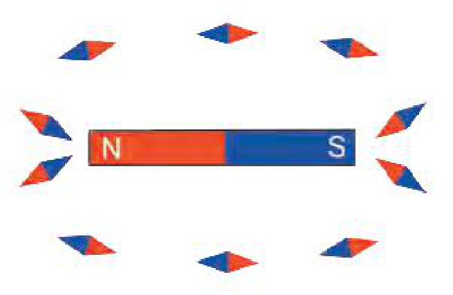
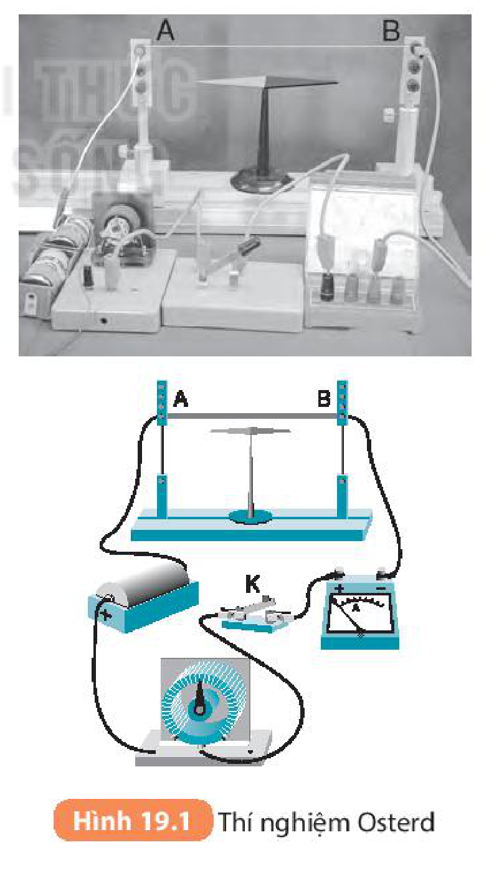
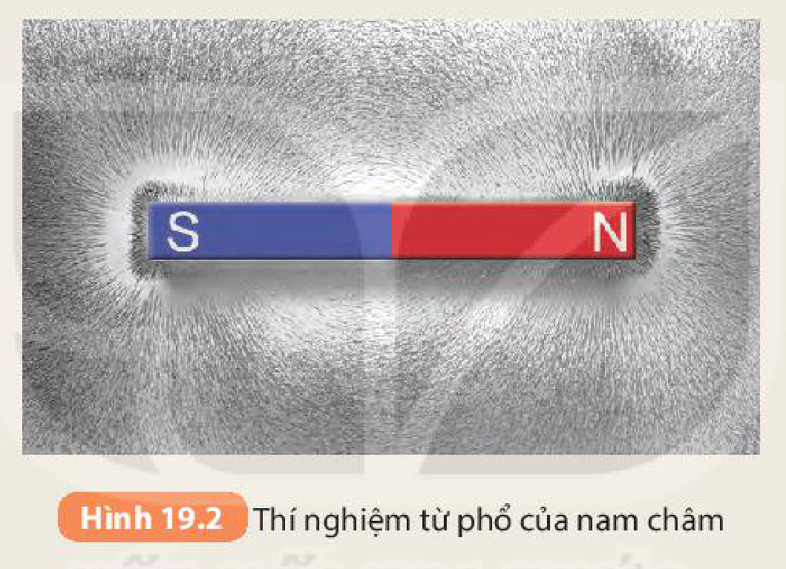
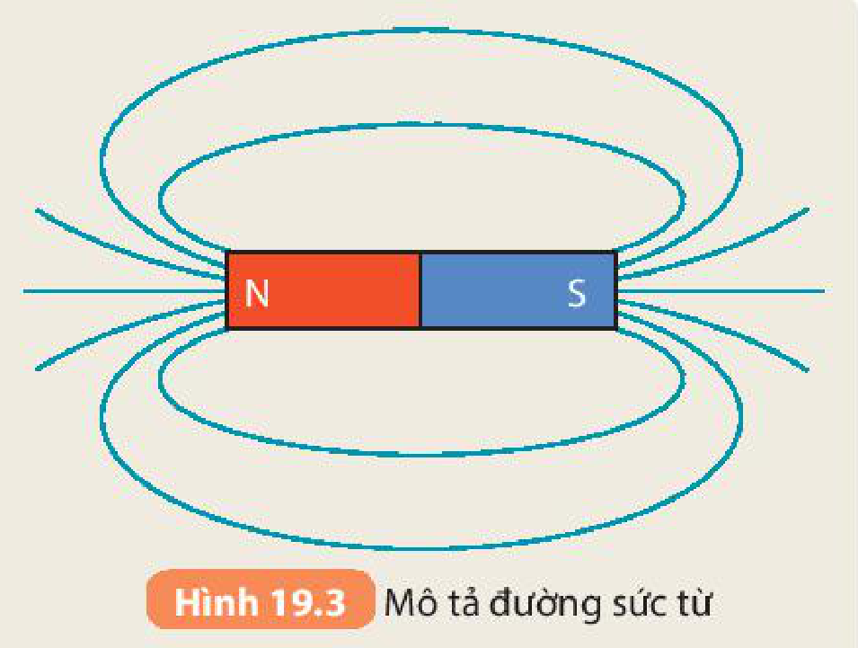
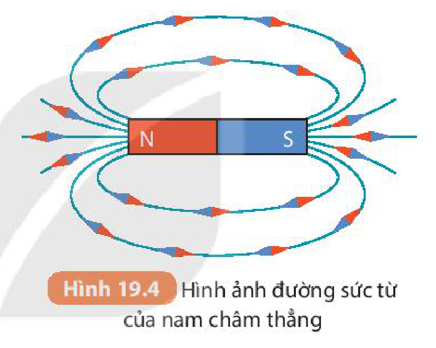
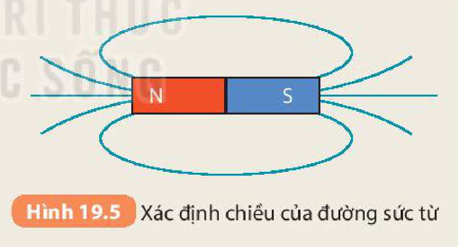
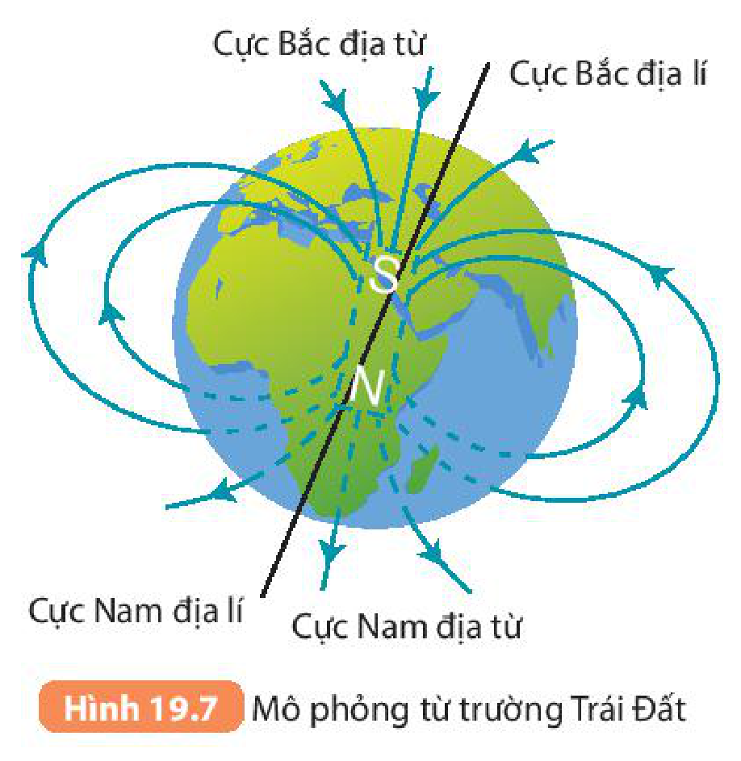
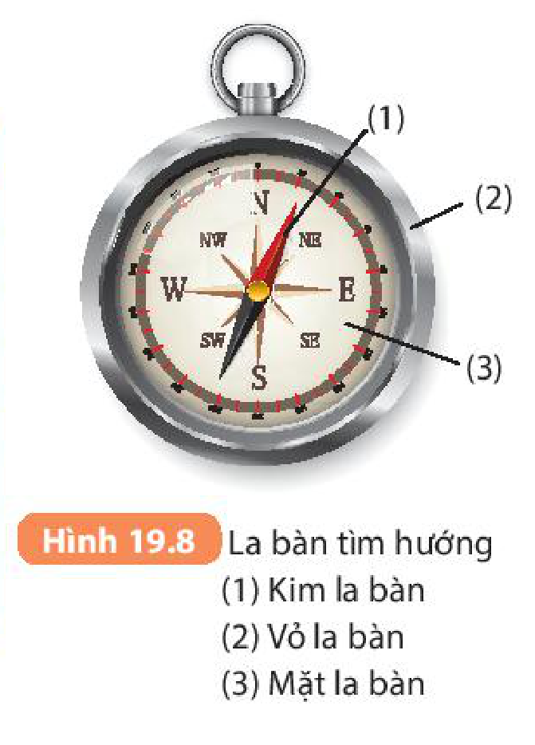
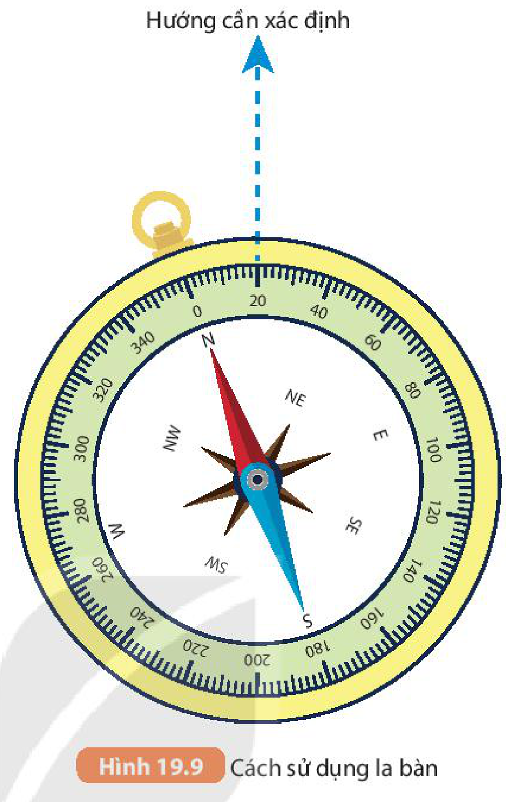
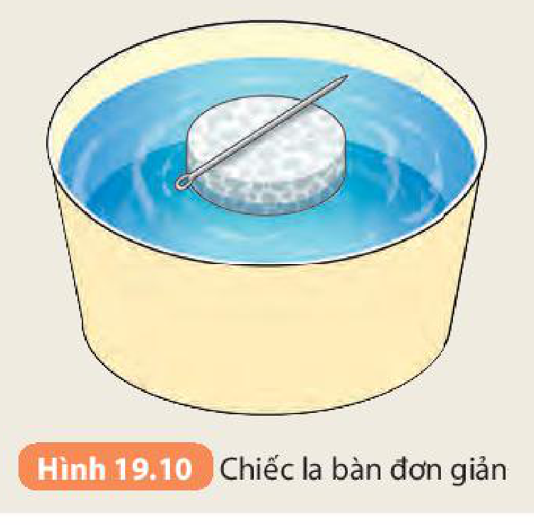

<!-- pdf:91 -->

# BÀI 19: TỪ TRƯỜNG

## 🎯 Mục tiêu

- Nêu được vùng không gian bao quanh một nam châm (hoặc dây dẫn mang dòng điện), mà vật liệu có tính chất từ đặt trong nó chịu tác dụng lực từ, được gọi là từ trường.
- Nêu được khái niệm từ phổ và tạo được từ phổ bằng mạt sắt và nam châm.
- Nêu được khái niệm đường sức từ và vẽ được đường sức từ quanh một nam châm.
- Dựa vào ảnh hoặc hình vẽ khẳng định được Trái Đất có từ trường.
- Nêu được cực Bắc địa từ và cực Bắc địa lí không trùng nhau.
- Sử dụng la bàn để tìm hướng địa lí.

## 🔴 Mở đầu

> Đặt kim nam châm tự do, xa nam châm hoặc vật liệu có tính chất từ khác, kim nam châm luôn nằm cân bằng theo hướng Bắc – Nam. Vì sao? Đặt kim nam châm tại các vị trí khác nhau xung quanh một nam châm thẳng như hình trên, kim nam châm nằm theo các hướng khác nhau. Vì sao?

## I. Từ trường

Trong bài Nam châm, các em đã biết, nam châm hút được các vật liệu có tính chất từ như sắt, cobalt, nickel,... Lực tác dụng của nam châm lên các vật liệu có từ tính và các nam châm khác gọi là **lực từ**. Để vật liệu có tính chất từ ở mọi vị trí xung quanh nam châm thì đều bị nam châm hút, người ta nói, xung quanh nam châm có **từ trường**.

Từ trường không chỉ tồn tại trong không gian bao quanh một nam châm mà còn tồn tại trong không gian bao quanh dây dẫn mang dòng điện.

Năm 1820, nhà bác học người Áo Ơ-xtet (Osterd) đã làm một thí nghiệm chứng tỏ xung quanh dòng điện có từ trường.

Hình 19.1. Thí nghiệm Osterd

<!-- pdf:92 -->

Bố trí thí nghiệm như Hình 19.1 sao cho lúc công tắc K mở, dây dẫn AB song song với kim nam châm đang đứng yên. Khi đóng mạch điện, kim nam châm lệch khỏi vị trí ban đầu, chứng tỏ kim nam châm đã chịu tác dụng của lực từ, vùng không gian bao quanh dây dẫn mang dòng điện có từ trường.

> ❓ Có thể phát hiện sự tồn tại của từ trường bằng cách nào?

## II. Từ phổ

> ✋ Đặt một tấm nhựa trong, mỏng lên một thanh nam châm. Rắc đều một lớp mạt sắt lên tấm nhựa, gõ nhẹ tấm nhựa. Quan sát hình ảnh các mạt sắt trên tấm nhựa (Hình 19.2).
>
> 
>
> Hình 19.2. Thí nghiệm từ phổ của nam châm

> ❓ 1. Các mạt sắt xung quanh nam châm (Hình 19.2) được sắp xếp thành những đường như thế nào ?
> 2. Ở vùng nào các đường mạt sắt sắp xếp dày, vùng nào sắp xếp thưa?

Hình ảnh các đường mạt sắt xung quanh nam châm tạo ra bởi thí nghiệm trên gọi là **từ phổ**. Từ phổ cho ta hình ảnh trực quan về từ trường. Vùng nào các đường mạt sắt sắp xếp dày thì từ trường ở đó mạnh, vùng nào các đường mạt sắt sắp xếp thưa thì từ trường ở đó yếu.

## III. Đường sức từ

> ✋ 1. Dùng bút tô dọc theo các đường mạt sắt nối từ cực nọ sang cực kia của nam châm trên tấm nhựa, ta sẽ được các đường gọi là **đường sức từ** (Hình 19.3).

<!-- pdf:93 -->

> 2. Đặt một kim nam châm nhỏ trên một đường sức và di chuyển kim nam châm theo đường sức từ.
>    - Có nhận xét gì về sự định hướng của kim nam châm khi di chuyển trên đường sức từ?
>    - Đánh dấu mũi tên tại mỗi vị trí đặt kim nam châm trên đường sức từ theo chiều từ cực Nam đến cực Bắc của kim.
>    Quy ước chiều đường sức từ là chiều đi từ cực Nam đến cực Bắc xuyên dọc kim nam châm đặt cân bằng trên đường sức từ đó.
>    - Vẽ một số đường sức từ của nam châm thẳng và đánh dấu chiều của đường sức từ.
>
> 
>
> Hình 19.3. Mô tả đường sức từ

*Kết luận:*

1. Kim nam châm đặt trong từ trường thì định hướng theo đường sức của từ trường (Hình 19.4).
2. Ở bên ngoài thanh nam châm, đường sức từ có chiều đi ra từ cực Bắc, đi vào cực Nam.

Hình 19.4. Hình ảnh đường sức từ của nam châm thẳng

> ❓ 1. Xác định chiều đường sức từ của một nam châm thẳng trong Hình 19.5.
>
> 
>
> Hình 19.5. Xác định chiều của đường sức từ
>
> 2. Hình 19.6 cho biết từ phổ của nam châm hình chữ U. Dựa vào đó hãy vẽ đường sức từ của nó. Có nhận xét gì về các đường sức từ của nam châm này?
>
> 
>
> Hình 19.6. Hình ảnh từ phổ của nam châm hình chữ U

<!-- pdf:94 -->

## IV. Từ trường Trái Đất

Hàng nghìn năm trước, con người đã biết đến từ trường Trái Đất và phát minh ra la bàn để xác định phương hướng. Hình 19.7 mô phỏng từ trường Trái Đất.

<!-- term: Từ trường Trái Đất -->
<!-- term: Cực địa từ -->
Trái Đất là một nam châm khổng lồ. Ở bên ngoài Trái Đất, đường sức từ trường Trái Đất có chiều đi từ Nam bán cầu đến Bắc bán cầu. Vì vậy, từ cực nằm ở Nam bán cầu phải gọi là cực Bắc địa từ còn từ cực nằm ở Bắc bán cầu phải gọi là cực Nam địa từ. Nhưng ngay từ đầu người ta lại gọi nhầm từ cực ở Bắc bán cầu là cực Bắc địa từ, từ cực ở Nam bán cầu là cực Nam địa từ. Ngày nay, ta vẫn dùng cách gọi tên theo thói quen. Cực Bắc địa từ không trùng với cực Bắc địa lí.

Hình 19.7. Mô phỏng từ trường Trái Đất

> ❓ Bằng cách nào chứng tỏ xung quanh Trái Đất có từ trường?

## V. La bàn

### 1. Cấu tạo

**La bàn** là dụng cụ được dùng để xác định hướng (Hình 19.8). Một la bàn thường có:

- Kim nam châm đặt lên trên trụ xoay được thiết kế theo dạng hình lá dẹt, mỏng, nhẹ, một đầu được sơn đỏ để chỉ hướng bắc và đầu còn lại được sơn xanh (hoặc trắng) để chỉ hướng nam. Được đặt trong một vỏ kim loại thường bằng nhôm hoặc nhựa có gắn cố định một mặt chia độ.
- Mặt kính của la bàn giúp bảo vệ kim nam châm.

Bảng 19.1. Quy ước kí hiệu trên la bàn

| Kí hiệu | Hướng |
| :---: | :---: |
| N | Bắc |
| NE | Đông bắc |
| E | Đông |
| SE | Đông nam |
| S | Nam |
| SW | Tây nam |
| W | Tây |
| NW | Tây bắc |
<!-- ocr-ok: đã đối chiếu ảnh trang gốc 94, Bảng 19.1 có tiêu đề nền cam Kí hiệu | Hướng và các kí hiệu E, S, W bị OCR đọc sai -->

Hình 19.8. La bàn tìm hướng: (1) Kim la bàn; (2) Vỏ la bàn; (3) Mặt la bàn

<!-- pdf:95 -->

### 2. Cách sử dụng la bàn xác định hướng địa lí

Các bước tiến hành:

- Đặt la bàn cách xa nam châm và các vật liệu có tính chất từ, để tránh tác động của các vật này lên kim la bàn.
- Giữ la bàn trong lòng bàn tay hoặc đặt trên một mặt bàn sao cho la bàn nằm ngang trước mặt. Sau đó xoay vỏ của la bàn sao cho đầu kim màu đỏ chỉ hướng bắc trùng khít với vạch ghi chữ N trên la bàn.
- Đọc giá trị của góc tạo bởi hướng cần xác định (hướng trước mặt) so với hướng bắc trên mặt chia độ của la bàn để tìm hướng cần xác định.

Ví dụ, ở Hình 19.9, đọc được con số $20^\circ$, ta xác định được hướng cần xác định lệch so với hướng Bắc $20^\circ$ về phía đông bắc.

Hình 19.9. Cách sử dụng la bàn

> ✋ Chế tạo chiếc la bàn đơn giản
>
> *Dụng cụ:* Một nam châm mạnh; hai chiếc kim khâu (hoặc hai đinh ghim) bằng thép; một miếng xốp mỏng; một cốc nhựa hoặc cốc giấy đựng nước.
>
> *Cách làm:* Xát nhẹ đầu kim khoảng 30 lần vào một cực của nam châm, sau đó xát nhẹ đầu lỗ kim vào cực kia của nam châm. Kiểm tra bằng cách cho chiếc kim đã được cọ xát hút chiếc kim bằng thép chưa được cọ xát.
>
> Thả miếng xốp vào cốc nước, sau đó đặt chiếc kim lên mặt xốp, chiếc kim sẽ chỉ hướng Bắc – Nam (Hình 19.10).
>
> 
>
> Hình 19.10. Chiếc la bàn đơn giản

<!-- pdf:96 -->

> 🔍 Em có biết?
>
> Từ trường Trái Đất ảnh hưởng đến đời sống con người và các sinh vật khác. Có một số hiện tượng trong thiên nhiên mà đến nay người ta chỉ có thể giải thích nguyên nhân là sự ảnh hưởng của từ trường Trái Đất. Chẳng hạn, cá hồi được sinh ra ở vùng nước ngọt. Ít lâu sau, đàn cá hồi con đổ ra biển và bơi đi rất xa để kiếm ăn. Sau thời gian dài sinh sống và trưởng thành giữa biển khơi, chúng lại quay về nơi sinh ra. Cuộc hành trình dài hàng nghìn kilômét, nhưng chúng không hề bị lạc đường. Có loài chim di trú (chim nhạn biển), suốt mùa hè Bắc bán cầu, chúng sống ở Bắc Băng Dương, gần Bắc cực. Sang mùa đông, chúng tránh rét bay đến tận Nam Băng Dương, gần Nam cực (lúc đó là mùa hè Nam bán cầu). Và khi Nam bán cầu sang đông chúng lại bay về Bắc cực. Bay qua mấy lục địa mà loài chim này không lạc đường.
>
> Người ta cho rằng, cơ thể cá hồi và chim di trú có những bộ phận giúp định hướng trong từ trường Trái Đất. Tuy nhiên, cho đến nay vẫn chưa đủ cơ sở khoa học chứng minh cho giả thuyết đó.

## 📌 Em đã học

<!-- term: Kim nam châm -->
- Vùng không gian bao quanh nam châm hoặc dây dẫn mang dòng điện có từ trường.
- Nam châm hoặc dòng điện đều có khả năng tác dụng lực từ lên kim nam châm đặt gần nó. Người ta dùng kim nam châm (gọi là nam châm thử) để nhận biết từ trường.
- Hình ảnh các đường mạt sắt xung quanh nam châm trên Hình 19.2 được gọi là từ phổ. Từ phổ cho ta một hình ảnh trực quan về từ trường.
- Các đường sức từ có chiều xác định. Ở ngoài nam châm chúng có chiều đi ra từ cực Bắc, đi vào cực Nam.
- Trái Đất là một nam châm khổng lồ có 2 cực địa từ không trùng với 2 cực địa lí.
- Cách sử dụng la bàn để xác định hướng địa lí.

## 🚀 Em có thể

- Tạo từ phổ của một nam châm nào đó để nghiên cứu từ trường của nó.
- Sử dụng kim nam châm thử để phát hiện ở đâu có từ trường và chiều của đường sức từ tại đó.
- Sử dụng la bàn để xác định được phương hướng.

## 📷 Danh sách hình trong bài

| Mã hình | Trang PDF | Vị trí trong bài | Chú thích gốc |
| --- | :---: | --- | --- |
| H7-khoa_hoc_tu_nhien-b19-01 | 91 | Mở đầu | (sách không đánh số, các kim nam châm đặt xung quanh một nam châm thẳng) |
| H7-khoa_hoc_tu_nhien-b19-02 | 91 | Mục I | Hình 19.1. Thí nghiệm Osterd |
| H7-khoa_hoc_tu_nhien-b19-03 | 92 | Mục II | Hình 19.2. Thí nghiệm từ phổ của nam châm |
| H7-khoa_hoc_tu_nhien-b19-04 | 93 | Mục III | Hình 19.3. Mô tả đường sức từ |
| H7-khoa_hoc_tu_nhien-b19-05 | 93 | Mục III | Hình 19.4. Hình ảnh đường sức từ của nam châm thẳng |
| H7-khoa_hoc_tu_nhien-b19-06 | 93 | Mục III | Hình 19.5. Xác định chiều của đường sức từ |
| H7-khoa_hoc_tu_nhien-b19-07 | 93 | Mục III | Hình 19.6. Hình ảnh từ phổ của nam châm hình chữ U |
| H7-khoa_hoc_tu_nhien-b19-08 | 94 | Mục IV | Hình 19.7. Mô phỏng từ trường Trái Đất |
| H7-khoa_hoc_tu_nhien-b19-09 | 94 | Mục V.1 | Hình 19.8. La bàn tìm hướng |
| H7-khoa_hoc_tu_nhien-b19-10 | 95 | Mục V.2 | Hình 19.9. Cách sử dụng la bàn |
| H7-khoa_hoc_tu_nhien-b19-11 | 95 | Mục V.2 | Hình 19.10. Chiếc la bàn đơn giản |
