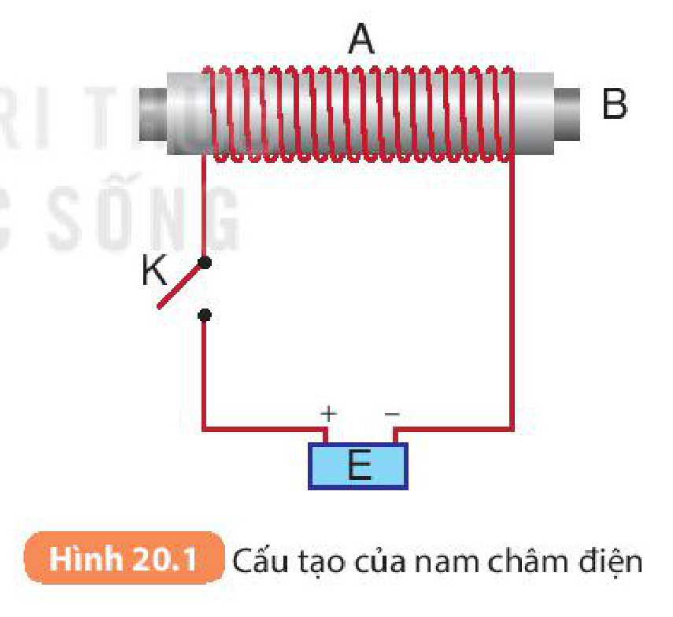
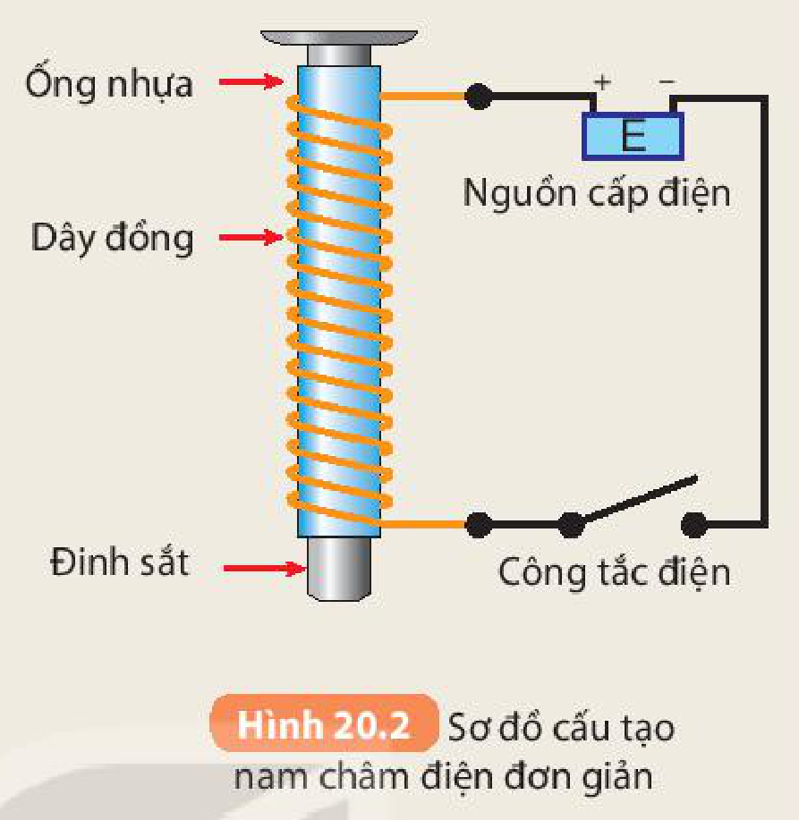
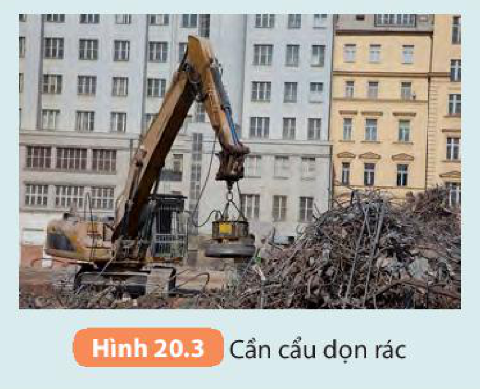
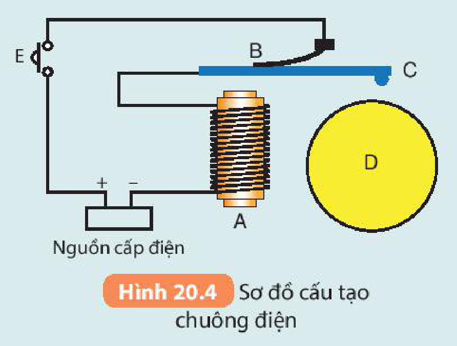

<!-- pdf:97 -->

# BÀI 20: CHẾ TẠO NAM CHÂM ĐIỆN ĐƠN GIẢN

## 🎯 Mục tiêu

- Chế tạo được nam châm điện đơn giản và làm thay đổi được từ trường của nó bằng thay đổi dòng điện.

## 🔴 Mở đầu

> Hình trên là nam châm của cần cẩu dọn rác kim loại. Nhờ nam châm này cần cẩu có thể lấy rác kim loại là hợp kim của sắt ở đống rác và di chuyển đến các thùng xe chở rác rồi thả xuống. Nhiều khi rác là những tấm kim loại lớn, nặng hàng trăm kilôgam. Nam châm ở cần cẩu có phải là loại nam châm vĩnh cửu mà ta đã học không? Tại sao?

## I. Nam châm điện

Các thí nghiệm cho thấy, dòng điện chạy trong dây dẫn thẳng hay trong cuộn dây đều sinh ra từ trường, người ta ứng dụng tính chất này để chế tạo ra nam châm, gọi là **nam châm điện**.

*Cấu tạo nam châm điện*

Hình 20.1 mô tả cấu tạo của một nam châm điện:

A là ống dây dẫn, B là một thỏi sắt non được lồng vào trong lòng ống dây. Hai đầu cuộn dây được nối với hai cực nguồn điện E thông qua khoá K.

Cho dòng điện chạy vào ống dây bằng cách đóng khoá K, ống dây trở thành một nam châm điện.

Hình 20.1. Cấu tạo của nam châm điện

> ❓ Làm cách nào biết ống dây đã trở thành nam châm điện?

<!-- pdf:98 -->

## II. Chế tạo nam châm điện đơn giản

> ✋ *Cách làm:*
> Dùng một đoạn dây đồng quấn xung quanh một ống nhựa, luồn vào trong ống một chiếc đinh sắt dài, nối hai đầu dây với nguồn điện (pin) qua một công tắc điện như Hình 20.2.
>
> *Tiến hành thí nghiệm:*
> Lần lượt thực hiện các động tác:
> - Đóng công tắc điện; kiểm tra xem xung quanh nam châm điện có từ trường không.
> - Ngắt công tắc điện; kiểm tra xem xung quanh nam châm còn từ trường không.
> - Thay đổi nguồn điện (bằng cách tăng số pin), đóng công tắc điện; dùng các ghim giấy bằng sắt để kiểm tra xem lực từ của nam châm thay đổi như thế nào (nếu nam châm hút được nhiều ghim giấy bằng sắt hơn thì lực từ mạnh hơn).
> - Thay đổi cực của nguồn điện; dùng kim nam châm thử để kiểm tra xem chiều từ trường có thay đổi không.
>
> 
>
> Hình 20.2. Sơ đồ cấu tạo nam châm điện đơn giản

> ❓ Từ kết quả thí nghiệm rút ra kết luận gì về từ trường của nam châm điện?

> 🔍 Em có biết?
>
> 1. Cần cẩu dọn rác
> - Nam châm điện được dùng ở cần cẩu dọn rác có lực từ rất mạnh, nhờ nam châm này mà cần cẩu dọn rác có thể nhấc được cả một chiếc ô tô hỏng ra khỏi đống rác và chất lên xe tải để chở đi đến nhà máy luyện thép (Hình 20.3).
> - Nam châm điện còn là bộ phận không thể thiếu trong các động cơ điện, máy phát điện.
>
> 
>
> Hình 20.3. Cần cẩu dọn rác

<!-- pdf:99 -->

<!-- term: Chuông điện -->
> 2. Chuông điện
>
> Hình 20.4 là sơ đồ cấu tạo của chuông điện: E là nút bấm chuông (công tắc điện); A là nam châm điện; C là cần gõ chuông; D là quả chuông; B là công tắc bằng kim loại đàn hồi.
>
> Nam châm điện là bộ phận cơ bản của chuông điện. Khi ấn nút E, dòng điện chạy vào nam châm A, nam châm hút cần gõ chuông C đập vào quả chuông. Khi đó, công tắc B bị ngắt, nam châm A không có dòng điện nên không hút cần C, cần C trở lại vị trí cũ và đóng công tắc B. Khi công tắc B đóng, dòng điện lại chạy vào nam châm A,... Cứ như vậy cần C gõ liên tục vào quả chuông D tạo ra tiếng kêu.
>
> 
>
> Hình 20.4. Sơ đồ cấu tạo chuông điện

## 📌 Em đã học

- Cấu tạo nam châm điện bao gồm ống dây dẫn, một thỏi sắt non lồng trong lòng ống dây, hai đầu ống dây nối với 2 cực nguồn điện. Lõi sắt non trong ống dây có tác dụng làm tăng từ trường của nam châm điện.
- Từ trường của nam châm điện chỉ tồn tại trong thời gian dòng điện chạy trong ống dây; dòng điện thay đổi thì từ trường của nam châm điện thay đổi.

## 🚀 Em có thể

- Tạo được một nam châm điện bằng những vật liệu thông dụng.
- Trình bày được một số ứng dụng của nam châm điện trong đời sống, chẳng hạn vì sao nam châm của cần cẩu dọn rác là nam châm điện.

## 📷 Danh sách hình trong bài

| Mã hình | Trang PDF | Vị trí trong bài | Chú thích gốc |
| --- | :---: | --- | --- |
| H7-khoa_hoc_tu_nhien-b20-01 | 97 | Mở đầu | (sách không đánh số, ảnh nam châm của cần cẩu dọn rác kim loại) |
| H7-khoa_hoc_tu_nhien-b20-02 | 97 | Mục I | Hình 20.1. Cấu tạo của nam châm điện |
| H7-khoa_hoc_tu_nhien-b20-03 | 98 | Mục II | Hình 20.2. Sơ đồ cấu tạo nam châm điện đơn giản |
| H7-khoa_hoc_tu_nhien-b20-04 | 98 | Em có biết? | Hình 20.3. Cần cẩu dọn rác |
| H7-khoa_hoc_tu_nhien-b20-05 | 99 | Em có biết? | Hình 20.4. Sơ đồ cấu tạo chuông điện |
