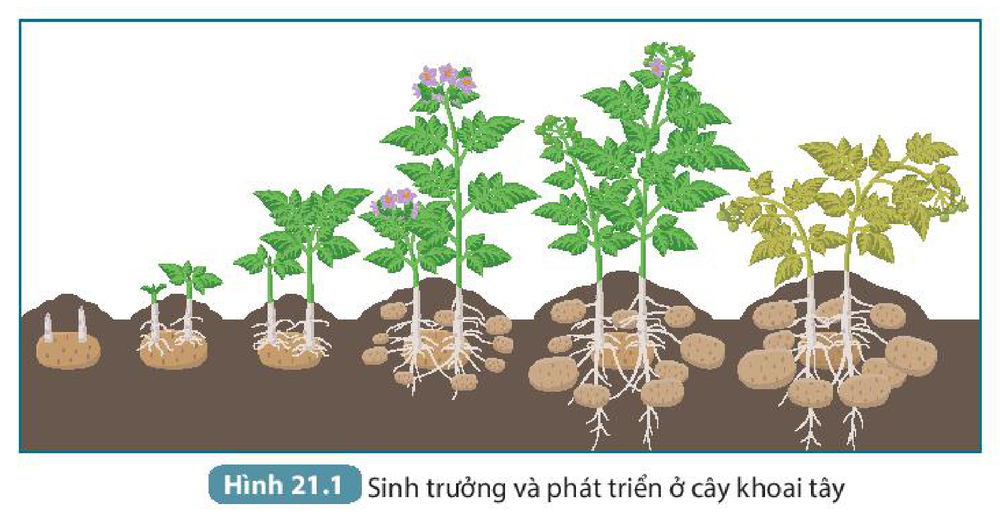
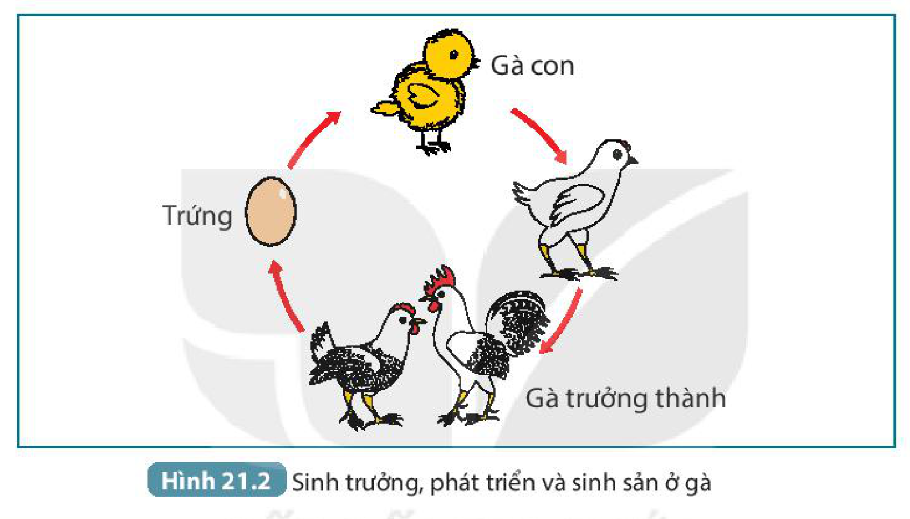

<!-- pdf:100 -->

# BÀI 21: KHÁI QUÁT VỀ TRAO ĐỔI CHẤT VÀ CHUYỂN HOÁ NĂNG LƯỢNG

## 🎯 Mục tiêu

- Phát biểu được khái niệm trao đổi chất và chuyển hoá năng lượng.
- Nêu được vai trò của trao đổi chất và chuyển hoá năng lượng trong cơ thể.

## 🔴 Mở đầu

Khi chạy, cơ thể có cảm giác nóng lên, mồ hôi ra nhiều, nhịp thở và nhịp tim tăng lên, có biểu hiện khát nước hơn so với lúc chưa chạy. Những thay đổi này được giải thích như thế nào?

## I. Trao đổi chất và chuyển hoá năng lượng

Sinh vật lấy các chất từ môi trường, biến đổi chúng thành các chất cần thiết cho cơ thể và tạo năng lượng cung cấp cho các hoạt động sống, đồng thời trả lại cho môi trường các chất thải, quá trình đó gọi là trao đổi chất. <!-- term: Trao đổi chất -->

Chuyển hoá năng lượng là sự biến đổi của năng lượng từ dạng này sang dạng khác, ví dụ: từ quang năng thành hoá năng; từ hoá năng thành cơ năng, nhiệt năng,... <!-- term: Chuyển hoá năng lượng -->

Trao đổi chất và chuyển hoá năng lượng luôn gắn liền với nhau.

> ❓ Đọc thông tin trong mục I, phát biểu khái niệm trao đổi chất và chuyển hoá năng lượng.

## II. Vai trò của trao đổi chất và chuyển hoá năng lượng

Mọi cơ thể sống đều không ngừng trao đổi chất và chuyển hoá năng lượng với môi trường, khi trao đổi chất dừng lại thì sinh vật sẽ chết. Như vậy, trao đổi chất và chuyển hoá năng lượng có vai trò đảm bảo cho sinh vật tồn tại.

Trao đổi chất và chuyển hoá năng lượng giúp cơ thể sinh trưởng, phát triển (Hình 21.1), cảm ứng, vận động và sinh sản (Hình 21.2). Các chất hữu cơ được cơ thể tổng hợp trong quá trình trao đổi chất cung cấp nguyên liệu để xây dựng tế bào và cơ thể, giúp cơ thể lớn lên và sinh sản tạo ra các cơ thể con. Quá trình chuyển hoá năng lượng tạo ra năng lượng dễ sử dụng cung cấp cho các hoạt động sống của cơ thể, trong đó có hoạt động cảm ứng và vận động.

<!-- pdf:101 -->

Hình 21.1. Sinh trưởng và phát triển ở cây khoai tây
<!-- ocr-ok: đã đối chiếu p101.png, OCR bỏ sót dòng chú thích Hình 21.1 -->

Hình 21.2. Sinh trưởng, phát triển và sinh sản ở gà

> ❓ 1. Quan sát sự thay đổi hình thái của sinh vật trong các Hình 21.1, 21.2, đọc thông tin trong mục II, nêu vai trò của trao đổi chất và chuyển hoá năng lượng đối với sinh trưởng và phát triển ở cây khoai tây và gà.
>
> 2. Lấy thêm ví dụ về vai trò của trao đổi chất và chuyển hoá năng lượng ở sinh vật.

## 📌 Em đã học

- Trao đổi chất là quá trình cơ thể lấy các chất từ môi trường, biến đổi chúng thành các chất cần thiết cho cơ thể và tạo năng lượng cung cấp cho các hoạt động sống, đồng thời trả lại cho môi trường các chất thải. <!-- term: Trao đổi chất -->
- Chuyển hoá năng lượng là sự biến đổi năng lượng từ dạng này sang dạng khác. <!-- term: Chuyển hoá năng lượng -->
- Trao đổi chất và chuyển hoá năng lượng giúp sinh vật tồn tại, sinh trưởng, phát triển, sinh sản, cảm ứng và vận động.

## 🚀 Em có thể

Giải thích được vì sao khi làm việc nặng hay vận động mạnh trong thời gian dài, cơ thể thường nóng lên, nhịp thở tăng, mồ hôi toát ra nhiều, nhanh khát và nhanh đói.

## 📷 Danh sách hình trong bài

| Mã hình | Trang PDF | Trang sách | Chú thích |
| --- | --- | --- | --- |
| H7-khoa_hoc_tu_nhien-b21-01 | 101 | 100 | Hình 21.1. Sinh trưởng và phát triển ở cây khoai tây |
| H7-khoa_hoc_tu_nhien-b21-02 | 101 | 100 | Hình 21.2. Sinh trưởng, phát triển và sinh sản ở gà |
