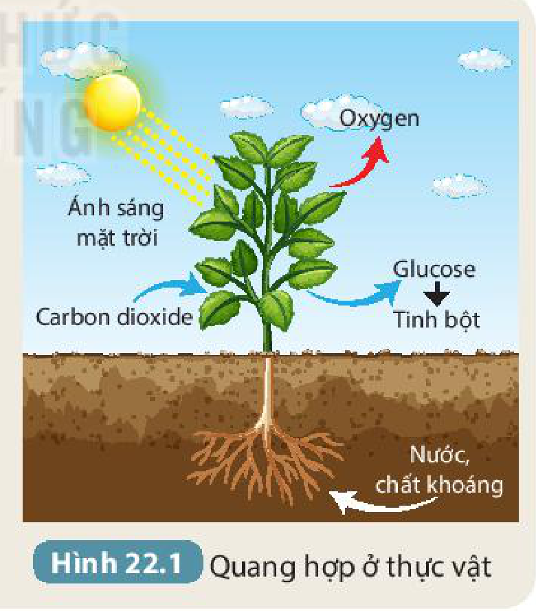
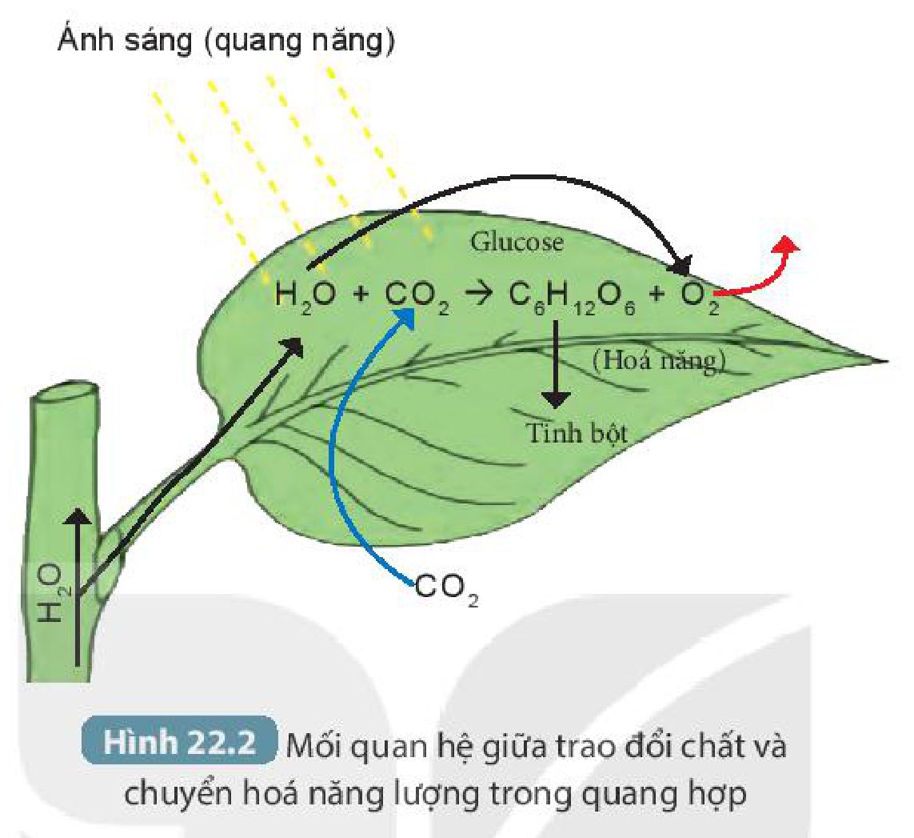
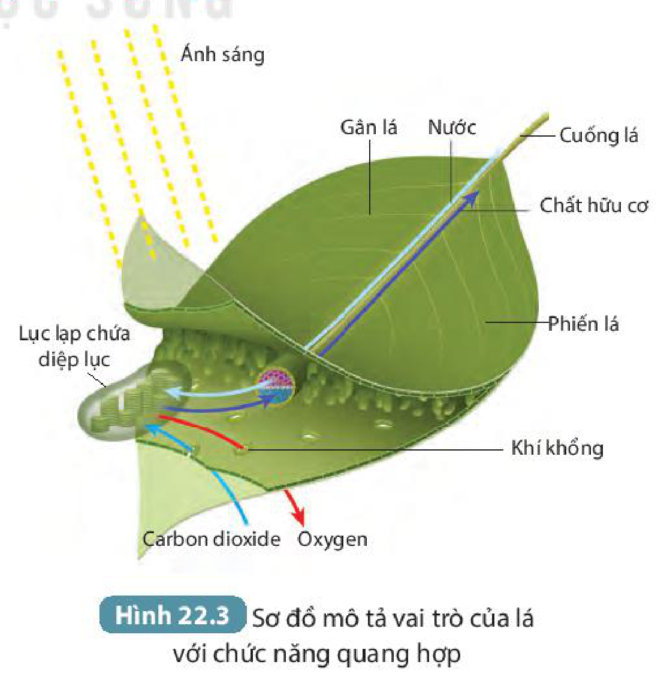

<!-- pdf:102 -->

# BÀI 22: QUANG HỢP Ở THỰC VẬT

## 🎯 Mục tiêu

- Nêu được khái niệm, nguyên liệu, sản phẩm của quang hợp.
- Viết được phương trình quang hợp.
- Nêu được mối quan hệ giữa trao đổi chất và chuyển hoá năng lượng trong quang hợp.
- Nêu được vai trò của lá cây với chức năng quang hợp.

## 🔴 Mở đầu

Thực vật có khả năng tự tổng hợp chất hữu cơ cung cấp cho cơ thể và nhiều sinh vật khác trên Trái Đất. Khả năng kì diệu đó được gọi là quang hợp.

Vậy quang hợp diễn ra ở đâu trong cơ thể thực vật? Thực vật thực hiện được quá trình đó bằng cách nào?

## I. Khái quát về quang hợp

Quang hợp là một trong những quá trình trao đổi chất và chuyển hoá năng lượng quan trọng ở thực vật. Quá trình này diễn ra chủ yếu ở lá cây, trong bào quan quang hợp là lục lạp. <!-- term: Quang hợp --> <!-- term: Lục lạp -->

### 1. Khái niệm quang hợp

> ✋ 1. Quan sát Hình 22.1 rồi hoàn thành nội dung theo mẫu Bảng 22.1.
>
> Bảng 22.1
>
> | Nguyên liệu (chất lấy vào) | Sản phẩm (chất tạo ra) | Các yếu tố tham gia |
> | --- | --- | --- |
> | ? | ? | ? |
>
> 2. Dựa vào kết quả ở câu 1, phát biểu khái niệm và viết phương trình tổng quát quá trình quang hợp.
>
> 
>
> Hình 22.1. Quang hợp ở thực vật
<!-- ocr-ok: đã đối chiếu p102.png, Bảng 22.1 trên nền xanh không được OCR đọc tiêu đề cột -->

### 2. Phương trình tổng quát

$$\ce{\text{Nước} + \text{Carbon dioxide} ->[\text{Ánh sáng}][\text{Diệp lục}] \text{Glucose} + \text{Oxygen}}$$
<!-- ocr-ok: đã đối chiếu p102.png, phương trình tổng quát biểu diễn bằng mhchem -->

Các phân tử glucose tạo thành trong quang hợp liên kết với nhau hình thành nên tinh bột, là chất dự trữ đặc trưng ở thực vật. <!-- term: Tinh bột -->

<!-- pdf:103 -->

### 3. Mối quan hệ giữa trao đổi chất và chuyển hoá năng lượng trong quang hợp

Trong quá trình quang hợp, trao đổi chất và chuyển hoá năng lượng diễn ra đồng thời. Nước và carbon dioxide được lấy từ môi trường ngoài để tổng hợp chất hữu cơ (như glucose, tinh bột) và giải phóng oxygen. Cũng trong quá trình này, quang năng chuyển hoá thành hoá năng dự trữ trong các hợp chất hữu cơ.

Hình 22.2. Mối quan hệ giữa trao đổi chất và chuyển hoá năng lượng trong quang hợp

> ❓ Quan sát Hình 22.2 và đọc thông tin trên để trả lời câu hỏi: Những chất nào được trao đổi giữa tế bào lá với môi trường và dạng năng lượng nào được chuyển hoá trong quá trình quang hợp?

## II. Vai trò của lá cây với chức năng quang hợp

Lá là cơ quan chủ yếu thực hiện quá trình quang hợp. Phiến lá có dạng bản mỏng, diện tích bề mặt lớn. Trên phiến lá có nhiều gân giúp vận chuyển nguyên liệu và sản phẩm của quang hợp. Lớp biểu bì lá có nhiều khí khổng (là nơi carbon dioxide đi từ bên ngoài vào bên trong lá và khí oxygen đi từ trong lá ra ngoài môi trường). Lá chứa nhiều lục lạp có các hạt diệp lục. Diệp lục có khả năng hấp thụ và chuyển hoá năng lượng ánh sáng. Chất hữu cơ được tổng hợp tại lục lạp. <!-- term: Khí khổng --> <!-- term: Lục lạp --> <!-- term: Diệp lục -->

Hình 22.3. Sơ đồ mô tả vai trò của lá với chức năng quang hợp

<!-- pdf:104 -->

> ❓ 1. Đọc thông tin trên và quan sát Hình 22.3 rồi hoàn thành nội dung theo mẫu Bảng 22.2.
>
> Bảng 22.2
>
> | Bộ phận | Đặc điểm | Vai trò trong quang hợp |
> | --- | --- | --- |
> | Phiến lá | ? | ? |
> | Lục lạp | ? | ? |
> | Gân lá | ? | ? |
> | Khí khổng | ? | ? |
>
> 2. Ở các loài cây có lá biến đổi như xương rồng, cành giao,... bộ phận nào trên cây sẽ thực hiện quá trình quang hợp?

> 🔍 Em có biết?
>
> Mật độ khí khổng của lá rất lớn, cứ $1\text{ cm}^2$ diện tích mặt lá có khoảng 30 000 khí khổng. Số lượng khí khổng ở mặt trên và mặt dưới của lá khác nhau tuỳ theo loài thực vật. Đa số các loài thực vật có số lượng khí khổng ở mặt trên của lá ít hơn mặt dưới. Nhiều loài thực vật thuỷ sinh (sen, súng,...), mặt trên của lá lại có số lượng khí khổng nhiều hơn mặt dưới. Một số loài thực vật khác (ngô, lúa mì,...) có số lượng khí khổng tương đối đồng đều giữa hai mặt lá.

## 📌 Em đã học

- Quang hợp là quá trình lá cây sử dụng nước và khí carbon dioxide nhờ năng lượng ánh sáng đã được diệp lục hấp thụ để tổng hợp chất hữu cơ và giải phóng oxygen. <!-- term: Quang hợp -->
- Trong quá trình quang hợp, trao đổi chất và chuyển hoá năng lượng luôn diễn ra đồng thời, nước và carbon dioxide được lấy từ môi trường ngoài để tổng hợp chất hữu cơ và giải phóng khí oxygen, trong quá trình đó quang năng được chuyển hoá thành hoá năng.
- Lá cây là cơ quan chủ yếu thực hiện chức năng quang hợp. Bên trong lá có nhiều lục lạp chứa diệp lục, có khả năng hấp thụ và chuyển hoá năng lượng ánh sáng.
- Phương trình tổng quát của quá trình quang hợp:

$$\ce{\text{Nước} + \text{Carbon dioxide} ->[\text{Ánh sáng}][\text{Diệp lục}] \text{Glucose} + \text{Oxygen}}$$
<!-- ocr-ok: đã đối chiếu p104.png, phương trình tổng quát trong hộp Em đã học biểu diễn bằng mhchem -->

## 🚀 Em có thể

- Giải thích được vì sao nhiều loại cây trồng trong nhà vẫn có thể sống được bình thường dù không có ánh nắng mặt trời. Giải thích được ý nghĩa của việc để cây xanh trong phòng khách.
- Vận dụng được những hiểu biết về vai trò của lá cây đối với quang hợp để có biện pháp chăm sóc và bảo vệ lá cây nói riêng và cây trồng nói chung.

## 📷 Danh sách hình trong bài

| Mã hình | Trang PDF | Trang sách | Chú thích |
| --- | --- | --- | --- |
| H7-khoa_hoc_tu_nhien-b22-01 | 102 | 101 | Hình 22.1. Quang hợp ở thực vật |
| H7-khoa_hoc_tu_nhien-b22-02 | 103 | 102 | Hình 22.2. Mối quan hệ giữa trao đổi chất và chuyển hoá năng lượng trong quang hợp |
| H7-khoa_hoc_tu_nhien-b22-03 | 103 | 102 | Hình 22.3. Sơ đồ mô tả vai trò của lá với chức năng quang hợp |
