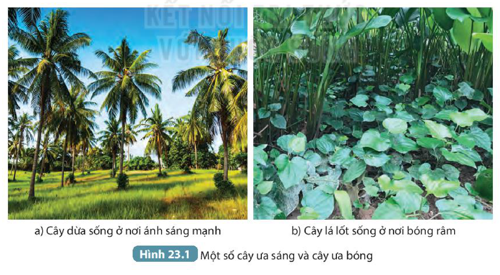
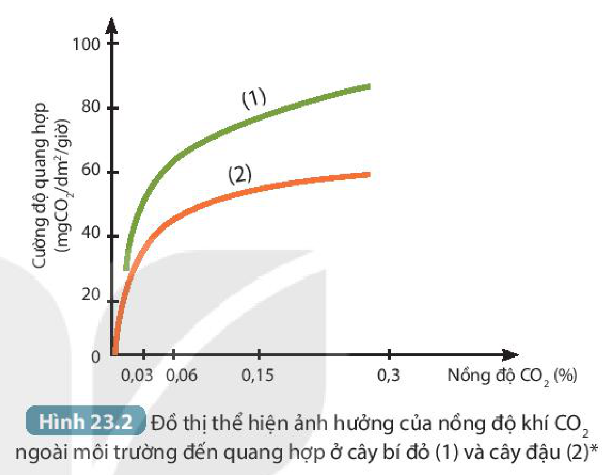
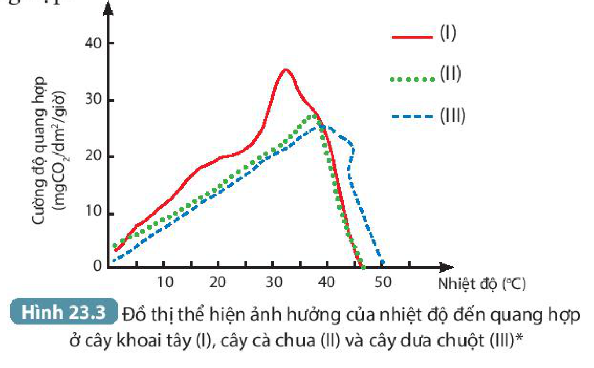
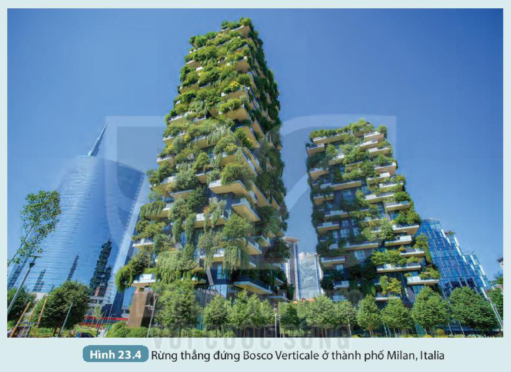

<!-- pdf:105 -->

# BÀI 23: MỘT SỐ YẾU TỐ ẢNH HƯỞNG ĐẾN QUANG HỢP

## 🎯 Mục tiêu

- Vận dụng hiểu biết về quang hợp để giải thích được ý nghĩa thực tiễn của việc trồng và bảo vệ cây xanh.
- Nêu được một số yếu tố chủ yếu ảnh hưởng đến quang hợp.

## 🔴 Mở đầu

Cây xanh có ý nghĩa rất lớn đối với sự sống trên Trái Đất. Vậy chúng ta cần trồng và bảo vệ cây xanh như thế nào? Những yếu tố nào ảnh hưởng đến quá trình quang hợp ở cây xanh?

## I. Một số yếu tố ảnh hưởng đến quang hợp

### 1. Ánh sáng

Thông thường, khi cường độ ánh sáng tăng thì hiệu quả quang hợp sẽ tăng và ngược lại. Tuy nhiên, ánh sáng quá mạnh sẽ làm cho lá cây bị “đốt nóng”, làm giảm hiệu quả quang hợp. Mỗi loài cây lại có nhu cầu khác nhau về ánh sáng. Những cây sống ở nơi có ánh sáng mạnh như phi lao, thông, ngô, hoa giấy, dừa,... là cây ưa sáng. Cây ưa bóng như lá lốt, trầu không,... thường sống ở nơi bóng râm (Hình 23.1). <!-- term: Cây ưa sáng --> <!-- term: Cây ưa bóng -->

Hình 23.1. Một số cây ưa sáng và cây ưa bóng

> ❓ Hãy kể tên những loài cây ưa bóng và ưa sáng khác mà em biết.

<!-- pdf:106 -->

### 2. Nước

Nước có ảnh hưởng kép tới quá trình quang hợp vì nước vừa là nguyên liệu của quang hợp, vừa là yếu tố tham gia vào việc đóng, mở khí khổng, liên quan đến sự trao đổi khí.

Khi tế bào lá cây mất nước, khí khổng đóng lại, hàm lượng khí carbon dioxide đi vào tế bào lá giảm, quang hợp của cây gặp khó khăn. Cây được cung cấp đủ nước, khí khổng mở giúp khí carbon dioxide dễ dàng khuếch tán vào bên trong lá, tăng hiệu quả quang hợp.

### 3. Khí carbon dioxide

Thông thường, hiệu quả quang hợp sẽ tăng khi nồng độ khí $\ce{CO2}$ ngoài môi trường tăng và ngược lại. Tuy nhiên, nếu nồng độ khí $\ce{CO2}$ tăng quá cao (khoảng $0,2\%$) có thể làm cây chết vì ngộ độc. Còn khi nồng độ quá thấp, quang hợp sẽ không xảy ra. Nồng độ khí $\ce{CO2}$ thấp nhất mà cây quang hợp được là từ $0,008\%$ đến $0,01\%$.

Hình 23.2. Đồ thị thể hiện ảnh hưởng của nồng độ khí $\ce{CO2}$ ngoài môi trường đến quang hợp ở cây bí đỏ (1) và cây đậu (2)*

> ❓ Quan sát Hình 23.2 và cho biết ảnh hưởng của nồng độ khí $\ce{CO2}$ đến quang hợp có giống nhau ở các loài cây không. Giải thích.

### 4. Nhiệt độ

Nhiệt độ thuận lợi nhất cho hầu hết các loài cây quang hợp là từ $25\text{ }^\circ\text{C}$ đến $35\text{ }^\circ\text{C}$. Nhiệt độ quá cao (trên $40\text{ }^\circ\text{C}$) hay quá thấp (dưới $10\text{ }^\circ\text{C}$) sẽ làm giảm hoặc ngừng hẳn quá trình quang hợp.

Hình 23.3. Đồ thị thể hiện ảnh hưởng của nhiệt độ đến quang hợp ở cây khoai tây (I), cây cà chua (II) và cây dưa chuột (III)*

*Nguồn: Giáo trình Sinh lí học thực vật – Nguyễn Như Khanh, Cao Phi Bằng – NXBGDVN

<!-- pdf:107 -->

Nhiệt độ thấp nhất mà cây có thể quang hợp khác nhau ở các loài. Ví dụ: nhiệt độ thấp nhất của cây ở vùng ôn đới có thể quang hợp là $-5\text{ }^\circ\text{C}$, trong khi cây ở vùng nhiệt đới có thể quang hợp ở nhiệt độ thấp nhất là $4\text{ }^\circ\text{C}$.

> ✋ 1. Đọc thông tin trong mục I, thảo luận nhóm và hoàn thành theo mẫu Bảng 23.1.
>
> Bảng 23.1
>
> | Yếu tố | Ảnh hưởng đến quang hợp |
> | --- | --- |
> | Ánh sáng | ? |
> | Nước | ? |
> | Khí carbon dioxide | ? |
> | Nhiệt độ | ? |
>
> 2. Giải thích vì sao nên trồng cây đúng thời vụ và đảm bảo mật độ phù hợp.
>
> 3. Ở những khu công nghiệp hay nơi có nhiều nhà máy, nồng độ khí carbon dioxide thường tăng cao. Quang hợp của cây trồng tại đó bị ảnh hưởng như thế nào?
>
> 4. Vào những ngày nắng nóng hoặc trời rét đậm, người làm vườn thường che nắng hoặc chống rét (ủ ấm gốc) cho cây. Em hãy giải thích ý nghĩa của việc làm đó.

## II. Vận dụng những hiểu biết về quang hợp trong việc trồng và bảo vệ cây xanh

Quang hợp ở cây xanh mang lại rất nhiều lợi ích cho môi trường tự nhiên và đời sống của con người như cung cấp chất hữu cơ cho mọi sinh vật; cân bằng, điều hoà khí trong không khí,... Chính vì vậy, việc trồng, chăm sóc và bảo vệ cây xanh là rất quan trọng, cần được thực hiện thường xuyên và tuyên truyền rộng rãi tới mọi người.

Bên cạnh việc bảo vệ cây xanh, đặc biệt là bảo vệ bộ lá - bộ máy quang hợp của cây xanh, cần điều chỉnh hợp lí các yếu tố ảnh hưởng đến quá trình quang hợp của cây thông qua chế độ chiếu sáng, tưới nước, bón phân,... giúp cây quang hợp tốt, sinh trưởng nhanh, cho năng suất cao.

> ❓ 1. Trình bày biện pháp bảo vệ cây xanh trong trường học của em.
>
> 2. Tại sao ở các thành phố hoặc nơi đông dân cư sinh sống lại cần trồng nhiều cây xanh?

<!-- pdf:108 -->

> 🔍 Em có biết?
>
> **“Khu rừng thẳng đứng” lọc không khí**
>
> Kiến trúc sư người Italia là Stê-pha-nô Bo-e-ri (Stefano Boeri) đã tạo ra toà tháp rừng thẳng đứng đầu tiên mang tên Bosco Verticale ở thành phố Milan, Italia. Toà tháp đôi này được phủ bằng một rừng cây gồm khoảng 900 cây xanh, 5 000 bụi cây với trên 11 000 loài thực vật khác nhau. Khu rừng này có thể hấp thụ $\ce{CO2}$, ngăn ngừa các khí gây hiệu ứng nhà kính phát tán lên bầu khí quyển. Cây xanh trên nóc toà nhà có thể lọc bụi mịn PM2.5. Kiến trúc sư Boeri đã chọn những loại cây có khả năng hấp thụ khí gây ô nhiễm và bụi mịn PM2.5 tốt nhất. Ngoài ra, khu rừng này còn là nơi cư trú của các loài côn trùng và các loài chim.
>
> 
>
> Hình 23.4. Rừng thẳng đứng Bosco Verticale ở thành phố Milan, Italia

## 📌 Em đã học

- Ánh sáng, nhiệt độ, khí carbon dioxide và nước là các yếu tố chủ yếu ảnh hưởng đến quang hợp ở thực vật.
- Con người có thể vận dụng những hiểu biết về quang hợp trong việc trồng và bảo vệ cây xanh nhằm giúp cây sinh trưởng nhanh, phát triển tốt, nâng cao năng suất cây trồng, góp phần nâng cao chất lượng cuộc sống và bảo vệ môi trường.

## 🚀 Em có thể

- Thực hiện và tuyên truyền cho mọi người cùng trồng và bảo vệ cây xanh.
- Vận dụng được những hiểu biết về quang hợp vào việc trồng, chăm sóc và bảo vệ cây xanh.

## 📷 Danh sách hình trong bài

| Mã hình | Trang PDF | Trang sách | Chú thích |
| --- | --- | --- | --- |
| H7-khoa_hoc_tu_nhien-b23-01 | 105 | 104 | Hình 23.1. Một số cây ưa sáng và cây ưa bóng |
| H7-khoa_hoc_tu_nhien-b23-02 | 106 | 105 | Hình 23.2. Đồ thị thể hiện ảnh hưởng của nồng độ khí CO₂ ngoài môi trường đến quang hợp ở cây bí đỏ (1) và cây đậu (2)* |
| H7-khoa_hoc_tu_nhien-b23-03 | 106 | 105 | Hình 23.3. Đồ thị thể hiện ảnh hưởng của nhiệt độ đến quang hợp ở cây khoai tây (I), cây cà chua (II) và cây dưa chuột (III)* |
| H7-khoa_hoc_tu_nhien-b23-04 | 108 | 107 | Hình 23.4. Rừng thẳng đứng Bosco Verticale ở thành phố Milan, Italia |
