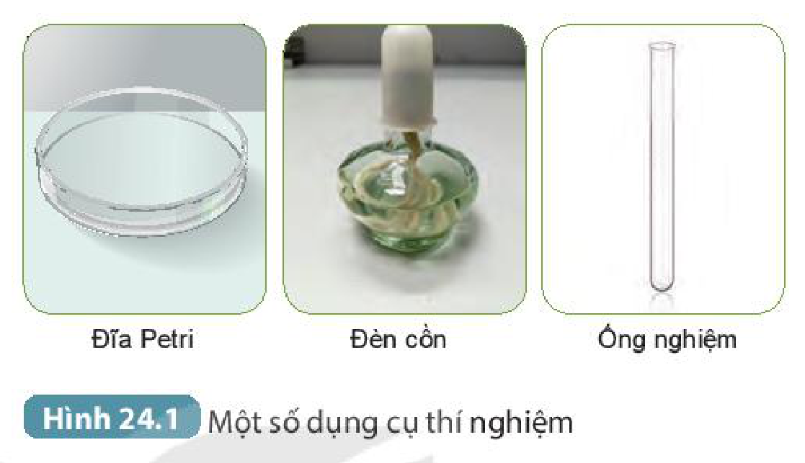
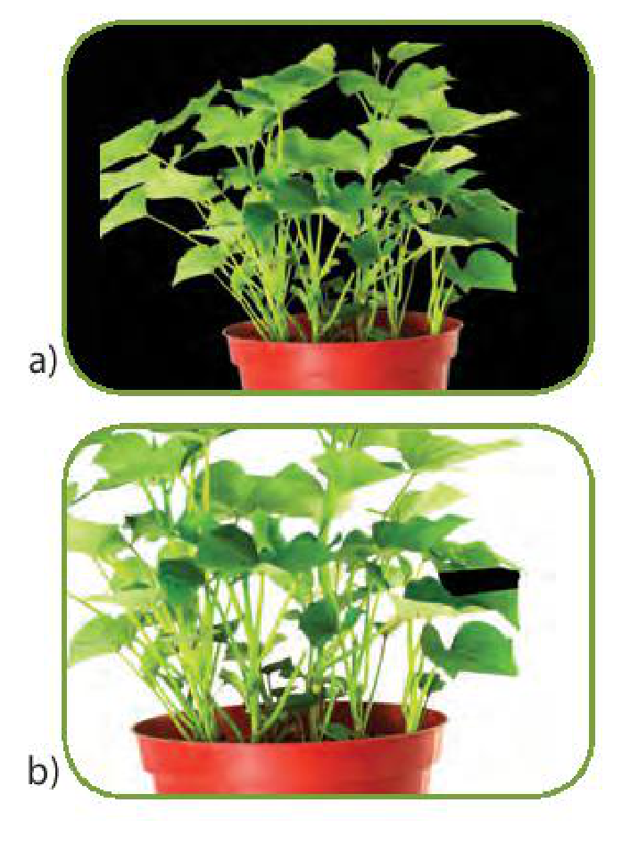
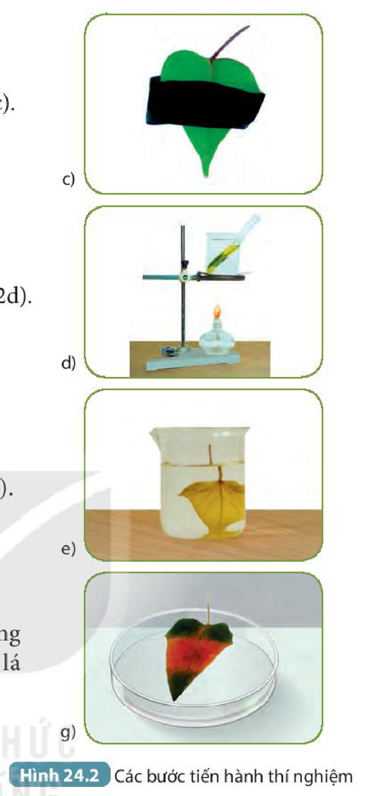
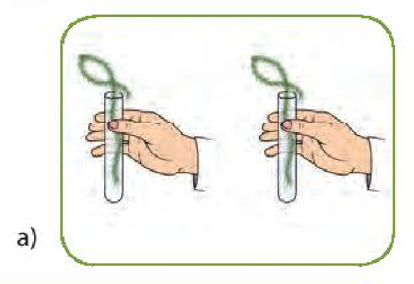
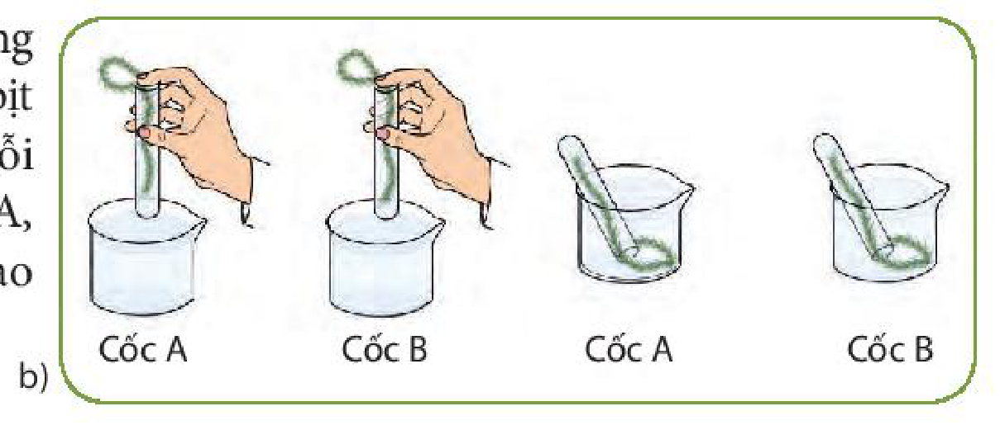
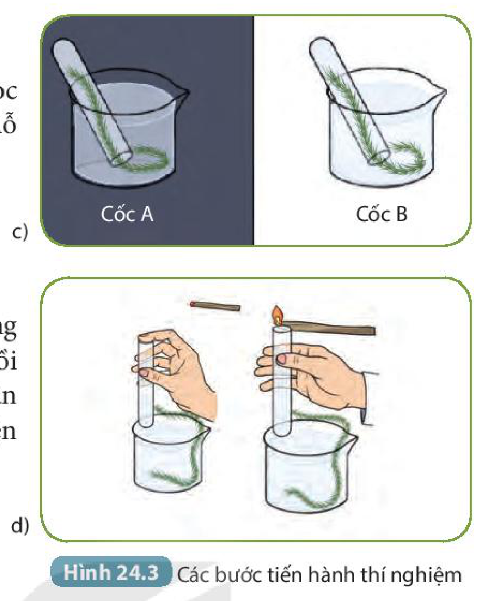

<!-- pdf:109 -->

# BÀI 24: THỰC HÀNH: CHỨNG MINH QUANG HỢP Ở CÂY XANH

## 🎯 Mục tiêu

- Tiến hành được thí nghiệm chứng minh quang hợp ở cây xanh.

## I. Chuẩn bị

### 1. Dụng cụ

Giá thí nghiệm; băng giấy đen; bóng đèn 500W có kết nối nguồn điện; nước ấm (khoảng $40\text{ }^\circ\text{C}$); cốc thuỷ tinh; nhiệt kế; panh và các dụng cụ trong Hình 24.1.

Hình 24.1. Một số dụng cụ thí nghiệm

### 2. Mẫu vật, hoá chất

- Chậu cây khoai lang (tuỳ từng địa phương và tuỳ theo thời vụ, có thể thay bằng các cây khác), rong đuôi chó.
- Cồn $90^\circ$, dung dịch iodine (iodine là thuốc thử tinh bột, khi nhỏ vào tinh bột, tinh bột sẽ chuyển thành màu xanh tím). <!-- term: Dung dịch iodine -->

> ⚠️ ***Lưu ý:*** Đặc biệt cẩn thận khi làm thí nghiệm với dụng cụ thuỷ tinh và lửa.

## II. Cách tiến hành

### 1. Thí nghiệm chứng minh tinh bột được tạo thành trong quang hợp

Bước 1: Đặt chậu cây khoai lang trong bóng tối 2 ngày (Hình 24.2a).

Bước 2: Dùng băng giấy đen bịt kín một phần lá ở cả 2 mặt của 1 chiếc lá, đem chậu cây để ra chỗ nắng hoặc để dưới ánh sáng đèn điện từ 4 giờ đến 6 giờ (Hình 24.2b).

<!-- pdf:110 -->

Bước 3: Ngắt chiếc lá, bỏ băng giấy đen (Hình 24.2c).

Bước 4: Đun lá trong cồn $90^\circ$ đến khi sôi (Hình 24.2d).

Bước 5: Rửa sạch lá trong cốc nước ấm (Hình 24.2e).

Bước 6: Nhúng lá vào dung dịch iodine đựng trong đĩa Petri và quan sát sự thay đổi màu sắc trên lá (Hình 24.2g).

Hình 24.2. Các bước tiến hành thí nghiệm

### 2. Thí nghiệm chứng minh quang hợp giải phóng khí oxygen

Bước 1: Lấy 2 cành rong đuôi chó cho vào 2 ống nghiệm sao cho phần ngọn rong ở phía dưới đáy ống nghiệm (Hình 24.3a).

Bước 2: Đổ đầy nước vào 2 ống nghiệm, sau đó dùng ngón tay bịt miệng ống nghiệm rồi úp ngược mỗi ống nghiệm vào cốc nước (cốc A, cốc B) sao cho bọt khí không lọt vào (Hình 24.3b).

<!-- pdf:111 -->

Bước 3: Để một cốc trong chỗ tối hoặc bọc giấy đen (cốc A), cốc còn lại (cốc B) để ra chỗ nắng (Hình 24.3c).

Bước 4: Sau 6 giờ, nhẹ nhàng rút 2 cành rong ra và bịt kín ống nghiệm, lấy ra khỏi 2 cốc rồi lật ngược lại. Đưa nhanh que đóm còn tàn đỏ vào miệng mỗi ống nghiệm, quan sát hiện tượng xảy ra (Hình 24.3d).

Hình 24.3. Các bước tiến hành thí nghiệm

## III. Kết quả

1. Hoàn thành bảng ghi kết quả thí nghiệm theo mẫu sau:

Bảng 24.1

| Thí nghiệm | Hiện tượng/Kết quả |
| --- | --- |
| Thí nghiệm chứng minh tinh bột được tạo thành trong quang hợp | ? |
| Thí nghiệm chứng minh quang hợp giải phóng khí oxygen | ? |

2. Giải thích hiện tượng/kết quả thí nghiệm và rút ra kết luận.

> Trả lời các câu hỏi sau:
>
> 1. Trong thí nghiệm chứng minh tinh bột được tạo thành trong quang hợp:
>    - Mục đích của việc sử dụng băng giấy đen bịt kín một phần lá ở cả 2 mặt là gì?
>    - Cho chiếc lá đã bỏ băng giấy đen vào cốc có cồn $90^\circ$, đun sôi cách thuỷ có tác dụng gì?
>    - Tinh bột được tạo thành ở phần nào của lá trong thí nghiệm trên? Vì sao em biết?
>
> 2. Trong thí nghiệm chứng minh quang hợp giải phóng khí oxygen:
>    - Điều kiện tiến hành thí nghiệm ở 2 cốc khác nhau như thế nào?
>    - Hiện tượng nào chứng tỏ cành rong đuôi chó thải chất khí? Chất khí đó là gì? Hiện tượng gì xảy ra khi đưa que đóm (còn tàn đỏ) vào miệng ống nghiệm?
>
> 3. Khi nuôi cá cảnh trong bể kính, người ta thường thả vào bể một số cành rong và cây thuỷ sinh. Em hãy giải thích ý nghĩa của việc làm đó.

## 📷 Danh sách hình trong bài

| Mã hình | Trang PDF | Trang sách | Chú thích |
| --- | --- | --- | --- |
| H7-khoa_hoc_tu_nhien-b24-01 | 109 | 108 | Hình 24.1. Một số dụng cụ thí nghiệm |
| H7-khoa_hoc_tu_nhien-b24-02 | 109 | 108 | Hình 24.2a, b. Các bước tiến hành thí nghiệm (Bước 1–2) |
| H7-khoa_hoc_tu_nhien-b24-03 | 110 | 109 | Hình 24.2. Các bước tiến hành thí nghiệm (Bước 3–6) |
| H7-khoa_hoc_tu_nhien-b24-04 | 110 | 109 | Hình 24.3a. Các bước tiến hành thí nghiệm (Bước 1) |
| H7-khoa_hoc_tu_nhien-b24-05 | 110 | 109 | Hình 24.3b. Các bước tiến hành thí nghiệm (Bước 2) |
| H7-khoa_hoc_tu_nhien-b24-06 | 111 | 110 | Hình 24.3. Các bước tiến hành thí nghiệm (Bước 3–4) |
