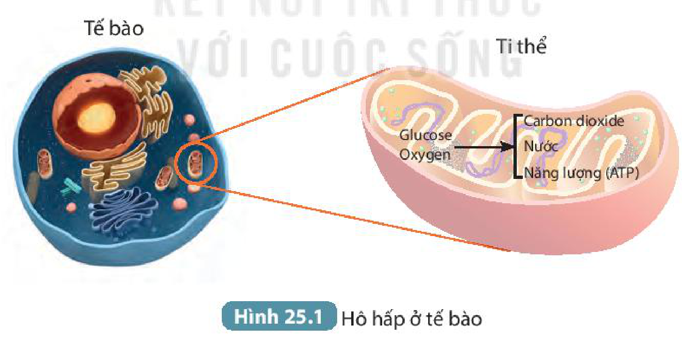

<!-- pdf:112 -->

# BÀI 25: HÔ HẤP TẾ BÀO

## 🎯 Mục tiêu

Mô tả được một cách tổng quát quá trình hô hấp tế bào (ở thực vật và ở động vật):

- Nêu được khái niệm.
- Viết được phương trình hô hấp dạng chữ.
- Thể hiện được hai chiều tổng hợp và phân giải chất hữu cơ ở tế bào.

## 🔴 Mở đầu

Năng lượng dùng cho các hoạt động sống của sinh vật được tạo ra như thế nào? Quá trình đó diễn ra ở đâu trong cơ thể sinh vật?

## I. Hô hấp tế bào

Hầu hết các quá trình sống của tế bào như sinh trưởng, phát triển, trao đổi chất, sinh sản,... đều cần đến năng lượng. Tuy nhiên, phần lớn năng lượng trong tế bào ở dạng khó sử dụng. Nhờ quá trình hô hấp tế bào với sự tham gia của khí oxygen mà các phân tử chất hữu cơ (chủ yếu là glucose) được phân giải thành khí carbon dioxide và nước, đồng thời tạo ra năng lượng **ATP** cung cấp cho các hoạt động của tế bào. <!-- term: Hô hấp tế bào -->

Hô hấp tế bào xảy ra ở ti thể. Ti thể là bào quan trong tế bào của sinh vật nhân thực. Ở đa số thực vật, glucose được tổng hợp từ quá trình quang hợp; ở động vật, tế bào lấy glucose từ quá trình phân giải thức ăn. <!-- term: Ti thể -->

Hình 25.1. Hô hấp ở tế bào

> ❓ Quan sát Hình 25.1, thảo luận nhóm và hoàn thành các yêu cầu sau:
>
> 1. Kể tên các chất tham gia vào quá trình hô hấp và các sản phẩm được tạo ra từ quá trình này.
> 2. Mô tả quá trình hô hấp diễn ra ở tế bào.
> 3. Nêu vai trò của quá trình hô hấp tế bào đối với cơ thể.

<!-- pdf:113 -->

## II. Mối quan hệ giữa tổng hợp và phân giải chất hữu cơ ở tế bào

Quá trình tổng hợp chất hữu cơ đã tạo ra nguyên liệu cho hô hấp. Hô hấp là quá trình phân giải chất hữu cơ như glucose tạo thành nước, carbon dioxide và năng lượng. Do đó có thể coi tổng hợp và phân giải chất hữu cơ là hai quá trình có biểu hiện trái ngược nhau nhưng phụ thuộc lẫn nhau. <!-- term: Tổng hợp và phân giải chất hữu cơ -->

> ❓ 1. Đọc thông tin trong mục II, sử dụng các từ: Glucose, Carbon dioxide, ATP, Nước, Oxygen thay thế cho các dấu (?) trong các phương trình dưới đây:
>
> $$(?) + (?) \xrightarrow{\text{Phân giải}} (?) + (?) + (?)$$
>
> $$(?) + (?) \xrightarrow[\text{Năng lượng}]{\text{Tổng hợp}} (?) + (?)$$
>
> 2. Tại sao nói tổng hợp và phân giải chất hữu cơ có biểu hiện trái ngược nhau nhưng phụ thuộc lẫn nhau?

> 🔍 Em có biết?
>
> **Hô hấp tế bào khác với quá trình đốt cháy nhiên liệu như thế nào?**
>
> Quá trình đốt cháy nhiên liệu và hô hấp tế bào đều sử dụng khí oxygen, thải ra khí carbon dioxide và sản sinh ra năng lượng. Tuy nhiên, việc đốt cháy nhiên liệu chỉ giải phóng ra năng lượng dưới dạng nhiệt năng một cách ồ ạt, với hiệu suất thấp (thường nhỏ hơn $25\%$); còn trong hô hấp tế bào, năng lượng được giải phóng từ từ qua từng giai đoạn hô hấp và phần lớn được tích luỹ dưới dạng hoá năng dễ sử dụng để tế bào có thể dùng cho các hoạt động sống, hiệu suất sinh năng lượng cao hơn (khoảng $40\%$). Chỉ một phần nhỏ năng lượng được giải phóng trong hô hấp dưới dạng nhiệt năng giúp duy trì thân nhiệt hoặc bị thất thoát ra môi trường. Như vậy, nhờ cách thức chuyển hoá năng lượng trong hô hấp mà tế bào thu được nhiều năng lượng hơn, đảm bảo cho tế bào có đủ năng lượng cung cấp cho các hoạt động sống.

## 📌 Em đã học

- Hô hấp tế bào là quá trình phân giải các chất hữu cơ tạo thành nước và carbon dioxide, đồng thời giải phóng ra năng lượng. <!-- term: Hô hấp tế bào -->
- Phương trình hô hấp:

$$\ce{\text{Glucose} + \text{Oxygen} -> \text{Carbon dioxide} + \text{Nước} + \text{Năng lượng (ATP)}}$$
<!-- ocr-ok: đã đối chiếu p113.png, phương trình hô hấp biểu diễn bằng mhchem -->

- Quá trình tổng hợp và phân giải chất hữu cơ có biểu hiện trái ngược nhau nhưng phụ thuộc lẫn nhau.

## 🚀 Em có thể

Giải thích được vai trò của khí oxygen và khí carbon dioxide đối với cơ thể sống.

## 📷 Danh sách hình trong bài

| Mã hình | Trang PDF | Trang sách | Chú thích |
| --- | --- | --- | --- |
| H7-khoa_hoc_tu_nhien-b25-01 | 112 | 111 | Hình 25.1. Hô hấp ở tế bào |
