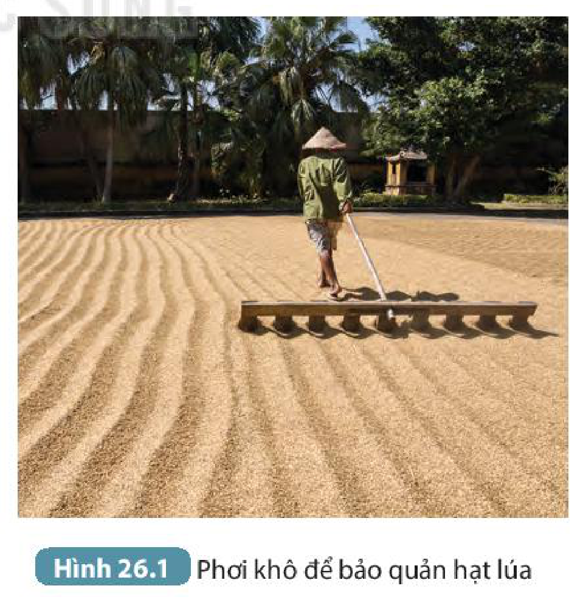
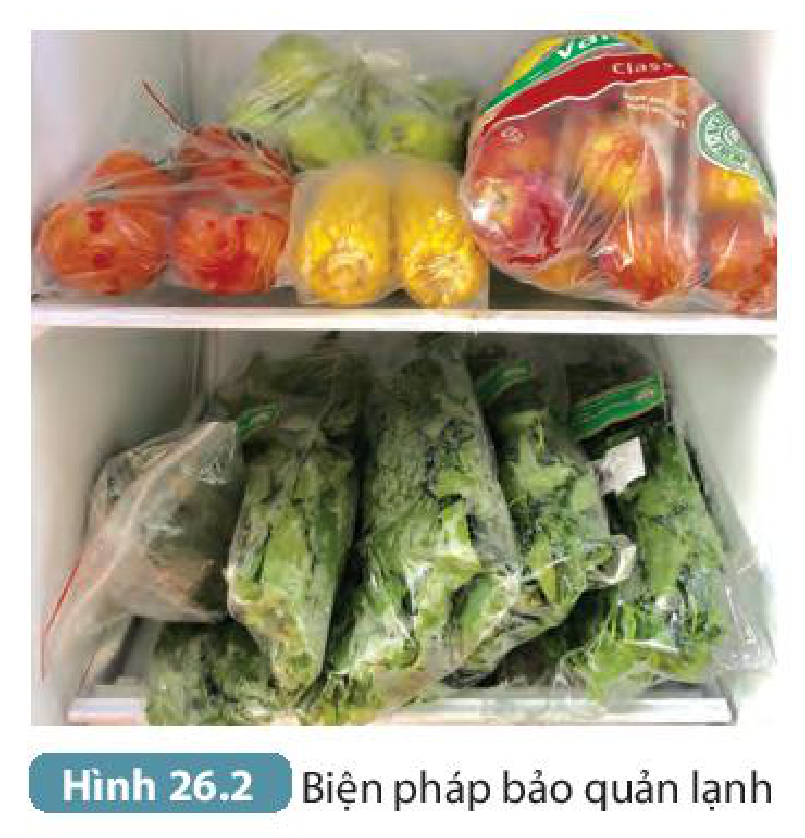

<!-- pdf:114 -->

# BÀI 26: MỘT SỐ YẾU TỐ ẢNH HƯỞNG ĐẾN HÔ HẤP TẾ BÀO

## 🎯 Mục tiêu

- Nêu được một số yếu tố chủ yếu ảnh hưởng đến hô hấp tế bào.
- Vận dụng hiểu biết về hô hấp tế bào để giải thích một số hiện tượng trong thực tiễn.

## 🔴 Mở đầu

Tại sao rau, quả cất giữ trong tủ lạnh đúng cách lại lâu hỏng hơn so với rau, quả để ngoài không khí? Tại sao muốn cất giữ các loại hạt được lâu lại phải phơi khô mà không để ẩm?

## I. Một số yếu tố chủ yếu ảnh hưởng đến hô hấp tế bào

### 1. Nước

Trong tế bào, nước là dung môi và môi trường cho các phản ứng hô hấp xảy ra, chính vì vậy, nước là yếu tố liên quan trực tiếp đến hô hấp của tế bào.

Tiến hành thí nghiệm đo **cường độ hô hấp** của một loại hạt ở các hàm lượng nước khác nhau, kết quả thu được như trong Bảng 26.1.

Bảng 26.1. Cường độ hô hấp của hạt lúa và lúa mì ở các hàm lượng nước khác nhau*

| Thí nghiệm | Hàm lượng nước trong hạt | Cường độ hô hấp |
| --- | --- | --- |
| Thí nghiệm 1 | $11\%$ đến $12\%$ | $1,5\text{ mg }\ce{CO2}/1\text{ kg hạt/giờ}$ |
| Thí nghiệm 2 | $14\%$ đến $15\%$ | Tăng lên 4 đến 5 lần |
| Thí nghiệm 3 | $30\%$ đến $35\%$ | Tăng lên hàng nghìn lần |
<!-- ocr-ok: đã đối chiếu p114.png, OCR không đọc được dòng tiêu đề nền xanh và số liệu trong Bảng 26.1 -->

> ❓ Từ kết quả thí nghiệm trong bảng trên, em hãy nhận xét về mối liên quan giữa hàm lượng nước và cường độ hô hấp của hạt.

### 2. Nồng độ khí oxygen

Oxygen là nguyên liệu của hô hấp tế bào nên có ảnh hưởng trực tiếp đến hô hấp. Ở thực vật, nếu nồng độ khí oxygen ngoài môi trường giảm xuống dưới $5\%$ thì cường độ hô hấp giảm.

> ❓ Vì sao trong trồng trọt, người ta thường làm đất tơi xốp trước khi gieo trồng và tháo nước khi cây bị ngập úng?

*Nguồn: Giáo trình Sinh lí học thực vật – Hoàng Minh Tấn (CB) – NXBĐHSP

<!-- pdf:115 -->

### 3. Nồng độ khí carbon dioxide

Nồng độ khí $\ce{CO2}$ ngoài môi trường từ $3\%$ đến $5\%$ đã gây ức chế hô hấp. Ở người và động vật, khi nồng độ khí $\ce{CO2}$ trong máu cao sẽ dẫn đến tình trạng $\ce{CO2}$ cạnh tranh với $\ce{O2}$ để liên kết với các tế bào hồng cầu, cơ thể bị thiếu khí $\ce{O2}$ ảnh hưởng đến quá trình hô hấp, gây nguy hiểm đến tính mạng.

> ❓ Vì sao không nên để nhiều hoa hoặc cây xanh trong phòng ngủ kín?

### 4. Nhiệt độ

Nhiệt độ quá cao hoặc quá thấp đều ảnh hưởng đến hô hấp tế bào. Ví dụ: Ở người, khi nhiệt độ cơ thể trên $40\text{ }^\circ\text{C}$, hô hấp tế bào gặp khó khăn.

## II. Vận dụng hiểu biết về hô hấp tế bào vào thực tiễn

### 1. Hô hấp tế bào và vấn đề bảo quản nông sản

Hô hấp tế bào là quá trình phân giải các chất hữu cơ. Do đó, hô hấp diễn ra càng mạnh thì lượng chất hữu cơ và chất dinh dưỡng trong nông sản (rau, củ, quả, hạt,...) tiêu hao càng nhiều, gây giảm sút khối lượng và chất lượng nông sản. Tuy nhiên, nếu ngừng hô hấp thì các tế bào sẽ chết dẫn đến nông sản cũng bị hỏng. Vì vậy, để bảo quản nông sản, cần đưa cường độ hô hấp ở nông sản về mức tối thiểu bằng cách điều chỉnh các yếu tố môi trường như nước, nhiệt độ, nồng độ khí carbon dioxide.

> ❓ Theo em, cần điều chỉnh các yếu tố môi trường như nước, nhiệt độ, nồng độ khí carbon dioxide như thế nào để có thể bảo quản được nông sản? Giải thích.

### 2. Các biện pháp bảo quản nông sản sau thu hoạch

Tuỳ từng loại nông sản mà có biện pháp bảo quản khác nhau.

> ❓ Kể tên một số biện pháp bảo quản nông sản mà em biết.

### a) Bảo quản khô

Biện pháp bảo quản khô thường sử dụng để bảo quản các loại hạt. Các hạt cần được phơi hoặc sấy khô đến khi độ ẩm của hạt còn khoảng $13\%$ đến $16\%$ tuỳ từng loại hạt (Hình 26.1). <!-- term: Bảo quản khô -->

Hình 26.1. Phơi khô để bảo quản hạt lúa

<!-- pdf:116 -->

### b) Bảo quản lạnh

Đây là biện pháp bảo quản nông sản ở điều kiện nhiệt độ thấp trong tủ lạnh hoặc kho lạnh. Phần lớn các loại thực phẩm, rau, quả được bảo quản theo cách này (Hình 26.2). Thực phẩm được giữ trong các kho lạnh, tủ lạnh ở các ngăn có nhiệt độ khác nhau. Mỗi loại rau, quả có một nhiệt độ bảo quản thích hợp, ví dụ: bảo quản củ khoai tây ở $4\text{ }^\circ\text{C}$, rau cải bắp ở $1\text{ }^\circ\text{C}$, quả cam ở $6\text{ }^\circ\text{C}$. <!-- term: Bảo quản lạnh -->

Hình 26.2. Biện pháp bảo quản lạnh
<!-- ocr-ok: đã đối chiếu p116.png, OCR bỏ sót toàn bộ dòng chú thích Hình 26.2 -->

### c) Bảo quản trong điều kiện nồng độ khí carbon dioxide cao

Đây là biện pháp bảo quản hiện đại và cho hiệu quả cao. Biện pháp này thường sử dụng trong các kho kín, quy mô lớn, có nồng độ khí $\ce{CO2}$ cao để bảo quản các loại nông sản. <!-- term: Bảo quản trong điều kiện nồng độ khí carbon dioxide cao -->

> ✋ Thảo luận nhóm và hoàn thành các yêu cầu sau:
>
> 1. Khi vào phòng kín có nồng độ carbon dioxide cao, em cần lưu ý điều gì?
> 2. Theo em, có nên bảo quản rau, quả tươi ở nhiệt độ bằng hoặc thấp hơn $0\text{ }^\circ\text{C}$ để kéo dài thời gian bảo quản hay không? Giải thích.
> 3. Cho một số loại nông sản sau: hạt lúa, quả cà chua, rau muống, củ hành tây, hạt đỗ, bắp ngô tươi, hạt lạc, quả dưa chuột, rau cải bắp, củ khoai tây, quả cam. Hãy lựa chọn biện pháp bảo quản phù hợp cho từng loại nông sản và giải thích.

> 🔍 Em có biết?
>
> Một số nghiên cứu đã cho rằng: Gạo được bảo quản trong điều kiện nồng độ khí $\ce{CO2}$ cao sau 18 tháng có tỉ lệ protein giảm chỉ bằng một nửa so với gạo bảo quản bằng biện pháp khô trong 3 tháng; tỉ lệ mất các chất dinh dưỡng khác cũng thấp hơn so với gạo bảo quản bằng biện pháp thông thường, cụ thể: carbohydrate giảm khoảng $2/3$, lipid giảm khoảng $2/3$, vitamin $\ce{B2}$ và độ chua giảm khoảng $1/3$. Điều đó cho thấy gạo được bảo quản trong điều kiện nồng độ khí $\ce{CO2}$ cao có thể giữ được chất lượng tốt hơn so với gạo được bảo quản khô.

## 📌 Em đã học

- Nước, nồng độ khí oxygen, khí carbon dioxide và nhiệt độ là một số yếu tố chủ yếu ảnh hưởng tới hô hấp tế bào.
- Vận dụng những hiểu biết về hô hấp tế bào vào thực tiễn sản xuất (cày, bừa, xới xáo,... làm tăng nồng độ khí $\ce{O2}$ trong đất, tạo điều kiện cho rễ cây hô hấp) và bảo quản nông sản sau thu hoạch bằng các biện pháp phơi/sấy khô, giữ lạnh hay bảo quản trong điều kiện nồng độ khí $\ce{CO2}$ cao.

## 🚀 Em có thể

Lựa chọn được biện pháp bảo quản phù hợp đối với các loại hạt, rau, củ, quả.

## 📷 Danh sách hình trong bài

| Mã hình | Trang PDF | Trang sách | Chú thích |
| --- | --- | --- | --- |
| H7-khoa_hoc_tu_nhien-b26-01 | 115 | 114 | Hình 26.1. Phơi khô để bảo quản hạt lúa |
| H7-khoa_hoc_tu_nhien-b26-02 | 116 | 115 | Hình 26.2. Biện pháp bảo quản lạnh |
