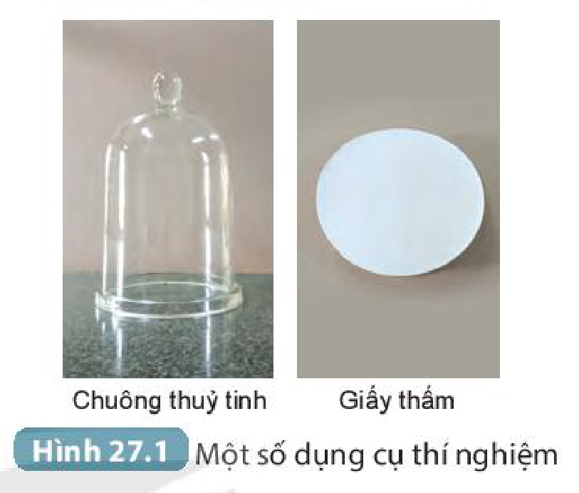
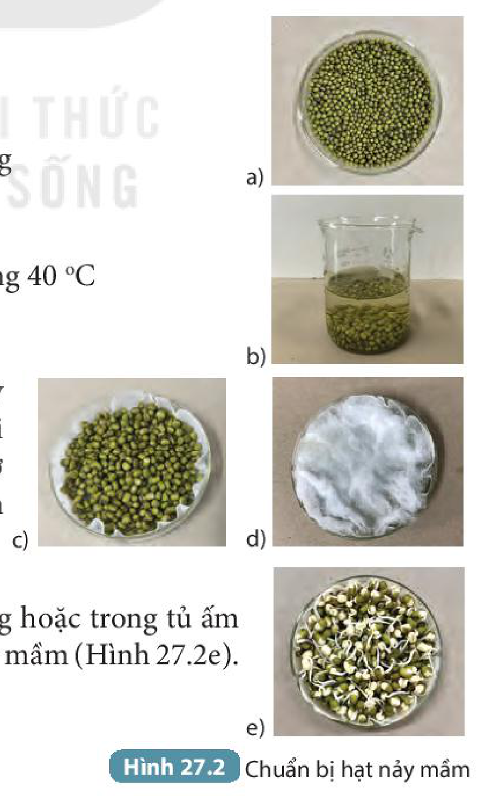
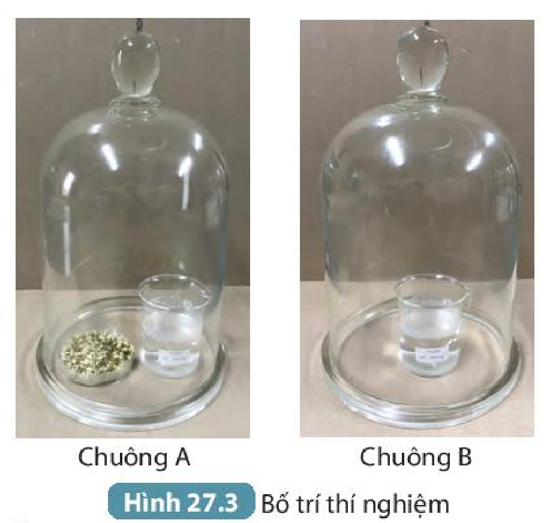

<!-- pdf:117 -->

# BÀI 27: THỰC HÀNH: HÔ HẤP Ở THỰC VẬT

## 🎯 Mục tiêu

- Tiến hành được thí nghiệm về hô hấp tế bào ở thực vật thông qua sự nảy mầm của hạt.

## I. Chuẩn bị

### 1. Thiết bị, dụng cụ

Tủ ấm (nếu có); đĩa Petri; cốc thuỷ tinh; nhiệt kế; nhãn dán; nước ấm (khoảng $40\text{ }^\circ\text{C}$); bông y tế và một số dụng cụ trong Hình 27.1.

Hình 27.1. Một số dụng cụ thí nghiệm

### 2. Mẫu vật, hoá chất

- Hạt đậu xanh, đậu đỏ,... Có thể dùng các loại hạt khác nhau tuỳ thuộc vào điều kiện địa phương và tuỳ theo thời vụ. Nên chọn loại hạt có vỏ mềm như hạt lạc, hạt đậu đen, đậu xanh, đậu đỏ, hạt cải, hạt vừng,...
- Nước vôi trong (Nước vôi trong tác dụng với $\ce{CO2}$ tạo thành kết tủa). <!-- term: Nước vôi trong -->

## II. Cách tiến hành

Bước 1: Chuẩn bị hạt nảy mầm.

- Chọn những hạt chắc, không bị vỡ, không bị mọt (Hình 27.2a).
- Ngâm hạt ngập trong cốc nước ấm khoảng $40\text{ }^\circ\text{C}$ trong 2 giờ (Hình 27.2b).
- Chuẩn bị đĩa Petri có lót bông hoặc giấy thấm đã thấm nước. Lấy hạt vừa ngâm rải đều trên lớp giấy thấm hoặc bông, đậy tờ giấy thấm hoặc bông đã thấm nước lên phía trên (Hình 27.2c, d).
- Để đĩa hạt trong điều kiện nhiệt độ phòng hoặc trong tủ ấm nhiệt độ khoảng $30\text{ }^\circ\text{C}$ đến $35\text{ }^\circ\text{C}$ để hạt nảy mầm (Hình 27.2e).

Hình 27.2. Chuẩn bị hạt nảy mầm

<!-- pdf:118 -->

Bước 2: Tiến hành thí nghiệm.

- Sử dụng 2 chuông thuỷ tinh (có dán nhãn chuông A và B).
- Đặt đĩa có hạt nảy mầm cùng cốc nước vôi trong vào trong chuông A (có dán nhãn cốc A). Đặt cốc nước vôi trong (có dán nhãn cốc B) vào trong chuông B và để trong điều kiện ánh sáng phòng thí nghiệm (Hình 27.3).

Hình 27.3. Bố trí thí nghiệm

Bước 3: Quan sát hiện tượng, kết quả thí nghiệm.

Sau 1 giờ, mở 2 chuông ra và quan sát hiện tượng trên bề mặt 2 cốc nước vôi trong. Ghi lại kết quả thí nghiệm.

## III. Kết quả

1. Hoàn thành bảng ghi kết quả thí nghiệm theo mẫu bên.

Bảng 27.1

| Thí nghiệm | Hiện tượng/Kết quả |
| --- | --- |
| Chuông A | ? |
| Chuông B | ? |
<!-- ocr-ok: đã đối chiếu p118.png, Bảng 27.1 nằm ngang cạnh mục III.1 trên nền màu nên OCR bỏ sót -->

2. Giải thích kết quả thí nghiệm và rút ra kết luận từ thí nghiệm trong bài.

> Trả lời các câu hỏi sau:
>
> 1. Trong bước chuẩn bị hạt nảy mầm:
>    - Mục đích của việc ngâm hạt trong nước là gì?
>    - Lót bông hoặc giấy đã thấm nước rồi đặt trong đĩa Petri có tác dụng gì?
>    - Tại sao sau khi hạt được ngâm nước lại để trong tủ ấm nhiệt độ khoảng từ $30\text{ }^\circ\text{C}$ đến $35\text{ }^\circ\text{C}$ hoặc điều kiện nhiệt độ phòng?
>
> 2. Tại sao hạt giống để lâu sau khi thu hoạch thì sức nảy mầm giảm?
>
> 3. Vào kì nghỉ hè, Lan thường được mẹ hướng dẫn làm giá đỗ từ hạt đậu xanh để có thêm nguồn rau sạch, các bước Lan được hướng dẫn như sau:
>    - Bước 1: Lọc bỏ những hạt lép, mọt hoặc bị vỡ.
>    - Bước 2: Để hạt đậu trong rổ (rá) và chà xát.
>    - Bước 3: Ngâm hạt đậu trong nước ấm ($40\text{ }^\circ\text{C}$ đến $45\text{ }^\circ\text{C}$) khoảng 2 đến 3 giờ.
>    - Bước 4: Cho hạt vào dụng cụ làm giá, để trong chỗ tối và cho hạt đậu “uống nước” mỗi ngày 2 lần.
>
>    Dựa trên những hiểu biết của mình, em hãy giải thích ý nghĩa của các bước làm trên.

## 📷 Danh sách hình trong bài

| Mã hình | Trang PDF | Trang sách | Chú thích |
| --- | --- | --- | --- |
| H7-khoa_hoc_tu_nhien-b27-01 | 117 | 116 | Hình 27.1. Một số dụng cụ thí nghiệm |
| H7-khoa_hoc_tu_nhien-b27-02 | 117 | 116 | Hình 27.2. Chuẩn bị hạt nảy mầm |
| H7-khoa_hoc_tu_nhien-b27-03 | 118 | 117 | Hình 27.3. Bố trí thí nghiệm |
