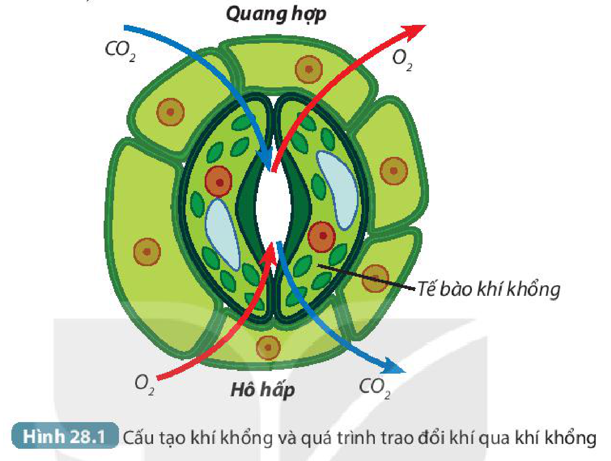
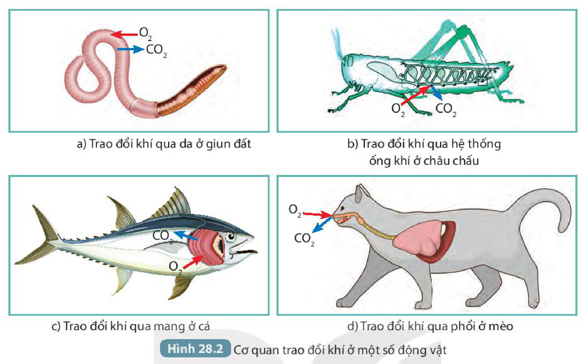
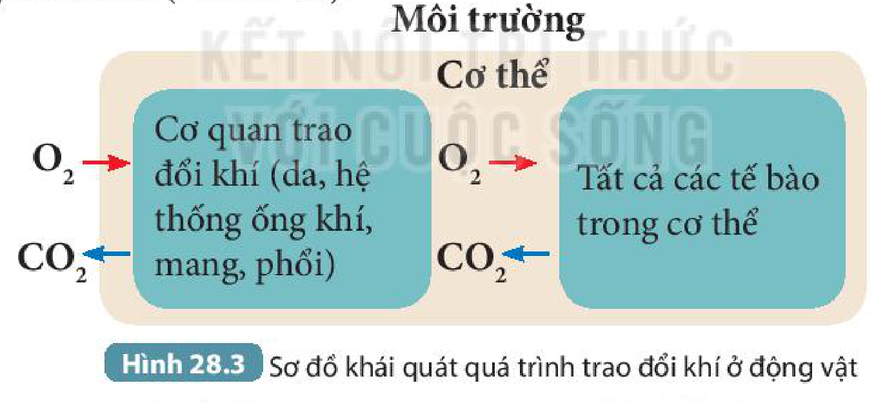
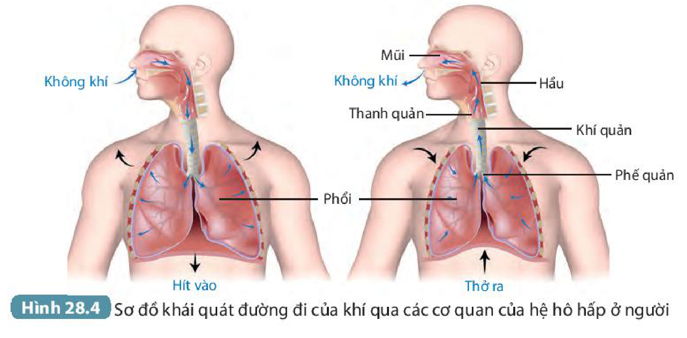

<!-- pdf:119 -->

# BÀI 28: TRAO ĐỔI KHÍ Ở SINH VẬT

## 🎯 Mục tiêu

- Sử dụng hình ảnh để mô tả được quá trình trao đổi khí qua tế bào khí khổng ở lá.
- Dựa vào hình vẽ, mô tả được cấu tạo khí khổng và nêu được chức năng của khí khổng.
- Dựa vào sơ đồ khái quát, mô tả được đường đi của khí qua các cơ quan của hệ hô hấp ở động vật (ví dụ ở người).

## 🔴 Mở đầu

Hình bên thể hiện sự trao đổi khí ở người. Trao đổi khí là gì? Quá trình trao đổi khí diễn ra như thế nào ở cơ thể động vật và thực vật?

## I. Trao đổi khí ở sinh vật

Trao đổi khí là quá trình sinh vật lấy $\ce{O2}$ hoặc $\ce{CO2}$ từ môi trường vào cơ thể, đồng thời thải ra môi trường khí $\ce{CO2}$ hoặc $\ce{O2}$. <!-- term: Trao đổi khí -->

Trao đổi khí giữa cơ thể sinh vật với môi trường diễn ra theo cơ chế khuếch tán. <!-- term: Trao đổi khí -->

Ở cơ thể động vật, trao đổi khí được thực hiện qua quá trình hô hấp, còn ở thực vật, trao đổi khí được thực hiện ở cả quá trình quang hợp và hô hấp.

> ❓ 1. Đọc thông tin trên rồi hoàn thành nội dung theo mẫu Bảng 28.1.
>
> Bảng 28.1
>
> | Trao đổi khí | | Khí lấy vào | Khí thải ra |
> | --- | --- | --- | --- |
> | Ở thực vật | Quang hợp | ? | ? |
> | | Hô hấp | ? | ? |
> | Ở động vật | Hô hấp | ? | ? |
>
> 2. Trao đổi khí có liên quan gì với hô hấp tế bào?
<!-- ocr-ok: đã đối chiếu p119.png, Bảng 28.1 có nền màu xanh nên OCR bỏ sót các dòng đầu -->

<!-- pdf:120 -->

## II. Trao đổi khí ở thực vật

### 1. Cấu tạo của khí khổng

Thực vật trao đổi khí với môi trường chủ yếu qua khí khổng (ở lá cây). Mỗi khí khổng gồm hai tế bào hình hạt đậu nằm áp sát nhau, thành ngoài mỏng, thành trong dày (Hình 28.1). <!-- term: Khí khổng -->

Hình 28.1. Cấu tạo khí khổng và quá trình trao đổi khí qua khí khổng

### 2. Chức năng của khí khổng

Trong quá trình quang hợp, khí khổng mở cho khí $\ce{CO2}$ từ môi trường khuếch tán vào lá và khí $\ce{O2}$ từ lá khuếch tán ra môi trường. Trong hô hấp, quá trình này diễn ra ngược lại, khí $\ce{O2}$ khuếch tán vào lá và khí $\ce{CO2}$ khuyếch tán ra môi trường qua khí khổng. Ngoài chức năng trao đổi khí, khí khổng còn thực hiện quá trình thoát hơi nước cho cây. <!-- term: Khí khổng -->

Ở hầu hết thực vật, khí khổng mở khi cây được chiếu sáng và được cung cấp đủ nước. Độ mở của khí khổng tăng từ sáng đến trưa rồi giảm dần và nhỏ nhất vào chiều tối.

> ❓ 1. Cấu tạo tế bào khí khổng phù hợp với chức năng trao đổi khí ở thực vật như thế nào?
>
> 2. Quan sát Hình 28.1, cho biết sự khác nhau giữa quá trình trao đổi khí qua khí khổng trong hô hấp và quang hợp.
>
> 3. Quá trình trao đổi khí chịu ảnh hưởng của những yếu tố nào? Cây bị thiếu nước ảnh hưởng như thế nào đến quá trình trao đổi khí?

## III. Trao đổi khí ở động vật

### 1. Cơ quan trao đổi khí ở động vật

Động vật trao đổi khí với môi trường qua cơ quan trao đổi khí. Tuỳ từng loài động vật mà cơ quan trao đổi khí là da, hệ thống ống khí, mang hay phổi (Hình 28.2). <!-- term: Cơ quan trao đổi khí ở động vật -->

<!-- pdf:121 -->

Hình 28.2. Cơ quan trao đổi khí ở một số động vật

### 2. Quá trình trao đổi khí ở động vật (ví dụ ở người)

Ở người, khi hít vào, không khí đi qua khoang mũi tới hầu, khí quản, phế quản (đường dẫn khí) để vào phổi. Tại phổi, khi hít vào, $\ce{O2}$ khuếch tán từ **phế nang** vào máu đến cung cấp cho các tế bào trong cơ thể. Tại các tế bào, $\ce{CO2}$ được chuyển vào máu đến phổi, sau đó sẽ khuếch tán vào phế nang và được đưa ra ngoài môi trường qua động tác thở ra (Hình 28.4). <!-- term: Đường dẫn khí --> <!-- term: Hệ hô hấp -->

Hình 28.3. Sơ đồ khái quát quá trình trao đổi khí ở động vật
<!-- ocr-ok: đã đối chiếu p121.png, OCR bỏ sót dòng chú thích Hình 28.3 -->

Hình 28.4. Sơ đồ khái quát đường đi của khí qua các cơ quan của hệ hô hấp ở người

<!-- pdf:122 -->

> ✋ Thảo luận nhóm, trả lời các câu hỏi và yêu cầu sau:
>
> 1. Quan sát Hình 28.2, cho biết tên cơ quan trao đổi khí ở giun đất, cá, châu chấu và mèo.
> 2. Quan sát Hình 28.3, mô tả đường đi của khí qua cơ quan trao đổi khí ở động vật.
> 3. Quan sát Hình 28.4, mô tả đường đi của khí $\ce{O2}$ và $\ce{CO2}$ qua các cơ quan của hệ hô hấp ở người.
> 4. Điều gì sẽ xảy ra nếu đường dẫn khí bị tắc nghẽn? Nêu những việc làm có lợi cho quá trình trao đổi khí ở người.

> 🔍 Em có biết?
>
> - Vào ban đêm, đa số các loài cây chỉ hấp thụ khí $\ce{O2}$ và thải ra khí $\ce{CO2}$ qua quá trình hô hấp. Tuy nhiên, một số loài cây có khả năng sinh ra khí $\ce{O2}$ và hấp thụ khí $\ce{CO2}$ vào ban đêm như cây lưỡi hổ, cây nha đam, cây phú quý, cây oải hương,... Trong đó, cây lưỡi hổ, ngoài khả năng hấp thụ $\ce{CO2}$ và tạo ra khí $\ce{O2}$ vào ban đêm còn có thể hấp thụ nhiều loại khí độc như formandehyde, nitrogen, khói thuốc lá,... Do đó, có thể trồng cây lưỡi hổ trong nhà, vừa có tác dụng trang trí, vừa giúp không khí trong sạch hơn.
> - Trong thực tế, một số gia đình có thói quen sưởi ấm bằng than vào mùa đông hoặc ủ bếp than tổ ong trong nhà phục vụ cho việc đun nấu. Việc làm đó dẫn đến nguy cơ ngạt khí cho con người do khí than chứa nhiều $\ce{CO2}$ và $\ce{CO}$, có thể gây nguy hiểm đến tính mạng. Vì vậy, không nên sưởi ấm bằng cách đốt than, củi trong phòng kín; luôn giữ môi trường sống thông thoáng; trồng nhiều cây xanh để có không khí trong lành, giúp chúng ta có hệ hô hấp khoẻ mạnh.

## 📌 Em đã học

- Trao đổi khí là quá trình sinh vật lấy $\ce{O2}$ hoặc $\ce{CO2}$ từ môi trường vào cơ thể, đồng thời thải ra môi trường khí $\ce{CO2}$ hoặc $\ce{O2}$. <!-- term: Trao đổi khí -->
- Thực vật trao đổi khí với môi trường chủ yếu thông qua khí khổng ở lá, được thực hiện trong quang hợp và hô hấp. Các chất khí khuếch tán vào và ra khỏi lá khi khí khổng mở.
- Ở người, khi hít vào, không khí đi qua đường dẫn khí vào đến phổi sẽ cung cấp $\ce{O2}$ cho các tế bào; khí $\ce{CO2}$ từ tế bào được máu chuyển tới phổi để thải ra ngoài môi trường qua động tác thở ra. <!-- term: Hệ hô hấp -->

## 🚀 Em có thể

- Tạo điều kiện cho quá trình trao đổi khí ở thực vật diễn ra thuận lợi bằng cách tưới nước, chiếu sáng, lau bụi cho lá.
- Thực hiện được một số biện pháp bảo vệ, chăm sóc cơ quan hô hấp của bản thân.

## 📷 Danh sách hình trong bài

| Mã hình | Trang PDF | Trang sách | Chú thích |
| --- | --- | --- | --- |
| H7-khoa_hoc_tu_nhien-b28-01 | 120 | 119 | Hình 28.1. Cấu tạo khí khổng và quá trình trao đổi khí qua khí khổng |
| H7-khoa_hoc_tu_nhien-b28-02 | 121 | 120 | Hình 28.2. Cơ quan trao đổi khí ở một số động vật |
| H7-khoa_hoc_tu_nhien-b28-03 | 121 | 120 | Hình 28.3. Sơ đồ khái quát quá trình trao đổi khí ở động vật |
| H7-khoa_hoc_tu_nhien-b28-04 | 121 | 120 | Hình 28.4. Sơ đồ khái quát đường đi của khí qua các cơ quan của hệ hô hấp ở người |
