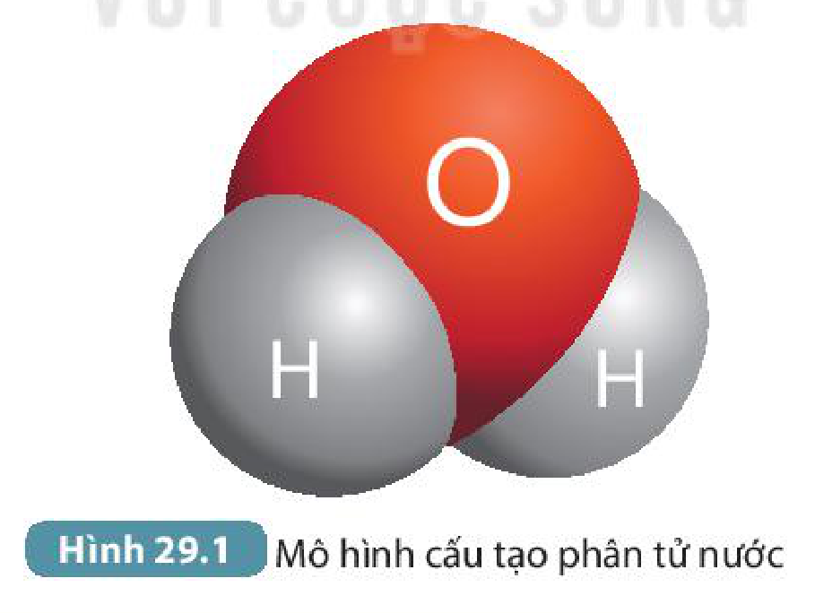
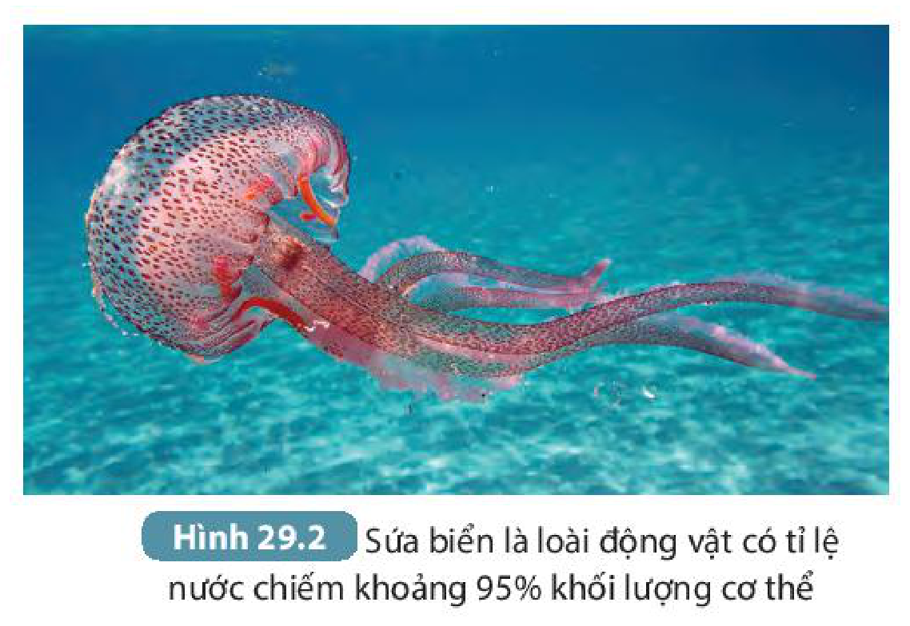
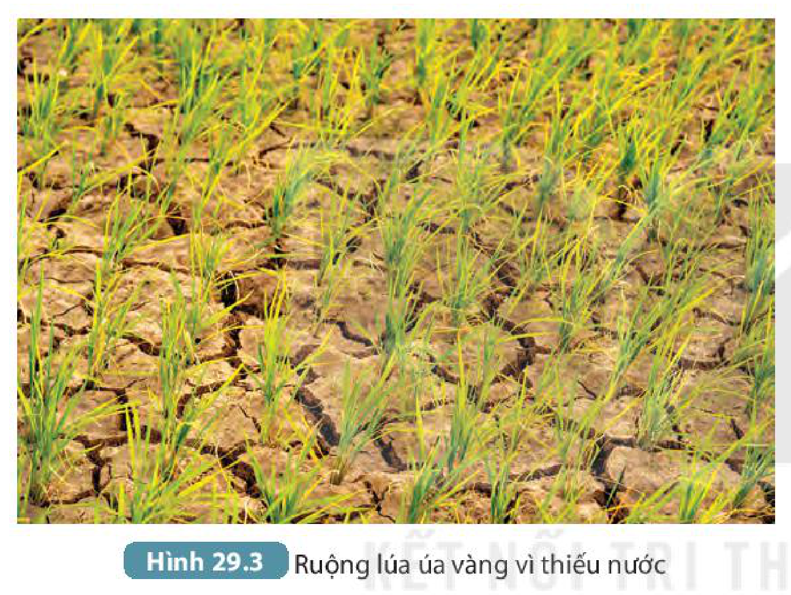
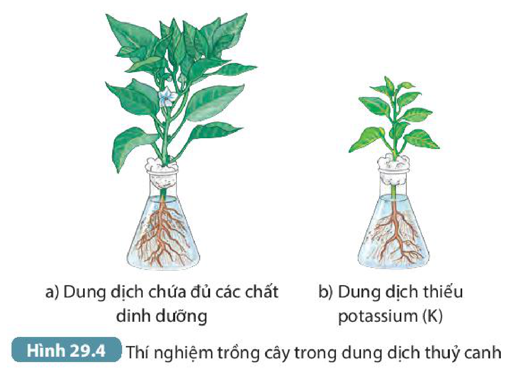
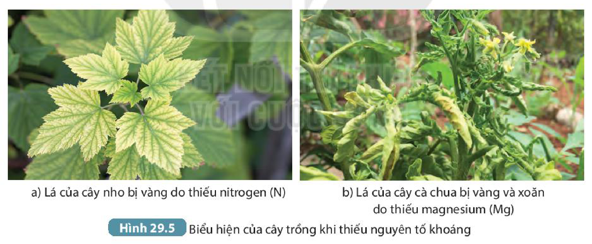
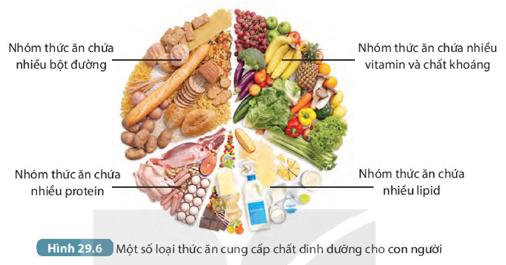
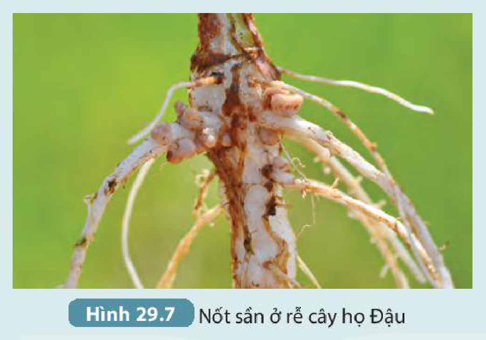

<!-- pdf:123 -->

# BÀI 29: VAI TRÒ CỦA NƯỚC VÀ CHẤT DINH DƯỠNG ĐỐI VỚI SINH VẬT

## 🎯 Mục tiêu

- Dựa vào sơ đồ (hoặc mô hình), nêu được thành phần hoá học, cấu trúc và tính chất của nước.
- Nêu được vai trò của nước và các chất dinh dưỡng đối với cơ thể sinh vật.

## 🔴 Mở đầu

Quan sát một cây trưởng thành to lớn được phát triển từ một hạt cây nhỏ xíu ban đầu, có bao giờ em tự hỏi: Nhờ đâu mà cây có thể lớn lên được? Nguyên liệu để tạo nên sự thay đổi kì diệu đó là gì?

## I. Thành phần hoá học, cấu trúc và tính chất của nước

Mỗi phân tử nước được tạo thành từ một nguyên tử oxygen liên kết với hai nguyên tử hydrogen bằng liên kết cộng hoá trị. Do cặp electron trong liên kết cộng hoá trị bị lệch về phía nguyên tử oxygen nên đầu mang nguyên tử oxygen của phân tử nước tích điện âm còn đầu mang nguyên tử hydrogen tích điện dương, đặc điểm này tạo nên tính phân cực của phân tử nước. Do tính chất phân cực nên các phân tử nước hút lẫn nhau và hút các phân tử phân cực khác, nhờ đó nước trở thành dung môi hoà tan nhiều chất. <!-- term: Tính phân cực của phân tử nước -->

Hình 29.1. Mô hình cấu tạo phân tử nước

> ❓ Quan sát Hình 29.1 và liên hệ với kiến thức đã học để trả lời các câu hỏi sau:
>
> 1. Phân tử nước được cấu tạo từ những nguyên tử nào? Trong phân tử nước, các nguyên tử liên kết với nhau bằng liên kết gì?
> 2. Tính phân cực của phân tử nước được thể hiện như thế nào?

<!-- pdf:124 -->

## II. Vai trò của nước đối với sinh vật

Nước là thành phần chủ yếu tham gia cấu tạo nên tế bào và cơ thể sinh vật. Ở người, nước chiếm khoảng $70\%$ khối lượng cơ thể, ở một số loài thực vật và động vật sống dưới nước thì nước có thể chiếm đến hơn $90\%$ khối lượng cơ thể (Hình 29.2).

Hình 29.2. Sứa biển là loài động vật có tỉ lệ nước chiếm khoảng 95% khối lượng cơ thể

Nước góp phần vận chuyển các chất dinh dưỡng trong cơ thể.
<!-- ocr-ok: đã đối chiếu p124.png, OCR bỏ sót dòng văn bản nằm giữa Hình 29.2 và Hình 29.3 -->

Nước còn là nguyên liệu và môi trường của nhiều quá trình sống trong cơ thể như quá trình quang hợp ở thực vật, quá trình tiêu hoá và hấp thụ thức ăn ở động vật,... Ngoài ra, nước còn góp phần điều hoà nhiệt độ cơ thể.

Nếu cơ thể bị thiếu nước, các quá trình sống cơ bản sẽ bị rối loạn và có thể bị chết (Hình 29.3).

Hình 29.3. Ruộng lúa úa vàng vì thiếu nước
<!-- ocr-ok: đã đối chiếu p124.png, OCR bỏ sót dòng chú thích Hình 29.3 -->

> ❓ 1. Nêu vai trò của nước đối với sinh vật. Điều gì sẽ xảy ra nếu sinh vật bị thiếu nước?
>
> 2. Hãy đề xuất cách tiến hành thí nghiệm chứng minh khẳng định “Nếu thiếu nước trong thời gian dài, cây sẽ bị héo, giảm sức sống và có thể chết”.
>
> 3. Khi bị nôn, sốt cao hoặc tiêu chảy, cơ thể bị mất rất nhiều nước. Trong trường hợp đó, em cần làm gì?

## III. Vai trò của chất dinh dưỡng đối với sinh vật

Chất dinh dưỡng có vai trò cung cấp nguyên liệu và năng lượng cho các quá trình sống của cơ thể. Nhu cầu chất dinh dưỡng của cơ thể khác nhau ở từng loài và từng giai đoạn phát triển. Thiếu hay thừa chất dinh dưỡng đều làm cho cơ thể sinh vật sinh trưởng và phát triển không bình thường (Hình 29.4). <!-- term: Chất dinh dưỡng -->

<!-- pdf:125 -->

Hình 29.4. Thí nghiệm trồng cây trong dung dịch thuỷ canh

### 1. Vai trò của chất dinh dưỡng đối với thực vật

Ở thực vật, chất dinh dưỡng là các chất khoáng, được hấp thụ chủ yếu từ đất như N, P, K, S, B, Mo,... Trong các nguyên tố đó, N góp phần quan trọng cho sinh trưởng và phát triển của cây trồng vì N là nguyên tố cần thiết để thực vật tổng hợp protein và diệp lục. Một số chất khoáng như Cu, Mo, B,... cây trồng cần một lượng rất nhỏ nhưng không thể thiếu vì chúng tham gia điều tiết quá trình trao đổi chất. Tình trạng thiếu chất khoáng ở thực vật thường biểu hiện qua việc sinh trưởng chậm và các dấu hiệu đặc trưng trên lá, quả,... (Hình 29.5). <!-- term: Chất khoáng -->

Hình 29.5. Biểu hiện của cây trồng khi thiếu nguyên tố khoáng

Để giúp cây trồng sinh trưởng nhanh, phát triển tốt, cho năng suất cao, người ta thường bổ sung các chất dinh dưỡng cho cây bằng cách bón phân như phân đạm (chứa N), phân lân (chứa P), phân kali (chứa K),...

> ❓ 1. Chất dinh dưỡng có vai trò gì đối với thực vật? Nêu một số biểu hiện ở thực vật khi thiếu hoặc thừa chất dinh dưỡng.
>
> 2. Giải thích tại sao trong trồng trọt, người ta thường trồng thay đổi các loài cây khác nhau trên cùng một diện tích đất trồng ở các mùa vụ khác nhau trong một năm.

<!-- pdf:126 -->

### 2. Vai trò của chất dinh dưỡng đối với động vật

Thức ăn của động vật chứa các loại chất dinh dưỡng cần cho cơ thể, trong đó những chất dinh dưỡng động vật cần với lượng lớn như chất đạm (protein), chất bột đường (carbohydrate) và chất béo (lipid). Những chất cơ thể cần ít hơn nhưng không thể thiếu là vitamin và chất khoáng. <!-- term: Protein --> <!-- term: Carbohydrate --> <!-- term: Lipid --> <!-- term: Vitamin -->

Hình 29.6. Một số loại thức ăn cung cấp chất dinh dưỡng cho con người

> ✋ Quan sát Hình 29.6 và liên hệ với các kiến thức đã học, thảo luận nhóm để hoàn thành thông tin theo mẫu Bảng 29.1:
>
> Bảng 29.1
>
> | Chất dinh dưỡng | Vai trò chính đối với cơ thể | Thức ăn chứa nhiều chất dinh dưỡng | Một số biểu hiện của cơ thể khi bị thiếu hoặc thừa chất dinh dưỡng |
> | --- | --- | --- | --- |
> | Protein | – Cấu tạo tế bào và cơ thể – Giúp các quá trình trao đổi chất và chuyển hoá năng lượng diễn ra thuận lợi | Thịt gà,... | ? |
> | Carbohydrate | Nguồn cung cấp năng lượng chủ yếu | ? | ? |
> | Lipid | – Dự trữ năng lượng – Chống mất nhiệt – Là dung môi hoà tan một số loại vitamin giúp cơ thể hấp thụ được | ? | ? |
> | Vitamin và chất khoáng | – Tham gia cấu tạo **enzyme**, xương, răng,... – Tham gia các hoạt động trao đổi chất của cơ thể | ? | ? |
<!-- term: Protein --> <!-- term: Carbohydrate --> <!-- term: Lipid --> <!-- term: Vitamin -->

<!-- pdf:127 -->

> 🔍 Em có biết?
>
> Nitrogen là một trong những nguyên tố cần thiết cho sự sinh trưởng và phát triển của thực vật. Không khí chứa đầy nitrogen nhưng thực vật không thể hấp thụ được nitrogen ở dạng này. Rất may, các loài vi khuẩn thuộc chi *Rhizobium*, sống trong nốt sần ở rễ cây họ Đậu (Hình 29.7) lại có khả năng biến đổi khí nitrogen thành dạng nitrogen dễ hấp thụ để bổ sung cho cây và làm giàu chất dinh dưỡng cho đất. <!-- term: Vi khuẩn Rhizobium -->
>
> 
>
> Hình 29.7. Nốt sần ở rễ cây họ Đậu

## 📌 Em đã học

- Nước được cấu tạo từ hai nguyên tố là oxygen và hydrogen. Nước có tính phân cực nên là dung môi hoà tan nhiều chất cho cơ thể.
- Nước là thành phần cấu tạo chủ yếu của tế bào và cơ thể, là nguyên liệu để tổng hợp chất hữu cơ trong quang hợp, là dung môi hoà tan nhiều chất, góp phần vận chuyển các chất và điều hoà thân nhiệt.
- Chất dinh dưỡng cung cấp nguyên liệu và năng lượng để sinh vật thực hiện các quá trình sống. Ở thực vật, chất dinh dưỡng là các chất khoáng. Ở động vật, chất dinh dưỡng là protein, carbohydrate, lipid, vitamin và chất khoáng. <!-- term: Chất dinh dưỡng -->

## 🚀 Em có thể

Sớm nhận biết tình trạng thiếu hoặc thừa nước và chất dinh dưỡng ở sinh vật để bổ sung và điều chỉnh kịp thời giúp sinh vật sinh trưởng, phát triển tốt.

## 📷 Danh sách hình trong bài

| Mã hình | Trang PDF | Trang sách | Chú thích |
| --- | --- | --- | --- |
| H7-khoa_hoc_tu_nhien-b29-01 | 123 | 122 | Hình 29.1. Mô hình cấu tạo phân tử nước |
| H7-khoa_hoc_tu_nhien-b29-02 | 124 | 123 | Hình 29.2. Sứa biển là loài động vật có tỉ lệ nước chiếm khoảng 95% khối lượng cơ thể |
| H7-khoa_hoc_tu_nhien-b29-03 | 124 | 123 | Hình 29.3. Ruộng lúa úa vàng vì thiếu nước |
| H7-khoa_hoc_tu_nhien-b29-04 | 125 | 124 | Hình 29.4. Thí nghiệm trồng cây trong dung dịch thuỷ canh |
| H7-khoa_hoc_tu_nhien-b29-05 | 125 | 124 | Hình 29.5. Biểu hiện của cây trồng khi thiếu nguyên tố khoáng |
| H7-khoa_hoc_tu_nhien-b29-06 | 126 | 125 | Hình 29.6. Một số loại thức ăn cung cấp chất dinh dưỡng cho con người |
| H7-khoa_hoc_tu_nhien-b29-07 | 127 | 126 | Hình 29.7. Nốt sần ở rễ cây họ Đậu |
