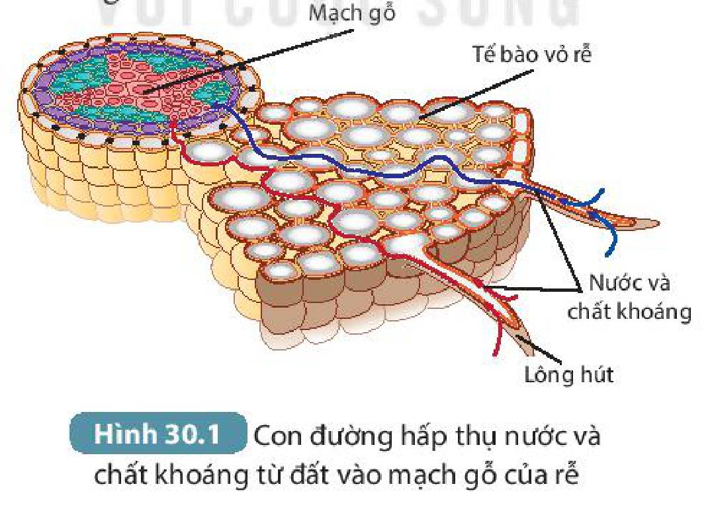
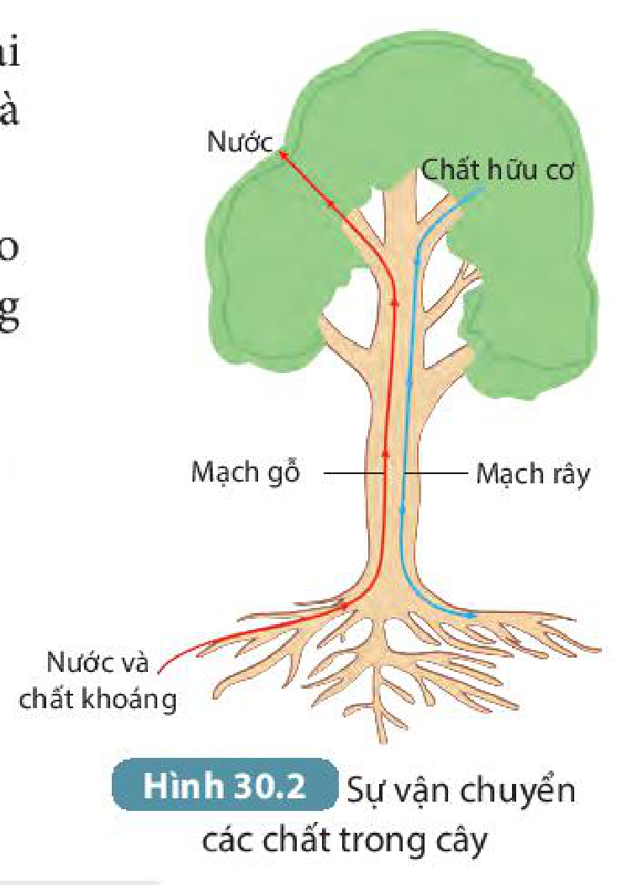
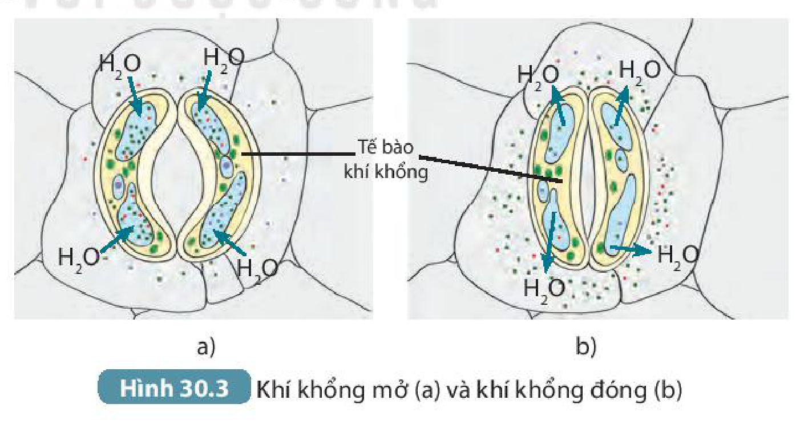
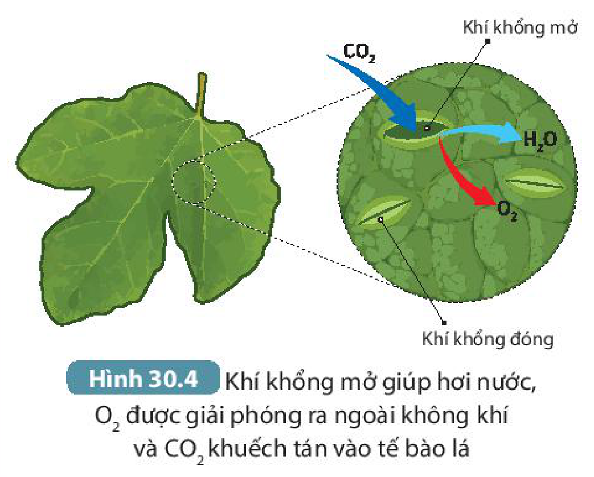
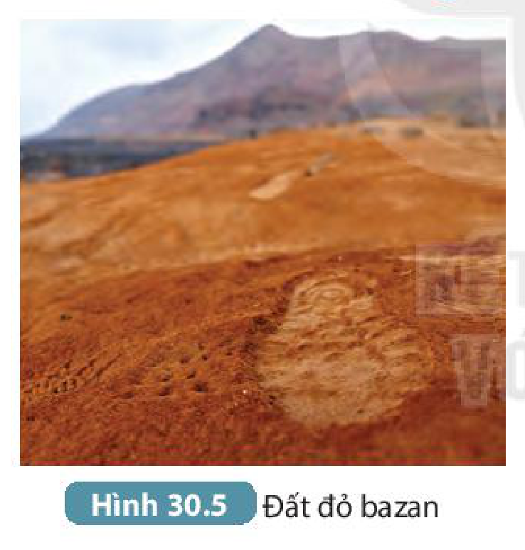

<!-- pdf:128 -->

# BÀI 30: TRAO ĐỔI NƯỚC VÀ CHẤT DINH DƯỠNG Ở THỰC VẬT

## 🎯 Mục tiêu

- Dựa vào sơ đồ đơn giản mô tả được con đường hấp thụ, vận chuyển nước và chất khoáng từ môi trường ngoài vào miền lông hút, vào rễ, lên thân và lá cây.
- Dựa vào sơ đồ, hình ảnh phân biệt được sự vận chuyển các chất trong mạch gỗ từ rễ lên lá cây và từ lá xuống các cơ quan trong mạch rây.
- Nêu được vai trò của thoát hơi nước ở lá và hoạt động đóng, mở khí khổng.
- Nêu được một số yếu tố ảnh hưởng đến sự trao đổi nước và chất dinh dưỡng ở thực vật.
- Vận dụng được những hiểu biết về trao đổi chất và chuyển hoá năng lượng ở thực vật vào thực tiễn (ví dụ: giải thích việc tưới nước và bón phân hợp lí cho cây).

## 🔴 Mở đầu

Cây xanh không có một “trái tim” để bơm máu đi nuôi cơ thể như ở hầu hết động vật, vậy các chất cần thiết cho cơ thể (nước, chất khoáng và chất hữu cơ) được vận chuyển như thế nào trong cây?

## I. Sự hấp thụ nước và chất khoáng từ môi trường ngoài vào rễ

Ở đa số thực vật, sự hấp thụ nước và chất khoáng của cây diễn ra ở các tế bào lông hút (là tế bào biểu bì rễ biến dạng). Nước và chất khoáng hoà tan trong đất được hấp thụ vào rễ rồi tiếp tục được vận chuyển theo mạch gỗ lên các bộ phận khác của cây (dòng đi lên). Sự phát triển của bộ rễ có ảnh hưởng lớn tới quá trình hấp thụ nước và chất khoáng. <!-- term: Lông hút --> <!-- term: Mạch gỗ -->

Hình 30.1. Con đường hấp thụ nước và chất khoáng từ đất vào mạch gỗ của rễ

> ❓ Quan sát Hình 30.1, mô tả con đường nước và chất khoáng từ đất đi vào mạch gỗ của cây.

<!-- pdf:129 -->

## II. Sự vận chuyển các chất trong cây

Nước và chất khoáng hoà tan từ môi trường ngoài được hấp thụ vào rễ, tiếp tục vận chuyển lên thân và lá cây theo mạch gỗ. <!-- term: Mạch gỗ -->

Chất hữu cơ tổng hợp ở lá được vận chuyển theo mạch rây trong thân và cành đến các nơi cần sử dụng hoặc bộ phận dự trữ của cây (hạt, củ, quả). <!-- term: Mạch rây -->

> ❓ Đọc thông tin trong mục II kết hợp với quan sát Hình 30.2, thảo luận và hoàn thành theo mẫu Bảng 30.1.
>
> Bảng 30.1
>
> | Loại mạch | Hướng vận chuyển chủ yếu | Chất được vận chuyển | Nguồn gốc của chất được vận chuyển |
> | --- | --- | --- | --- |
> | Mạch gỗ | ? | ? | ? |
> | Mạch rây | ? | ? | ? |
>
> 
>
> Hình 30.2. Sự vận chuyển các chất trong cây
<!-- ocr-ok: đã đối chiếu p129.png, Bảng 30.1 nền xanh không được OCR đọc tiêu đề cột -->

## III. Quá trình thoát hơi nước ở lá

### 1. Hoạt động đóng, mở khí khổng

Thoát hơi nước diễn ra chủ yếu qua khí khổng ở lá. Cơ chế điều chỉnh sự thoát hơi nước chính là cơ chế điều tiết độ đóng, mở của khí khổng. Khi cây đủ nước, tế bào khí khổng trương nước, căng ra, làm khí khổng mở rộng khiến hơi nước thoát ra ngoài nhiều. Khi cây thiếu nước, tế bào khí khổng sẽ xẹp xuống, khí khổng khép bớt lại khiến hàm lượng hơi nước thoát ra ngoài giảm đi. <!-- term: Thoát hơi nước -->

> ❓ Quan sát Hình 30.3, mô tả quá trình thoát hơi nước qua khí khổng và cho biết độ mở của khí khổng phụ thuộc chủ yếu vào yếu tố nào.
>
> 
>
> Hình 30.3. Khí khổng mở (a) và khí khổng đóng (b)

### 2. Ý nghĩa của sự thoát hơi nước ở lá

Thoát hơi nước là động lực đầu trên của dòng đi lên, đóng vai trò như lực kéo giúp vận chuyển dòng nước và các chất khoáng từ rễ lên lá và đến các bộ phận khác của cây trên mặt đất. <!-- term: Thoát hơi nước -->

<!-- pdf:130 -->

Khí khổng mở rộng trong quá trình thoát hơi nước tạo điều kiện cho khí $\ce{CO2}$ đi vào bên trong tế bào lá, cung cấp nguyên liệu cho quá trình quang hợp và giải phóng $\ce{O2}$ ra ngoài không khí (Hình 30.4). <!-- term: Thoát hơi nước -->

Ngoài ra, hơi nước thoát ra ngoài mang theo một lượng nhiệt nhất định giúp hạ nhiệt độ của lá cây, bảo vệ lá vào những ngày nắng nóng, đảm bảo cho các quá trình sinh lí diễn ra bình thường. <!-- term: Thoát hơi nước -->

Hình 30.4. Khí khổng mở giúp hơi nước, $\ce{O2}$ được giải phóng ra ngoài không khí và $\ce{CO2}$ khuếch tán vào tế bào lá

> ❓ 1. Thoát hơi nước có vai trò gì đối với thực vật và đối với môi trường?
>
> 2. Tại sao vào những ngày hè nắng nóng, khi đứng dưới bóng cây, chúng ta có cảm giác mát mẻ, dễ chịu?

## IV. Một số yếu tố chủ yếu ảnh hưởng đến trao đổi nước và chất dinh dưỡng ở thực vật

Các đặc điểm của đất như độ ẩm, hàm lượng khí $\ce{O2}$ trong đất,... có ảnh hưởng trực tiếp đến khả năng hấp thụ nước và chất dinh dưỡng ở rễ cây. Đất tơi xốp, thoáng khí sẽ làm tăng khả năng hấp thụ nước của cây. Ví dụ: Đất đỏ bazan (Hình 30.5) có tầng đất dày, tơi xốp, nhiều chất dinh dưỡng, thuận lợi cho quá trình hút nước và chất dinh dưỡng của cây trồng. Cây chỉ hút được các chất khoáng khi chúng được hoà tan trong nước, vì vậy, cần đảm bảo độ ẩm cho đất để nâng cao khả năng hấp thụ chất dinh dưỡng của cây.

Hình 30.5. Đất đỏ bazan

Sự trao đổi nước và chất dinh dưỡng của thực vật còn phụ thuộc vào các yếu tố khác như ánh sáng, nhiệt độ, độ ẩm không khí,... Ánh sáng chủ yếu ảnh hưởng đến quá trình thoát hơi nước ở lá với vai trò là tác nhân gây mở khí khổng. Nhiệt độ ảnh hưởng đến cả sự hấp thụ nước ở rễ, vận chuyển nước trong thân và thoát hơi nước ở lá. Độ ẩm không khí liên quan chặt chẽ đến quá trình thoát hơi nước ở lá, độ ẩm không khí càng thấp thì thoát hơi nước càng mạnh.

> ❓ Dựa vào thông tin trong mục IV, trả lời các câu hỏi sau:
>
> 1. Kể tên các yếu tố ảnh hưởng đến trao đổi nước và các chất dinh dưỡng ở thực vật.
> 2. Vì sao trước khi trồng cây hoặc gieo hạt, người ta thường làm đất tơi xốp và bón lót một số loại phân?

<!-- pdf:131 -->

## V. Vận dụng hiểu biết về trao đổi chất và chuyển hoá năng lượng ở thực vật vào thực tiễn

Ở thực vật, nhu cầu về nước, ánh sáng, chất dinh dưỡng,... khác nhau tuỳ loài, giai đoạn phát triển và điều kiện thời tiết. Vì vậy, để cây trồng sinh trưởng và phát triển tốt, cho năng suất cao cần căn cứ vào những nhu cầu này để tưới nước, bón phân hợp lí. Ví dụ: Những loại rau sử dụng thân, lá làm thức ăn như rau cải, rau muống cần nhiều nitrogen (N); Những ngày trời khô hanh, có gió mạnh cần phải bổ sung nhiều nước cho cây.

> ✋ Thảo luận nhóm để hoàn thành các câu hỏi sau:
>
> 1. Vì sao khi di chuyển cây đi trồng ở nơi khác, người ta thường cắt bớt một phần cành, lá?
> 2. Vì sao vào những ngày khô hanh, độ ẩm không khí thấp hoặc những ngày nắng nóng cần phải tưới nhiều nước cho cây?

> 🔍 Em có biết?
>
> Sa mạc là nơi có điều kiện vô cùng khắc nghiệt, lượng mưa ở đây rất ít, có khi cả năm không có mưa. Trong điều kiện khắc nghiệt đó, mỗi loài thực vật ở đây có một cách riêng để tồn tại và phát triển. Nhiều loài có bộ rễ dài (có thể lên đến 50 m), đâm sâu vào lòng đất để tìm mạch nước ngầm. Một số loài khác lại có bộ rễ toả rộng hàng chục mét, tập trung ở gần mặt đất để hứng sương đêm.

## 📌 Em đã học

- Nước và chất khoáng hoà tan trong đất được các tế bào lông hút hấp thụ vào rễ rồi vận chuyển từ rễ lên thân cây và lá nhờ mạch gỗ (dòng đi lên). Chất hữu cơ do lá tổng hợp được vận chuyển đến nơi cần dùng hoặc nơi dự trữ nhờ mạch rây (dòng đi xuống). <!-- term: Lông hút --> <!-- term: Mạch gỗ --> <!-- term: Mạch rây -->
- Thoát hơi nước ở lá góp phần vận chuyển nước và chất khoáng trong cây, điều hoà nhiệt độ cơ thể, giúp khí $\ce{CO2}$ đi vào bên trong lá và giải phóng khí $\ce{O2}$ ra ngoài môi trường. <!-- term: Thoát hơi nước -->
- Quá trình thoát hơi nước ở lá cây phụ thuộc vào sự đóng, mở của khí khổng.
- Các yếu tố bên ngoài như ánh sáng, nhiệt độ, độ ẩm đất và không khí,... có ảnh hưởng đến sự trao đổi nước và chất dinh dưỡng ở thực vật.
- Để cây trồng phát triển tốt, cho năng suất cao cần bón phân và tưới nước hợp lí cho cây.

## 🚀 Em có thể

- Vận dụng các kiến thức đã học trong việc trồng và chăm sóc cây xanh (xới giúp đất tơi xốp, thoáng khí; vun gốc định kì; tưới đủ nước, bón phân hợp lí).
- Giải thích được tại sao nên di chuyển cây đi trồng nơi khác vào ngày trời râm, mát, tỉa bớt lá và cành cây.

## 📷 Danh sách hình trong bài

| Mã hình | Trang PDF | Trang sách | Chú thích |
| --- | --- | --- | --- |
| H7-khoa_hoc_tu_nhien-b30-01 | 128 | 127 | Hình 30.1. Con đường hấp thụ nước và chất khoáng từ đất vào mạch gỗ của rễ |
| H7-khoa_hoc_tu_nhien-b30-02 | 129 | 128 | Hình 30.2. Sự vận chuyển các chất trong cây |
| H7-khoa_hoc_tu_nhien-b30-03 | 129 | 128 | Hình 30.3. Khí khổng mở (a) và khí khổng đóng (b) |
| H7-khoa_hoc_tu_nhien-b30-04 | 130 | 129 | Hình 30.4. Khí khổng mở giúp hơi nước, O₂ được giải phóng ra ngoài không khí và CO₂ khuếch tán vào tế bào lá |
| H7-khoa_hoc_tu_nhien-b30-05 | 130 | 129 | Hình 30.5. Đất đỏ bazan |
