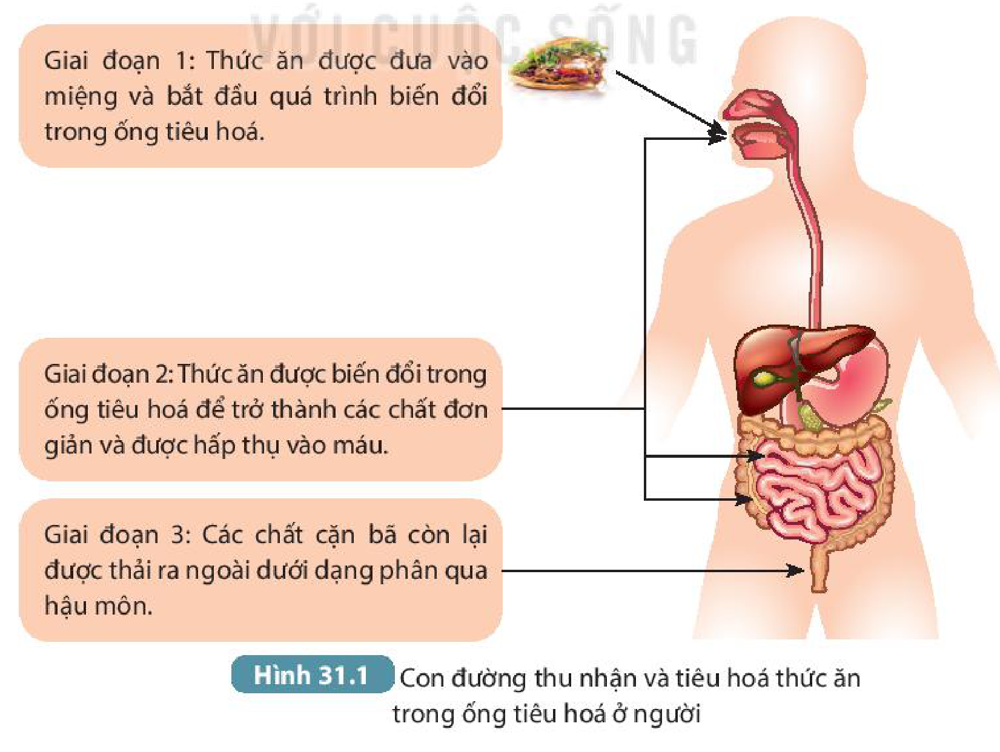
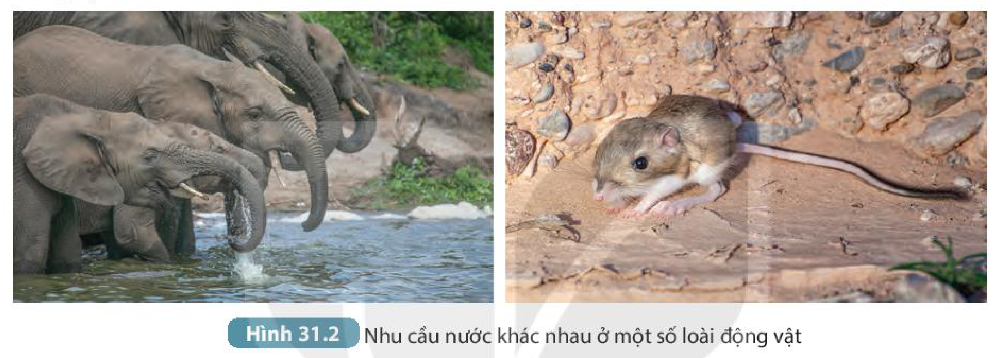
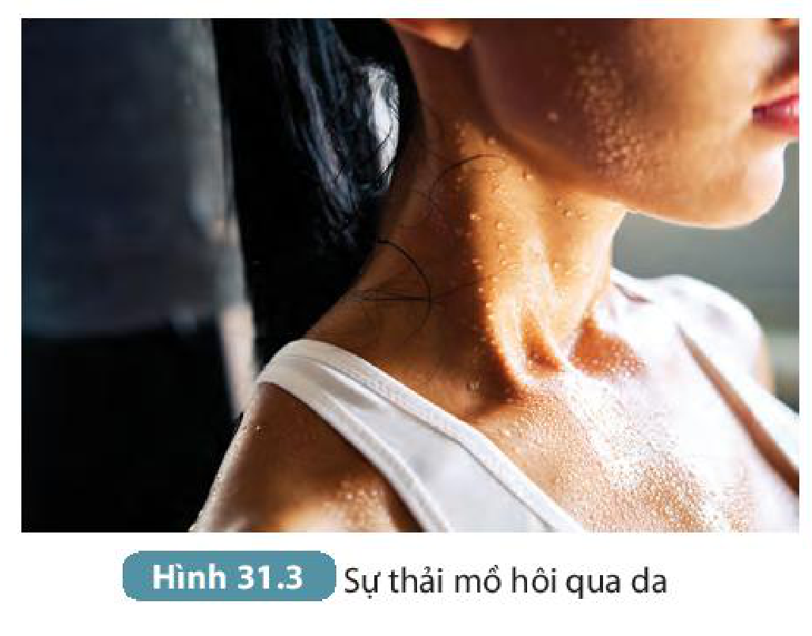
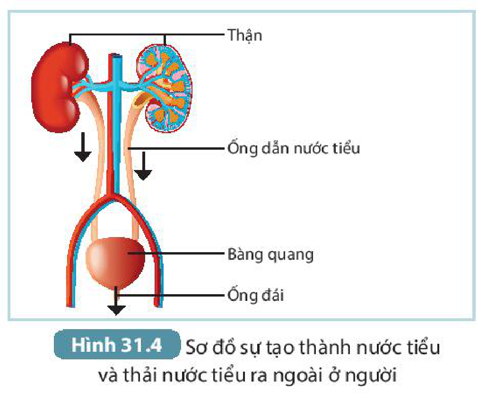
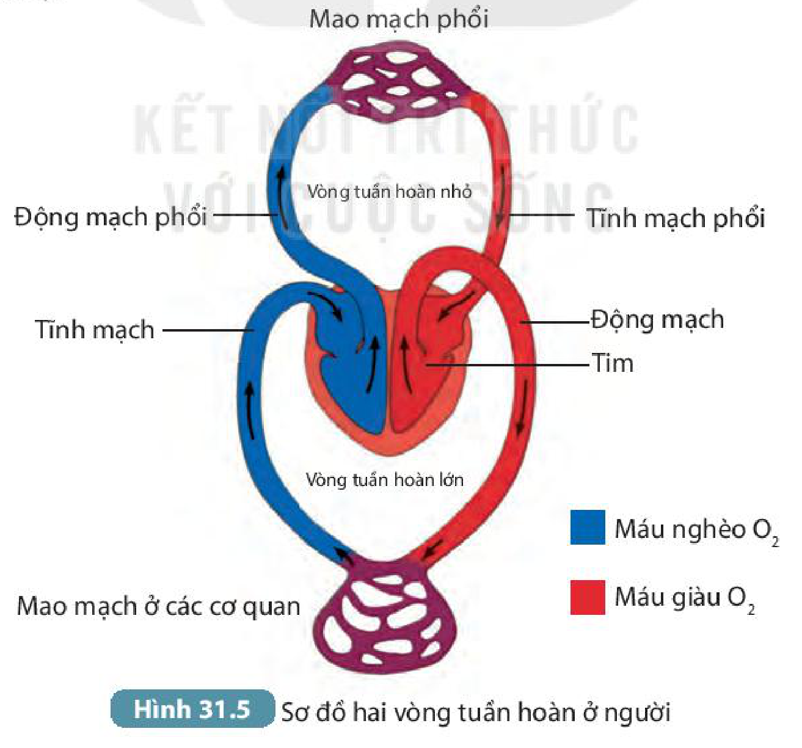
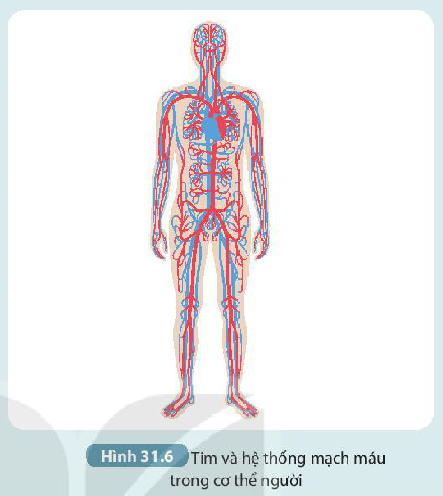

<!-- pdf:132 -->

# BÀI 31: TRAO ĐỔI NƯỚC VÀ CHẤT DINH DƯỠNG Ở ĐỘNG VẬT

## 🎯 Mục tiêu

- Dựa vào sơ đồ khái quát, mô tả được con đường thu nhận và tiêu hoá thức ăn trong ống tiêu hoá ở động vật (đại diện ở người).
- Trình bày được con đường trao đổi nước và nhu cầu sử dụng nước ở động vật.
- Mô tả được quá trình vận chuyển các chất ở động vật, lấy ví dụ cụ thể hai vòng tuần hoàn ở người.
- Vận dụng những hiểu biết về trao đổi chất và năng lượng ở động vật vào thực tiễn (ví dụ về dinh dưỡng và vệ sinh ăn uống,...).

## 🔴 Mở đầu

Có bao giờ em tự hỏi chiếc bánh mì thơm ngon, hấp dẫn sẽ biến đổi như thế nào sau khi em ăn nó?

## I. Con đường thu nhận và tiêu hoá thức ăn trong ống tiêu hoá ở động vật

Động vật thu nhận thức ăn từ môi trường ngoài chủ yếu thông qua hoạt động ăn và uống. Các chất dinh dưỡng có trong thức ăn như carbohydrate, protein, lipid,... cần được biến đổi thành các chất đơn giản để cơ thể có thể hấp thụ được. Quá trình biến đổi này được thực hiện nhờ hoạt động tiêu hoá trong ống tiêu hoá. Các chất cặn bã không được cơ thể hấp thụ sẽ thải ra ngoài qua hậu môn. <!-- term: Tiêu hoá --> <!-- term: Hệ tiêu hoá -->

Hình 31.1. Con đường thu nhận và tiêu hoá thức ăn trong ống tiêu hoá ở người

<!-- pdf:133 -->

> ❓ Quan sát Hình 31.1, hãy mô tả con đường thu nhận và tiêu hoá thức ăn trong ống tiêu hoá ở người.

## II. Nhu cầu sử dụng nước và con đường trao đổi nước ở động vật

Giống như những sinh vật khác, động vật cần nước để duy trì sự sống. Mỗi loài động vật có nhu cầu sử dụng nước khác nhau phụ thuộc vào tuổi, đặc điểm sinh học, môi trường sống,...

Ví dụ: Một con voi cần uống từ 160 lít đến 300 lít nước mỗi ngày, trong khi loài chuột nhảy ở Bắc Mỹ không cần uống nước mà lấy nước từ các loại hạt ăn hằng ngày (Hình 31.2).

Hình 31.2. Nhu cầu nước khác nhau ở một số loài động vật

Đa số động vật và con người lấy nước vào cơ thể chủ yếu qua thức ăn và nước uống. Nước được hấp thụ trực tiếp ở các bộ phận của ống tiêu hoá, trong đó ruột già là nơi hấp thụ nhiều nước nhất. Sau khi hấp thụ vào mạch máu, nước được vận chuyển tới các tế bào và các cơ quan trong cơ thể để tham gia vào quá trình trao đổi chất. Nước và các chất thải được đào thải ra khỏi cơ thể chủ yếu qua nước tiểu và mồ hôi. Nước tiểu được tạo ra nhờ quá trình lọc máu ở thận, sau đó được ống dẫn nước tiểu đưa xuống bàng quang và thải ra ngoài qua ống đái. Vì nước luôn có sự đào thải ra khỏi cơ thể nên việc bổ sung nước là vô cùng quan trọng. <!-- term: Con đường trao đổi nước ở động vật -->

Hình 31.3. Sự thải mồ hôi qua da

Hình 31.4. Sơ đồ sự tạo thành nước tiểu và thải nước tiểu ra ngoài ở người

<!-- pdf:134 -->

> ✋ Đọc thông tin trên và thảo luận để trả lời các câu hỏi sau:
>
> 1. Em có thể bổ sung nước cho cơ thể bằng những cách nào?
> 2. Quan sát Hình 31.3 và 31.4, cho biết nước đào thải ra khỏi cơ thể như thế nào.
> 3. Theo khuyến nghị năm 2012 của Viện Dinh dưỡng Quốc gia, trẻ em ở tuổi vị thành niên cần 40 mL nước/1 kg thể trọng mỗi ngày. Dựa vào khuyến nghị này, hãy tính lượng nước cần uống mỗi ngày của bản thân để đảm bảo nhu cầu nước cho cơ thể.

## III. Sự vận chuyển các chất ở động vật

Các tế bào và cơ quan trong cơ thể động vật được nuôi dưỡng bởi chất dinh dưỡng và oxygen. Oxygen được lấy từ phổi còn chất dinh dưỡng do cơ quan tiêu hoá cung cấp. Quá trình trao đổi chất ở tế bào cũng như hoạt động của các cơ quan sẽ tạo ra các sản phẩm thải (trong đó có $\ce{CO2}$), những chất này được máu vận chuyển đến phổi và cơ quan bài tiết để thải ra ngoài. Hệ tuần hoàn là hệ cơ quan thực hiện việc vận chuyển các chất trong cơ thể động vật. <!-- term: Hệ tuần hoàn -->

Ở người, các chất được vận chuyển theo hai vòng tuần hoàn. Vòng tuần hoàn nhỏ đưa máu có màu đỏ thẫm nghèo $\ce{O2}$ từ tim đến phổi, tại đây máu nhận $\ce{O2}$ và thải $\ce{CO2}$ trở thành máu có màu đỏ tươi rồi trở về tim. Vòng tuần hoàn lớn đưa máu có màu đỏ tươi giàu $\ce{O2}$ và các chất dinh dưỡng đi nuôi cơ thể. Tại các tế bào, mô, cơ quan, máu nhận các chất bài tiết và $\ce{CO2}$ trở thành máu có màu đỏ thẫm và trở về tim (Hình 31.5). <!-- term: Vòng tuần hoàn nhỏ --> <!-- term: Vòng tuần hoàn lớn -->

Hình 31.5. Sơ đồ hai vòng tuần hoàn ở người

> ❓ Đọc thông tin mục III kết hợp quan sát Hình 31.5, mô tả con đường vận chuyển các chất ở động vật và người.

<!-- pdf:135 -->

## IV. Vận dụng hiểu biết về trao đổi chất và chuyển hoá năng lượng ở động vật vào thực tiễn

### 1. Những nguy cơ khi thiếu hoặc thừa dinh dưỡng

Nếu bị thiếu hụt một chất dinh dưỡng nào đó, cơ thể sẽ không thể hoạt động bình thường. Thiếu tinh bột, cơ thể sẽ thiếu năng lượng để hoạt động; thiếu protein sẽ không có đủ nguyên liệu để cấu tạo tế bào; thiếu vitamin A sẽ mắc bệnh khô mắt, quáng gà,...

Một số chất dinh dưỡng khi cơ thể tiêu thụ quá nhiều cũng gây ra những hậu quả không tốt. Ăn quá nhiều thức ăn chứa đường và vệ sinh răng miệng không đúng cách có thể làm cho răng bị sâu. Ăn quá nhiều chất béo và carbohydrate khiến cho năng lượng cung cấp cho cơ thể mỗi ngày bị dư thừa so với nhu cầu dẫn đến béo phì. Thừa cân nghiêm trọng có thể gây ra tổn thương các khớp, tăng nguy cơ mắc các bệnh như tiểu đường, tim mạch.

> ✋ Liên hệ các kiến thức đã học và thảo luận nhóm, trả lời các câu hỏi sau:
>
> 1. Giải thích vì sao chúng ta nên ăn đa dạng các loại thức ăn mà không nên chỉ ăn một loại thức ăn dù loại thức ăn đó rất bổ dưỡng.
> 2. Xây dựng thực đơn cho mỗi bữa ăn trong một ngày để đảm bảo chế độ ăn cân đối và đầy đủ chất dinh dưỡng.

### 2. Vệ sinh ăn uống

Có rất nhiều tác nhân có thể gây hại cho các cơ quan trong ống tiêu hoá cũng như cơ thể như vi khuẩn, nấm có trong thức ăn bị ôi thiu; giun, sán sống kí sinh trong ruột có thể gây tắc ống mật, tắc ruột và sử dụng một phần chất dinh dưỡng của cơ thể. Hoạt động tiêu hoá và hấp thụ có thể kém hiệu quả do ăn uống không đúng cách như ăn vội vàng, nhai không kĩ, ăn không đúng giờ hay khẩu phần ăn không hợp lí,...

> ✋ Thảo luận với bạn và hoàn thành nội dung theo mẫu Bảng 31.1.
>
> Bảng 31.1
>
> | Hoạt động | Tác dụng |
> | --- | --- |
> | Vệ sinh răng miệng đúng cách sau khi ăn | Giúp bảo vệ răng, tránh sâu răng |
> | Ăn chín, uống sôi | ? |
> | Rửa tay trước khi ăn | ? |
> | Tạo không khí thoải mái khi ăn | ? |
> | Chuẩn bị bữa ăn có đầy đủ các nhóm chất dinh dưỡng | ? |

<!-- pdf:136 -->

> 🔍 Em có biết?
>
> Trong cơ thể người, tim là bộ phận hoạt động nhiều nhất. Trung bình 1 ngày, tim đập khoảng 100 000 lần để vận chuyển hơn 7 500 lít máu đi nuôi cơ thể. Máu trong cơ thể di chuyển trong một mạng lưới bao gồm động mạch, mao mạch và tĩnh mạch. Ở người trưởng thành, nếu duỗi thẳng toàn bộ mạng lưới mạch máu trong cơ thể rồi nối lại với nhau sẽ có độ dài khoảng 96 000 km (gấp gần 2,5 lần so với chu vi của Trái Đất). <!-- term: Hệ tuần hoàn -->
>
> (Nguồn: Khoa học.tv)
>
> 
>
> Hình 31.6. Tim và hệ thống mạch máu trong cơ thể người

## 📌 Em đã học

- Nhu cầu sử dụng nước ở động vật phụ thuộc vào tuổi, đặc điểm sinh học, môi trường sống,... Động vật lấy nước vào cơ thể chủ yếu qua thức ăn, nước uống; nước thải ra khỏi cơ thể qua nước tiểu và mồ hôi.
- Con đường trao đổi chất dinh dưỡng trong ống tiêu hoá ở động vật bao gồm ba giai đoạn: ăn, tiêu hoá và hấp thụ chất dinh dưỡng, thải phân. <!-- term: Hệ tiêu hoá -->
- Nước, chất dinh dưỡng, chất thải,... được vận chuyển trong cơ thể nhờ hoạt động của hệ tuần hoàn. Ở người, sự vận chuyển các chất diễn ra theo vòng tuần hoàn nhỏ và vòng tuần hoàn lớn. <!-- term: Hệ tuần hoàn -->
- Để người và động vật sinh trưởng, phát triển tốt cần có chế độ dinh dưỡng hợp lí, đảm bảo vệ sinh ăn uống.

## 🚀 Em có thể

- Thực hiện được một số biện pháp bảo vệ hệ tiêu hoá như ăn chín, uống sôi, rửa tay sạch trước khi ăn và sử dụng các thực phẩm rõ nguồn gốc. <!-- term: Hệ tiêu hoá -->
- Dựa trên khuyến nghị của Viện Dinh dưỡng Quốc gia để xác định lượng nước mà cơ thể cần uống mỗi ngày của bản thân và các thành viên trong gia đình.

## 📷 Danh sách hình trong bài

| Mã hình | Trang PDF | Trang sách | Chú thích |
| --- | --- | --- | --- |
| H7-khoa_hoc_tu_nhien-b31-01 | 132 | 131 | Hình 31.1. Con đường thu nhận và tiêu hoá thức ăn trong ống tiêu hoá ở người |
| H7-khoa_hoc_tu_nhien-b31-02 | 133 | 132 | Hình 31.2. Nhu cầu nước khác nhau ở một số loài động vật |
| H7-khoa_hoc_tu_nhien-b31-03 | 133 | 132 | Hình 31.3. Sự thải mồ hôi qua da |
| H7-khoa_hoc_tu_nhien-b31-04 | 133 | 132 | Hình 31.4. Sơ đồ sự tạo thành nước tiểu và thải nước tiểu ra ngoài ở người |
| H7-khoa_hoc_tu_nhien-b31-05 | 134 | 133 | Hình 31.5. Sơ đồ hai vòng tuần hoàn ở người |
| H7-khoa_hoc_tu_nhien-b31-06 | 136 | 135 | Hình 31.6. Tim và hệ thống mạch máu trong cơ thể người |
