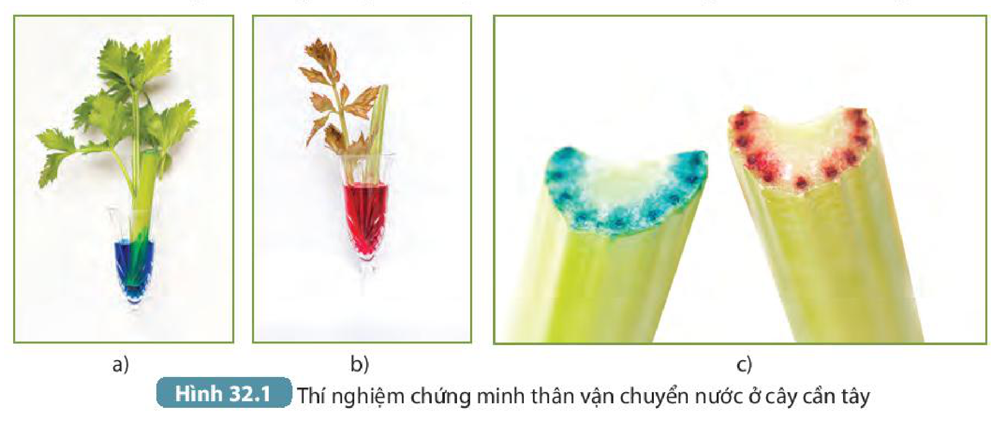
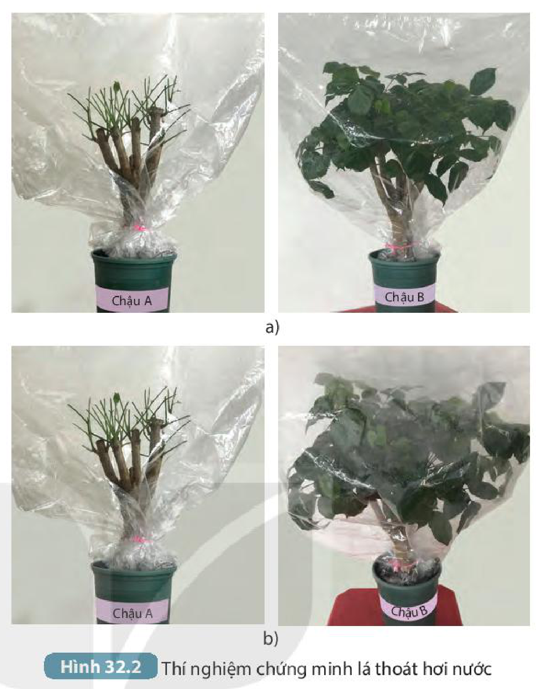

<!-- pdf:137 -->

# BÀI 32: THỰC HÀNH: CHỨNG MINH THÂN VẬN CHUYỂN NƯỚC VÀ LÁ THOÁT HƠI NƯỚC

## 🎯 Mục tiêu

- Tiến hành được thí nghiệm chứng minh thân vận chuyển nước và lá thoát hơi nước.

## I. Chuẩn bị

### 1. Dụng cụ

Cốc thuỷ tinh; dao mổ; kính lúp; túi nylon trong suốt.

### 2. Mẫu vật, hoá chất

- Cây cần tây hoặc cành hoa màu trắng (hồng trắng, cúc trắng,...).
- 2 cây trồng trong 2 chậu đất ẩm (nên chọn các cây có thân thấp, nhiều lá).
- Nước pha màu (mực đỏ, mực tím hoặc mực xanh).

## II. Cách tiến hành

### 1. Thí nghiệm chứng minh thân vận chuyển nước

Ở cây cần tây, phần thân rất ngắn, phần cuống lá dài, nên nước và các chất khoáng được vận chuyển qua thân rất nhanh để vào mạch gỗ ở cuống lá và thoát ra ngoài qua lá.

Bước 1: Dùng dao mổ cắt ngang qua cuống lá cần tây (gần sát gốc) rồi cắm vào cốc thuỷ tinh chứa nước pha màu, để ra chỗ thoáng. Sau khoảng thời gian từ 30 phút đến 60 phút, quan sát sự thay đổi màu của cuống và lá cần tây ở cốc nước pha màu xanh và cốc nước pha màu đỏ (Hình 32.1a và 32.1b).

Bước 2: Dùng dao mổ cắt ngang phần cuống lá cần tây có lá bị nhuộm màu thành các đoạn ngắn (Hình 32.1c).

Bước 3: Sử dụng kính lúp để quan sát phần mạch dẫn trong các đoạn cuống lá.

Hình 32.1. Thí nghiệm chứng minh thân vận chuyển nước ở cây cần tây

<!-- pdf:138 -->

### 2. Thí nghiệm chứng minh lá thoát hơi nước

Bước 1: Đánh dấu 2 chậu cây là chậu A, chậu B.

Bước 2: Ngắt toàn bộ lá cây ở chậu A, cây ở chậu B giữ nguyên lá.

Bước 3: Trùm túi nylon trong suốt lên cây trong chậu A và chậu B (chú ý trùm kín toàn bộ phần lá cây rồi buộc kín miệng túi), đặt 2 chậu cây ra ngoài sáng (Hình 32.2a).

Bước 4: Sau khoảng thời gian từ 15 phút đến 30 phút, quan sát hiện tượng xảy ra ở mặt trong túi nylon trùm trên cây ở chậu A và cây ở chậu B (Hình 32.2b).

Hình 32.2. Thí nghiệm chứng minh lá thoát hơi nước

## III. Kết quả

1. Hoàn thành bảng ghi kết quả thí nghiệm theo mẫu sau:

Bảng 32.1

| Thí nghiệm | Hiện tượng/Kết quả |
| --- | --- |
| Chứng minh thân vận chuyển nước | ? |
| Chứng minh lá thoát hơi nước | ? |

2. Giải thích kết quả của các thí nghiệm và rút ra kết luận.

> Trả lời các câu hỏi sau:
>
> 1. Tại sao trong thí nghiệm chứng minh thân vận chuyển nước phải sử dụng nước pha màu?
> 2. Tại sao trong thí nghiệm chứng minh lá thoát hơi nước phải trùm túi nylon trong suốt, kín toàn bộ phần lá cây?

## 📷 Danh sách hình trong bài

| Mã hình | Trang PDF | Trang sách | Chú thích |
| --- | --- | --- | --- |
| H7-khoa_hoc_tu_nhien-b32-01 | 137 | 136 | Hình 32.1. Thí nghiệm chứng minh thân vận chuyển nước ở cây cần tây |
| H7-khoa_hoc_tu_nhien-b32-02 | 138 | 137 | Hình 32.2. Thí nghiệm chứng minh lá thoát hơi nước |
