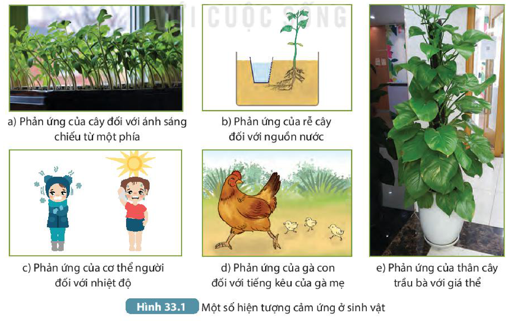
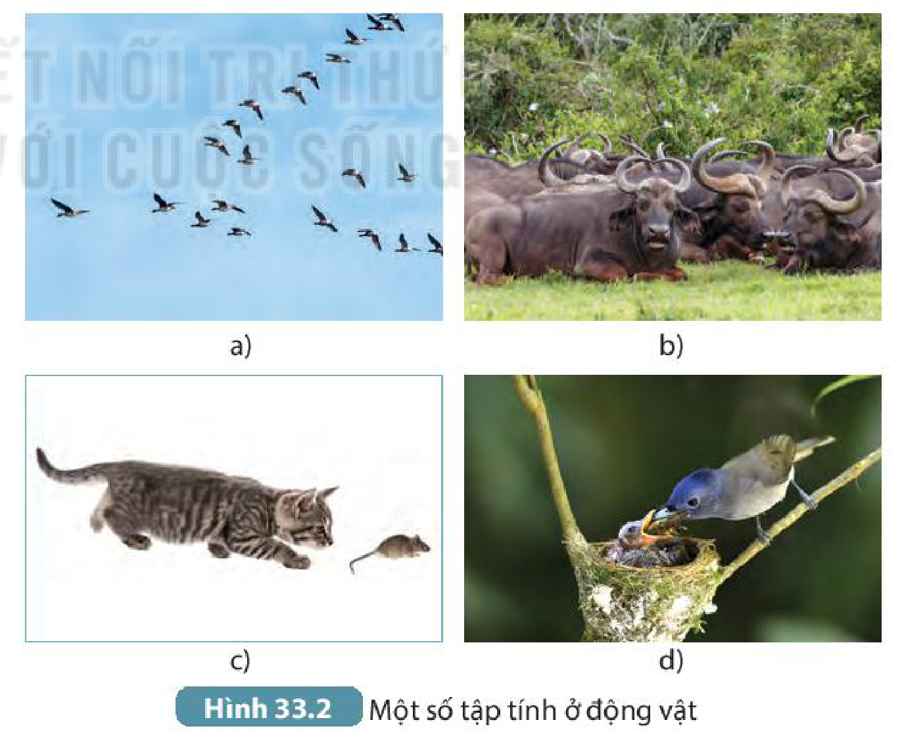
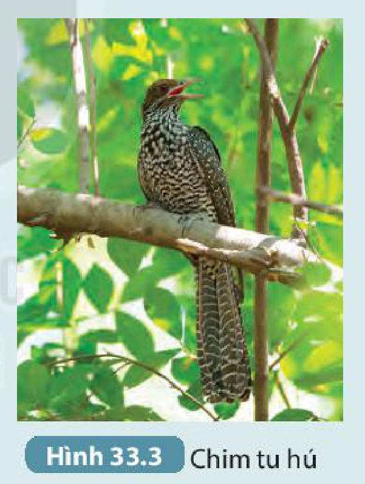

<!-- pdf:139 -->

# BÀI 33: CẢM ỨNG Ở SINH VẬT VÀ TẬP TÍNH Ở ĐỘNG VẬT

## 🎯 Mục tiêu

- Phát biểu được khái niệm cảm ứng ở sinh vật. Lấy được ví dụ về các hiện tượng cảm ứng ở sinh vật (ở thực vật và động vật).
- Phát biểu được khái niệm tập tính ở động vật. Lấy được ví dụ minh hoạ.
- Nêu được vai trò của cảm ứng đối với sinh vật và tập tính đối với động vật.

## 🔴 Mở đầu

Khi ta chạm tay vào lá cây trinh nữ (xấu hổ), lá cây sẽ cụp lại (hình bên). Đây là hiện tượng gì? Hiện tượng này có ý nghĩa như thế nào đối với sinh vật?

## I. Cảm ứng và vai trò của cảm ứng ở sinh vật

### 1. Cảm ứng ở sinh vật là gì?

Cảm ứng là phản ứng của sinh vật đối với các kích thích đến từ môi trường. <!-- term: Cảm ứng ở sinh vật -->

- *a) Phản ứng của cây đối với ánh sáng chiếu từ một phía*
- *b) Phản ứng của rễ cây đối với nguồn nước*
- *c) Phản ứng của cơ thể người đối với nhiệt độ*
- *d) Phản ứng của gà con đối với tiếng kêu của gà mẹ*
- *e) Phản ứng của thân cây trầu bà với giá thể*

Hình 33.1. Một số hiện tượng cảm ứng ở sinh vật

<!-- pdf:140 -->

> ❓ 1. Quan sát Hình 33.1 và hoàn thành theo mẫu Bảng 33.1.
>
> Bảng 33.1
>
> | Hình | Kích thích | Phản ứng |
> |---|---|---|
> | a | Ánh sáng | Ngọn cây hướng về phía có ánh sáng |
> | b | ? | ? |
> | c | ? | ? |
> | d | ? | ? |
> | e | ? | ? |
>
> 2. Nêu thêm một số ví dụ về hiện tượng cảm ứng ở thực vật và động vật. Chỉ rõ tác nhân kích thích và phản ứng của sinh vật.

### 2. Vai trò của cảm ứng ở sinh vật

> ❓ Nếu các sinh vật không có phản ứng đối với các kích thích đến từ môi trường (ví dụ: cây ở Hình 33.1a không có phản ứng hướng về phía có ánh sáng) thì điều gì sẽ xảy ra? Từ đó cho biết vai trò của cảm ứng đối với sinh vật.

Cảm ứng giúp sinh vật thích ứng với những thay đổi của môi trường để tồn tại và phát triển. <!-- term: Cảm ứng ở sinh vật -->

## II. Tập tính ở động vật

### 1. Tập tính là gì?

Tập tính là một chuỗi những phản ứng trả lời các kích thích đến từ môi trường bên trong hoặc bên ngoài cơ thể, đảm bảo cho động vật tồn tại và phát triển. Tập tính bẩm sinh là loại tập tính sinh ra đã có, đặc trưng cho loài. Tập tính học được là loại tập tính được hình thành trong quá trình sống của cá thể, thông qua học tập và rút kinh nghiệm. <!-- term: Tập tính --> <!-- term: Tập tính bẩm sinh --> <!-- term: Tập tính học được -->

Các tập tính thường gặp ở động vật là tập tính kiếm ăn, tập tính bảo vệ lãnh thổ, tập tính sinh sản, tập tính chăm sóc con non, tập tính di cư,...

Hình 33.2. Một số tập tính ở động vật

> ❓ 1. Đặt tên tập tính của các động vật thể hiện trong Hình 33.2a, b, c, d.
>
> 2. Lấy thêm ví dụ về tập tính ở người và động vật.

<!-- pdf:141 -->

### 2. Vai trò của tập tính

Tập tính có vai trò quan trọng đối với đời sống động vật. Nhờ có tập tính, động vật có thể thích ứng với môi trường, đảm bảo cho chúng tồn tại và phát triển. <!-- term: Tập tính -->

> ❓ Hoàn thành nội dung theo mẫu Bảng 33.2.
>
> Bảng 33.2
>
> | Tập tính ở động vật | Tác dụng đối với động vật |
> |---|---|
> | Mèo bắt chuột thường rình mồi, vồ mồi, vờn mồi | ? |
> | Chim công đực thường múa, khoe bộ lông sặc sỡ để quyến rũ chim công cái vào mùa sinh sản | ? |
> | Chim én di cư về phương nam vào cuối mùa thu | ? |
> | Chó sói thường đánh dấu lãnh thổ bằng nước tiểu | ? |
> | Trâu rừng thường sống theo đàn | ? |

> 🔍 Em có biết?
>
> Chim tu hú (Hình 33.3) là loài chim có một không hai trong tự nhiên. Thay vì làm tổ, đẻ trứng, ấp và chăm sóc con non như nhiều loài chim khác, chim tu hú mẹ lại đi gửi trứng của mình vào tổ của những loài chim khác (thường là chim chích) và giao trách nhiệm chăm sóc con non cho những con chim mẹ khác loài. Sau khi chim chích đẻ trứng vào tổ từ một đến hai ngày, chim tu hú sẽ tìm cách đẻ trộm trứng của mình vào đó. Kích thước trứng của chim tu hú gần bằng trứng của chim chích, hoa văn cũng rất giống nhau nên cặp đôi chim chích không nhận ra và vẫn ấp nở bình thường.
>
> Trứng chim tu hú thường nở trước trứng chim chích. Sau khi nở ra, chim tu hú non đẩy hết các chú chim chích mới nở và những quả trứng chưa kịp nở ra khỏi tổ nhằm độc chiếm nguồn thức ăn từ bố mẹ nuôi.
>
> 
>
> Hình 33.3. Chim tu hú

## 📌 Em đã học

- Cảm ứng là phản ứng của sinh vật đối với kích thích từ môi trường.
- Cảm ứng giúp sinh vật thích ứng với sự thay đổi của môi trường để tồn tại và phát triển.
- Tập tính là một chuỗi những phản ứng của động vật trả lời kích thích từ môi trường, đảm bảo cho động vật tồn tại và phát triển.
- Tập tính giúp động vật thích ứng với môi trường sống để tồn tại và phát triển.

## 🚀 Em có thể

- Hình thành các thói quen tốt cho bản thân.
- Vận dụng kiến thức về cảm ứng, lập và thực hiện được kế hoạch hình thành các thói quen cho bản thân như thức dậy và đi ngủ đúng giờ, thực hiện tốt các quy định về an toàn giao thông,...

## 📷 Danh sách hình trong bài

| Mã hình | Trang PDF | Trang sách | Chú thích |
|---|---|---|---|
| H7-khoa_hoc_tu_nhien-b33-01 | 139 | 138 | Hình 33.1. Một số hiện tượng cảm ứng ở sinh vật |
| H7-khoa_hoc_tu_nhien-b33-02 | 140 | 139 | Hình 33.2. Một số tập tính ở động vật |
| H7-khoa_hoc_tu_nhien-b33-03 | 141 | 140 | Hình 33.3. Chim tu hú |
