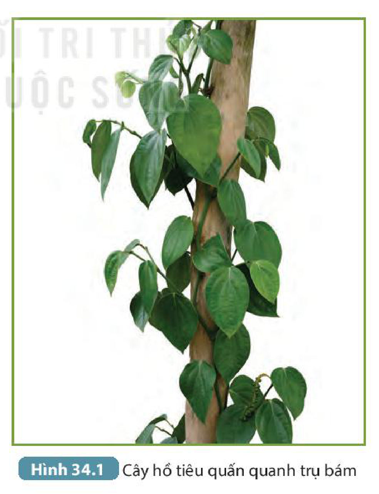
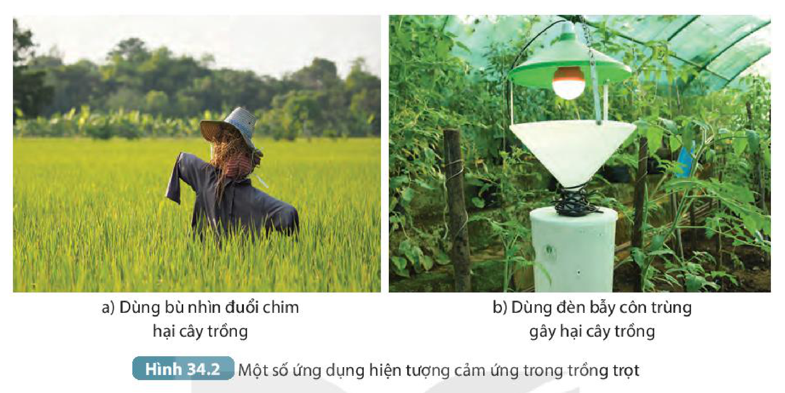
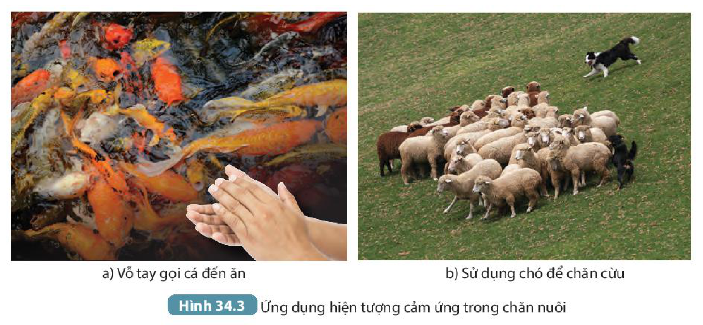
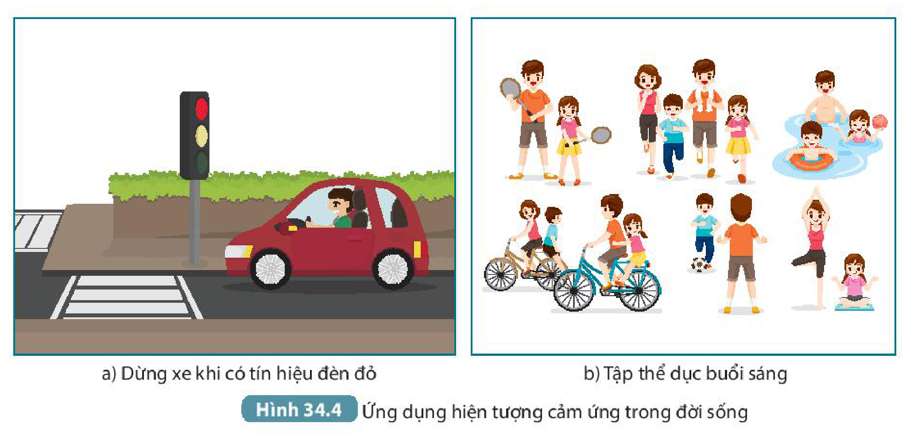
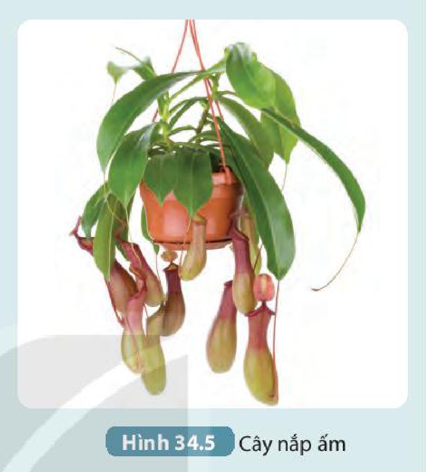

<!-- pdf:142 -->

# BÀI 34: VẬN DỤNG HIỆN TƯỢNG CẢM ỨNG Ở SINH VẬT VÀO THỰC TIỄN

## 🎯 Mục tiêu

- Vận dụng được các kiến thức cảm ứng vào giải thích một số hiện tượng trong thực tiễn (trong học tập, chăn nuôi, trồng trọt).

## 🔴 Mở đầu

Vì sao khi trồng các loài cây thân leo như mướp, bầu, bí, thiên lí,... người trồng thường phải làm giàn cho cây?

## I. Ứng dụng hiện tượng cảm ứng ở sinh vật trong trồng trọt

Con người đã ứng dụng tính hướng sáng, hướng nước, hướng chất dinh dưỡng,... ở các loài thực vật để có chế độ chiếu sáng, tưới nước, bón phân, làm giàn,... phù hợp với mỗi loài nhằm tạo điều kiện cho cây trồng sinh trưởng nhanh, phát triển tốt, đồng thời đáp ứng được các nhu cầu khác nhau của con người. Ví dụ: Người ta làm trụ cho cây hồ tiêu dựa trên hiện tượng cảm ứng hướng tiếp xúc giúp cho cây sinh trưởng nhanh, phát triển tốt, cho năng suất cao. <!-- term: Tính hướng ở thực vật --> <!-- term: Cảm ứng hướng tiếp xúc -->

Hình 34.1. Cây hồ tiêu quấn quanh trụ bám

<!-- pdf:143 -->

Người ta cũng lợi dụng tập tính của các loài động vật gây hại cho cây trồng như bướm, bọ xít, châu chấu, chuột,... để tìm cách xua đuổi và tiêu diệt chúng, bảo vệ mùa màng.

- *a) Dùng bù nhìn đuổi chim hại cây trồng*
- *b) Dùng đèn bẫy côn trùng gây hại cây trồng*

Hình 34.2. Một số ứng dụng hiện tượng cảm ứng trong trồng trọt

> ❓ 1. Quan sát Hình 34.2 và hoàn thành nội dung theo mẫu Bảng 34.1.
>
> Bảng 34.1
>
> | Tên sinh vật | Hiện tượng cảm ứng được ứng dụng | Biện pháp ứng dụng | Lợi ích |
> |---|---|---|---|
> | Côn trùng hại cây trồng (bướm, bọ xít,...) | ? | ? | ? |
> | Chim | ? | ? | ? |
>
> 2. Lấy thêm các ví dụ về việc ứng dụng hiện tượng cảm ứng trong trồng trọt.

## II. Ứng dụng hiện tượng cảm ứng ở sinh vật trong chăn nuôi

Dựa trên những hiểu biết về tập tính học được ở động vật, con người đã huấn luyện cho các vật nuôi trong nhà hình thành được những tập tính tốt như ăn, ngủ đúng giờ; đi vệ sinh đúng chỗ; nghe hiệu lệnh (tiếng kẻng, tiếng gọi, huýt sáo, tiếng vỗ tay,...). Ví dụ: Gõ mõ để trâu bò về chuồng đúng giờ; dùng đèn để thu hút một số loài hải sản; vỗ tay gọi cá đến (Hình 34.3a) để giảm công sức chăm sóc của con người. Con người cũng ứng dụng tập tính để huấn luyện động vật phục vụ trong chăn nuôi như huấn luyện chó chăn cừu (Hình 34.3b).

<!-- pdf:144 -->

- *a) Vỗ tay gọi cá đến ăn*
- *b) Sử dụng chó để chăn cừu*

Hình 34.3. Ứng dụng hiện tượng cảm ứng trong chăn nuôi

> ❓ Nêu các ví dụ ứng dụng hiện tượng cảm ứng hoặc tập tính của động vật trong chăn nuôi mà em biết.

## III. Ứng dụng hiện tượng cảm ứng ở sinh vật trong học tập và đời sống

Các thói quen tốt hay xấu ở người đều là những tập tính học được, được hình thành do lặp đi lặp lại nhiều lần trong quá trình sống. Do đó, trong học tập, muốn nắm chắc kiến thức và ghi nhớ bài được lâu, cần thường xuyên ôn lại bài và làm bài tập nhiều lần. Tương tự, muốn hình thành những thói quen tốt như đi ngủ và thức dậy đúng giờ, đọc sách, tập thể dục buổi sáng, chấp hành luật an toàn giao thông (Hình 34.4),... cần kiên trì lặp lại các hoạt động đó trong thời gian dài và tiếp tục duy trì sau đó. Muốn loại bỏ các thói quen xấu như thức khuya, ngủ dậy muộn,... cần phải có quyết tâm từ bỏ chúng bằng cách thường xuyên thực hiện các việc làm và thói quen ngược lại. <!-- term: Thói quen -->

- *a) Dừng xe khi có tín hiệu đèn đỏ*
- *b) Tập thể dục buổi sáng*

Hình 34.4. Ứng dụng hiện tượng cảm ứng trong đời sống

<!-- pdf:145 -->

> ❓ 1. Tập tính được ứng dụng như thế nào trong học tập?
>
> 2. Muốn tạo được thói quen tập thể dục buổi sáng, em cần làm gì?
>
> 3. Hãy nêu những việc em sẽ làm để bỏ được thói quen ngủ dậy muộn.

> 🔍 Em có biết?
>
> Cây nắp ấm (Hình 34.5) có nguồn gốc từ các nước Đông Nam Á và Australia, là một trong các loài thực vật ăn thịt nguy hiểm đối với nhiều loài côn trùng. Lá của loài cây này có hình dạng rất độc đáo, tận cùng các lá mọc ra các râu đỡ lấy những cấu trúc có hình dạng giống như những chiếc bình có nắp đậy, do đó nó có tên gọi là “nắp ấm”. Từ các bình tiết ra mùi hương hấp dẫn để thu hút các loài côn trùng. Khi có côn trùng bò vào bình, ngay lập tức nắp bình sẽ đậy lại, nhốt con vật ở bên trong, đồng thời tiết một loại chất nhờn tiêu hoá nó thành chất dinh dưỡng cung cấp cho cây. Cây nắp ấm không chỉ có hình dạng độc đáo mà còn giúp con người tiêu diệt sâu bệnh, ruồi, muỗi, thanh lọc không khí và có tác dụng chữa bệnh. Chính vì vậy, hiện nay, nhiều người lựa chọn chúng làm loại cây trang trí trong nhà.
>
> 
>
> Hình 34.5. Cây nắp ấm

## 📌 Em đã học

Hiện tượng cảm ứng ở sinh vật được con người ứng dụng rộng rãi trong thực tiễn nhằm tạo điều kiện cho cây trồng và vật nuôi sinh trưởng, phát triển tốt; xây dựng các thói quen tốt và nâng cao hiệu quả học tập cho con người.

## 🚀 Em có thể

- Vận dụng các kiến thức về cảm ứng ở thực vật vào trồng trọt nhằm nâng cao năng suất cây trồng.
- Hình thành cho vật nuôi các thói quen đáp ứng yêu cầu thực tiễn của con người.

## 📷 Danh sách hình trong bài

| Mã hình | Trang PDF | Trang sách | Chú thích |
|---|---|---|---|
| H7-khoa_hoc_tu_nhien-b34-01 | 142 | 141 | Hình 34.1. Cây hồ tiêu quấn quanh trụ bám |
| H7-khoa_hoc_tu_nhien-b34-02 | 143 | 142 | Hình 34.2. Một số ứng dụng hiện tượng cảm ứng trong trồng trọt |
| H7-khoa_hoc_tu_nhien-b34-03 | 144 | 143 | Hình 34.3. Ứng dụng hiện tượng cảm ứng trong chăn nuôi |
| H7-khoa_hoc_tu_nhien-b34-04 | 144 | 143 | Hình 34.4. Ứng dụng hiện tượng cảm ứng trong đời sống |
| H7-khoa_hoc_tu_nhien-b34-05 | 145 | 144 | Hình 34.5. Cây nắp ấm |
