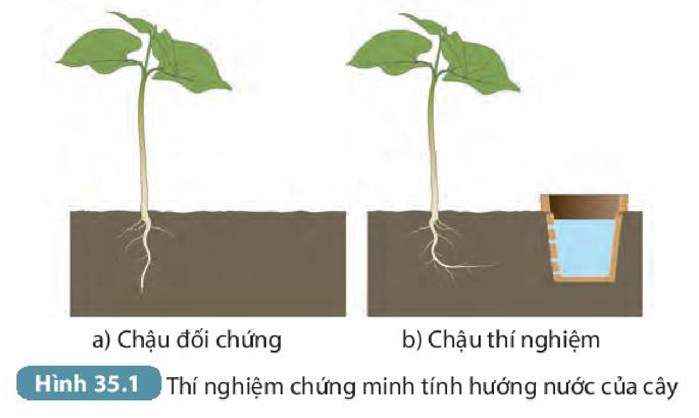
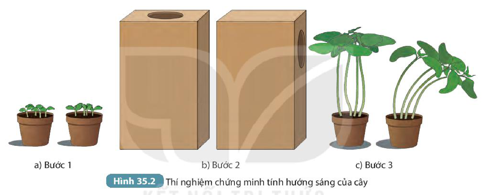

<!-- pdf:146 -->

# BÀI 35: THỰC HÀNH: CẢM ỨNG Ở SINH VẬT

## 🎯 Mục tiêu

- Trình bày được cách làm thí nghiệm chứng minh tính cảm ứng ở thực vật (ví dụ hướng sáng, hướng nước, hướng tiếp xúc).
- Quan sát, ghi chép và trình bày được kết quả quan sát một số tập tính của động vật.

## I. Chuẩn bị

### 1. Dụng cụ

- Chậu trồng cây cảnh/khay nhựa; đất/cát trồng cây; que tre hoặc gỗ nhỏ; chậu hoặc chai nhựa (đã sử dụng) đục lỗ nhỏ; nước; hộp carton.
- Tranh ảnh về một số hiện tượng cảm ứng ở cây xanh; video về một số tập tính ở động vật như tập tính kiếm ăn, đánh dấu lãnh thổ, chăm sóc con non, di cư, sống bầy đàn,...

### 2. Mẫu vật

Hạt đỗ (đậu), hạt bầu, hạt bí hoặc cây non của các loài đó.

## II. Cách tiến hành

### 1. Thí nghiệm chứng minh tính hướng nước của cây

Chuẩn bị: 2 chậu đất/cát giống nhau (nếu sử dụng đất, cần lấy đất tơi xốp, nhiều mùn để khi nhổ cây quan sát không bị đứt rễ).

Bước 1: Gieo hạt đỗ vào 2 chậu, tưới nước đủ ẩm.

Bước 2: Theo dõi sự nảy mầm của hạt thành cây có từ 3 đến 5 lá.

Bước 3: Đặt chậu nước có lỗ thủng nhỏ vào trong 1 chậu cây sao cho nước ngấm vào đất mà không gây ngập úng cây (cách bố trí theo Hình 35.1).

Bước 4: Sau 3 đến 5 ngày (kể từ khi đặt chậu nước), nhẹ nhàng nhổ cây ra khỏi chậu và quan sát hướng mọc của rễ cây.

- *a) Chậu đối chứng*
- *b) Chậu thí nghiệm*

Hình 35.1. Thí nghiệm chứng minh tính hướng nước của cây

<!-- pdf:147 -->

### 2. Thí nghiệm chứng minh tính hướng sáng của cây

Chuẩn bị: 2 chậu đất trồng cây giống nhau; 2 hộp carton không đáy, 1 hộp khoét lỗ phía trên, hộp còn lại khoét phía bên cạnh.

Bước 1: Gieo hạt đỗ vào trong đất, tưới nước đủ ẩm và đợi cho đến khi hạt nảy mầm (Hình 35.2a).

Bước 2: Úp lên mỗi chậu cây 1 hộp carton, đặt trong môi trường ánh sáng tự nhiên (Hình 35.2b).

Bước 3: Sau khoảng từ 3 đến 5 ngày, nhấc hộp carton ra khỏi các chậu cây, quan sát hướng của thân cây (Hình 35.2c).

- *a) Bước 1*
- *b) Bước 2*
- *c) Bước 3*

Hình 35.2. Thí nghiệm chứng minh tính hướng sáng của cây

### 3. Quan sát tính hướng tiếp xúc của cây

- Quan sát tranh ảnh, video về tính hướng tiếp xúc của cây mướp hoặc cây bầu, bí.
- Ghi kết quả quan sát được vào phiếu theo mẫu Bảng 35.2.

### 4. Quan sát một số tập tính của động vật

- Quan sát tranh ảnh, video về một số tập tính ở động vật như tập tính kiếm ăn, đánh dấu lãnh thổ, chăm sóc con non, di cư, sống bầy đàn,...
- Ghi chép kết quả quan sát được vào phiếu theo mẫu Bảng 35.3.

## III. Kết quả

1. Hoàn thành bảng ghi kết quả thí nghiệm và quan sát theo mẫu Bảng 35.1, 35.2, 35.3.

<!-- pdf:148 -->

Bảng 35.1

| Thí nghiệm | Hiện tượng/Kết quả |
|---|---|
| Chứng minh tính hướng nước | ? |
| Chứng minh tính hướng sáng | ? |

Bảng 35.2

| Tên cây | Loại giá thể | Mô tả | Ý nghĩa |
|---|---|---|---|
| ? | ? | ? | ? |
| ? | ? | ? | ? |
<!-- ocr-ok: đã đối chiếu ảnh trang gốc p148, tiêu đề Bảng 35.2 in chữ trắng trên nền xanh nên OCR bỏ sót -->

Bảng 35.3

| Loài động vật | Tập tính | Mô tả | Ý nghĩa |
|---|---|---|---|
| ? | ? | ? | ? |
| ? | ? | ? | ? |
<!-- ocr-ok: đã đối chiếu ảnh trang gốc p148, tiêu đề Bảng 35.3 in chữ trắng trên nền xanh nên OCR bỏ sót -->

2. Nhận xét, kết luận về kết quả của các thí nghiệm chứng minh tính hướng nước, hướng sáng, hướng tiếp xúc của cây.

> ❓ Trả lời các câu hỏi sau:
>
> 1. Tại sao trong thí nghiệm chứng minh tính hướng nước, người ta lại đặt chậu nước thủng lỗ nhỏ ở một phía của chậu cây và chỉ cho nước ngấm từ từ mà không để nước ngấm nhanh ra khắp chậu?
>
> 2. Trong thí nghiệm chứng minh tính hướng sáng, nếu thường xuyên xoay chậu theo các hướng khác nhau thì kết quả sẽ như thế nào? Giải thích.

## 📷 Danh sách hình trong bài

| Mã hình | Trang PDF | Trang sách | Chú thích |
|---|---|---|---|
| H7-khoa_hoc_tu_nhien-b35-01 | 146 | 145 | Hình 35.1. Thí nghiệm chứng minh tính hướng nước của cây |
| H7-khoa_hoc_tu_nhien-b35-02 | 147 | 146 | Hình 35.2. Thí nghiệm chứng minh tính hướng sáng của cây |
