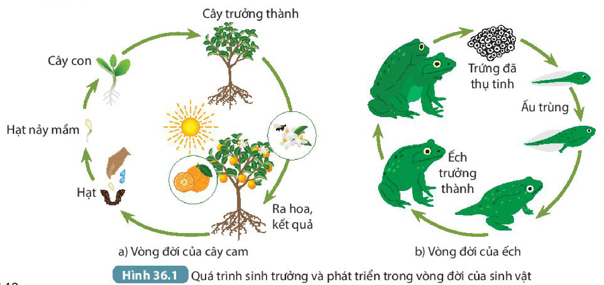
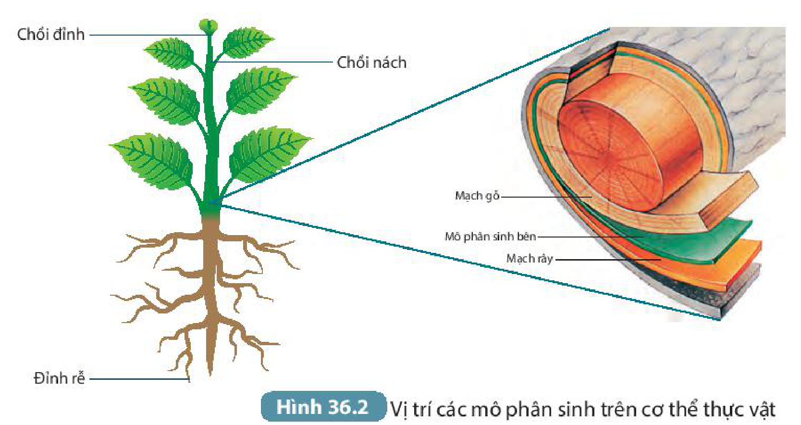
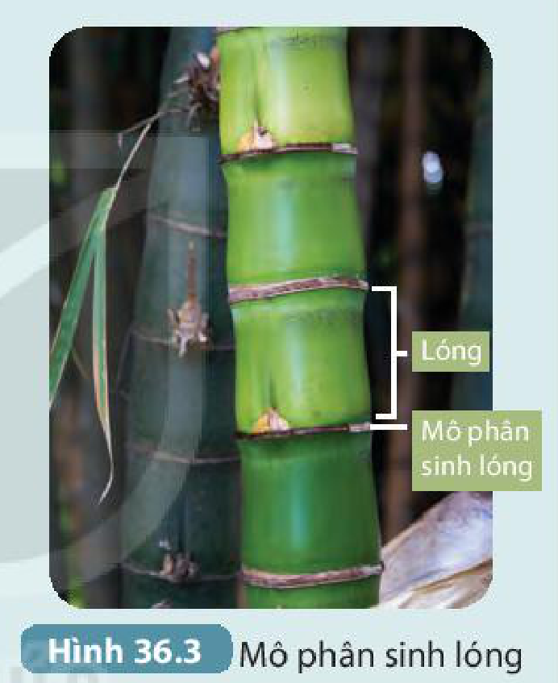

<!-- pdf:149 -->

# BÀI 36: KHÁI QUÁT VỀ SINH TRƯỞNG VÀ PHÁT TRIỂN Ở SINH VẬT

## 🎯 Mục tiêu

- Phát biểu được khái niệm sinh trưởng và phát triển ở sinh vật.
- Nêu được mối quan hệ giữa sinh trưởng và phát triển.
- Chỉ ra được mô phân sinh trên sơ đồ cắt ngang thân cây hai lá mầm và trình bày được chức năng của mô phân sinh làm cây lớn lên.
- Dựa vào hình vẽ vòng đời của một sinh vật, trình bày được các giai đoạn sinh trưởng và phát triển của sinh vật đó.

## 🔴 Mở đầu

Mỗi sinh vật từ khi hình thành, sinh ra và lớn lên đều trải qua quá trình sinh trưởng và phát triển. Vậy quá trình sinh trưởng và phát triển là gì? Các quá trình này diễn ra như thế nào?

## I. Sinh trưởng và phát triển ở sinh vật

### 1. Sinh trưởng, phát triển là gì?

Sinh trưởng là sự tăng về kích thước và khối lượng của cơ thể do sự tăng lên về số lượng và kích thước tế bào, nhờ đó cơ thể lớn lên. <!-- term: Sinh trưởng -->

Phát triển bao gồm sinh trưởng, phân hoá tế bào, phát sinh hình thái cơ quan và cơ thể. <!-- term: Phát triển -->

- *a) Vòng đời của cây cam*
- *b) Vòng đời của ếch*

Hình 36.1. Quá trình sinh trưởng và phát triển trong vòng đời của sinh vật

<!-- pdf:150 -->

> ❓ Đọc thông tin trên và quan sát Hình 36.1, thực hiện các yêu cầu sau:
>
> 1. Phát biểu khái niệm sinh trưởng và phát triển.
>
> 2. Mô tả các dấu hiệu thể hiện sự sinh trưởng ở cây cam và ếch. Những biến đổi nào diễn ra trong đời sống của chúng thể hiện sự phát triển?

### 2. Các giai đoạn sinh trưởng và phát triển ở sinh vật

Mỗi sinh vật từ khi sinh ra cho đến khi trưởng thành đều trải qua những giai đoạn sinh trưởng và phát triển nhất định, có hình thái và kích thước khác nhau, đặc trưng cho từng loài.

Trong vòng đời của sinh vật, các giai đoạn sinh trưởng và phát triển diễn ra đan xen với nhau. Sinh trưởng gắn với phát triển và phát triển dựa trên cơ sở của sinh trưởng. Do đó, nếu không có sinh trưởng sẽ không có phát triển và ngược lại.

> ❓ Quan sát Hình 36.1 và thực hiện các yêu cầu sau:
>
> 1. Trình bày các giai đoạn sinh trưởng và phát triển của cây cam và ếch.
>
> 2. Sinh trưởng và phát triển có mối quan hệ với nhau như thế nào?

## II. Mô phân sinh và chức năng của mô phân sinh

Thực vật sinh trưởng nhờ hoạt động của mô phân sinh – nhóm tế bào chưa phân hoá nên còn duy trì được khả năng phân chia. Có hai loại mô phân sinh chính là mô phân sinh đỉnh và mô phân sinh bên. <!-- term: Mô phân sinh -->

Mô phân sinh đỉnh có ở đỉnh rễ và các chồi thân (gồm chồi ngọn hay còn gọi là chồi đỉnh và chồi nách), giúp thân, cành và rễ tăng lên về chiều dài. Mô phân sinh bên giúp thân, cành và rễ tăng về chiều ngang. <!-- term: Mô phân sinh đỉnh --> <!-- term: Mô phân sinh bên -->

Hình 36.2. Vị trí các mô phân sinh trên cơ thể thực vật

<!-- pdf:151 -->

> ❓ 1. Quan sát Hình 36.2 và đọc thông tin mục II để hoàn thành nội dung theo mẫu Bảng 36.1.
>
> Bảng 36.1
>
> | Loại mô phân sinh | Vị trí | Vai trò |
> |---|---|---|
> | Mô phân sinh đỉnh | ? | ? |
> | Mô phân sinh bên | ? | ? |
>
> 2. Tại sao nhiều loài thực vật không ngừng dài ra và to lên?

> 🔍 Em có biết?
>
> Thực vật một lá mầm không có mô phân sinh bên nên đường kính thân không tăng nhiều như ở thực vật hai lá mầm. Tuy nhiên, nhóm thực vật này ngoài mô phân sinh ngọn còn có mô phân sinh lóng giúp chiều cao cây tăng lên nhanh chóng. Mô phân sinh lóng nằm ở vị trí các mắt của thân, có tác dụng làm tăng chiều dài của lóng (Hình 36.3). <!-- term: Mô phân sinh lóng -->
>
> Những cây một lá mầm lâu năm (cây dừa, cây cau) có vòng mô phân sinh thứ cấp nằm dưới các mầm lá, phân chia tạo nên những dãy tế bào mô mềm ở phía ngoài làm cho đường kính thân tăng lên. Kiểu sinh trưởng này gọi là sinh trưởng thứ cấp phân tán. <!-- term: Sinh trưởng thứ cấp phân tán -->
>
> 
>
> Hình 36.3. Mô phân sinh lóng

## 📌 Em đã học

- Sinh trưởng là sự tăng về kích thước và khối lượng của cơ thể do sự tăng lên về số lượng và kích thước tế bào, nhờ đó cơ thể lớn lên.
- Phát triển bao gồm sinh trưởng, phân hoá tế bào, phát sinh hình thái cơ quan và cơ thể.
- Thực vật sinh trưởng nhờ các mô phân sinh. Mô phân sinh đỉnh có ở đỉnh của rễ và đỉnh chồi giúp thân, cành và rễ tăng lên về chiều dài. Mô phân sinh bên giúp thân, cành và rễ tăng lên về chiều ngang.

## 🚀 Em có thể

Vận dụng các kiến thức về sinh trưởng và phát triển ở sinh vật nhằm nâng cao năng suất của vật nuôi và cây trồng.

## 📷 Danh sách hình trong bài

| Mã hình | Trang PDF | Trang sách | Chú thích |
|---|---|---|---|
| H7-khoa_hoc_tu_nhien-b36-01 | 149 | 148 | Hình 36.1. Quá trình sinh trưởng và phát triển trong vòng đời của sinh vật |
| H7-khoa_hoc_tu_nhien-b36-02 | 150 | 149 | Hình 36.2. Vị trí các mô phân sinh trên cơ thể thực vật |
| H7-khoa_hoc_tu_nhien-b36-03 | 151 | 150 | Hình 36.3. Mô phân sinh lóng |
