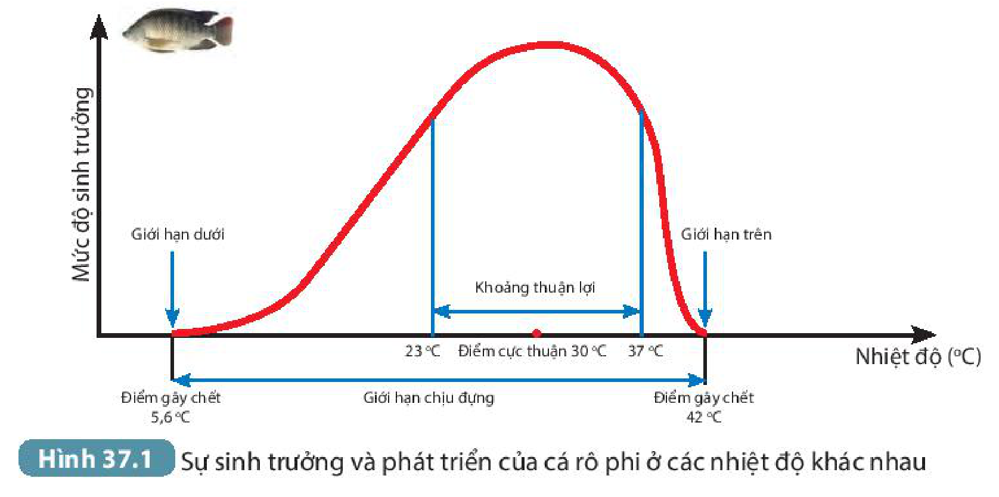
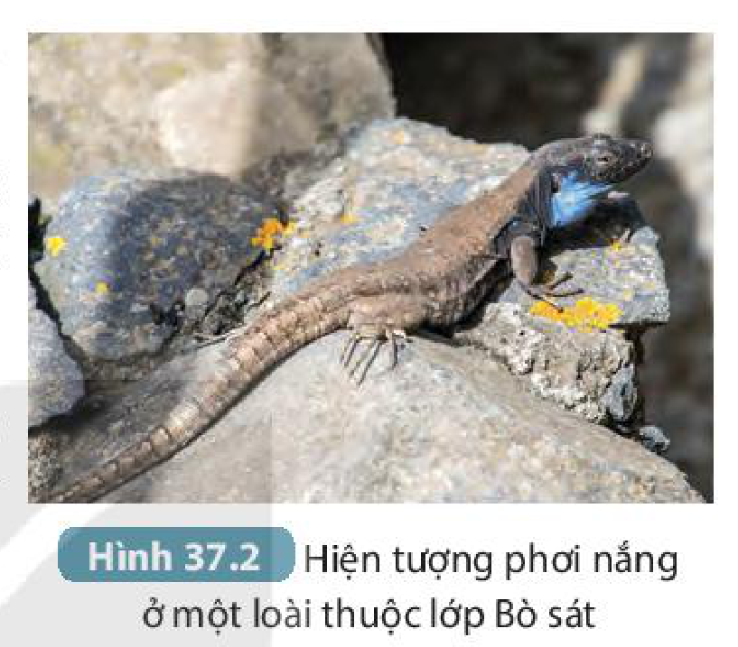
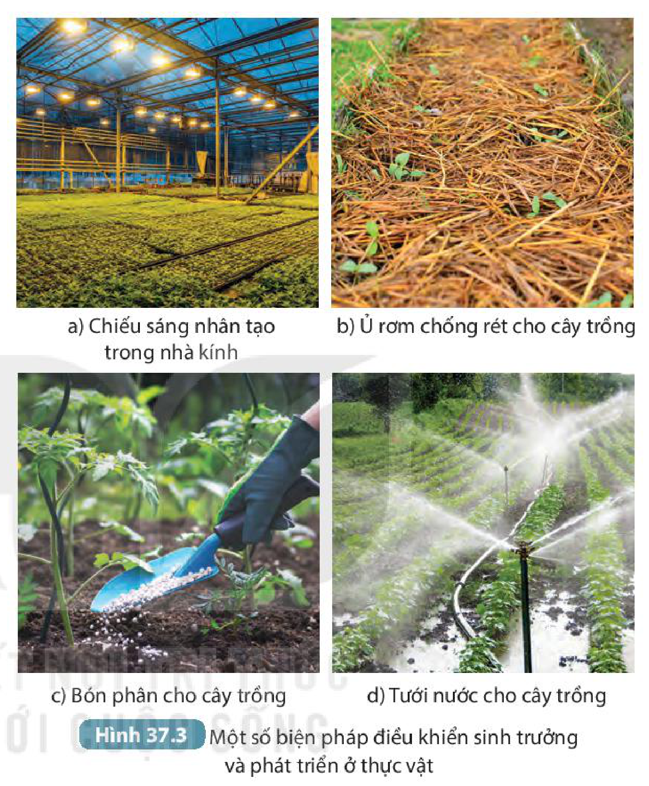
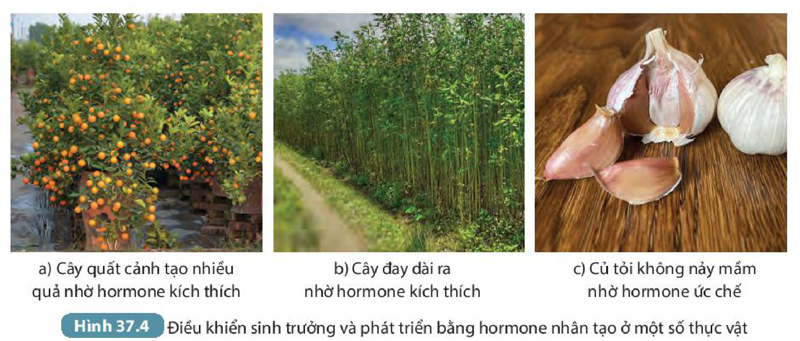
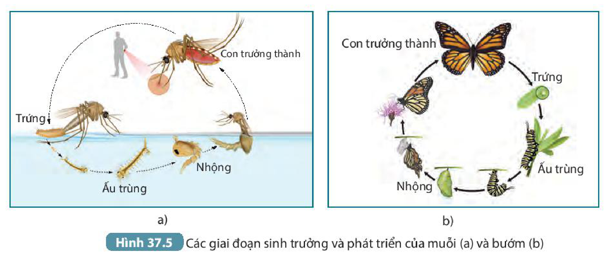

<!-- pdf:152 -->

# BÀI 37: ỨNG DỤNG SINH TRƯỞNG VÀ PHÁT TRIỂN Ở SINH VẬT VÀO THỰC TIỄN

## 🎯 Mục tiêu

- Nêu được các nhân tố chủ yếu ảnh hưởng đến sinh trưởng và phát triển ở sinh vật (nhân tố nhiệt độ, ánh sáng, nước, chất dinh dưỡng).
- Trình bày được một số ứng dụng sinh trưởng và phát triển trong thực tiễn (ví dụ: điều hoà sinh trưởng và phát triển ở sinh vật bằng sử dụng chất kích thích hoặc điều khiển yếu tố môi trường).
- Vận dụng được những hiểu biết về sinh trưởng và phát triển của sinh vật để giải thích một số hiện tượng thực tiễn (ví dụ: tiêu diệt muỗi ở giai đoạn ấu trùng, phòng trừ sâu bệnh, chăn nuôi).

## 🔴 Mở đầu

Muốn thúc đẩy quá trình sinh trưởng, phát triển ở vật nuôi và cây trồng để thu được năng suất cao, chúng ta cần làm gì?

## I. Các nhân tố chủ yếu ảnh hưởng đến sinh trưởng và phát triển ở sinh vật

Sự sinh trưởng và phát triển ở sinh vật chịu sự tác động của các nhân tố như nhiệt độ, ánh sáng, nước, chất dinh dưỡng và một số chất có tác dụng kích thích hoặc ức chế sinh trưởng, phát triển do cơ thể tiết ra (hormone).

### 1. Nhiệt độ

Mỗi loài sinh vật sinh trưởng và phát triển tốt trong điều kiện nhiệt độ môi trường thích hợp. Nhiệt độ quá cao hoặc quá thấp có thể làm chậm quá trình sinh trưởng và phát triển, đặc biệt là đối với thực vật và **động vật biến nhiệt**. Khi trời lạnh, động vật mất nhiều năng lượng để duy trì nhiệt độ cơ thể, dẫn đến sinh trưởng giảm nếu không được bổ sung thêm thức ăn để chống rét.

Hình 37.1. Sự sinh trưởng và phát triển của cá rô phi ở các nhiệt độ khác nhau

<!-- pdf:153 -->

> ❓ Quan sát Hình 37.1 và thực hiện các yêu cầu sau:
>
> 1. Nhận xét mức độ sinh trưởng và phát triển của cá rô phi ở các mức nhiệt độ khác nhau, từ đó cho biết nhiệt độ có ảnh hưởng như thế nào tới sự sinh trưởng và phát triển của sinh vật.
>
> 2. Nhiệt độ thuận lợi nhất cho sự sinh trưởng và phát triển của cá rô phi là bao nhiêu? Nhiệt độ quá cao hoặc quá thấp so với nhiệt độ cực thuận có ảnh hưởng như thế nào tới mức độ sinh trưởng và phát triển của sinh vật?

### 2. Ánh sáng

Ánh sáng ảnh hưởng đến sinh trưởng, phát triển và thời gian ra hoa của thực vật.

Ở động vật, ánh sáng mặt trời giúp cơ thể tổng hợp vitamin D – chất đóng vai trò quan trọng trong việc hấp thụ calcium để hình thành xương, từ đó tác động đến sự sinh trưởng của cơ thể. Ánh sáng cũng giúp động vật thu thêm nhiệt từ môi trường và giảm mất nhiệt trong những ngày trời rét, tập trung các chất để xây dựng cơ thể, thúc đẩy sinh trưởng, phát triển.

Hình 37.2. Hiện tượng phơi nắng ở một loài thuộc lớp Bò sát

> ❓ 1. Nhiều loài động vật có tập tính phơi nắng (Hình 37.2), tập tính này có tác dụng gì đối với sự sinh trưởng và phát triển của chúng?
>
> 2. Giải thích vì sao nên cho trẻ nhỏ tắm nắng vào sáng sớm hoặc chiều muộn.

### 3. Nước

Nước tham gia vào quá trình trao đổi chất và chuyển hoá năng lượng nên ảnh hưởng đến sinh trưởng và phát triển của sinh vật. Ví dụ: Ở thực vật, nước là nguyên liệu cho quá trình quang hợp tạo ra các chất hữu cơ giúp cây lớn lên; ở động vật, nước là nguyên liệu và môi trường cho quá trình tổng hợp các chất xây dựng cơ thể. Nếu thiếu nước, quá trình sinh trưởng và phát triển của sinh vật sẽ bị chậm hoặc ngừng lại, thậm chí là chết.

> ❓ Nước có ảnh hưởng tới quá trình sinh trưởng và phát triển ở sinh vật như thế nào? Vì sao nước có thể ảnh hưởng tới các quá trình này?

### 4. Chất dinh dưỡng

Dinh dưỡng là nhân tố quan trọng tác động đến quá trình sinh trưởng và phát triển của sinh vật. Nếu thiếu các chất dinh dưỡng, đặc biệt là protein, động vật sẽ chậm lớn, gầy yếu, sức đề kháng kém. Ở thực vật, nếu thiếu các nguyên tố khoáng, đặc biệt là nitrogen, quá trình sinh trưởng sẽ bị ức chế, thậm chí có thể bị chết.

Tuy nhiên, nếu thừa chất dinh dưỡng, quá trình sinh trưởng và phát triển ở thực vật, động vật và người cũng bị ảnh hưởng.

<!-- pdf:154 -->

> ❓ 1. Chất dinh dưỡng có ảnh hưởng tới sinh trưởng và phát triển của sinh vật như thế nào? Cho ví dụ.
>
> 2. Giải thích vì sao chế độ dinh dưỡng lại có thể tác động tới sự sinh trưởng và phát triển.

## II. Ứng dụng sinh trưởng và phát triển trong thực tiễn

### 1. Ứng dụng sinh trưởng và phát triển trong trồng trọt

### a) Điều khiển sinh trưởng và phát triển bằng các yếu tố bên ngoài

Con người đã chủ động điều khiển các yếu tố bên ngoài cho phù hợp thông qua các biện pháp như chiếu sáng nhân tạo, trồng cây trong nhà kính, bón phân, tưới nước hợp lí, thu hoạch đúng thời điểm,... để thúc đẩy sinh trưởng và phát triển, nhằm tăng năng suất cây trồng.

- *a) Chiếu sáng nhân tạo trong nhà kính*
- *b) Ủ rơm chống rét cho cây trồng*
- *c) Bón phân cho cây trồng*
- *d) Tưới nước cho cây trồng*

Hình 37.3. Một số biện pháp điều khiển sinh trưởng và phát triển ở thực vật

> ❓ 1. Nêu các biện pháp điều khiển sinh trưởng, phát triển ở thực vật trong Hình 37.3 và tác dụng của từng biện pháp. Kể thêm các biện pháp khác mà em biết.
>
> 2. Người trồng rừng đã điều khiển quá trình sinh trưởng của cây lấy gỗ bằng cách để mật độ dày khi cây còn non và khi cây đã đạt đến chiều cao mong muốn thì tỉa bớt. Giải thích ý nghĩa của việc làm này.

### b) Điều khiển sinh trưởng và phát triển bằng các nhân tố bên trong

Dựa vào các chất kích thích và ức chế sinh trưởng cây tiết ra, con người đã tổng hợp được các chất kích thích và ức chế sinh trưởng nhân tạo, sử dụng chúng trong trồng trọt với nhiều mục đích khác nhau. Các chất kích thích nhân tạo được sử dụng để kích thích cây ra rễ, ra hoa, thúc hạt và củ nảy mầm, kích thích tăng chiều cao cây, phát triển lá, tạo quả (Hình 37.4a, b). Các chất ức chế thường được dùng để kìm hãm sự nảy mầm của hạt và củ để bảo quản (Hình 37.4c), kìm hãm sự phát triển của thân và lá để duy trì hình dáng của cây cảnh,... <!-- term: Chất kích thích sinh trưởng nhân tạo --> <!-- term: Chất ức chế sinh trưởng nhân tạo -->

<!-- pdf:155 -->

- *a) Cây quất cảnh tạo nhiều quả nhờ hormone kích thích*
- *b) Cây đay dài ra nhờ hormone kích thích*
- *c) Củ tỏi không nảy mầm nhờ hormone ức chế*

Hình 37.4. Điều khiển sinh trưởng và phát triển bằng hormone nhân tạo ở một số thực vật

> ❓ Đọc thông tin trong mục 1b, lựa chọn loại hormone phù hợp cho các đối tượng trong bảng bằng cách đánh dấu X vào ô tương ứng và nêu lợi ích của việc sử dụng loại hormone đó theo mẫu bảng bên.
>
> Bảng 37.1
>
> | Đối tượng thực vật | Hormone kích thích | Hormone ức chế | Lợi ích |
> |---|---|---|---|
> | Cây lấy sợi, lấy gỗ | ? | ? | ? |
> | Cây quất cảnh | ? | ? | ? |
> | Hành, tỏi, khoai tây | ? | ? | ? |

### 2. Ứng dụng sinh trưởng và phát triển trong chăn nuôi

Để vật nuôi sinh trưởng và phát triển tốt, cho năng suất cao, cần cho vật nuôi ăn uống đầy đủ, chăm sóc và vệ sinh chuồng trại thường xuyên, chú ý chống nóng, chống rét cho vật nuôi,... Ví dụ: Khi làm chuồng cho vật nuôi, nên làm theo hướng đông nam để đảm bảo mùa đông ấm, mùa hè mát, giúp vật nuôi sinh trưởng, phát triển thuận lợi. Ngoài ra, người ta còn sử dụng chất kích thích sinh trưởng trộn lẫn vào thức ăn giúp vật nuôi lớn nhanh. Tuy nhiên, việc sử dụng các chất kích thích sinh trưởng nhân tạo cho vật nuôi dùng làm thực phẩm cho người cần tuân thủ các nguyên tắc nhất định về liều lượng, thời điểm, đối tượng để đảm bảo an toàn cho người sử dụng.

> ❓ 1. Những hiểu biết về sinh trưởng và phát triển ở sinh vật đã được con người ứng dụng như thế nào trong chăn nuôi? Cho ví dụ.
>
> 2. Khi sử dụng các chất kích thích sinh trưởng trong chăn nuôi, chúng ta cần chú ý những điều gì? Vì sao?

### 3. Ứng dụng sinh trưởng và phát triển ở sinh vật trong phòng trừ sinh vật gây hại

Dựa vào những hiểu biết về các giai đoạn sinh trưởng, phát triển của sinh vật gây bệnh cho người và sinh vật khác, chúng ta có thể áp dụng các biện pháp phòng trừ sinh vật có hại như muỗi, bướm,... bằng cách cắt đứt một giai đoạn nào đó trong vòng đời của chúng. Ví dụ: Để diệt muỗi, người ta thường loại bỏ các vũng nước đọng để tránh muỗi đẻ trứng vào đó hay tiêu diệt ấu trùng, vì đây là các giai đoạn dễ tác động nhất trong vòng đời của chúng.

<!-- pdf:156 -->

Hình 37.5. Các giai đoạn sinh trưởng và phát triển của muỗi (a) và bướm (b)

> ✋ Quan sát Hình 37.5, thực hiện các yêu cầu sau:
>
> 1. Nhận xét về hình thái của muỗi và bướm ở các giai đoạn khác nhau trong vòng đời.
>
> 2. Theo em, diệt muỗi ở giai đoạn nào cho hiệu quả nhất? Vì sao? Hãy đề xuất các biện pháp diệt muỗi và ngăn chặn sự phát triển của muỗi.
>
> 3. Hãy đề xuất các biện pháp diệt bướm để bảo vệ mùa màng.

> 🔍 Em có biết?
>
> Có thể nói, việc nghiên cứu và tạo ra các chế phẩm kích thích sinh trưởng là một thành tựu công nghệ sinh học của loài người, có ý nghĩa rất lớn đối với ngành nông nghiệp. Chế phẩm kích thích sinh trưởng được sử dụng đúng thời điểm, đúng liều lượng, đúng đối tượng sẽ giúp tăng năng suất vật nuôi, cây trồng. Tuy nhiên, việc sử dụng chất kích thích sinh trưởng sẽ ảnh hưởng không tốt đến người sử dụng nông sản nếu dùng quá liều lượng trên các loài được dùng làm lương thực, thực phẩm; không đảm bảo thời gian cách li tối thiểu hoặc sử dụng các chất kích thích sinh trưởng không có nguồn gốc rõ ràng và không nằm trong danh mục cho phép của Bộ Nông nghiệp và Phát triển nông thôn. <!-- term: Chất kích thích sinh trưởng nhân tạo -->

## 📌 Em đã học

- Các nhân tố chủ yếu ảnh hưởng đến quá trình sinh trưởng và phát triển ở sinh vật là nhiệt độ, ánh sáng, nước và chất dinh dưỡng.
- Con người có thể chủ động điều khiển quá trình sinh trưởng và phát triển của sinh vật nhằm nâng cao năng suất của vật nuôi và cây trồng bằng cách sử dụng chất kích thích hoặc ức chế nhân tạo; cải thiện chế độ dinh dưỡng, điều chỉnh chế độ chiếu sáng, tưới nước,...
- Dựa vào đặc điểm các giai đoạn phát triển ở côn trùng, lựa chọn các biện pháp hiệu quả để phòng trừ các loài gây hại như muỗi, bướm,...

## 🚀 Em có thể

- Vận dụng kiến thức về sinh trưởng và phát triển, đề xuất các giải pháp về dinh dưỡng giúp tăng trưởng chiều cao ở người, giải pháp thúc đẩy sự sinh trưởng và phát triển của vật nuôi và cây trồng.
- Vận dụng được những hiểu biết về vòng đời của các côn trùng gây hại như muỗi, bướm,... để phòng trừ các sinh vật này.

## 📷 Danh sách hình trong bài

| Mã hình | Trang PDF | Trang sách | Chú thích |
|---|---|---|---|
| H7-khoa_hoc_tu_nhien-b37-01 | 152 | 151 | Hình 37.1. Sự sinh trưởng và phát triển của cá rô phi ở các nhiệt độ khác nhau |
| H7-khoa_hoc_tu_nhien-b37-02 | 153 | 152 | Hình 37.2. Hiện tượng phơi nắng ở một loài thuộc lớp Bò sát |
| H7-khoa_hoc_tu_nhien-b37-03 | 154 | 153 | Hình 37.3. Một số biện pháp điều khiển sinh trưởng và phát triển ở thực vật |
| H7-khoa_hoc_tu_nhien-b37-04 | 155 | 154 | Hình 37.4. Điều khiển sinh trưởng và phát triển bằng hormone nhân tạo ở một số thực vật |
| H7-khoa_hoc_tu_nhien-b37-05 | 156 | 155 | Hình 37.5. Các giai đoạn sinh trưởng và phát triển của muỗi (a) và bướm (b) |
