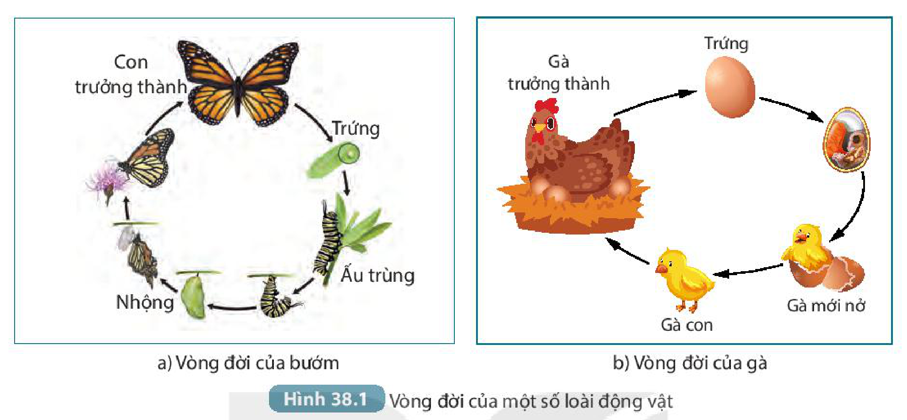

<!-- pdf:157 -->

# BÀI 38: THỰC HÀNH: QUAN SÁT, MÔ TẢ SỰ SINH TRƯỞNG VÀ PHÁT TRIỂN Ở MỘT SỐ SINH VẬT

## 🎯 Mục tiêu

- Thực hành quan sát và mô tả được sự sinh trưởng, phát triển ở một số thực vật, động vật.
- Tiến hành được thí nghiệm chứng minh cây có sự sinh trưởng.

## I. Chuẩn bị

### 1. Thiết bị, dụng cụ

- Chai nhựa đã qua sử dụng; đất trồng cây; bình tưới có vòi phun sương; nước ấm; dao hoặc kéo.
- Thước đo chia đơn vị đến mm; nhiệt kế.
- Các video hoặc tranh ảnh về quá trình sinh trưởng, phát triển ở một số loài động vật: muỗi, bướm, ếch đồng, cá, gà, lợn,...

### 2. Mẫu vật

Hạt đậu (đậu xanh, đậu đen hoặc đậu tương), hạt ngô hoặc lạc. Tuỳ mùa vụ, tuỳ địa phương, chọn loại hạt có thời gian nảy mầm ngắn, phù hợp. Chú ý chọn các hạt to, mẩy, không bị sâu, bệnh.

## II. Cách tiến hành

### 1. Thí nghiệm chứng minh cây có sự sinh trưởng và thực hành quan sát, mô tả sự sinh trưởng, phát triển ở một số thực vật

Bước 1: Dùng dao hoặc kéo cắt chai nhựa theo chiều dọc hoặc theo chiều ngang rồi cho đất vào để tạo thành chậu hoặc khay trồng cây.

Bước 2: Ngâm hạt trong nước ấm có nhiệt độ từ $35\text{ }^\circ\text{C}$ đến $40\text{ }^\circ\text{C}$ (trong khoảng 5 đến 10 giờ tuỳ loại hạt).

Bước 3: Gieo hạt đã nảy mầm vào chậu, dùng vòi phun sương tưới ẩm đất trong chậu.

Bước 4: Đặt chậu trong môi trường đủ ánh sáng, tưới nước hằng ngày và theo dõi.

Bước 5: Quan sát sự nảy mầm, sinh trưởng, phát triển của các cây trong mỗi chậu. Đếm số lá, dùng thước đo chiều cao cây và kích thước lá hằng ngày (trong khoảng từ 5 đến 7 ngày) và ghi vào sổ theo dõi.

### 2. Quan sát, mô tả sự sinh trưởng và phát triển ở một số động vật

Quan sát tranh ảnh hoặc video về quá trình sinh trưởng, phát triển ở một số loài động vật như bướm, muỗi, chó, gà,... trong vòng đời của chúng.

*Yêu cầu quan sát:*

- Các giai đoạn sinh trưởng, phát triển của mỗi loài.
- Hình thái và kích thước cơ thể sinh vật ở mỗi giai đoạn.

<!-- pdf:158 -->

- Biểu hiện của mối quan hệ giữa sinh trưởng và phát triển.
- Điểm giống và khác nhau trong quá trình sinh trưởng, phát triển ở các loài quan sát.
- Ghi chép ra vở các nội dung quan sát được.

- *a) Vòng đời của bướm*
- *b) Vòng đời của gà*

Hình 38.1. Vòng đời của một số loài động vật

## III. Kết quả

1. Ghi kết quả quan sát sự sinh trưởng, phát triển của cây ở các chậu và sự sinh trưởng, phát triển của các loài động vật vào bảng theo mẫu sau:

Bảng 38.1

| Tên cây trồng | Ngày | Chiều cao cây (cm) | Số lá | Kích thước lá ($\text{cm}^2$) |
|---|---|---|---|---|
| ? | 1 | ? | ? | ? |
| ? | 2 | ? | ? | ? |
| ? | 3 | ? | ? | ? |
| ? | 4 | ? | ? | ? |
| ? | 5 | ? | ? | ? |
<!-- ocr-ok: đã đối chiếu ảnh trang gốc p158, tiêu đề Bảng 38.1 in trên nền xanh và cột Tên cây trồng gộp 5 dòng -->

Bảng 38.2

| Tên động vật | Các giai đoạn sinh trưởng, phát triển | Đặc điểm về kích thước, hình thái cơ thể ở các giai đoạn |
|---|---|---|
| ? | ? | ? |
| ? | ? | ? |
| ? | ? | ? |
<!-- ocr-ok: đã đối chiếu ảnh trang gốc p158, tiêu đề Bảng 38.2 in trên nền xanh nên OCR đọc sai -->

2. Nhận xét và rút ra kết luận từ kết quả quan sát sự sinh trưởng và phát triển của thực vật, động vật.

> ❓ Trả lời các câu hỏi sau:
>
> 1. Mô tả hạt nảy mầm và sinh trưởng của cây trong thời gian quan sát.
>
> 2. So sánh sinh trưởng, phát triển của các loài động vật đã quan sát.

## 📷 Danh sách hình trong bài

| Mã hình | Trang PDF | Trang sách | Chú thích |
|---|---|---|---|
| H7-khoa_hoc_tu_nhien-b38-01 | 158 | 157 | Hình 38.1. Vòng đời của một số loài động vật |
