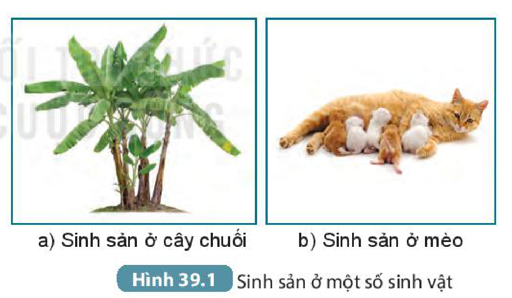
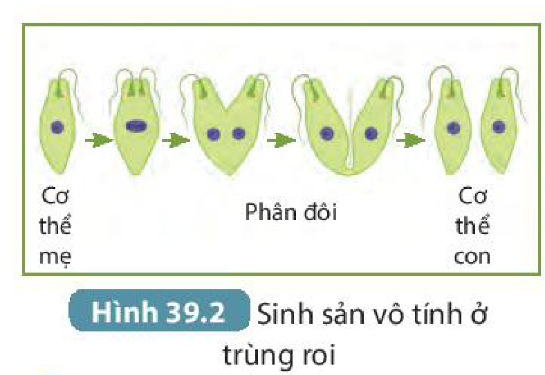
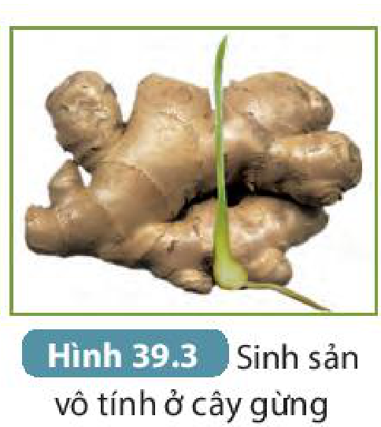
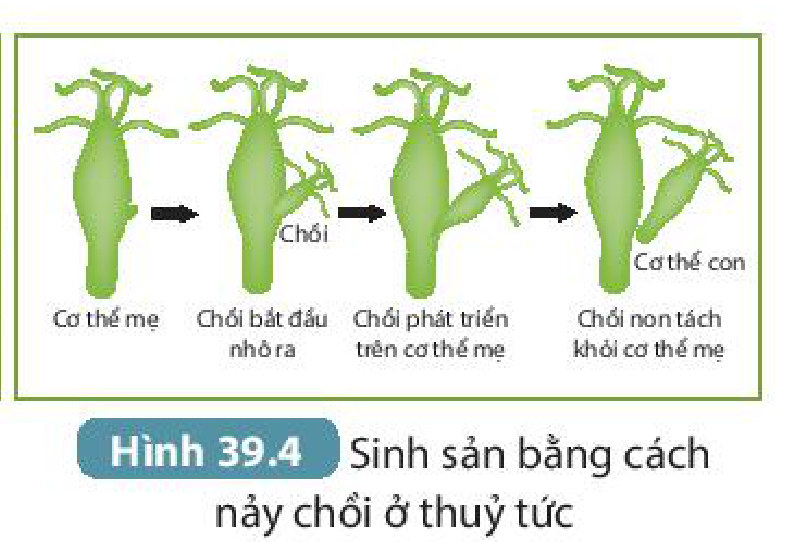
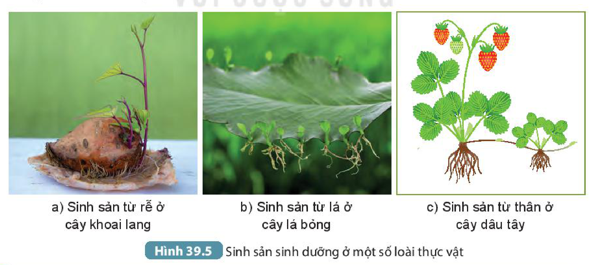
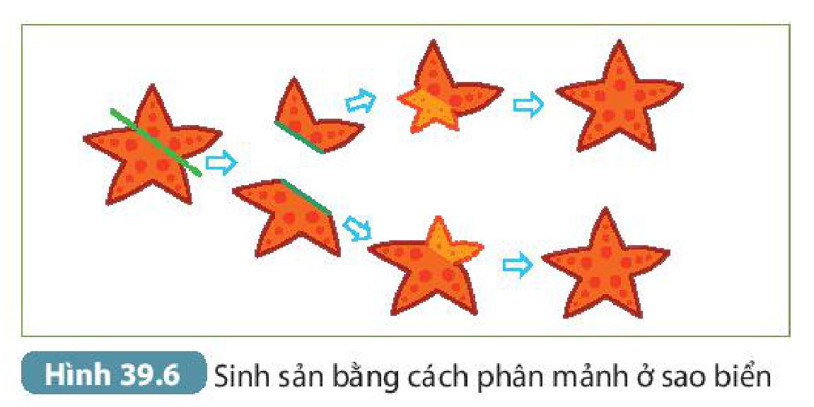
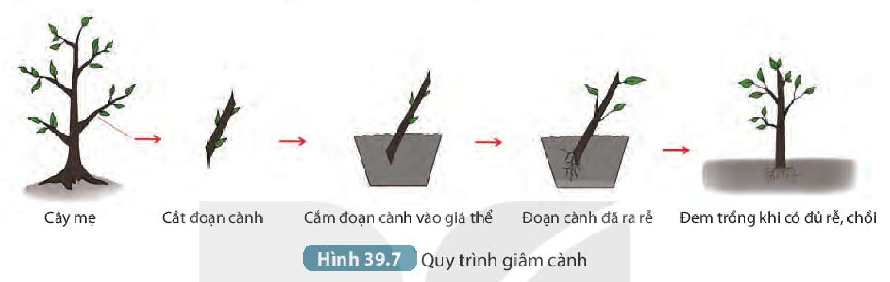
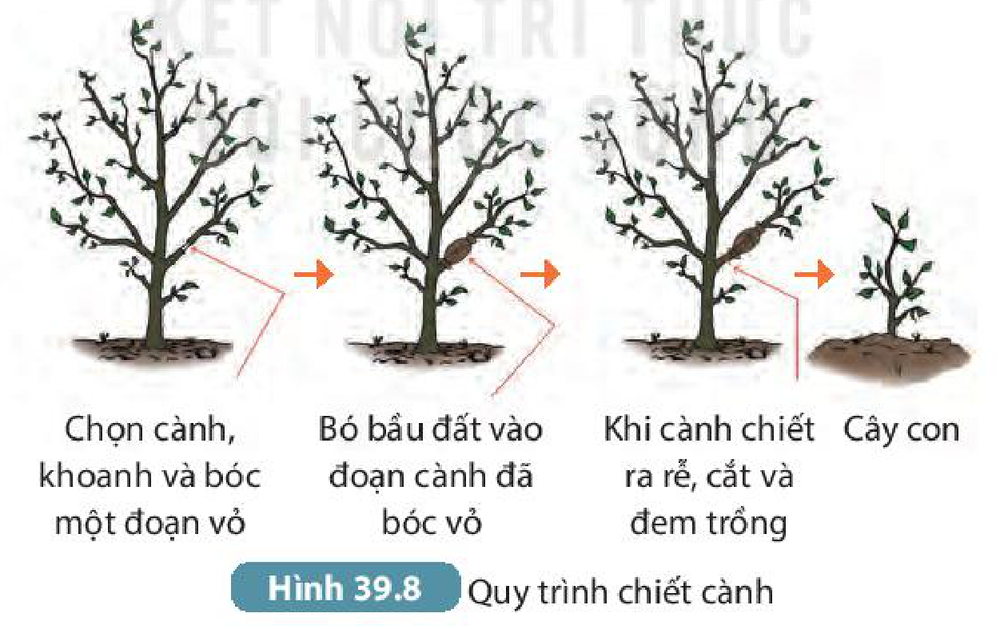
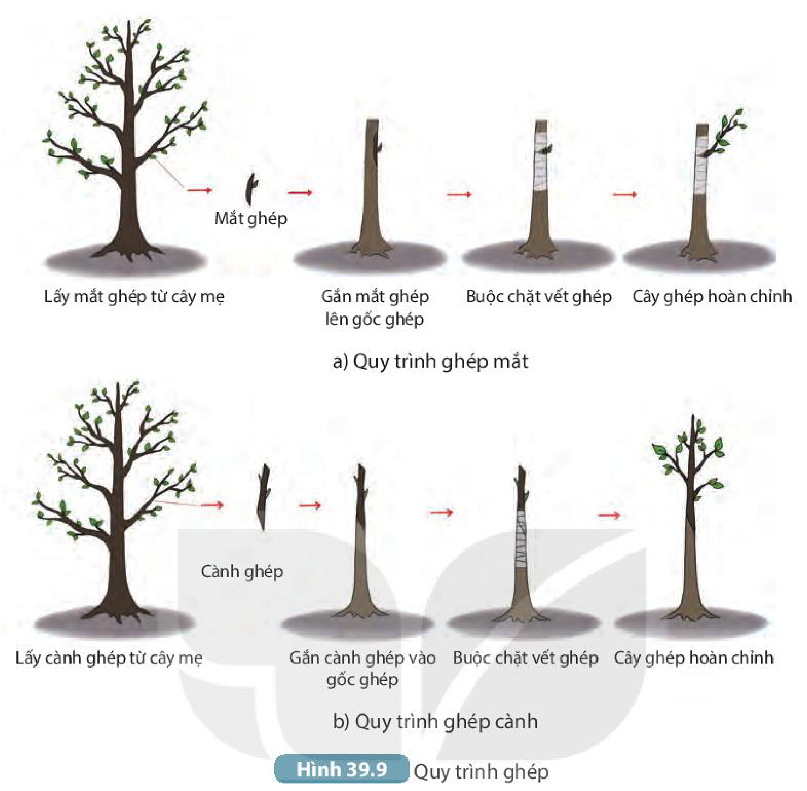
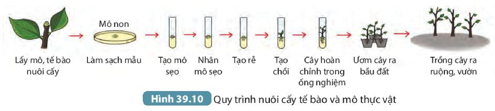

<!-- pdf:159 -->

# BÀI 39: SINH SẢN VÔ TÍNH Ở SINH VẬT

## 🎯 Mục tiêu

- Phát biểu được khái niệm sinh sản ở sinh vật.
- Nêu được khái niệm sinh sản vô tính ở sinh vật.
- Phân biệt được các hình thức sinh sản sinh dưỡng ở thực vật. Lấy được ví dụ minh hoạ.
- Phân biệt được các hình thức sinh sản vô tính ở động vật. Lấy được ví dụ minh hoạ.
- Trình bày được vai trò và các ứng dụng của sinh sản vô tính vào thực tiễn.

## 🔴 Mở đầu

Những “nhành cây” với màu sắc rực rỡ trong hình bên là các tập đoàn san hô gồm hàng nghìn cá thể dính liền với nhau, được tạo thành nhờ hình thức sinh sản vô tính. Vậy sinh sản vô tính là gì?

## I. Sinh sản là gì?

Sinh sản là một trong những đặc trưng cơ bản của cơ thể sống. <!-- term: Sinh sản -->

> ❓ Quan sát Hình 39.1 kết hợp kiến thức đã biết, hãy nêu khái niệm sinh sản và lấy ví dụ.

Có hai hình thức sinh sản ở sinh vật là sinh sản vô tính và sinh sản hữu tính. <!-- term: Sinh sản -->

- *a) Sinh sản ở cây chuối*
- *b) Sinh sản ở mèo*

Hình 39.1. Sinh sản ở một số sinh vật

## II. Sinh sản vô tính

### 1. Khái niệm

Sinh sản vô tính là hình thức sinh sản không có sự kết hợp của **giao tử đực** và **giao tử cái**, cơ thể con được tạo thành từ một phần của cơ thể mẹ. <!-- term: Sinh sản vô tính -->

Các vi khuẩn, nguyên sinh vật, nấm, một số động vật và nhiều loài thực vật có hình thức sinh sản này.

<!-- pdf:160 -->

Hình 39.2. Sinh sản vô tính ở trùng roi

Hình 39.3. Sinh sản vô tính ở cây gừng

Hình 39.4. Sinh sản bằng cách nảy chồi ở thuỷ tức

> ❓ 1. Quan sát Hình 39.2, 39.3 và 39.4, kết hợp đọc thông tin trong mục II, đánh dấu X vào ô phù hợp theo mẫu Bảng 39.1.
>
> Bảng 39.1
>
> | Hình thức | Con sinh ra có sự kết hợp của giao tử đực và giao tử cái | Con sinh ra từ một phần cơ thể mẹ | Con có các đặc điểm giống hệt cơ thể mẹ | Con có những đặc điểm khác cơ thể mẹ |
> |---|---|---|---|---|
> | Sinh sản ở trùng roi | ? | ? | ? | ? |
> | Sinh sản ở cây gừng | ? | ? | ? | ? |
> | Sinh sản ở thuỷ tức | ? | ? | ? | ? |
>
> 2. Dựa vào kết quả ở câu 1, em hãy nêu các đặc điểm của sinh sản vô tính.

### 2. Các hình thức sinh sản vô tính ở thực vật

Thực vật có hai hình thức sinh sản vô tính là sinh sản sinh dưỡng và sinh sản bào tử. Trong đó, sinh sản sinh dưỡng là chủ yếu.

Sinh sản sinh dưỡng là hình thức sinh sản trong đó cơ thể mới được hình thành từ cơ quan sinh dưỡng của cơ thể mẹ (như rễ, thân, lá). <!-- term: Sinh sản sinh dưỡng -->

- *a) Sinh sản từ rễ ở cây khoai lang*
- *b) Sinh sản từ lá ở cây lá bỏng*
- *c) Sinh sản từ thân ở cây dâu tây*

Hình 39.5. Sinh sản sinh dưỡng ở một số loài thực vật

> ❓ Hãy kể tên một số loài cây khác có khả năng sinh sản bằng rễ, thân, lá mà em biết. Vì sao người ta gọi hình thức sinh sản từ rễ, thân, lá là sinh sản sinh dưỡng?

<!-- pdf:161 -->

### 3. Các hình thức sinh sản vô tính ở động vật

### a) Nảy chồi

Nảy chồi là hình thức sinh sản trong đó “chồi” được mọc ra từ cơ thể mẹ, lớn dần lên và tách ra khỏi cơ thể mẹ thành cơ thể mới như ở thuỷ tức (Hình 39.4) hoặc vẫn dính với cơ thể mẹ tạo thành tập đoàn gồm nhiều cá thể như ở san hô. <!-- term: Nảy chồi -->

### b) Phân mảnh

Phân mảnh là hình thức sinh sản mà mỗi mảnh nhỏ riêng biệt của cơ thể mẹ có thể phát triển thành một cơ thể mới hoàn chỉnh. Hình thức sinh sản này xảy ra ở giun dẹp hoặc sao biển (Hình 39.6),... <!-- term: Phân mảnh -->

Hình 39.6. Sinh sản bằng cách phân mảnh ở sao biển

### c) Trinh sản (trinh sinh)

Trinh sản là hình thức sinh sản trong đó tế bào trứng không thụ tinh phát triển thành cơ thể mới. Hình thức sinh sản này gặp ở rệp cây, ong, kiến và một số thằn lằn,... <!-- term: Trinh sản -->

Ví dụ: Ở loài ong mật, loài ong chúa đẻ ra rất nhiều trứng, trứng không được thụ tinh sẽ phát triển thành ong đực, trứng được thụ tinh sẽ phát triển thành ong chúa và ong thợ.

> ✋ Đọc thông tin ở mục 3 và hoàn thành bảng theo mẫu Bảng 39.2.
>
> Bảng 39.2
>
> | Hình thức sinh sản \ Đặc điểm | Giống | Khác |
> |---|---|---|
> | Nảy chồi | ? | ? |
> | Phân mảnh | ? | ? |
> | Trinh sản | ? | ? |

### 4. Vai trò và ứng dụng của sinh sản vô tính

Sinh sản vô tính có nhiều đóng góp trong đời sống và sản xuất của con người như duy trì được những tính trạng tốt ở sinh vật phục vụ cho con người; tạo giống cây sạch bệnh; khôi phục các giống cây quý hiếm đang có nguy cơ tuyệt chủng hay bị thoái hoá; nhân nhanh giống cây trồng, giúp hạ thấp giá thành, nâng cao hiệu quả kinh tế.

<!-- pdf:162 -->

> ✋ Em hãy tìm hiểu trên sách, báo, internet hoặc từ người thân về những hạn chế của hình thức sinh sản vô tính ở sinh vật.

Dưới đây là những ứng dụng của hình thức sinh sản sinh dưỡng do con người tiến hành.

- Giâm cành:

Giâm cành là phương pháp cắt một đoạn cành có đủ mắt, chồi, cắm xuống đất ẩm hoặc giá thể cho cành đó ra rễ và phát triển thành cây mới (Hình 39.7). <!-- term: Giâm cành -->

Hình 39.7. Quy trình giâm cành

Giâm cành thường được áp dụng để nhân giống đối với một số cây như sắn, mía, các cây hoa (hoa hồng, hoa cúc,...) và cây ăn quả (dâu tằm, chanh,...).

- Chiết cành:

Chiết cành là phương pháp làm cho cành ra rễ ngay trên cây, rồi cắt đoạn cành mang rễ đó đem trồng thành cây mới (Hình 39.8). <!-- term: Chiết cành -->

Hình 39.8. Quy trình chiết cành

Chiết cành thường được tiến hành để nhân giống các loài cây ăn quả lâu năm như hồng xiêm, cam,... Chiết cành và giâm cành giúp rút ngắn thời gian sinh trưởng của cây con, nhanh cho thu hoạch.

- Ghép cây:

Ghép cây là phương pháp dùng bộ phận sinh dưỡng của một cây như mắt, chồi hoặc cành rồi gắn vào cây khác (gốc ghép) cho tiếp tục phát triển thành cây mang cành của các cây khác nhau (cùng loài hoặc khác loài) (Hình 39.9). <!-- term: Ghép cây -->

<!-- pdf:163 -->

- *a) Quy trình ghép mắt*
- *b) Quy trình ghép cành*

Hình 39.9. Quy trình ghép
<!-- ocr-ok: đã đối chiếu ảnh trang gốc p163, nhãn Hình 39.9 in trên thẻ xanh nên OCR đọc sai thành 'q22 Quy tình onép' -->

Phương pháp này có thể kết hợp được những ưu điểm của cành/mắt ghép và gốc ghép theo mong muốn của con người. Có thể sử dụng phương pháp ghép để ghép các cây khác nhau nhưng cùng loài như mít với mít, bơ với bơ, xoài với xoài hoặc đối với các cây cùng giống như cam với bưởi, chanh với bưởi, hoa quỳnh với thanh long,...

- Nuôi cấy tế bào và mô thực vật:

Đây là phương pháp nuôi cấy tế bào hoặc mô từ các phần của cơ thể thực vật như củ, lá, ngọn, bao phấn,... trong môi trường dinh dưỡng thích hợp, ở điều kiện vô trùng để tạo thành cây con (Hình 39.10). <!-- term: Nuôi cấy tế bào và mô thực vật -->

Hình 39.10. Quy trình nuôi cấy tế bào và mô thực vật

<!-- pdf:164 -->

Nuôi cấy tế bào và mô thực vật là phương pháp nhân giống vô tính hiệu quả nhất, tạo ra số lượng lớn các cây con đồng đều, sạch bệnh, giữ được đặc tính tốt của cây mẹ và hiệu quả kinh tế cao. Ở nước ta, nhiều giống hoa, cây thuốc và cây gỗ quý hiếm như hoa phong lan, sâm ngọc linh, trầm hương,... vốn khó nhân giống bằng phương pháp thông thường, nay đã được nhân lên với số lượng lớn nhờ nuôi cấy tế bào và mô. <!-- term: Nuôi cấy tế bào và mô thực vật -->

Tuy nhiên, phương pháp này đòi hỏi trang thiết bị hiện đại và trình độ kĩ thuật cao.

> ✋ 1. Đọc thông tin ở mục 4 và hoàn thành bảng theo mẫu Bảng 39.3.
>
> Bảng 39.3
>
> | Phương pháp nhân giống | Áp dụng với các cây | Ưu điểm |
> |---|---|---|
> | Giâm cành | ? | ? |
> | Chiết cành | ? | ? |
> | Ghép | ? | ? |
> | Nuôi cấy tế bào, mô | ? | ? |
>
> 2. Tại sao cành được sử dụng để giâm cần phải có đủ mắt, chồi?
>
> 3. Để khôi phục các loài thực vật quý hiếm đang có nguy cơ tuyệt chủng, phương pháp nhân giống nào được sử dụng có hiệu quả nhất? Vì sao?

> 🔍 Em có biết?
>
> Ngày nay, rất nhiều giống cây trồng được tạo ra bằng phương pháp nuôi cấy tế bào và mô trong ống nghiệm. Trong quy trình thực hiện phương pháp này, bước đầu người ta lấy một phần rất nhỏ của cơ thể thực vật, nuôi trong ống nghiệm có môi trường dinh dưỡng đặc biệt ở điều kiện vô trùng để tạo thành mô sẹo có thể phân chia nhiều lần liên tiếp. Sau đó, sử dụng các chất kích thích sinh trưởng làm cho các mô sẹo này phân hoá thành cây. Cây con được tạo thành từ phương pháp này có đặc điểm sạch bệnh, mang các đặc tính của cây ban đầu, tạo ra số lượng cây con lớn, đáp ứng nhu cầu của con người. <!-- term: Mô sẹo -->

## 📌 Em đã học

- Sinh sản là quá trình tạo ra những cá thể mới, đảm bảo sự phát triển liên tục của loài. <!-- term: Sinh sản -->
- Sinh sản vô tính là hình thức sinh sản không có sự kết hợp của giao tử đực và giao tử cái, cơ thể con sinh ra từ một phần của cơ thể mẹ. Sinh sản sinh dưỡng gồm các hình thức sinh sản bằng rễ, thân, lá. Sinh sản vô tính ở động vật gồm nảy chồi, phân mảnh và trinh sản.
- Sinh sản vô tính có vai trò quan trọng trong sản xuất và đời sống. Ứng dụng sinh sản vô tính trong giâm cành, chiết cành, ghép cây, nuôi cấy tế bào và mô giúp nhân nhanh các giống cây trồng, đem lại hiệu quả kinh tế cao.

## 🚀 Em có thể

- Nhận biết được hình thức sinh sản của một số thực vật, động vật.
- Biết lựa chọn phương pháp nhân giống cây trồng phù hợp với từng loài.
- Trồng cây bằng các phương pháp nhân giống đơn giản như giâm cành, chiết cành, ghép cành.

## 📷 Danh sách hình trong bài

| Mã hình | Trang PDF | Trang sách | Chú thích |
|---|---|---|---|
| H7-khoa_hoc_tu_nhien-b39-01 | 159 | 158 | Hình 39.1. Sinh sản ở một số sinh vật |
| H7-khoa_hoc_tu_nhien-b39-02 | 160 | 159 | Hình 39.2. Sinh sản vô tính ở trùng roi |
| H7-khoa_hoc_tu_nhien-b39-03 | 160 | 159 | Hình 39.3. Sinh sản vô tính ở cây gừng |
| H7-khoa_hoc_tu_nhien-b39-04 | 160 | 159 | Hình 39.4. Sinh sản bằng cách nảy chồi ở thuỷ tức |
| H7-khoa_hoc_tu_nhien-b39-05 | 160 | 159 | Hình 39.5. Sinh sản sinh dưỡng ở một số loài thực vật |
| H7-khoa_hoc_tu_nhien-b39-06 | 161 | 160 | Hình 39.6. Sinh sản bằng cách phân mảnh ở sao biển |
| H7-khoa_hoc_tu_nhien-b39-07 | 162 | 161 | Hình 39.7. Quy trình giâm cành |
| H7-khoa_hoc_tu_nhien-b39-08 | 162 | 161 | Hình 39.8. Quy trình chiết cành |
| H7-khoa_hoc_tu_nhien-b39-09 | 163 | 162 | Hình 39.9. Quy trình ghép |
| H7-khoa_hoc_tu_nhien-b39-10 | 163 | 162 | Hình 39.10. Quy trình nuôi cấy tế bào và mô thực vật |
