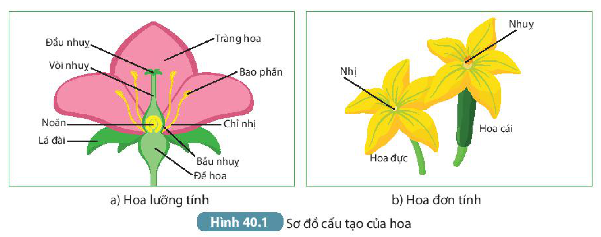
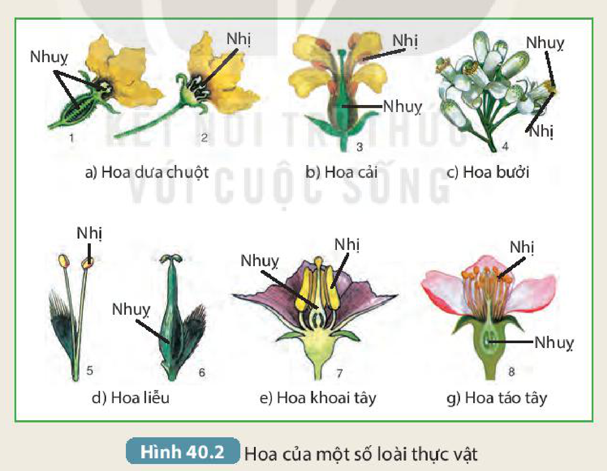
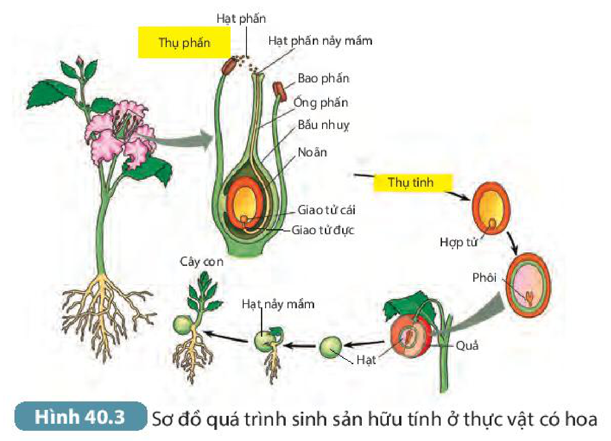
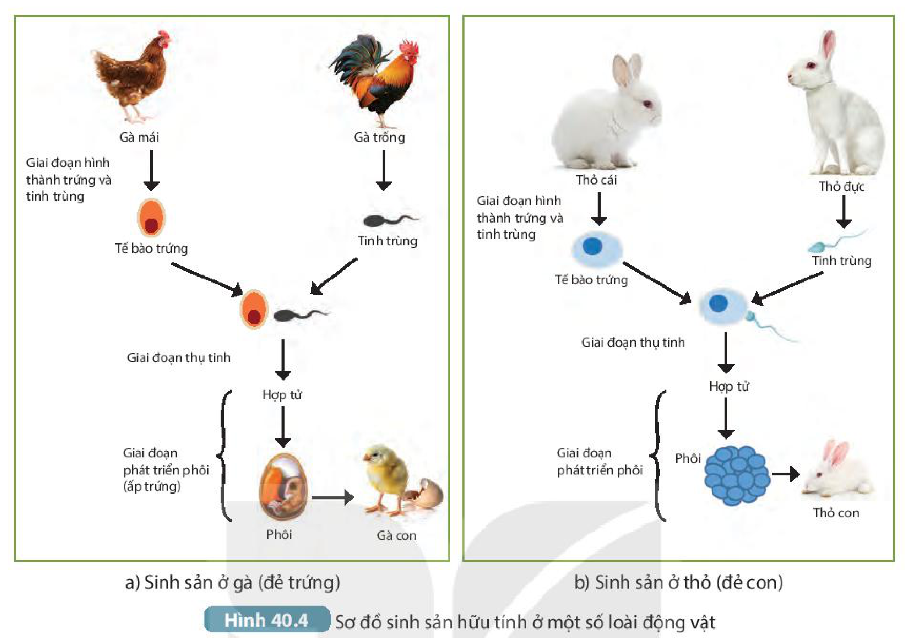
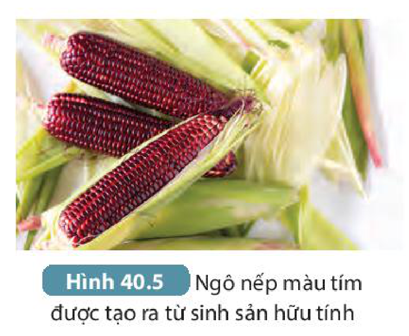

<!-- pdf:165 -->

# BÀI 40: SINH SẢN HỮU TÍNH Ở SINH VẬT

## 🎯 Mục tiêu

- Nêu được khái niệm sinh sản hữu tính ở sinh vật.
- Phân biệt được sinh sản hữu tính và sinh sản vô tính.
- Mô tả được các bộ phận của hoa lưỡng tính, phân biệt hoa đơn tính và hoa lưỡng tính.
- Mô tả được thụ phấn, thụ tinh và lớn lên của quả.
- Mô tả được khái quát quá trình sinh sản hữu tính ở động vật (lấy ví dụ ở động vật đẻ trứng và đẻ con).
- Nêu được vai trò và ứng dụng của sinh sản hữu tính ở sinh vật.

## 🔴 Mở đầu

Cây đậu ở hình bên không được sinh ra từ rễ, thân hay lá của cây mẹ mà lại mọc lên từ một bộ phận đặc biệt là hạt. Đây là ví dụ về sinh sản hữu tính. Vậy sinh sản hữu tính là gì và quá trình này diễn ra như thế nào?

## I. Khái niệm sinh sản hữu tính

Sinh sản hữu tính là hình thức sinh sản tạo ra cơ thể mới qua sự hợp nhất giữa giao tử đực và giao tử cái tạo nên hợp tử, hợp tử phát triển thành cơ thể mới. Sinh sản hữu tính là hình thức sinh sản điển hình ở thực vật có hoa và nhiều nhóm động vật. Ví dụ: Ở thực vật, sinh sản hữu tính gặp ở các loài như lúa, ngô, cam, chanh,... Ở động vật, sinh sản hữu tính gặp ở các loài như trâu, bò, lợn, gà, cá chép, voi,... <!-- term: Sinh sản hữu tính -->

> ❓ Lấy ví dụ các loài sinh vật có hình thức sinh sản hữu tính mà em biết.

## II. Sinh sản hữu tính ở thực vật có hoa

### 1. Cơ quan sinh sản

Ở thực vật có hoa, hoa là cơ quan sinh sản, bộ phận sinh sản của hoa là nhị và nhuỵ. Nhị hoa gồm chỉ nhị và bao phấn; bao phấn chứa hạt phấn (mang giao tử đực). Nhuỵ hoa gồm đầu nhuỵ, vòi nhuỵ và bầu nhuỵ; bầu nhuỵ chứa noãn (mang giao tử cái). <!-- term: Nhị hoa --> <!-- term: Nhuỵ hoa -->

<!-- pdf:166 -->

Hoa có cả nhị và nhuỵ được gọi là hoa lưỡng tính, ví dụ: hoa li, hoa hồng, hoa đào,... Hoa chỉ mang nhị hoặc nhuỵ được gọi là hoa đơn tính, ví dụ: hoa mướp, hoa bí, hoa dưa chuột, hoa liễu, hoa dưa hấu,... Ngoài ra, hoa còn có nhiều bộ phận khác (Hình 40.1). <!-- term: Hoa lưỡng tính --> <!-- term: Hoa đơn tính -->

- *a) Hoa lưỡng tính*
- *b) Hoa đơn tính*

Hình 40.1. Sơ đồ cấu tạo của hoa

> ❓ 1. Quan sát Hình 40.1a, mô tả cấu tạo của hoa lưỡng tính. Hoa lưỡng tính có đặc điểm gì khác hoa đơn tính?
>
> 2. Phân loại hoa đơn tính và hoa lưỡng tính trong Hình 40.2.
>
> 
>
> Hình 40.2. Hoa của một số loài thực vật

### 2. Quá trình sinh sản hữu tính ở thực vật

Sinh sản hữu tính ở thực vật có hoa gồm các giai đoạn nối tiếp nhau: tạo giao tử, thụ phấn, thụ tinh, hình thành quả và hạt.

Tạo giao tử: Các giao tử đực được hình thành trong bao phấn, giao tử cái được hình thành trong bầu nhuỵ.

<!-- pdf:167 -->

Thụ phấn: là quá trình di chuyển hạt phấn đến đầu nhuỵ. Hiện tượng thụ phấn xảy ra nhờ gió, côn trùng hoặc tác động của con người. <!-- term: Thụ phấn -->

Thụ tinh: Hạt phấn sau khi đến đầu nhuỵ, nảy mầm thành ống phấn chứa giao tử đực, xuyên qua vòi nhuỵ vào bầu nhuỵ. Tại đây, giao tử đực kết hợp với giao tử cái tạo thành hợp tử. Thực chất của thụ tinh là sự hợp nhất nhân của giao tử đực và nhân của giao tử cái. <!-- term: Thụ tinh -->

Hình 40.3. Sơ đồ quá trình sinh sản hữu tính ở thực vật có hoa

Hình thành quả và hạt: Hợp tử phân chia và phát triển thành phôi nằm trong hạt. Hạt do noãn phát triển thành. Mỗi noãn được thụ tinh tạo thành một hạt. Bầu nhuỵ sinh trưởng dày lên, phát triển thành quả chứa hạt. Quả được hình thành không qua thụ tinh là quả không hạt. <!-- term: Quả không hạt -->

> ❓ Đọc thông tin trên kết hợp quan sát Hình 40.3 để thực hiện các yêu cầu:
>
> 1. Mô tả các giai đoạn trong sinh sản hữu tính ở thực vật. Phân biệt quá trình thụ phấn và thụ tinh ở thực vật. Cho biết ý nghĩa của thụ tinh trong quá trình hình thành quả và hạt.
>
> 2. Cho biết quả và hạt được hình thành từ bộ phận nào của hoa. Giải thích tại sao trong tự nhiên có loại quả có hạt và loại quả không có hạt.

## III. Sinh sản hữu tính ở động vật

Sinh sản hữu tính ở hầu hết các loài động vật gồm ba giai đoạn nối tiếp nhau: hình thành giao tử, thụ tinh, phát triển phôi thành cơ thể mới (Hình 40.4).

Hình thành giao tử: Tế bào trứng (giao tử cái) được hình thành và phát triển trong cơ quan sinh dục cái, tinh trùng (giao tử đực) được hình thành trong cơ quan sinh dục đực.

Thụ tinh: là sự kết hợp của giao tử cái với giao tử đực tạo thành hợp tử. Ở một số động vật, quá trình thụ tinh diễn ra ở bên ngoài cơ thể cá thể cái, ví dụ như như cá chép, ếch,... Ngược lại, nhiều loài khác có quá trình thụ tinh xảy ra trong cơ quan sinh dục của con cái như các loài thuộc lớp Chim, Thú (trong đó có con người). <!-- term: Thụ tinh -->

Phát triển phôi: Hợp tử phân chia và phát triển thành phôi. Phôi có thể phát triển thành cơ thể con ở bên ngoài cơ thể mẹ (đối với loài đẻ trứng) hoặc ở bên trong cơ thể mẹ (đối với loài đẻ con). <!-- term: Động vật đẻ trứng --> <!-- term: Động vật đẻ con -->

<!-- pdf:168 -->

- *a) Sinh sản ở gà (đẻ trứng)*
- *b) Sinh sản ở thỏ (đẻ con)*

Hình 40.4. Sơ đồ sinh sản hữu tính ở một số loài động vật

> ✋ 1. Quan sát Hình 40.4, mô tả khái quát các giai đoạn sinh sản hữu tính ở gà và thỏ.
>
> 2. Phân biệt sinh sản vô tính và sinh sản hữu tính ở sinh vật.
>
> 3. Nêu những ưu điểm của hình thức mang thai và sinh con ở động vật có vú so với hình thức đẻ trứng ở các động vật khác.

## IV. Vai trò và ứng dụng của sinh sản hữu tính ở sinh vật

Sinh sản hữu tính tạo ra các cá thể mới đa dạng, đảm bảo sự phát triển liên tục của loài và sự thích nghi của loài trước môi trường sống luôn thay đổi. Sinh sản hữu tính tạo ra các cá thể con với nhiều đặc điểm khác nhau, đây là nguồn nguyên liệu phong phú cho chọn giống. Con người đã tạo ra nhiều giống vật nuôi, cây trồng mới nhờ sinh sản hữu tính kết hợp với chọn lọc như vịt xiêm; giống lúa DT17, DT24, DT25;...

Trong chăn nuôi và trồng trọt, con người đã ứng dụng sinh sản hữu tính để tạo ra thế hệ con mang đặc điểm tốt của cả bố lẫn mẹ, đáp ứng nhu cầu đa dạng của con người. Tiến hành lai giữa các cá thể mang đặc điểm tốt rồi chọn lọc ở thế hệ con để chọn ra những cá thể mang đặc điểm phù hợp với nhu cầu của con người.

<!-- pdf:169 -->

Ví dụ: Ở ngô, tiến hành cho hoa đực (bông cờ) của cây ngô có bắp màu tím, to và hạt ngọt thụ phấn với hoa cái của cây ngô nếp ta có bắp màu trắng, hạt dẻo, sẽ thu được các cây ngô có bắp màu tím, to và hạt dẻo (Hình 40.5). Sự kết hợp giữa giống lợn thuần chủng Đại Bạch và giống lợn Ỉ trong sinh sản hữu tính đã tạo ra giống lợn lai Ỉ – Đại Bạch lớn nhanh, trọng lượng xuất chuồng lớn, tỉ lệ nạc cao, đem lại hiệu quả kinh tế.

Hình 40.5. Ngô nếp màu tím được tạo ra từ sinh sản hữu tính

> ❓ Sinh sản hữu tính ở sinh vật có vai trò và ứng dụng như thế nào? Cho ví dụ.

> 🔍 Em có biết?
>
> Các nhà khoa học đã chọn và tạo ra được một số giống dê, cừu có năng suất cao, chất lượng sản phẩm tốt bằng cách cho sinh sản hữu tính giữa nguồn giống ngoại nhập với nguồn giống nội địa. Ví dụ: giống dê Boer-VCN lai giữa ba dòng BBC (dòng Boer, dòng Bách Thảo, dòng Cỏ) có trọng lượng trưởng thành trung bình từ 100 kg đến 120 kg, tỉ lệ thịt xẻ cao. Ngoài ra, các nhà khoa học còn sử dụng công nghệ thụ tinh nhân tạo cho dê nhằm nâng cao hiệu quả nhân giống, giảm giá thành con giống, tạo điều kiện cho nhiều hộ gia đình có thể chăn nuôi dê để cải thiện kinh tế. <!-- term: Thụ tinh nhân tạo -->

## 📌 Em đã học

- Sinh sản hữu tính là hình thức sinh sản có sự hợp nhất giữa giao tử đực và giao tử cái tạo nên hợp tử, hợp tử phát triển thành cơ thể mới.
- Hoa là cơ quan sinh sản ở thực vật, gồm hai loại là hoa đơn tính và hoa lưỡng tính. Sinh sản hữu tính ở thực vật bao gồm quá trình tạo giao tử, thụ phấn, thụ tinh, tạo hạt và quả.
- Sinh sản hữu tính ở động vật bao gồm quá trình tạo trứng và tinh trùng, thụ tinh và phát triển phôi hình thành cơ thể mới. Ở động vật có hình thức thụ tinh ngoài và thụ tinh trong, có loài đẻ trứng và loài đẻ con.
- Sinh sản hữu tính tạo ra các cá thể mới đa dạng, đảm bảo sự phát triển liên tục của loài và sự thích nghi của sinh vật trước môi trường sống thay đổi. Sinh sản hữu tính cung cấp nguyên liệu cho chọn giống, con người đã sử dụng những nguyên liệu này để tạo giống mới hay cải tạo giống cũ trong trồng trọt và chăn nuôi.

## 🚀 Em có thể

Giải thích được một số hiện tượng trong tự nhiên và thực tiễn sản xuất như hiện tượng quả không có hạt, hiện tượng năng suất quả và hạt phụ thuộc vào các loài côn trùng và điều kiện thời tiết khi cây thụ phấn,...

## 📷 Danh sách hình trong bài

| Mã hình | Trang PDF | Trang sách | Chú thích |
|---|---|---|---|
| H7-khoa_hoc_tu_nhien-b40-01 | 166 | 165 | Hình 40.1. Sơ đồ cấu tạo của hoa |
| H7-khoa_hoc_tu_nhien-b40-02 | 166 | 165 | Hình 40.2. Hoa của một số loài thực vật |
| H7-khoa_hoc_tu_nhien-b40-03 | 167 | 166 | Hình 40.3. Sơ đồ quá trình sinh sản hữu tính ở thực vật có hoa |
| H7-khoa_hoc_tu_nhien-b40-04 | 168 | 167 | Hình 40.4. Sơ đồ sinh sản hữu tính ở một số loài động vật |
| H7-khoa_hoc_tu_nhien-b40-05 | 169 | 168 | Hình 40.5. Ngô nếp màu tím được tạo ra từ sinh sản hữu tính |
