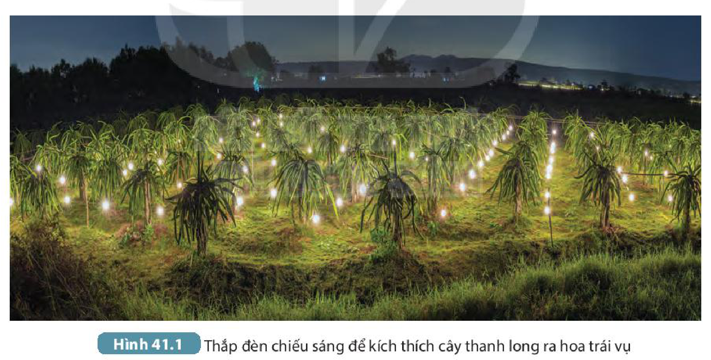
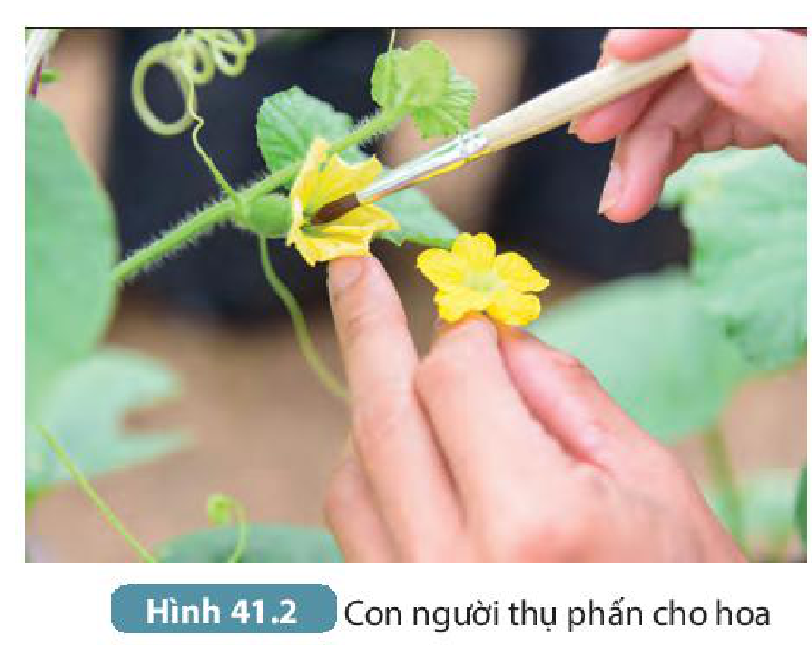
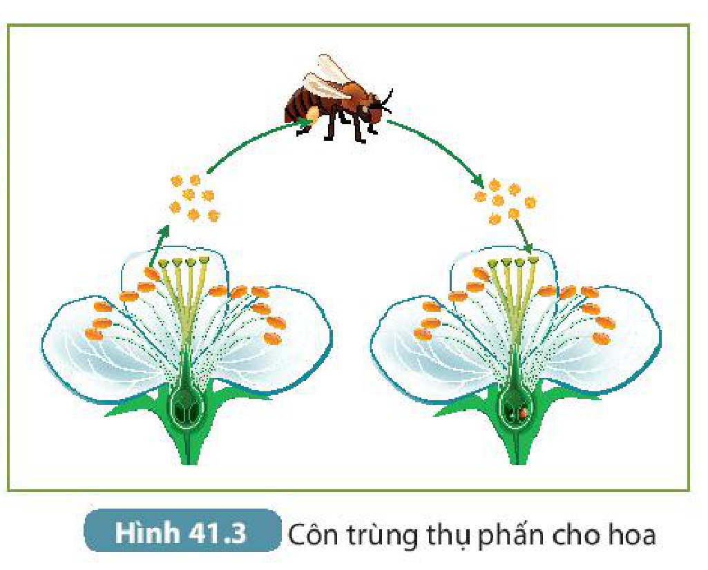
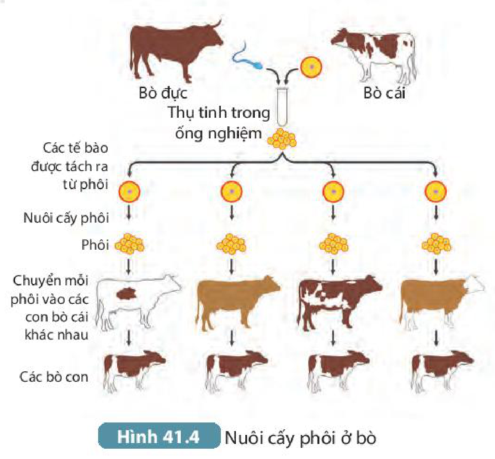

<!-- pdf:170 -->

# BÀI 41: MỘT SỐ YẾU TỐ ẢNH HƯỞNG VÀ ĐIỀU HOÀ, ĐIỀU KHIỂN SINH SẢN Ở SINH VẬT

## 🎯 Mục tiêu

- Nêu được một số yếu tố ảnh hưởng đến sinh sản và điều hoà, điều khiển sinh sản ở sinh vật.
- Vận dụng được những hiểu biết về sinh sản hữu tính trong thực tiễn đời sống và chăn nuôi (thụ phấn nhân tạo; điều khiển số con, giới tính). Giải thích tại sao phải bảo vệ một số loài côn trùng thụ phấn cho cây.

## 🔴 Mở đầu

Sự sinh sản của sinh vật có ý nghĩa vô cùng quan trọng đối với chăn nuôi và trồng trọt. Liệu con người có thể chủ động điều khiển được quá trình sinh sản của vật nuôi và cây trồng theo ý muốn để nâng cao năng suất chăn nuôi và trồng trọt không? Nếu có thì tiến hành ra sao?

## I. Một số yếu tố ảnh hưởng đến sinh sản ở sinh vật

### 1. Các yếu tố bên trong

Một số yếu tố bên trong ảnh hưởng đến sinh sản của sinh vật như đặc điểm di truyền, **hormone**, tuổi của sinh vật. Ví dụ: Ở nữ giới, khi đến tuổi dậy thì, cơ thể bắt đầu sản sinh hormone FSH và LH kích thích trứng chín và rụng báo hiệu cơ thể bắt đầu có khả năng sinh sản.

### 2. Các yếu tố bên ngoài

Ánh sáng, độ ẩm, nhiệt độ và chế độ dinh dưỡng là những yếu tố bên ngoài chủ yếu ảnh hưởng tới quá trình sinh sản ở sinh vật.

Ở thực vật, độ ẩm và nhiệt độ không khí quá cao hay quá thấp đều làm giảm hiệu quả thụ phấn và thụ tinh, làm tăng số lượng hạt lép.

Nhiệt độ môi trường quá cao hoặc quá thấp làm giảm quá trình sinh trứng ở động vật, ví dụ: cá chép chỉ đẻ ở nhiệt độ trên $15\text{ }^\circ\text{C}$.

> ❓ Em hãy lấy ví dụ về ảnh hưởng của một số yếu tố môi trường đến sự sinh sản của sinh vật.

## II. Điều hoà, điều khiển sinh sản ở sinh vật

### 1. Điều hoà sinh sản ở sinh vật

Quá trình sinh sản của sinh vật diễn ra bình thường là nhờ các cơ chế điều hoà. Cơ chế điều hoà sinh sản ở sinh vật chủ yếu là điều hoà quá trình sinh giao tử. <!-- term: Điều hoà sinh sản ở sinh vật -->

<!-- pdf:171 -->

Ở thực vật, sự ra hoa chịu ảnh hưởng của một số hormone, ví dụ: hormone florigen kích thích sự ra hoa.

Ở động vật, một số hormone do tuyến yên tiết ra có khả năng điều khiển quá trình sinh tinh trùng và trứng.

### 2. Điều khiển sinh sản ở sinh vật

Dựa vào ảnh hưởng của hormone và các yếu tố môi trường tới sinh sản ở sinh vật, con người đã chủ động điều khiển quá trình sinh sản ở sinh vật cho phù hợp với mục đích chăn nuôi và trồng trọt. <!-- term: Điều khiển sinh sản ở sinh vật -->

## III. Vận dụng những hiểu biết về sinh sản hữu tính trong thực tiễn đời sống

### 1. Trong trồng trọt

Trong trồng trọt, con người đã chủ động điều khiển sinh sản ở thực vật bằng cách sử dụng các hormone hoặc điều chỉnh nhiệt độ, chế độ chiếu sáng, chế độ dinh dưỡng để kích thích cây ra hoa, tạo quả trái vụ,... Ví dụ: cây thanh long chỉ ra hoa, tạo quả vào mùa hè, muốn cây ra hoa vào mùa đông, người ta đã thắp đèn chiếu sáng cho cây vào ban đêm (Hình 41.1).

Hình 41.1. Thắp đèn chiếu sáng để kích thích cây thanh long ra hoa trái vụ

Con người còn trực tiếp thụ phấn cho cây, đồng thời chủ động bảo vệ và phát triển các loài côn trùng thụ phấn trong tự nhiên nhằm nâng cao hiệu quả thụ phấn, giúp tăng năng suất quả và hạt (Hình 41.2, 41.3). Người ta còn ngắt ngọn bầu, bí trước thời điểm cây ra hoa để phát triển nhiều chồi, nhánh giúp cây ra nhiều quả hơn hoặc dùng khói để hun cho cây dưa chuột kích thích ra nhiều hoa cái. <!-- term: Thụ phấn nhân tạo -->

<!-- pdf:172 -->

Hình 41.2. Con người thụ phấn cho hoa

Hình 41.3. Côn trùng thụ phấn cho hoa

Ngoài ra, con người đã tạo ra các loại quả không hạt như chanh, nho, dưa hấu, bưởi, cam, táo,... bằng cách ngăn không cho hoa thụ phấn và kích thích để bầu nhuỵ phát triển thành quả không hạt.

> ✋ Dựa vào thông tin trên và liên hệ kiến thức đã học để thực hiện các yêu cầu và câu hỏi sau:
>
> 1. Trình bày các biện pháp điều khiển sinh sản ở thực vật. Lấy ví dụ trong thực tế.
>
> 2. Giải thích tại sao cần phải bảo vệ một số loài côn trùng như ong mật, ong bắp cày.
>
> 3. Giải thích cơ sở của việc tạo thành quả không hạt và kể tên một số loại quả không hạt mà em biết.
>
> 4. Việc trồng cây đúng thời vụ có ý nghĩa gì đối với quá trình sinh sản ở thực vật? Giải thích.

### 2. Trong chăn nuôi

Con người đã tác động vào quá trình sinh sản ở động vật nhằm điều khiển số lượng hay giới tính đàn con.

Các biện pháp giúp tăng số con như sử dụng các hormone nhân tạo kích thích trứng chín sớm, thụ tinh nhân tạo giúp tăng hiệu quả thụ tinh, nuôi cấy phôi và điều chỉnh các yếu tố môi trường. Ví dụ: Người ta đã sử dụng các hormone kích thích trứng chín và rụng, cho trứng đó thụ tinh với tinh trùng trong ống nghiệm để phát triển thành phôi, tuỳ từng đối tượng mà người ta đem cấy phôi đó vào tử cung con cái hoặc tách phôi thành nhiều phần, mỗi phần phát triển thành một phôi mới rồi mới cấy vào tử cung của các con cái để tạo ra số lượng con lớn (Hình 41.4). <!-- term: Thụ tinh nhân tạo --> <!-- term: Nuôi cấy phôi -->

Hình 41.4. Nuôi cấy phôi ở bò

<!-- pdf:173 -->

Tuỳ từng mục đích sản xuất mà con người cần số lượng lớn con đực hay con cái. Để đáp ứng mục đích nhân giống nhanh thì cần nhiều con cái, còn để đáp ứng nhu cầu cung cấp thịt, lông,... thì cần nhiều con đực. Con người có thể điều khiển giới tính của đàn con bằng cách sử dụng hormone hoặc lọc, tách tinh trùng và lựa chọn loại tinh trùng đem thụ tinh với trứng để tạo đàn con có giới tính mong muốn. Bằng cách trên, người ta có thể tạo ra đàn lợn, bò, dê đực phục vụ nhu cầu lấy thịt hoặc đàn bò và dê cái phục vụ nhu cầu nhân giống và lấy sữa,...

> ❓ 1. Điều khiển số con và giới tính của đàn con có ý nghĩa như thế nào trong chăn nuôi?
>
> 2. Em hãy nêu một số thành tựu về điều khiển sinh sản ở động vật trong chăn nuôi.

> 🔍 Em có biết?
>
> Tư tưởng trọng nam khinh nữ ở nhiều nước phương Đông là nguyên nhân chủ yếu khiến nhiều cặp vợ chồng tìm mọi cách để xác định giới tính thai nhi trước khi sinh với mục đích chỉ giữ lại các thai nhi mang giới tính nam. Điều này dẫn đến tình trạng mất cân bằng giới tính và gây ra nhiều hệ luỵ trong tương lai như nam giới khó kết hôn, phải kết hôn với người nước ngoài dẫn đến sự khác biệt về văn hoá và ngôn ngữ trong gia đình; gia tăng nạn bắt cóc và buôn bán phụ nữ; tệ nạn mại dâm kéo theo nguy cơ lây nhiễm HIV và các bệnh xã hội cũng như những bất ổn về kinh tế, chính trị, xã hội.

## 📌 Em đã học

- Sinh sản ở sinh vật chịu ảnh hưởng của một số yếu tố bên trong như hormone, đặc điểm di truyền và một số yếu tố bên ngoài như nhiệt độ, ánh sáng, độ ẩm.
- Quá trình sinh sản ở sinh vật được điều hoà chủ yếu bởi các hormone.
- Con người chủ động điều khiển quá trình sinh sản ở sinh vật bằng cách sử dụng các hormone nhân tạo và điều chỉnh các yếu tố bên ngoài phù hợp với mục đích chăn nuôi và trồng trọt.

## 🚀 Em có thể

Thực hiện thụ phấn nhân tạo cho cây trồng trong vườn nhà hoặc vườn trường nhằm nâng cao năng suất quả và hạt. <!-- term: Thụ phấn nhân tạo -->

## 📷 Danh sách hình trong bài

| Mã hình | Trang PDF | Trang sách | Chú thích |
|---|---|---|---|
| H7-khoa_hoc_tu_nhien-b41-01 | 171 | 170 | Hình 41.1. Thắp đèn chiếu sáng để kích thích cây thanh long ra hoa trái vụ |
| H7-khoa_hoc_tu_nhien-b41-02 | 172 | 171 | Hình 41.2. Con người thụ phấn cho hoa |
| H7-khoa_hoc_tu_nhien-b41-03 | 172 | 171 | Hình 41.3. Côn trùng thụ phấn cho hoa |
| H7-khoa_hoc_tu_nhien-b41-04 | 172 | 171 | Hình 41.4. Nuôi cấy phôi ở bò |
