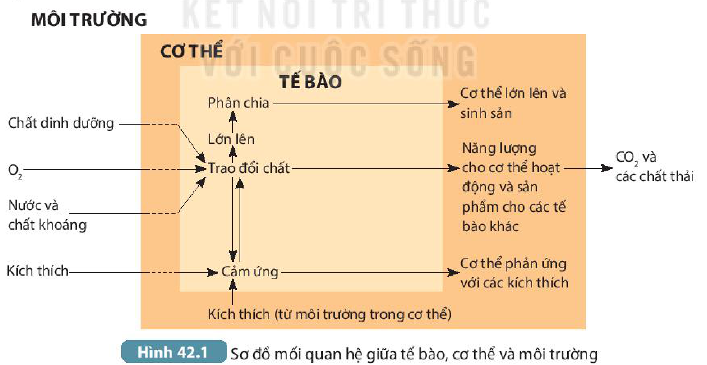
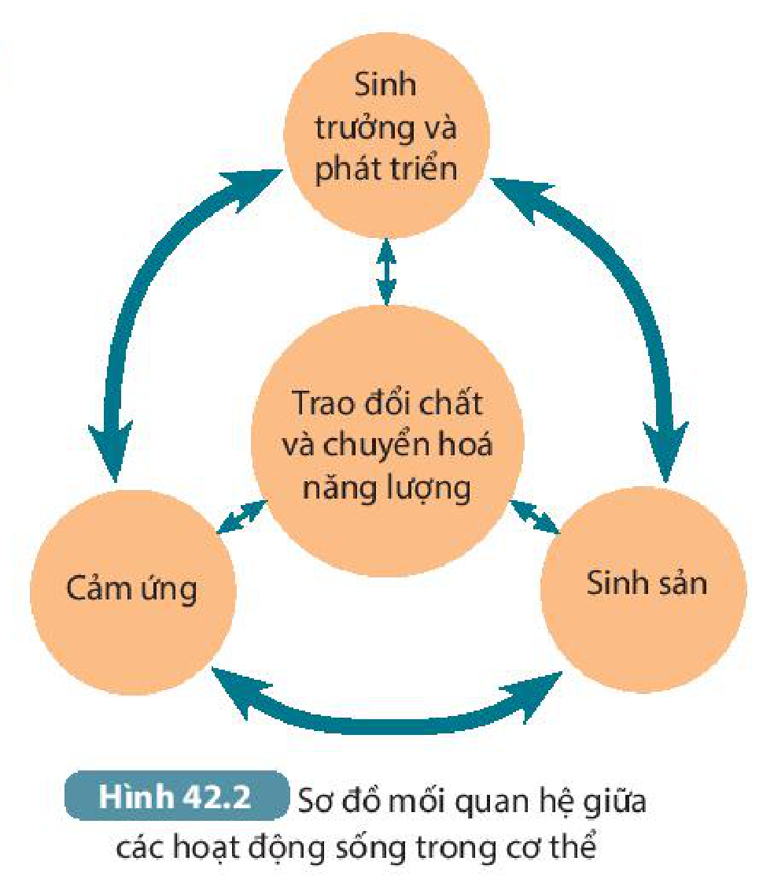

<!-- pdf:174 -->

# BÀI 42: CƠ THỂ SINH VẬT LÀ MỘT THỂ THỐNG NHẤT

## 🎯 Mục tiêu

- Dựa vào sơ đồ mối quan hệ giữa tế bào với cơ thể sinh vật và môi trường (tế bào – cơ thể – môi trường) và sơ đồ quan hệ giữa các hoạt động sống (trao đổi chất và chuyển hoá năng lượng – sinh trưởng, phát triển – cảm ứng – sinh sản) chứng minh cơ thể sinh vật là một thể thống nhất.

## 🔴 Mở đầu

Tế bào, cơ thể và môi trường có mối quan hệ tương tác qua lại, đảm bảo cho cơ thể thực hiện các hoạt động sống và tồn tại như một thể thống nhất. Sự thống nhất này được thể hiện như thế nào?

## I. Mối quan hệ giữa tế bào, cơ thể sinh vật và môi trường

Mọi cơ thể sống đều được cấu tạo từ tế bào. Cơ thể đa bào gồm nhiều tế bào, phân hoá thành mô, cơ quan, hệ cơ quan khác nhau cùng phối hợp thực hiện tất cả các hoạt động sống của cơ thể. Tế bào và cơ thể có mối quan hệ chặt chẽ với nhau và với môi trường. Nhờ cơ thể lấy các chất dinh dưỡng, nước, chất khoáng và $\ce{O2}$ từ môi trường mà tế bào thực hiện được quá trình trao đổi chất để lớn lên, sinh sản và cảm ứng, từ đó giúp cơ thể thực hiện được các hoạt động sống. <!-- term: Cơ thể đa bào -->

Các hoạt động sống ở cấp độ tế bào là cơ sở cho các hoạt động sống ở cấp độ cơ thể. Ngược lại, các hoạt động sống ở cấp độ cơ thể lại điều khiển các hoạt động sống ở cấp độ tế bào, đảm bảo cơ thể sinh vật là một thể thống nhất. <!-- term: Tính thống nhất của cơ thể sinh vật -->

Hình 42.1. Sơ đồ mối quan hệ giữa tế bào, cơ thể và môi trường

> ❓ 1. Tế bào có các hoạt động sống nào? Khi tách tế bào ra khỏi cơ thể thì điều gì sẽ xảy ra?
>
> 2. Quan sát Hình 42.1, mô tả mối quan hệ giữa tế bào, cơ thể và môi trường.

<!-- pdf:175 -->

## II. Mối quan hệ giữa các hoạt động sống trong cơ thể sinh vật

Các hoạt động sống trong cơ thể sinh vật có mối quan hệ qua lại mật thiết với nhau. Quá trình trao đổi chất và chuyển hoá năng lượng cung cấp vật chất và năng lượng đảm bảo cho cơ thể sinh trưởng và phát triển, sinh sản và cảm ứng. Ngược lại, các quá trình sinh trưởng, phát triển, sinh sản và cảm ứng có tác động trở lại đối với quá trình trao đổi chất và chuyển hoá năng lượng trong cơ thể sinh vật (Hình 42.2). Mối quan hệ qua lại này đảm bảo sự thống nhất trong hoạt động của toàn bộ cơ thể, nhờ đó cơ thể tồn tại và phát triển như một thể thống nhất. <!-- term: Tính thống nhất của cơ thể sinh vật -->

Hình 42.2. Sơ đồ mối quan hệ giữa các hoạt động sống trong cơ thể

> ❓ 1. Quan sát Hình 42.2, cho biết cơ thể có các hoạt động sống nào và nêu mối quan hệ giữa các hoạt động sống đó.
>
> 2. Nếu quá trình trao đổi chất và năng lượng gặp trục trặc thì các hoạt động sống khác của cơ thể bị ảnh hưởng như thế nào?

> 🔍 Em có biết?
>
> Béo phì là một bệnh lí đang ngày càng phổ biến ở lứa tuổi vị thành niên mà nguyên nhân chủ yếu là do cơ thể thu nhận quá nhiều năng lượng từ thức ăn và đồ uống dẫn đến rối loạn quá trình trao đổi chất của tế bào và cơ thể. Để phòng và chống béo phì, thanh thiếu niên cần rèn luyện thói quen ăn uống lành mạnh và tập thể dục thường xuyên. <!-- term: Béo phì -->

## 📌 Em đã học

- Mọi cơ thể sống đều được cấu tạo từ tế bào. Cơ thể lấy các chất dinh dưỡng, nước, chất khoáng và $\ce{O2}$ từ môi trường cung cấp cho tế bào thực hiện quá trình trao đổi chất để lớn lên, sinh sản và cảm ứng, từ đó giúp cơ thể thực hiện được các hoạt động sống.
- Các hoạt động sống như trao đổi chất và chuyển hoá năng lượng, sinh trưởng và phát triển, sinh sản và cảm ứng có mối quan hệ qua lại mật thiết với nhau đảm bảo sự thống nhất trong hoạt động của toàn bộ cơ thể như một thể thống nhất.

## 🚀 Em có thể

Thực hiện chế độ dinh dưỡng hợp lí, luyện tập thể dục thể thao thường xuyên kết hợp với chế độ sinh hoạt điều độ để cơ thể phát triển khoẻ mạnh.

## 📷 Danh sách hình trong bài

| Mã hình | Trang PDF | Trang sách | Chú thích |
|---|---|---|---|
| H7-khoa_hoc_tu_nhien-b42-01 | 174 | 173 | Hình 42.1. Sơ đồ mối quan hệ giữa tế bào, cơ thể và môi trường |
| H7-khoa_hoc_tu_nhien-b42-02 | 175 | 174 | Hình 42.2. Sơ đồ mối quan hệ giữa các hoạt động sống trong cơ thể |
