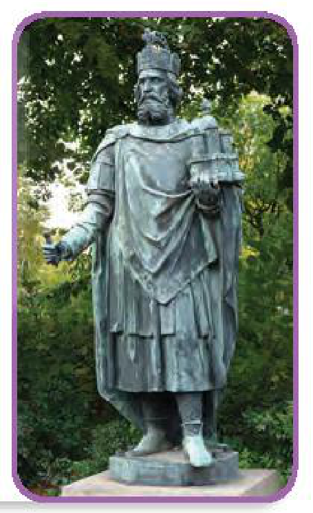
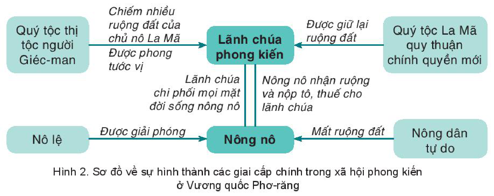
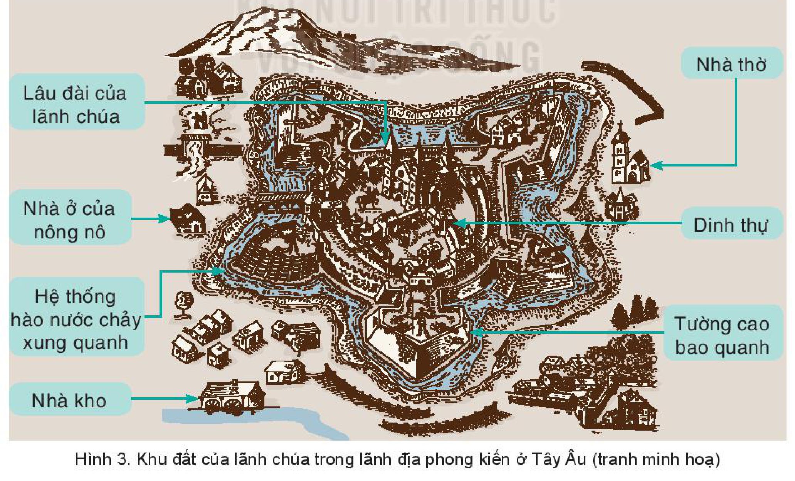
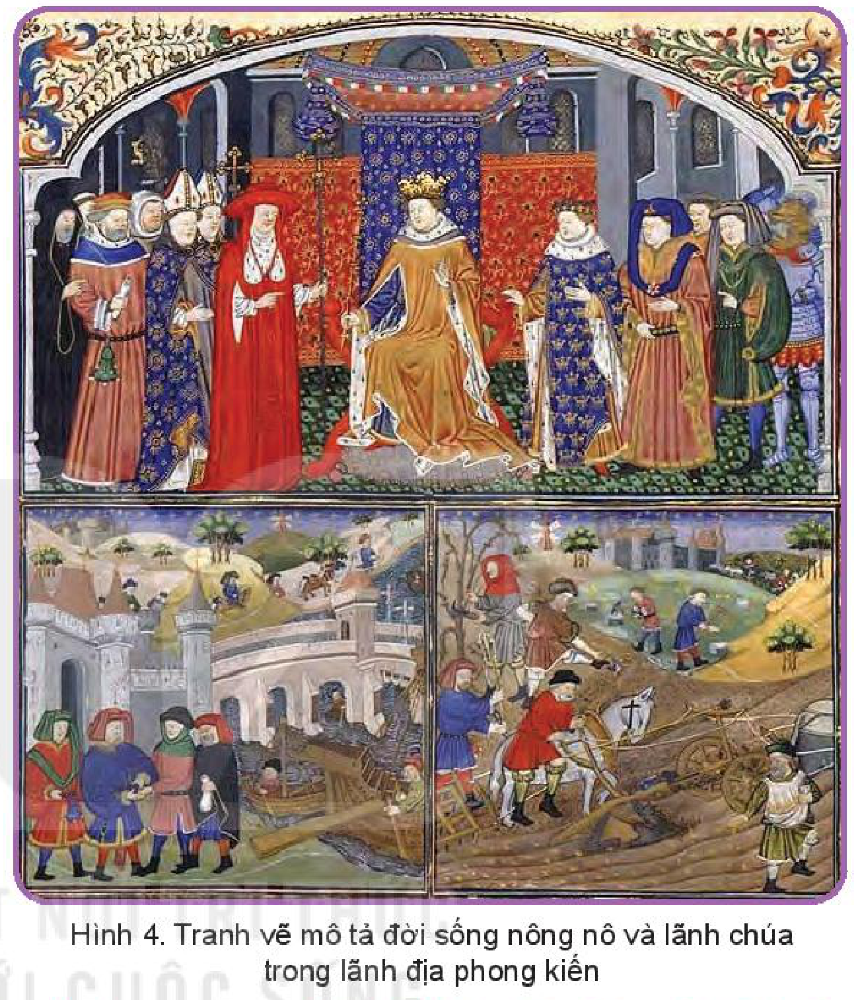
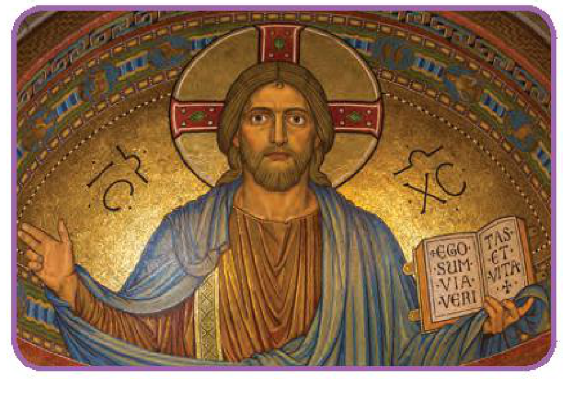
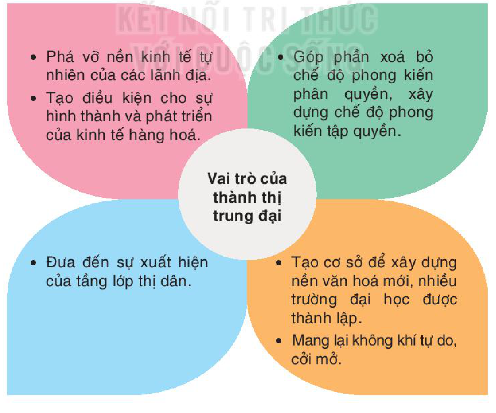
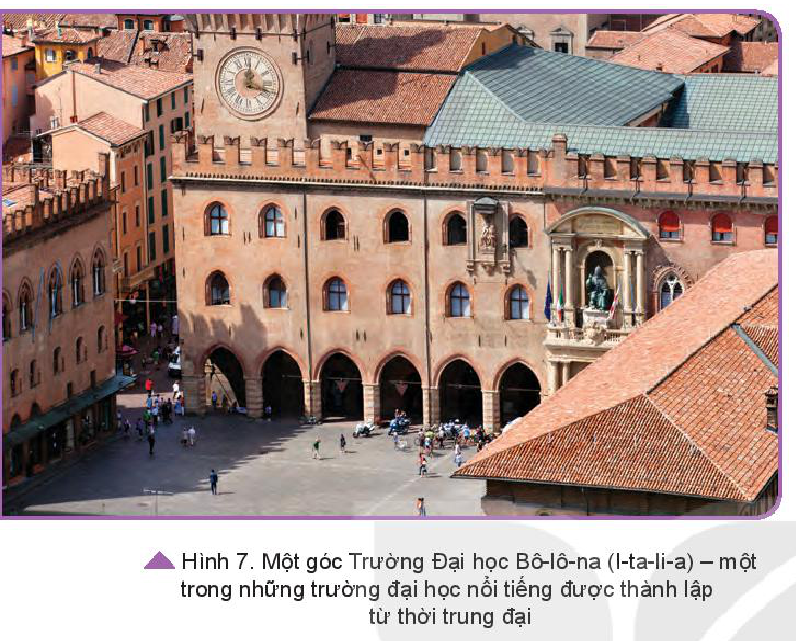

<!-- pdf:10 -->

# BÀI 1: QUÁ TRÌNH HÌNH THÀNH VÀ PHÁT TRIỂN CỦA CHẾ ĐỘ PHONG KIẾN Ở TÂY ÂU

## 🎯 Học xong bài này, em sẽ:

- Kể lại được những sự kiện chủ yếu về quá trình hình thành xã hội phong kiến ở Tây Âu.
- Trình bày được đặc điểm của lãnh địa phong kiến và quan hệ xã hội của chế độ phong kiến Tây Âu.
- Mô tả được sơ lược sự ra đời của Thiên Chúa giáo.
- Phân tích được vai trò của thành thị trung đại.

## 🔴 Mở đầu

Trên lãnh thổ nhiều nước châu Âu ngày nay đã xây dựng tượng đài để tưởng niệm vị Hoàng đế Sác-lơ-ma-nhơ. Ông đã có công lao gì mà được tôn vinh như thế? Hãy chia sẻ những hiểu biết của em về vị hoàng đế này cũng như về sự hình thành và phát triển của chế độ phong kiến Tây Âu từ thế kỉ V đến thế kỉ XVI.

*Hình 1. Tượng Hoàng đế Sác-lơ-ma-nhơ (742 – 814) ở thành phố Hăm-buốc (Đức)*
<!-- ocr-ok: đã đối chiếu p010.png, chú thích nằm đè lên logo chìm nền nên OCR nhầm "814" thành "614" và sai dấu -->

## 1. Quá trình hình thành xã hội phong kiến ở Tây Âu

Từ thế kỉ III, đế quốc La Mã lâm vào tình trạng khủng hoảng. Các cuộc đấu tranh của nô lệ dẫn đến tình trạng sản xuất sút kém, xã hội ngày càng rối ren. Đến nửa cuối thế kỉ V, các bộ tộc người Giéc-man từ phương Bắc tràn xuống xâm chiếm lãnh thổ, đưa đến sự diệt vong của đế quốc La Mã (476). Chế độ phong kiến từng bước được hình thành ở Tây Âu.

Khi tràn vào lãnh thổ La Mã, người Giéc-man đã thủ tiêu bộ máy nhà nước của chủ nô La Mã, thành lập nhiều vương quốc mới như: Vương quốc của người Ăng-glô Xắc-xông, Vương quốc Phơ-răng, Vương quốc Tây Gốt, Vương quốc Đông Gốt,... Trong đó, Vương quốc Phơ-răng thông qua các cuộc chiến tranh chinh phục của Hoàng đế Sác-lơ-ma-nhơ đã trở thành một đế quốc rộng lớn, tồn tại lâu dài và giữ vai trò quan trọng trong lịch sử Tây Âu thời kì này.

Quá trình phong kiến hoá diễn ra mạnh mẽ và sâu sắc ở Vương quốc Phơ-răng với sự hình thành của các giai cấp mới – lãnh chúa phong kiến và nông nô.

> 💡 **Em có biết?**
>
> Các tộc người Giéc-man có nguồn gốc từ Bắc Âu, đến sinh sống ở ngoài cương giới của đế quốc La Mã, thường liên minh với nhau để xâm chiếm đất đai của người La Mã. Trước thế kỉ V, họ đang trong thời kì xã hội nguyên thuỷ nên người La Mã gọi họ là “man tộc”.
<!-- ocr-ok: đã đối chiếu p010.png, hộp Em có biết? đặt ở cột phải nền xám nên OCR trộn dòng với cột văn bản bên trái -->

<!-- pdf:11 -->

*Hình 2. Sơ đồ về sự hình thành các giai cấp chính trong xã hội phong kiến ở Vương quốc Phơ-răng*

> **Sơ đồ về sự hình thành các giai cấp chính trong xã hội phong kiến ở Vương quốc Phơ-răng:**
> - Quý tộc thị tộc người Giéc-man (chiếm nhiều ruộng đất của chủ nô La Mã; được phong tước vị) và Quý tộc La Mã quy thuận chính quyền mới (được giữ lại ruộng đất) → Lãnh chúa phong kiến.
> - Nô lệ (được giải phóng) và Nông dân tự do (mất ruộng đất) → Nông nô.
> - Quan hệ xã hội: Lãnh chúa chi phối mọi mặt đời sống nông nô; nông nô nhận ruộng và nộp tô, thuế cho lãnh chúa.

Sau khi Sác-lơ-ma-nhơ mất, Vương quốc Phơ-răng bị phân chia thành ba vương quốc (về sau trở thành các nước Pháp, Đức và I-ta-li-a) mà chế độ phong kiến hoàn toàn ngự trị ở đây.

> ❓ 1. Quan sát hình 2, em hãy cho biết lãnh chúa phong kiến và nông nô được hình thành từ những tầng lớp nào.
>
> 2. Trình bày những nét chính về quá trình hình thành xã hội phong kiến ở Tây Âu.

## 2. Lãnh địa phong kiến và quan hệ xã hội của chế độ phong kiến ở Tây Âu

Đến thế kỉ IX, những vùng đất đai rộng lớn nhanh chóng bị các quý tộc biến thành khu đất riêng của mình, gọi là lãnh địa phong kiến và họ trở thành lãnh chúa. Mỗi lãnh chúa như "ông vua" cai quản lãnh địa của mình. Đây là đơn vị chính trị và kinh tế cơ bản ở Tây Âu thời kì này.

*Hình 3. Khu đất của lãnh chúa trong lãnh địa phong kiến ở Tây Âu (tranh minh hoạ)*

<!-- pdf:12 -->

<!-- term: Đất khẩu phần -->
Lãnh địa là một khu đất rộng lớn bao gồm đất của lãnh chúa và đất khẩu phần.

<!-- term: Đất khẩu phần -->
<!-- term: Quyền miễn trừ -->
Đất khẩu phần ở xung quanh lâu đài được lãnh chúa giao cho nông nô cày cấy và thu tô, thuế. Lãnh chúa lập ra quân đội, luật pháp, toà án, chế độ thuế khoá, tiền tệ và hệ thống đo lường riêng..., Thậm chí, nhà vua cũng không được can thiệp vào lãnh địa của lãnh chúa (gọi là quyền “miễn trừ”).

Kinh tế lãnh địa mang tính chất tự cấp tự túc, trong đó nông nghiệp đóng vai trò chủ đạo. Nông nô tự sản xuất ra lương thực, thực phẩm và mọi thứ đồ dùng để phục vụ nhu cầu trong lãnh địa. Chỉ những thứ không sản xuất được mới phải mua từ bên ngoài: sắt, muối và một số hàng xa xỉ (lụa, hương liệu,... từ các nước phương Đông).

Trong xã hội phong kiến, lãnh chúa sống bằng việc bóc lột sức lao động của nông nô. Nông nô là lực lượng sản xuất chính, nhận ruộng đất của lãnh chúa để cày cấy, phải nộp tô và nhiều loại thuế khác cho lãnh chúa như: thuế cưới xin, thuế ma chay,...

*Hình 4. Tranh vẽ mô tả đời sống nông nô và lãnh chúa trong lãnh địa phong kiến*

> ❓ 1. Quan sát hình 3 và đọc thông tin trong mục, em hãy trình bày đặc điểm của lãnh địa phong kiến ở Tây Âu.
>
> 2. Khai thác sơ đồ hình 2 và thông tin trong mục, hãy trình bày mối quan hệ giữa lãnh chúa và nông nô trong xã hội phong kiến.

## 3. Sự ra đời của Thiên Chúa giáo

<!-- term: Thiên Chúa giáo -->
Thiên Chúa giáo ra đời vào đầu Công nguyên ở vùng Giê-ru-sa-lem (thuộc Pa-le-xtin ngày nay). Ban đầu, đó là tôn giáo của những người nghèo khổ, bị áp bức, nhưng về sau đã trở thành công cụ cai trị về mặt tinh thần của giai cấp thống trị. Đến thế kỉ IV, Thiên Chúa giáo được công nhận là quốc giáo của đế quốc La Mã.

*Hình 5. Chúa Giê-su – người sáng lập ra Thiên Chúa giáo*

<!-- pdf:13 -->

<!-- term: Thiên Chúa giáo -->
Thời phong kiến, Giáo hội Thiên Chúa có thế lực rất lớn ở Tây Âu, cả về chính trị, kinh tế, văn hoá, tư tưởng.

> ❓ Hãy trình bày sự ra đời của Thiên Chúa giáo.

## 4. Sự xuất hiện và vai trò của thành thị trung đại

*Hình 6. Thành phố Phi-ren-xê (I-ta-li-a) hình thành từ thời trung đại*

<!-- term: Thành thị trung đại -->
Từ cuối thế kỉ XI, thủ công nghiệp phát triển, hàng hoá sản xuất ra ngày càng nhiều đã thúc đẩy nhu cầu trao đổi. Một số thợ thủ công tìm cách bỏ trốn khỏi lãnh địa hoặc dùng tiền chuộc lại thân phận tự do. Họ đến những nơi có đông người qua lại để lập các xưởng sản xuất và bán hàng hoá. Từ đó, các thị trấn xuất hiện, sau trở thành thành phố, gọi là thành thị trung đại. Ngoài ra còn có những thành thị do các lãnh chúa lập ra hoặc được phục hồi từ những thành thị cổ đại. Cư dân sống trong các thành thị chủ yếu là thương nhân và thợ thủ công.

Sự ra đời của các thành thị trung đại có vai trò rất quan trọng đối với sự phát triển của xã hội phong kiến ở châu Âu. C. Mác nhận xét: Thành thị giống như những bông hoa rực rỡ nhất của châu Âu thời trung đại.

<!-- term: Thành thị trung đại -->
> **Vai trò của thành thị trung đại:**
> - Phá vỡ nền kinh tế tự nhiên của các lãnh địa; tạo điều kiện cho sự hình thành và phát triển của kinh tế hàng hoá.
> - Góp phần xoá bỏ chế độ phong kiến phân quyền, xây dựng chế độ phong kiến tập quyền.
> - Đưa đến sự xuất hiện của tầng lớp thị dân.
> - Tạo cơ sở để xây dựng nền văn hoá mới, nhiều trường đại học được thành lập; mang lại không khí tự do, cởi mở.

<!-- pdf:14 -->

*Hình 7. Một góc Trường Đại học Bô-lô-na (I-ta-li-a) – một trong những trường đại học nổi tiếng được thành lập từ thời trung đại*

> 💡 **Em có biết?**
>
> Ra đời năm 1088, Trường Đại học Bô-lô-na là trường đại học lâu đời nhất trên thế giới. Nhiệm vụ ban đầu của ngôi trường này là dạy Kinh thánh và luật pháp. Sau đó, Bô-lô-na trở thành trung tâm về giáo dục cao học của I-ta-li-a nói riêng và châu Âu nói chung. Đến nay, ngôi trường này đã thu hút hàng trăm nghìn sinh viên từ nhiều nơi trên thế giới đến học tập.

> ❓ 1. Thành thị trung đại ra đời thế nào?
>
> 2. Em hãy phân tích vai trò của các thành thị đối với châu Âu thời trung đại.

## ✏️ Luyện tập – Vận dụng

1. Em hãy lập và hoàn thành bảng theo mẫu dưới đây.
<!-- ocr-ok: đã đối chiếu p014.png, dòng lệnh câu 1 nằm trên nền màu sát biểu tượng nên OCR bỏ sót -->

| Nội dung | Lãnh địa phong kiến | Thành thị trung đại |
| --- | --- | --- |
| Thời gian xuất hiện | ? | ? |
| Hoạt động kinh tế chủ yếu | ? | ? |
| Thành phần cư dân chủ yếu | ? | ? |

2. "Thành thị giống như những bông hoa rực rỡ nhất của châu Âu thời trung đại". Em hãy tìm những dẫn chứng trong bài học để chứng minh cho ý kiến trên.

3. Tìm hiểu và cho biết một số dấu ấn tiêu biểu của thành thị trung đại (các thành phố cổ, trường đại học,...) còn được bảo tồn, gìn giữ và phát triển đến ngày nay.

## 📷 Danh sách hình trong bài

| Mã hình | Trang PDF | Trang sách | Chú thích |
| --- | --- | --- | --- |
| H7-lich_su_va_dia_ly-ls-b01-01 | 10 | 9 | Hình 1. Tượng Hoàng đế Sác-lơ-ma-nhơ (742 – 814) ở thành phố Hăm-buốc (Đức) |
| H7-lich_su_va_dia_ly-ls-b01-02 | 11 | 10 | Hình 2. Sơ đồ về sự hình thành các giai cấp chính trong xã hội phong kiến ở Vương quốc Phơ-răng |
| H7-lich_su_va_dia_ly-ls-b01-03 | 11 | 10 | Hình 3. Khu đất của lãnh chúa trong lãnh địa phong kiến ở Tây Âu (tranh minh hoạ) |
| H7-lich_su_va_dia_ly-ls-b01-04 | 12 | 11 | Hình 4. Tranh vẽ mô tả đời sống nông nô và lãnh chúa trong lãnh địa phong kiến |
| H7-lich_su_va_dia_ly-ls-b01-05 | 12 | 11 | Hình 5. Chúa Giê-su – người sáng lập ra Thiên Chúa giáo |
| H7-lich_su_va_dia_ly-ls-b01-06 | 13 | 12 | Hình 6. Thành phố Phi-ren-xê (I-ta-li-a) hình thành từ thời trung đại |
| H7-lich_su_va_dia_ly-ls-b01-07 | 13 | 12 | [Sơ đồ vai trò của thành thị trung đại] |
| H7-lich_su_va_dia_ly-ls-b01-08 | 14 | 13 | Hình 7. Một góc Trường Đại học Bô-lô-na (I-ta-li-a) – một trong những trường đại học nổi tiếng được thành lập từ thời trung đại |
