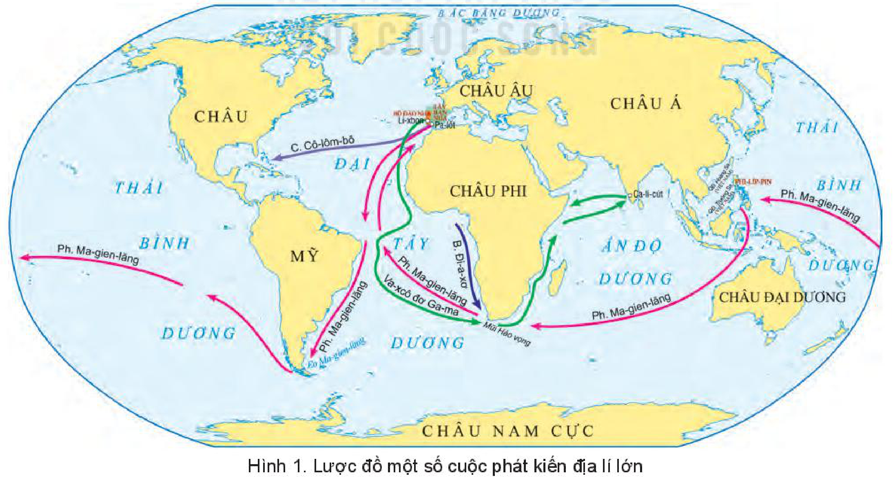
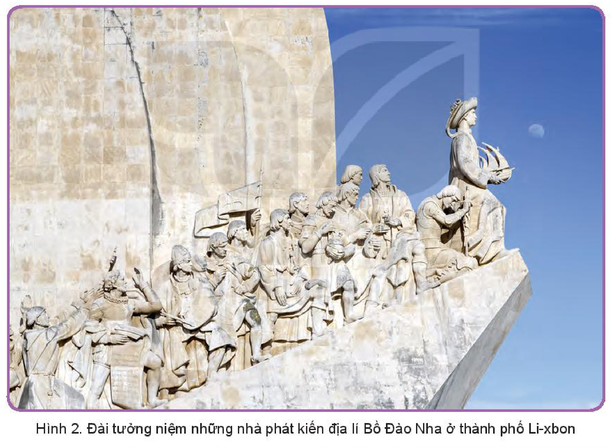
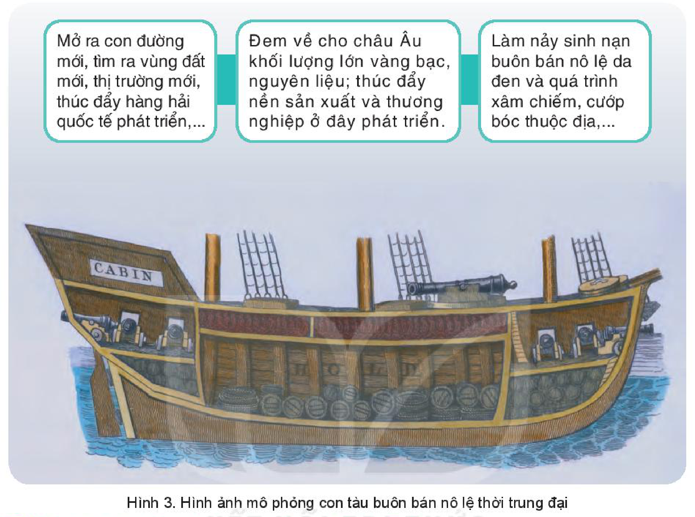
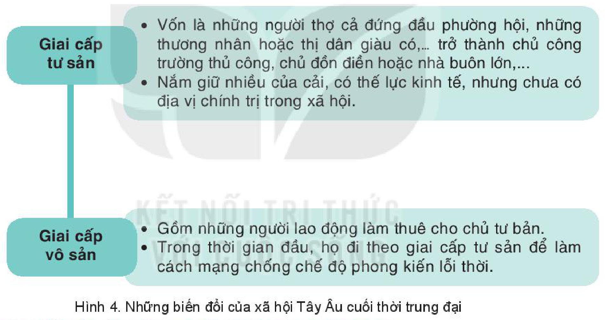

<!-- pdf:15 -->

# BÀI 2: CÁC CUỘC PHÁT KIẾN ĐỊA LÍ VÀ SỰ HÌNH THÀNH QUAN HỆ SẢN XUẤT TƯ BẢN CHỦ NGHĨA Ở TÂY ÂU

## 🎯 Học xong bài này, em sẽ:

- Sử dụng lược đồ hoặc bản đồ, giới thiệu được những nét chính về hành trình của một số cuộc phát kiến địa lí lớn trên thế giới.
- Nêu được hệ quả của các cuộc phát kiến địa lí.
- Trình bày được sự nảy sinh phương thức sản xuất tư bản chủ nghĩa ở Tây Âu.
- Xác định được những biến đổi chính trong xã hội Tây Âu.

## 🔴 Mở đầu

Em đã biết, từ thời xa xưa người Trung Quốc đã phát minh ra kim chỉ nam để xác định phương hướng. Từ đó, người châu Âu đã kế thừa để chế tạo ra la bàn. Theo em, người châu Âu sử dụng la bàn để làm gì? Em đã từng nghe nhắc đến những cái tên như C. Cô-lôm-bô, Ph. Ma-gien-lăng,...? Hãy chia sẻ những điều em biết về những nhân vật lịch sử này cũng như những sự kiện liên quan đến họ.

## 1. Các cuộc phát kiến địa lí lớn trên thế giới

### a) Sơ lược về hành trình của một số cuộc phát kiến địa lí lớn

*Hình 1. Lược đồ một số cuộc phát kiến địa lí lớn*

<!-- pdf:16 -->

Bồ Đào Nha và Tây Ban Nha là những nước tiên phong trong các cuộc thám hiểm bằng đường biển.

Năm 1487, B. Đi-a-xơ – hiệp sĩ hoàng gia Bồ Đào Nha, đã dẫn đầu đoàn thám hiểm đến được mũi cực Nam châu Phi – mũi Hảo Vọng.

Năm 1492, C. Cô-lôm-bô cùng đoàn thuỷ thủ từ Tây Ban Nha đi về phía tây, vượt qua Đại Tây Dương và đã tìm ra vùng đất mới – châu Mỹ.

Năm 1497, đoàn thám hiểm của V. Ga-ma gồm 4 chiếc tàu với 160 thuỷ thủ rời cảng Li-xbon (Bồ Đào Nha), cũng vòng qua điểm cực Nam châu Phi và cập bến Ca-li-cút ở phía tây nam Ấn Độ (1498). Ước mơ phát hiện tuyến đường biển sang Ấn Độ đã được thực hiện.

> 💡 **Em có biết?**
>
> Trên đường đi, đoàn thám hiểm của B. Đi-a-xơ bị gặp bão. Cơn bão đã thổi bật họ xuống phía nam và bất ngờ đi tới mũi cực Nam châu Phi. Vì vậy, lúc đầu ông đặt tên cho vùng đất này là mũi Bão Táp, sau này lại được đổi thành mũi Hảo Vọng.

*Hình 2. Đài tưởng niệm những nhà phát kiến địa lí Bồ Đào Nha ở thành phố Li-xbon*

Năm 1519, Ph. Ma-gien-lăng và đoàn thám hiểm từ Tây Ban Nha, đi về phía tây, hoàn thành chuyến đi vòng quanh thế giới năm 1522.

> 🔗 **Kết nối với văn hoá**
>
> Ở Mỹ hiện nay có ngày lễ trọng đại là *Columbus Day* diễn ra vào thứ Hai của tuần thứ 2 tháng 10 để tưởng nhớ đến C. Cô-lôm-bô – người đã có công lao tìm ra châu Mỹ.

> ❓ 1. Dựa vào hình 1 và thông tin trong mục, hãy giới thiệu nét chính về hành trình của một số cuộc phát kiến địa lí lớn trên thế giới.
>
> 2. Theo em, cuộc phát kiến địa lí nào là quan trọng nhất? Vì sao?

<!-- pdf:17 -->

### b) Hệ quả của các cuộc phát kiến địa lí

Phát kiến địa lí đã để lại những hệ quả lớn lao cho loài người.

> - Mở ra con đường mới, tìm ra vùng đất mới, thị trường mới, thúc đẩy hàng hải quốc tế phát triển,...
> - Đem về cho châu Âu khối lượng lớn vàng bạc, nguyên liệu; thúc đẩy nền sản xuất và thương nghiệp ở đây phát triển.
> - Làm nảy sinh nạn buôn bán nô lệ da đen và quá trình xâm chiếm, cướp bóc thuộc địa,...

*Hình 3. Hình ảnh mô phỏng con tàu buôn bán nô lệ thời trung đại*

> ❓ Hãy trình bày hệ quả của các cuộc phát kiến địa lí.

## 2. Sự nảy sinh chủ nghĩa tư bản và những biến đổi chính trong xã hội Tây Âu

### a) Sự nảy sinh chủ nghĩa tư bản

Sau các cuộc phát kiến địa lí, giới quý tộc và thương nhân châu Âu đẩy mạnh cướp bóc của cải, tài nguyên từ các nước thuộc địa châu Á, châu Phi, châu Mỹ đem về châu Âu. Ở trong nước, họ dùng bạo lực và nhiều thủ đoạn để tước đoạt ruộng đất của nông nô, tư liệu sản xuất của thợ thủ công,...

Hàng triệu người da đen ở châu Phi bị bắt để bán cho các chủ đồn điền, hầm mỏ ở châu Âu, châu Mỹ làm nhân công. Tại châu Âu, do phong trào “rào đất cướp ruộng”, hàng vạn nông nô không có ruộng cày cấy, trở thành những người đi lang thang, cuối cùng buộc phải vào làm thuê trong các công xưởng của tư sản.

> 💡 **Em có biết?**
>
> Giới quý tộc, điển hình nhất ở Anh, đã trấn áp, cướp đoạt ruộng đất của nông nô, rào lại thành đồng cỏ nuôi cừu để lấy lông cung cấp cho ngành sản xuất len dạ. Hàng vạn gia đình nông nô mất đất phải đi lang thang. Tô-mát Mo-rơ (nhà xã hội học người Anh) gọi đây là hiện tượng “cừu ăn thịt người”.

<!-- pdf:18 -->

Nhờ thế, tư sản ở Tây Âu đã tích luỹ được một nguồn vốn ban đầu và tập hợp được đội ngũ đông đảo những người làm thuê. Họ ra sức mở rộng kinh doanh, lập các công trường thủ công, những đồn điền quy mô lớn và cả các công ti thương mại. Hình thức kinh doanh tư bản chủ nghĩa xuất hiện.

<!-- term: Quan hệ sản xuất tư bản chủ nghĩa -->
Quan hệ giữa chủ công trường thủ công, chủ đồn điền,... với những người làm thuê (công nhân) là quan hệ chủ – thợ. Toàn bộ nhà xưởng, ruộng đất, công cụ và nguyên liệu,... đều là của chủ, còn công nhân thì phải bán sức lao động của mình và nhận về đồng lương ít ỏi. Quan hệ sản xuất tư bản chủ nghĩa đã hình thành trong lòng xã hội phong kiến Tây Âu.

> ❓ 1. Hãy cho biết quá trình tích luỹ vốn và tập trung nhân công của giai cấp tư sản trong giai đoạn đầu như thế nào.
>
> 2. Nêu những biểu hiện của sự nảy sinh chủ nghĩa tư bản ở Tây Âu.

### b) Sự biến đổi của xã hội Tây Âu

Cùng với quá trình nảy sinh chủ nghĩa tư bản là những biến đổi mạnh mẽ trong xã hội với sự hình thành của các giai cấp mới – tư sản và vô sản.

*Hình 4. Những biến đổi của xã hội Tây Âu cuối thời trung đại*

<!-- term: Giai cấp tư sản -->
<!-- term: Giai cấp vô sản -->
> - **Giai cấp tư sản:**
>   - Vốn là những người thợ cả đứng đầu phường hội, những thương nhân hoặc thị dân giàu có,... trở thành chủ công trường thủ công, chủ đồn điền hoặc nhà buôn lớn,...
>   - Nắm giữ nhiều của cải, có thế lực kinh tế, nhưng chưa có địa vị chính trị trong xã hội.
> - **Giai cấp vô sản:**
>   - Gồm những người lao động làm thuê cho chủ tư bản.
>   - Trong thời gian đầu, họ đi theo giai cấp tư sản để làm cách mạng chống chế độ phong kiến lỗi thời.

> ❓ Hãy cho biết biến đổi chính trong xã hội Tây Âu giai đoạn này.

## ✏️ Luyện tập – Vận dụng

1. Trong các hệ quả của các cuộc phát kiến địa lí, theo em hệ quả nào là quan trọng nhất? Vì sao?

2. Theo em, biến đổi lớn nhất của xã hội Tây Âu thời kì này là gì?

3. Một hậu quả của phát kiến địa lí là dẫn đến làn sóng xâm lược thuộc địa và cướp bóc thực dân. Em hãy tìm hiểu thêm và cho biết Việt Nam đã từng bị xâm lược và trở thành thuộc địa của nước nào.

## 📷 Danh sách hình trong bài

| Mã hình | Trang PDF | Trang sách | Chú thích |
| --- | --- | --- | --- |
| H7-lich_su_va_dia_ly-ls-b02-01 | 15 | 14 | Hình 1. Lược đồ một số cuộc phát kiến địa lí lớn |
| H7-lich_su_va_dia_ly-ls-b02-02 | 16 | 15 | Hình 2. Đài tưởng niệm những nhà phát kiến địa lí Bồ Đào Nha ở thành phố Li-xbon |
| H7-lich_su_va_dia_ly-ls-b02-03 | 17 | 16 | Hình 3. Hình ảnh mô phỏng con tàu buôn bán nô lệ thời trung đại |
| H7-lich_su_va_dia_ly-ls-b02-04 | 18 | 17 | Hình 4. Những biến đổi của xã hội Tây Âu cuối thời trung đại |
