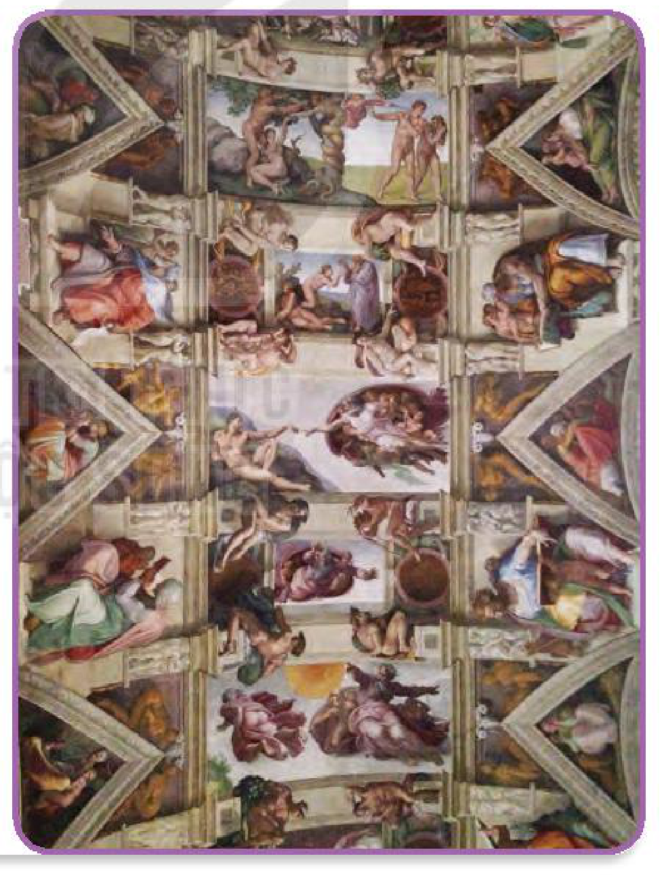
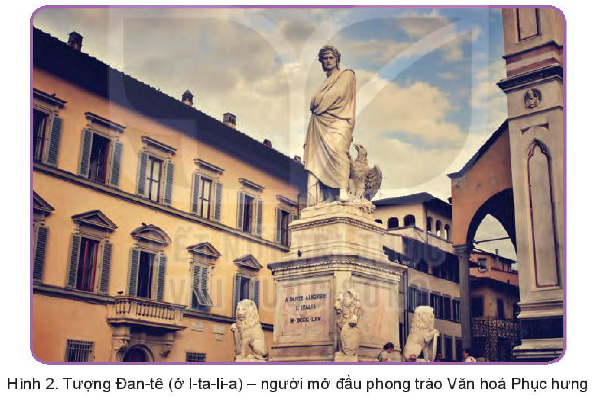
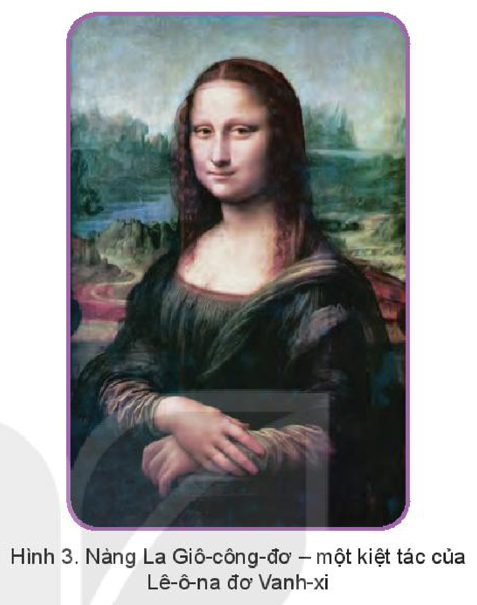
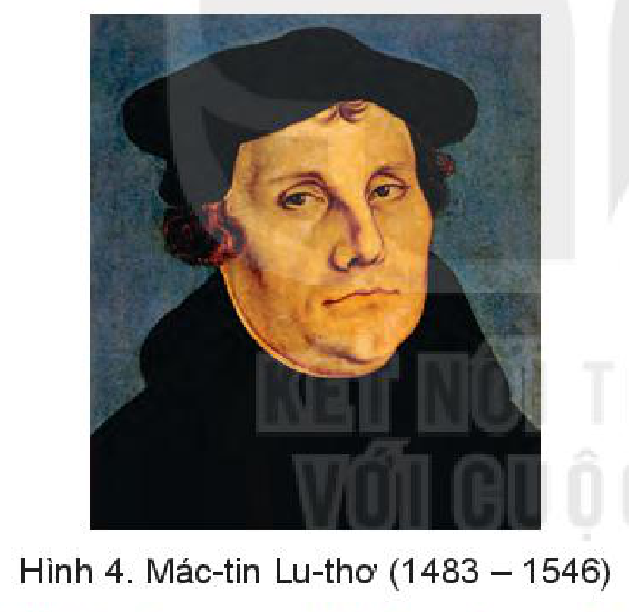
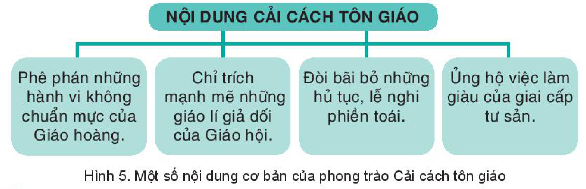

<!-- pdf:19 -->

# BÀI 3: PHONG TRÀO VĂN HOÁ PHỤC HƯNG VÀ CẢI CÁCH TÔN GIÁO

## 🎯 Học xong bài này, em sẽ:

- Giới thiệu được sự biến đổi quan trọng về kinh tế – xã hội của Tây Âu từ thế kỉ XIII đến thế kỉ XVI.
- Trình bày được những thành tựu tiêu biểu của phong trào Văn hoá Phục hưng.
- Nhận biết được ý nghĩa và tác động của phong trào Văn hoá Phục hưng đối với xã hội Tây Âu.
- Nêu và giải thích được nguyên nhân của phong trào Cải cách tôn giáo.
- Mô tả khái quát được nội dung cơ bản và tác động của các cuộc Cải cách tôn giáo đối với xã hội Tây Âu.

## 🔴 Mở đầu

Cùng với sự ra đời của chủ nghĩa tư bản là sự xuất hiện một nền văn hoá mới, đối lập gay gắt với hệ tư tưởng, văn hoá phong kiến. Đó được coi “là một cuộc cách mạng tiến bộ vĩ đại nhất mà loài người chưa từng thấy, một thời đại đã đẻ ra những con người khổng lồ, khổng lồ về tư tưởng,... về tài năng mọi mặt và sự hiểu biết sâu rộng của họ”. Theo em, “cuộc cách mạng” đó là sự kiện nào? Vì sao sự kiện đó lại được đánh giá cao như vậy?

*Hình 1. Bích hoạ của Mi-ken-lăng-giơ trên vòm nhà thờ Xích-xtin (Va-ti-căng) – một kiệt tác đương thời*

## 1. Những biến đổi về kinh tế – xã hội Tây Âu từ thế kỉ XIII đến thế kỉ XVI

Từ cuối thế kỉ XIII, tình hình kinh tế – xã hội Tây Âu có nhiều biến đổi. Các công trường thủ công, công ti thương mại, các đồn điền ra đời và ngày càng được mở rộng quy mô. Quan hệ sản xuất tư bản chủ nghĩa đã xuất hiện.

<!-- pdf:20 -->

Giai cấp tư sản ra đời, có thế lực về kinh tế song lại chưa có địa vị xã hội tương xứng. Họ không chấp nhận những giáo lí lỗi thời, muốn xây dựng một nền văn hoá mới đề cao giá trị con người và quyền tự do cá nhân, coi trọng khoa học – kĩ thuật,... để mở đường cho chủ nghĩa tư bản phát triển.

> ❓ Hãy chỉ ra những biến đổi quan trọng nhất về kinh tế – xã hội ở Tây Âu từ thế kỉ XIII đến thế kỉ XVI.

## 2. Phong trào Văn hoá Phục hưng

<!-- term: Phong trào Văn hoá Phục hưng -->
Phong trào Văn hoá Phục hưng diễn ra đầu tiên ở I-ta-li-a (thế kỉ XIV), sau đó lan nhanh sang các nước Tây Âu và trở thành một trào lưu rộng lớn.

### a) Những thành tựu tiêu biểu

Thời kì này chứng kiến sự phát triển đến đỉnh cao của văn học, sự nở rộ của các tài năng nghệ thuật với các gương mặt tiêu biểu như: M. Xéc-van-tét, W. Sếch-xpia, Lê-ô-na đơ Vanh-xi,...

*Hình 2. Tượng Đan-tê (ở I-ta-li-a) – người mở đầu phong trào Văn hoá Phục hưng*

M. Xéc-van-tét là một nhà văn lớn của Tây Ban Nha với tác phẩm nổi tiếng là *Đôn Ki-hô-tê*.

Nhà viết kịch vĩ đại thời Phục hưng là W. Sếch-xpia (người Anh) với nhiều vở kịch nổi tiếng như: *Rô-mê-ô và Giu-li-ét*, *Hăm-lét*, *Ô-ten-lô*,...

Lê-ô-na đơ Vanh-xi (người I-ta-li-a) là một hoạ sĩ thiên tài, để lại nhiều kiệt tác cho nhân loại như: *Bữa tiệc cuối cùng*, *Nàng La Giô-công-đơ*.

> 🔗 **Kết nối với văn học**
>
> Thông qua hình ảnh chàng hiệp sĩ lỗi thời Đôn Ki-hô-tê, Xéc-van-tét đã khắc hoạ bức tranh chân thực về xã hội Tây Ban Nha thế kỉ XVI, đồng thời châm biếm toàn bộ xã hội phong kiến, thể hiện khát vọng mãnh liệt về sự công bằng và bác ái. *Đôn Ki-hô-tê* được dịch ra hầu hết các thứ tiếng và xếp vào hàng kiệt tác.

<!-- pdf:21 -->

Mi-ken-lăng-giơ là một danh hoạ, một nhà điêu khắc, kiến trúc sư nổi tiếng người I-ta-li-a với những tác phẩm tiêu biểu: *Sáng tạo thế giới*, *Cuộc phán xét cuối cùng*, *Tượng Đa-vít*,...

> 🔗 **Kết nối với nghệ thuật**
>
> Để hoàn thành bức tranh trên vòm nhà thờ Xích-xtin, Mi-ken-lăng-giơ đã phải trèo lên một giàn giáo rất cao, ngửa cổ, còng lưng, thậm chí nằm ngửa để vẽ liên tục trong 4 năm 3 tháng,... Bức tranh có diện tích 540m² với 343 nhân vật.

*Hình 3. Nàng La Giô-công-đơ – một kiệt tác của Lê-ô-na đơ Vanh-xi*

Thời Phục hưng đã xuất hiện nhiều nhà khoa học dũng cảm chống lại những quan điểm sai lầm, bảo thủ. Tiêu biểu là N. Cô-péc-ních (người Ba Lan), G. Bru-nô và G. Ga-li-lê (người I-ta-li-a),...

Cô-péc-ních là nhà thiên văn học đầu tiên chứng minh rằng Trái Đất quay quanh trục của nó và quay xung quanh Mặt Trời. Tuy nhiên, học thuyết của Cô-péc-ních bị Giáo hội cấm lưu truyền. Ga-li-lê vì công bố học thuyết Trái Đất quay mà bị bỏ tù khi đã 70 tuổi. Ông nổi tiếng với câu nói khi bị kết án: “Dù sao thì Trái Đất vẫn quay”.

> ❓ 1. Hãy trình bày một số thành tựu tiêu biểu của phong trào Văn hoá Phục hưng.
>
> 2. Em ấn tượng với thành tựu nào nhất? Vì sao?

### b) Ý nghĩa và tác động của phong trào Văn hoá Phục hưng đối với xã hội Tây Âu

Bằng những tác phẩm của mình, các nhà Văn hoá Phục hưng đã lên án gay gắt Giáo hội Thiên Chúa giáo và đả phá trật tự phong kiến.

<!-- term: Phong trào Văn hoá Phục hưng -->
Văn hoá Phục hưng đề cao giá trị con người và tự do cá nhân, đề cao tinh thần dân tộc, đồng thời có nhiều đóng góp quan trọng đối với kho tàng văn hoá nhân loại.

> 1. *“Dòng dõi thì chẳng qua là lưu truyền, còn việc làm tốt đẹp thì do tự mình mà có. Đạo đức tự nó có giá trị gấp bao lần dòng dõi”* (Lời của Đôn Ki-hô-tê trong tác phẩm *Đôn Ki-hô-tê* của Xéc-van-tét).
>
> (Theo Nguyễn Gia Phu..., *Lịch sử thế giới trung đại*, NXB Giáo dục, 2006, tr.115)
>
> 2. *Trong đời sống của mỗi người, cái nghĩa vụ vĩ đại là đối với Tổ quốc (Ma-ki-a-vê-li).*
>
> (Theo Nguyễn Gia Phu..., *Lịch sử thế giới trung đại*, Sđd, tr.116)

<!-- pdf:22 -->

<!-- term: Phong trào Văn hoá Phục hưng -->
Phong trào Văn hoá Phục hưng là cuộc đấu tranh công khai đầu tiên trên lĩnh vực văn hoá, tư tưởng của giai cấp tư sản chống lại chế độ phong kiến lỗi thời, mở đường cho văn hoá Tây Âu phát triển trong những thế kỉ sau.

> ❓ 1. Tư liệu 1, 2 phản ánh quan điểm của các nhà Văn hoá Phục hưng về vấn đề gì?
>
> 2. Phong trào Văn hoá Phục hưng có ý nghĩa và tác động đến xã hội Tây Âu như thế nào?

## 3. Phong trào Cải cách tôn giáo

<!-- Sách in nhầm số thứ tự mục 3 thành số 2 ở trang 21 (PDF 22) -->

### a) Nguyên nhân bùng nổ

Thời trung đại, Thiên Chúa giáo là chỗ dựa vững chắc nhất của chế độ phong kiến, chi phối toàn bộ đời sống tinh thần của xã hội châu Âu.

Đến đầu thế kỉ XVI, Giáo hội Thiên Chúa giáo ngày càng có xu hướng cản trở sự phát triển của giai cấp tư sản, nhiều giáo hoàng và giám mục quá quan tâm đến quyền lực và đặt ra những lễ nghi tốn kém.

<!-- term: Phong trào Cải cách tôn giáo -->
Do đó, phong trào Cải cách tôn giáo đã bùng nổ khắp các nước Tây Âu, khởi đầu là Đức, Thuỵ Sĩ, sau đó lan sang Bỉ, Hà Lan, Anh, Pháp. Tiêu biểu nhất là tư tưởng cải cách của Mác-tin Lu-thơ (Đức) và Giăng Can-vanh (Thuỵ Sĩ).

*Hình 4. Mác-tin Lu-thơ (1483 – 1546)*

<!-- term: Dị giáo -->
> 💡 **Em có biết?**
>
> Mác-tin Lu-thơ là một tu sĩ đồng thời là Giáo sư ở Trường Đại học Vít-ten-béc (Đức). Lu-thơ căm ghét việc giáo sĩ được phép bán “thẻ miễn tội”. Năm 1517, ông đã ghim lên cánh cửa nhà thờ bản luận văn chỉ trích Giáo hội. Sau đó, ông bị buộc tội dị giáo (đi ngược lại với đức tin của Giáo hội) và bị trừng phạt.

> ❓ Hãy giải thích vì sao xuất hiện phong trào Cải cách tôn giáo.

### b) Nội dung cơ bản

*Hình 5. Một số nội dung cơ bản của phong trào Cải cách tôn giáo*

<!-- term: Phong trào Cải cách tôn giáo -->
> **Nội dung Cải cách tôn giáo:**
> - Phê phán những hành vi không chuẩn mực của Giáo hoàng.
> - Chỉ trích mạnh mẽ những giáo lí giả dối của Giáo hội.
> - Đòi bãi bỏ những hủ tục, lễ nghi phiền toái.
> - Ủng hộ việc làm giàu của giai cấp tư sản.
<!-- ocr-ok: đã đối chiếu p022.png, chữ trong các ô màu sơ đồ Hình 5 bị OCR dính liền từ -->

> ❓ Hãy trình bày những nội dung chính của phong trào Cải cách tôn giáo.

<!-- pdf:23 -->

### c) Tác động

<!-- term: Cựu giáo và Tân giáo -->
Cải cách tôn giáo được đông đảo nhân dân ủng hộ, đã lan rộng khắp Tây Âu trong thế kỉ XVI. Do tác động của Cải cách tôn giáo, Thiên Chúa giáo phân hoá thành hai giáo phái: Cựu giáo (Thiên Chúa giáo) và Tân giáo (Anh giáo, Tin Lành,... là những tôn giáo cải cách).

<!-- term: Chiến tranh nông dân Đức -->
Phong trào Cải cách tôn giáo còn làm bùng lên một cuộc đấu tranh rộng lớn ở Đức, thường gọi là cuộc Chiến tranh nông dân Đức.

<!-- term: Phong trào Cải cách tôn giáo -->
Cùng với Văn hoá Phục hưng, Cải cách tôn giáo là một trong những cuộc đấu tranh công khai đầu tiên trên lĩnh vực văn hoá – tư tưởng của giai cấp tư sản chống lại chế độ phong kiến đã suy tàn, mở đường cho nền văn hoá châu Âu phát triển cao hơn.

> ❓ Trình bày tác động của phong trào Cải cách tôn giáo đối với xã hội Tây Âu.

## ✏️ Luyện tập – Vận dụng

1. Hãy lập và hoàn thành bảng theo mẫu dưới đây.

| Các nhà Văn hoá phục hưng | Lĩnh vực | Tác phẩm/Công trình tiêu biểu |
| --- | --- | --- |
| M. Xéc-van-tét | ? | ? |
| W. Sếch-xpia | ? | ? |
| Lê-ô-na đơ Vanh-xi | ? | ? |
| N. Cô-péc-ních | ? | ? |
| G. Ga-li-lê | ? | ? |

2. Vẽ sơ đồ tư duy (hoặc lập bảng hệ thống) thể hiện những nét chính của phong trào Cải cách tôn giáo (nguyên nhân, nội dung, tác động).

3. Sưu tầm tư liệu từ internet và sách, báo để giới thiệu (theo cách của em) về một công trình/tác phẩm/nhà văn hoá thời Phục hưng mà em ấn tượng nhất.

## 📷 Danh sách hình trong bài

| Mã hình | Trang PDF | Trang sách | Chú thích |
| --- | --- | --- | --- |
| H7-lich_su_va_dia_ly-ls-b03-01 | 19 | 18 | Hình 1. Bích hoạ của Mi-ken-lăng-giơ trên vòm nhà thờ Xích-xtin (Va-ti-căng) – một kiệt tác đương thời |
| H7-lich_su_va_dia_ly-ls-b03-02 | 20 | 19 | Hình 2. Tượng Đan-tê (ở I-ta-li-a) – người mở đầu phong trào Văn hoá Phục hưng |
| H7-lich_su_va_dia_ly-ls-b03-03 | 21 | 20 | Hình 3. Nàng La Giô-công-đơ – một kiệt tác của Lê-ô-na đơ Vanh-xi |
| H7-lich_su_va_dia_ly-ls-b03-04 | 22 | 21 | Hình 4. Mác-tin Lu-thơ (1483 – 1546) |
| H7-lich_su_va_dia_ly-ls-b03-05 | 22 | 21 | Hình 5. Một số nội dung cơ bản của phong trào Cải cách tôn giáo |
